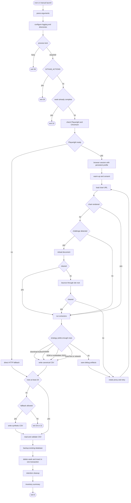

# 🎵 Script 1: Automated Data Acquisition from YouTube Charts


 


> **Pipeline position:** **`1_download_chart`** → `2_1_country_genre` → `2_2_song_catalog` → `3_chart_enrichment` → `4_notebooks` → `5_export`

> ⚠️ **Important note**: This version is designed to run **only locally** (on a physical machine with residential internet access), **without using GitHub Actions**. This is due to Google blocking GitHub Actions IPs.

> **Deprecated resources:**
> - **Code:** [old_script.py](https://github.com/adroguetth/youtube-music-charts-intelligence/blob/main/scripts/deprecated/1_download/old_script.py)
> - **Documentation:** [1_download.md](https://github.com/adroguetth/youtube-music-charts-intelligence/blob/main/doc_en/deprecated/1_download.md)
> - **Workflow:** [workflow.txt](https://github.com/adroguetth/youtube-music-charts-intelligence/blob/main/scripts/deprecated/1_download/workflow.txt)

> ⚠️ **Important note:** This version is **not compatible with Windows**. It requires a POSIX-compliant operating system (Linux or macOS) because it uses fcntl for process locking and relies on a Unix-like display server for headed browser execution.

## 📋 General Description

Script 1 is the **ingestion stage** of the YouTube Charts intelligence system. It downloads the weekly YouTube Charts ranking, normalizes every row to a canonical schema, and persists the result twice:

1. **`latest_chart.csv`** — a human-readable snapshot of the most recent download.
2. **`youtube_charts_YYYY-Www.db`** — one SQLite database per ISO week, with the full history.

The chart page is not a static HTML table. It is a Polymer application that renders through shadow DOM, exposes an official CSV download button only when the session is trusted, and serves a reCAPTCHA interstitial to sessions it does not trust. The scraper is therefore a **browser scraper**, not an API client. It runs **headed by default**, keeps a **persistent Chrome profile**, warms the session on the site root, and handles challenges automatically.

### Why a local physical host?

The short answer is **IP reputation and browser state**.

| Constraint | GitHub Actions runner | Local physical host |
| :--- | :--- | :--- |
| **Egress IP** | Shared datacenter range, heavily challenged by Google | Residential/ISP IP, normal reputation |
| **Browser state** | Ephemeral; the profile disappears after the job | Persistent `.browser-profile/` keeps cookies and consent |
| **Display** | None; headless is the only option | Real display; headed Chrome is possible |
| **Challenge handling** | The runner cannot keep a trusted session across jobs | The profile accumulates trust week after week |
| **Runtime** | Billing limits, job timeouts, concurrency | No external timeout; the operator controls the host |

Google challenges headless sessions and datacenter IPs far more aggressively than a headed browser on a residential connection. A GitHub runner starts every run from zero: no profile, no consent cookie, no session history, and a new IP. That is the worst possible starting point for this chart.

The pipeline encodes this as a hard guard:

```python
# scripts/1_download_chart/config.py
IS_GITHUB_ACTIONS = os.environ.get("GITHUB_ACTIONS") == "true"
IS_LOCAL = not IS_GITHUB_ACTIONS
```

```python
# scripts/1_download_chart/__main__.py
if IS_GITHUB_ACTIONS:
    log.error("This build runs on local hosts only, not on CI runners")
    return ExitCode.NO_DATA
```

`download_youtube_charts()` repeats the guard before launching Playwright. A CI job does not fail with a confusing timeout; it exits deterministically with code `20` and a clear message.

### What this stage produces

| Item | Location | Format |
| :--- | :--- | :--- |
| **Latest CSV** | `charts_archive/1_download-chart/latest_chart.csv` | CSV, canonical columns |
| **Weekly database** | `charts_archive/1_download-chart/databases/youtube_charts_YYYY-Www.db` | SQLite (`chart_data`) |
| **Backups** | `charts_archive/1_download-chart/backup/backup_*.db` | SQLite copies |
| **Logs** | `logs/scraper_YYYY-MM-DD.log` and `stdout` | Text |
| **Debug artifacts** | `logs/debug/` | PNG, HTML, TXT (only on failure) |
| **Synthetic fallback** | `charts_archive/1_download-chart/fallback_chart_YYYY-Www.csv` | CSV, `is_synthetic=1` |

## 🧩 Architecture Overview

The pipeline is intentionally organized into **focused modules**, each with a single responsibility. The goal is not to minimize lines of code, but to ensure that a change in one part of the process never silently breaks another:

| Module         | Responsibility                                               |
| :------------- | :----------------------------------------------------------- |
| `core/`        | Browser control, challenge handling, and all extraction strategies (DOM, shadow DOM, embedded JSON, internal API). |
| `persistence/` | CSV writing and reading, SQLite schema management, atomic updates, and backup/retention policies. |
| `models/`      | The canonical schema (`ChartEntry`, `ChartData`) and the only normalization boundary. CSV and SQLite both consume these types, so they cannot drift apart. |
| `utils/`       | Pure helpers: parsers, process locking, orphan reaping, and logging setup. |
| `fallbacks/`   | Deterministic synthetic data for tests and offline development. It is never written to `latest_chart.csv`. |
| `__main__.py`  | The orchestrator: parses arguments, acquires the process lock, runs the attempt loop, and decides the exit code. |

The dependency direction is **strict and one-way**:

```
__main__.py
   │
   ├──► cli.py ──────────────► models/enums.py
   ├──► config.py
   ├──► core/downloader.py ──► core/browser.py
   │        │                  core/captcha.py
   │        │                  core/extractor.py
   │        └──► persistence/csv_handler.py ──► models/chart.py
   │                                              └──► utils/parsers.py
   ├──► persistence/sqlite_handler.py ──► persistence/backup.py
   ├──► persistence/backup.py
   ├──► fallbacks/synthetic.py
   └──► utils/locking.py, utils/processes.py, utils/logging_setup.py
```

No extractor writes to SQLite. No persistence module launches a browser. `utils/` never imports Playwright. The entry point is the only module that knows the full pipeline.

### Design decisions

| Decision                         | Alternative                | Why this one                                                 |
| :------------------------------- | :------------------------- | :----------------------------------------------------------- |
| Headed browser by default        | Headless                   | Headless sessions are challenged almost immediately          |
| Persistent profile               | Fresh context every run    | Trust is accumulated; the profile is the anti-captcha asset  |
| Automatic recovery ladder        | Manual captcha prompt      | Cron must never block on a human                             |
| Three download attempts          | Infinite retry             | Bounded runtime; exit `21` tells cron to retry later         |
| Proxy rotation per attempt       | Single egress              | A fresh IP is the only lever that does not destroy profile trust |
| One DB per ISO week              | One growing DB             | Easy to publish, inspect, back up and retain                 |
| Delete-and-insert per week       | Append-only                | Re-scrapes are idempotent; no duplicate weeks                |
| CSV + SQLite                     | SQLite only                | The CSV is the portable artifact; SQLite is the queryable history |
| Explicit exit codes              | Generic `1` for everything | Cron and alerting can distinguish retryable from terminal    |
| Synthetic fallback behind a flag | Silent placeholders        | Tests can run offline without contaminating real data        |

---

## ✨ Key Features

### Ingestion

- **Headed Chromium by default** — the window is visible; headless is opt-in and explicitly discouraged.
- **Persistent profile** (`.browser-profile/`) — keeps consent, cookies and session state across weeks.
- **Warm-up navigation** — visits `https://charts.youtube.com/` before the chart URL, so the chart request inherits a warm session.
- **Consent handling** in English and Spanish (`Accept all`, `Aceptar todo`, `Reject all`, …).
- **Six extraction strategies**, cheapest and most authoritative first:
  1. Official CSV download button.
  2. Internal `youtubei/v1/browse` endpoint.
  3. DOM + shadow DOM walker.
  4. Embedded JSON (`__NEXT_DATA__`, `ytInitialData`).
  5. `body.innerText` table heuristic.
  6. Captured network JSON payloads.
- **Shadow-DOM aware** — `document.body.innerText` is empty on this Polymer page; the extractors walk shadow roots.
- **Canonical schema** — nine chart columns, with alias resolution for legacy and official exports.
- **100 songs** — the chart page exposes the top 100; thresholds allow partial results when the layout changes.

### Resilience

- **Automatic challenge detection** — frames, shadow-piercing locators, deep JS walk, and visible text.
- **Automatic recovery ladder** — reload → bounce through the site root → rotate egress → exit `21`.
- **No manual prompt, ever** — `--captcha-timeout` does not exist; there is no `input()` in the challenge path.
- **Proxy rotation** — `YOUTUBE_CHARTS_PROXY_LIST` is consumed one endpoint per attempt.
- **Bounded retries** — three attempts with 10 s / 20 s backoff.
- **Orphan process reaping** — a crashed Chromium is terminated before the next attempt; the profile is preserved.
- **Process lock** — `flock` prevents two cron runs from corrupting the profile.
- **Idempotent weeks** — a week with at least 50 real rows is skipped unless `--force`.
- **Row thresholds** — a partial render never overwrites a complete CSV.
- **Explicit exit codes** — `10`, `20`, `21`, `30` tell cron exactly what happened.
- **Synthetic fallback gated** — `--allow-fallback` is the only path that writes placeholder rows.

### Operations

- **Local-only guard** — `GITHUB_ACTIONS=true` exits with code `20` before touching the browser.
- **Cron and systemd friendly** — `--terminal` disables prompts; the package is anchored at the repository root.
- **Daily log file** — `logs/scraper_YYYY-MM-DD.log`, plus stdout.
- **Debug artifacts** — screenshot, HTML, shadow text and network log on failure.
- **Backup before rewrite** — every existing weekly DB is copied before the delete-and-insert transaction.
- **Retention** — 7 days of backups, 52 weeks of databases (configurable).
- **Publishable results** — only `charts_archive/` is meant to be committed.

---

## 📁 Module Structure

```text
scripts/1_download_chart/                      4,454 lines / 25 files
├── __main__.py                                 418   entry point and pipeline
├── __init__.py                                  37   package docstring
├── cli.py                                      145   argparse definition
├── config.py                                   246   paths, constants, proxy, flags
│
├── core/                                       1,833
│   ├── __init__.py                              11
│   ├── browser.py                              289   launch, profile, teardown
│   ├── captcha.py                              290   detection and recovery
│   ├── downloader.py                           606   strategy orchestration
│   ├── extractor.py                            825   DOM, JSON, youtubei, debug
│   └── reassembler.py                          212   cleanup and split-row repair
│
├── models/                                       270
│   ├── __init__.py                               9
│   ├── chart.py                                200   ChartEntry / ChartData
│   └── enums.py                                 61   ChartType / ExitCode
│
├── persistence/                                  517
│   ├── __init__.py                               9
│   ├── backup.py                               124   backups and retention
│   ├── csv_handler.py                          106   canonical CSV read/write
│   └── sqlite_handler.py                       278   schema and idempotent writes
│
├── utils/                                        475
│   ├── __init__.py                              10
│   ├── locking.py                              107   flock and Chrome singleton cleanup
│   ├── logging_setup.py                         87   console + daily file
│   ├── parsers.py                              149   pure parsing helpers
│   └── processes.py                            122   orphan reaping, xdg-open
│
└── fallbacks/                                    113
    ├── __init__.py                               9
    └── synthetic.py                            104   deterministic test rows
```

The package directory starts with a digit, so it cannot be imported with a normal `import` statement. The only supported invocation is:

```bash
python -m scripts.1_download_chart
```

---

## 🔍 Detailed Module Analysis

### 1. Entry Point — `__main__.py`

**Purpose:** coordinate the pipeline. It parses arguments, acquires the process lock, checks idempotency, downloads, validates, persists, cleans up and prints the summary. It is the only module that knows the full order of operations.

**Pipeline stages:**

```text
0. CHECKING DEPENDENCIES...     Playwright + Chromium (unless --no-browser)
1. DOWNLOADING YOUTUBE CHARTS... browser attempts + HTTP fallback
2. VALIDATING CSV...            row count, header, synthetic gate
3. WRITING TO SQLITE...         backup + delete/insert transaction
4. CLEANING OLD FILES...        backup and database retention
5. SUMMARY...                   inventory of every weekly database
```

The guard and the retry loop are the core of the module:

```python
MAX_DOWNLOAD_ATTEMPTS = 3
RETRY_BACKOFF_SECONDS = 10

def _run_pipeline(args) -> int:
    if IS_GITHUB_ACTIONS:
        log.error("This build runs on local hosts only, not on CI runners")
        return ExitCode.NO_DATA

    week_id = args.week or get_week_identifier()
    if not args.force:
        db_path = DATABASE_DIR / f"youtube_charts_{week_id}.db"
        if db_path.exists():
            existing = count_real_rows(db_path, week_id)
            if existing >= MIN_ROWS_IDEMPOTENCY:
                log.info("Week %s already holds %d real rows; skipping", week_id, existing)
                return ExitCode.IDEMPOTENT_SKIP

    for attempt in range(1, MAX_DOWNLOAD_ATTEMPTS + 1):
        proxy = proxies[(attempt - 1) % len(proxies)]
        try:
            csv_path = asyncio.run(
                download_youtube_charts(
                    chart=args.chart,
                    country=args.country,
                    show_browser=not args.headless,
                    use_chrome=args.use_chrome,
                    keep_profile=not args.no_profile,
                    proxy=proxy,
                )
            )
        except ChallengeDetected as exc:
            challenged = True
            csv_path = None
            log.warning("Attempt %d/%d blocked by a challenge: %s", attempt, MAX_DOWNLOAD_ATTEMPTS, exc.url)

        if csv_path and Path(csv_path).exists():
            with open(csv_path, "r", encoding="utf-8", errors="ignore") as handle:
                rows = sum(1 for _ in handle) - 1
            if rows >= MIN_ROWS_PRIMARY:
                break

        if attempt < MAX_DOWNLOAD_ATTEMPTS:
            time.sleep(RETRY_BACKOFF_SECONDS * attempt)
```

**What makes this module special:**

- **Thin orchestrator** — it contains no extraction, parsing or SQL. It only composes the modules.
- **Deterministic exit codes** — every terminal outcome has a code, so cron can distinguish "retry later" (`21`) from "already done" (`10`) and "nothing to write" (`20`).
- **Profile preservation** — the retry loop never deletes `.browser-profile/`; `--wipe-profile` is the only, explicit reset.
- **Interactive tail** — `--terminal` returns before any prompt. Without it, `--pause` (or a non-TTY launch) waits for Enter; this is a desktop convenience, not part of challenge handling.

The final summary is generated by `list_available_databases()`, which prints one line per weekly DB and returns structured inventory data:

```text
Available databases (2):
  2026-W47: 100 rows (0 synthetic), 44.0 KB, 2026-11-20 to 2026-11-20
  2026-W48: 100 rows (0 synthetic), 44.0 KB, 2026-11-23 to 2026-11-23
TOTAL: 200 rows across 2 databases
```

---

### 2. Command-Line Interface — `cli.py`

**Purpose:** one flag per behaviour, documented for cron operators. The parser is deliberately small and stable; downstream automation depends on these names.

```python
parser = argparse.ArgumentParser(
    prog="python -m scripts.1_download_chart",
    description="YouTube Charts weekly scraper for a local Linux host.",
)
parser.add_argument("--country", default="global", help="Chart country, e.g. global, us, cl.")
parser.add_argument("--chart", default=ChartType.TOP_SONGS.value, help="Chart type, e.g. TopSongs.")
parser.add_argument("--week", default=None, help="Force the week id, e.g. 2025-W05.")
parser.add_argument("--allow-fallback", action="store_true", help="Allow SYNTHETIC rows on failure.")
parser.add_argument("--no-browser", action="store_true", help="Skip Playwright and use direct HTTP only.")
parser.add_argument("--terminal", action="store_true", help="Non-interactive mode; the cron mode.")
parser.add_argument("--show-browser", action="store_true", help="Show the browser window (default).")
parser.add_argument("--headless", action="store_true", help="Force headless mode. Not recommended.")
parser.add_argument("--use-chrome", action="store_true", help="Use installed Google Chrome.")
parser.add_argument("--no-profile", action="store_true", help="Use a throwaway context.")
parser.add_argument("--open-folder", action="store_true", help="Open the archive folder on success.")
parser.add_argument("--force", action="store_true", help="Re-scrape even when the week is complete.")
parser.add_argument("--wipe-profile", action="store_true", help="DESTRUCTIVE: delete .browser-profile.")
parser.add_argument("--pause", action="store_true", help="Wait for Enter before exiting.")
```

| Flag | Effect | Notes |
| :--- | :--- | :--- |
| `--country` | Chart country code | `global`, `us`, `cl`, … |
| `--chart` | Chart type | `TopSongs` (default), `TopArtists`, `TopVideos` |
| `--week` | Force an ISO week | `2026-W48`; defaults to the current ISO week |
| `--allow-fallback` | Permit synthetic rows | Only for tests/offline runs |
| `--no-browser` | Skip Playwright | Uses direct HTTP + embedded JSON |
| `--terminal` | Disable prompts | **Not headless**; the window still opens |
| `--show-browser` | Request headed mode | Headed is already the default; kept for compatibility |
| `--headless` | Force headless | Google challenges headless sessions much more often |
| `--use-chrome` | Use installed Chrome | `channel="chrome"`; recommended on desktops |
| `--no-profile` | Ephemeral context | Loses accumulated trust; not recommended |
| `--open-folder` | Open the archive | Only on success; non-terminal mode |
| `--force` | Re-scrape the week | Bypasses the idempotency guard |
| `--wipe-profile` | Delete the profile | Destructive; expect a captcha on the next run |
| `--pause` | Wait for Enter | Double-click convenience; unrelated to captcha |

> **Common misunderstanding:** `--terminal` is not a headless flag. It only suppresses the final `input()` prompt. The browser window still opens when `DISPLAY` or `WAYLAND_DISPLAY` is available.

---

### 3. Configuration — `config.py`

**Purpose:** the single source of truth for paths, thresholds, timezone, proxy rotation and Chromium flags. Every path is anchored at the repository root because cron starts jobs from an arbitrary working directory.

```python
REPO_ROOT = Path(__file__).resolve().parents[2]
BASE_DIR = Path(os.environ.get("YOUTUBE_CHARTS_BASE_DIR") or REPO_ROOT).expanduser().resolve()

OUTPUT_DIR = BASE_DIR / "data"
ARCHIVE_DIR = BASE_DIR / "charts_archive" / "1_download-chart"
DATABASE_DIR = ARCHIVE_DIR / "databases"
BACKUP_DIR = ARCHIVE_DIR / "backup"
LOGS_DIR = BASE_DIR / "logs"
DEBUG_DIR = LOGS_DIR / "debug"
BROWSER_PROFILE_DIR = BASE_DIR / ".browser-profile"
LOCK_FILE = LOGS_DIR / "youtube_charts.lock"
LATEST_CSV = ARCHIVE_DIR / "latest_chart.csv"

MIN_ROWS_PRIMARY = 20
MIN_ROWS_SECONDARY = 10
MIN_ROWS_IDEMPOTENCY = 50

BACKUP_RETENTION_DAYS = 7
DATABASE_RETENTION_WEEKS = 52
```

**Key constants:**

| Constant | Value | Why |
| :--- | :--- | :--- |
| `MIN_ROWS_PRIMARY` | `20` | A complete-looking chart must have at least 20 rows before it is persisted |
| `MIN_ROWS_SECONDARY` | `10` | Lower bar for the `youtubei` and `innerText` strategies |
| `MIN_ROWS_IDEMPOTENCY` | `50` | A week with 50+ real rows is considered complete |
| `BACKUP_RETENTION_DAYS` | `7` | One week of pre-rewrite backups |
| `DATABASE_RETENTION_WEEKS` | `52` | One year of weekly databases |
| `USER_AGENT` | Chrome 140 on Linux | Keeps the browser identity consistent |
| `LOCAL_TIMEZONE` | `America/Santiago` | Browser timezone; override with `YOUTUBE_CHARTS_TZ` or `TZ` |

Proxy rotation is environment-driven:

```python
PROXY_SERVER = os.environ.get("YOUTUBE_CHARTS_PROXY") or ""
PROXY_LIST = [
    entry.strip()
    for entry in re.split(r"[,\n]", os.environ.get("YOUTUBE_CHARTS_PROXY_LIST", ""))
    if entry.strip()
]

def proxy_candidates() -> List[Optional[Dict[str, str]]]:
    servers = PROXY_LIST or ([PROXY_SERVER] if PROXY_SERVER else [])
    if not servers:
        return [None]  # direct egress
    return [{"server": server, "username": ..., "password": ...} for server in servers]
```

Chromium flags are platform-aware. On Linux, the sandbox flags are added because many hosts lack user namespaces:

```python
args = [
    "--disable-gpu",
    "--disable-blink-features=AutomationControlled",
    "--disable-features=IsolateOrigins,site-per-process,Translate",
    "--disable-translate",
    "--disable-infobars",
    "--disable-popup-blocking",
    "--window-size=1920,1080",
    "--start-maximized",
]
if IS_LINUX:
    args = ["--no-sandbox", "--disable-dev-shm-usage", "--disable-setuid-sandbox", *args]
```

`get_chart_urls()` returns the current layout first and the legacy `/weekly` URL second:

```python
return [
    f"https://charts.youtube.com/charts/{chart}/{country}",
    f"https://charts.youtube.com/charts/{chart}/{country}/weekly",
]
```

**What makes this module special:**

- **Cron-safe paths** — `Path(__file__).resolve().parents[2]` is independent of the process CWD.
- **One override** — `YOUTUBE_CHARTS_BASE_DIR` relocates the whole deployment without editing code.
- **No import-time side effects** — directories are created by `ensure_directories()`, called from the entry point.
- **Proxy credentials read once** — they are not re-read on every attempt.

---

### 4. Browser Lifecycle — `core/browser.py`

**Purpose:** verify Playwright, launch Chromium (or installed Chrome), keep or discard the persistent profile, inject anti-detection scripts, and guarantee teardown.

The persistent context is the primary anti-captcha asset:

```python
@asynccontextmanager
async def browser_session(show_browser, use_chrome, keep_profile, proxy=None):
    headless = _resolve_headless(show_browser)
    browser_args = get_browser_args()

    async with async_playwright() as playwright:
        if keep_profile and IS_LOCAL:
            BROWSER_PROFILE_DIR.mkdir(parents=True, exist_ok=True)
            cleanup_browser_locks()
            context = await playwright.chromium.launch_persistent_context(
                user_data_dir=str(BROWSER_PROFILE_DIR),
                headless=headless,
                args=browser_args,
                **_context_options(proxy),
            )
        else:
            browser = await playwright.chromium.launch(headless=headless, args=browser_args)
            context = await browser.new_context(**_context_options(proxy))

        await context.add_init_script(ANTI_DETECTION_SCRIPT)
        page = context.pages[0] if (keep_profile and IS_LOCAL and context.pages) else await context.new_page()
        page.set_default_timeout(60_000)
        try:
            yield context, page
        finally:
            await context.close()
```

The context options keep the identity consistent:

```python
options = {
    "accept_downloads": True,
    "viewport": {"width": 1920, "height": 1080},
    "user_agent": USER_AGENT,
    "locale": "en-US",
    "timezone_id": LOCAL_TIMEZONE,
    "extra_http_headers": {
        "Accept-Language": DEFAULT_ACCEPT_LANGUAGE,
        "Accept": DEFAULT_ACCEPT,
        "Referer": "https://charts.youtube.com/",
    },
}
```

The anti-detection script removes the most obvious automation markers:

```javascript
Object.defineProperty(navigator, 'webdriver', { get: () => undefined });
Object.defineProperty(navigator, 'plugins', { get: () => [1,2,3,4,5] });
Object.defineProperty(navigator, 'languages', { get: () => ['en-US','en'] });
```

**Headed vs headless:**

```python
def _resolve_headless(show_browser: bool) -> bool:
    if not show_browser:
        return True
    if IS_LINUX and not (os.environ.get("DISPLAY") or os.environ.get("WAYLAND_DISPLAY")):
        log.warning("--show-browser requested without DISPLAY/WAYLAND_DISPLAY")
        log.warning("Falling back to headless; run from a desktop session instead")
        return True
    return False
```

**What makes this module special:**

- **Persistent profile, not a fresh context** — consent and session cookies survive across weeks.
- **No runtime package installation on local Linux** — the script refuses to run `pip install`; the virtualenv belongs to the operator, and PEP 668 environments would break.
- **Stale lock cleanup** — `SingletonLock`, `SingletonCookie` and `SingletonSocket` are removed before launch.
- **Guaranteed teardown** — the async context manager closes the context and browser even on exceptions.
- **Proxy per attempt** — the proxy is injected into the context, not into a global process environment.

### 5. Challenge Detection and Recovery — `core/captcha.py`

**Purpose:** detect the reCAPTCHA interstitial that `charts.youtube.com` serves to untrusted sessions, and recover without a human in the loop.

The challenge is not a simple DOM element. It is a **cross-origin reCAPTCHA iframe nested inside shadow roots**. `document.querySelectorAll('iframe[src*=recaptcha]')` never sees it, and `document.body.innerText` is empty on this Polymer page. Detection therefore combines four signals:

1. **Playwright frames** — the cross-origin iframe URL is listed in `page.frames`.
2. **Shadow-piercing locators** — Playwright locators traverse shadow DOM.
3. **Deep JavaScript walk** — visits light and shadow roots, checks iframe `src`, class/id names, and layout size.
4. **Visible text** — `Select all images`, `Click verify`, `I'm not a robot`, `No soy un robot`.

```python
CHALLENGE_TEXTS = (
    "Select all images",
    "Click verify",
    "I'm not a robot",
    "No soy un robot",
)

async def detect_captcha(page) -> bool:
    shadow_text = await page_text_with_shadow(page)
    if has_chart_content(shadow_text):
        return False

    for frame in page.frames:
        frame_url = (frame.url or "").lower()
        if "recaptcha" in frame_url or "/api2/" in frame_url or "bframe" in frame_url:
            return True

    marker = await page.evaluate(JS_CAPTCHA_PROBE)
    if marker:
        return True

    for text in CHALLENGE_TEXTS:
        if await page.get_by_text(text, exact=False).count() > 0:
            return True

    return False
```

The recovery ladder has two rungs:

```python
async def attempt_challenge_escape(page, url, settle_s=8.0) -> bool:
    if await _reload_and_check(page, settle_s):
        log.info("Challenge cleared after reload; resuming extraction")
        return True

    if await _root_cycle_and_check(page, url, settle_s):
        log.info("Challenge cleared after root cycle; resuming extraction")
        return True

    return False
```

- **Rung 1 — reload:** re-requests the same URL with a fresh challenge token.
- **Rung 2 — root cycle:** navigates to `https://charts.youtube.com/`, then back to the chart. The interstitial token is tied to the session's last top-level document; a root navigation re-issues consent and session state.
- **Rung 3 — caller retry:** if both rungs fail, `download_youtube_charts()` raises `ChallengeDetected`; the entry point rotates the proxy and retries with backoff. After three blocked attempts it exits `21`.

**What makes this module special:**

- **No manual step** — there is no `input()`, no 180-second window, no "solve it in the window" prompt. Earlier revisions paused for a human; the current pipeline does not.
- **Layout-size discrimination** — 1×1 background iframes are ignored; only visible challenge frames (at least 200×80) count.
- **Frame-first detection** — the cross-origin frame URL is the most reliable signal, even when the visible text is localized.
- **Explicit signal** — `ChallengeDetected` is a typed exception, not a boolean that callers can accidentally ignore.

> **What is not attempted:** solving a reCAPTCHA programmatically. The reliable levers are a trusted profile, a headed browser, a warm session and a different exit IP.

---

### 6. Download Orchestration — `core/downloader.py`

**Purpose:** run every extraction strategy against the candidate chart URLs until one produces a complete enough result to persist.

**Strategy order per URL** (cheapest and most authoritative first):

| # | Strategy | Function | Acceptance threshold |
| :-: | :--- | :--- | :--- |
| 1 | Official CSV download button | `_try_download_button()` | at least 21 lines (header + 20 rows) |
| 2 | Internal `youtubei/v1/browse` | `try_youtubei_browse()` | `MIN_ROWS_SECONDARY` (10) |
| 3 | DOM + shadow DOM | `extract_via_dom()` | `MIN_ROWS_PRIMARY` (20) |
| 4 | Embedded JSON (`__NEXT_DATA__`, `ytInitialData`) | `parse_next_data()`, `parse_yt_initial_data()` | `MIN_ROWS_PRIMARY` (20) |
| 5 | `body.innerText` table heuristic | `extract_via_inner_text()` | triggered at `MIN_ROWS_SECONDARY` (10); final save still requires 20 |
| 6 | Captured network JSON | `extract_rows_from_yt_json()` | `MIN_ROWS_PRIMARY` (20) |

The page is prepared before any strategy runs:

```python
async def _warm_up(page) -> None:
    await page.goto("https://charts.youtube.com/", wait_until="domcontentloaded", timeout=45_000)
    await page.wait_for_timeout(2000)
    await _accept_consent(page)
```

```python
async def _accept_consent(page) -> None:
    for label in CONSENT_LABELS:  # Accept all, Reject all, Aceptar todo, ...
        button = page.get_by_role("button", name=re.compile(label, re.I))
        if await button.count() > 0:
            await button.first.click(timeout=3000)
            await page.wait_for_timeout(1500)
            return
```

The main loop:

```python
async with browser_session(show_browser, use_chrome, keep_profile, proxy) as (_, page):
    captured_json, captured_urls = _capture_network(page)
    await _warm_up(page)

    for url in get_chart_urls(chart, country):
        await page.goto(url, wait_until="domcontentloaded", timeout=90_000)
        await page.wait_for_timeout(3000)

        if not await wait_for_chart(page, timeout_s=CHART_RENDER_TIMEOUT):
            if await detect_captcha(page):
                if not await attempt_challenge_escape(page, url):
                    raise ChallengeDetected(url)
            else:
                log.warning("Chart did not render and no challenge was detected; running extractors anyway")

        await page.wait_for_load_state("networkidle", timeout=15000)
        await _accept_consent(page)
        await _scroll_page(page)

        downloaded = await _try_download_button(page, LATEST_CSV)
        if downloaded is not None:
            return downloaded

        youtubei_rows = await try_youtubei_browse(page, chart, country)
        if len(youtubei_rows) >= MIN_ROWS_SECONDARY:
            return save_rows_to_csv(youtubei_rows, LATEST_CSV)

        rows = await extract_via_dom(page)
        # embedded JSON, innerText, debug artifacts, network payloads...
        if len(rows) >= MIN_ROWS_PRIMARY:
            return save_rows_to_csv(rows, LATEST_CSV)
```

The direct HTTP fallback is used when Playwright is unavailable or every browser attempt fails:

```python
def download_via_http(chart="TopSongs", country="global") -> Optional[Path]:
    for url in get_chart_urls(chart, country):
        request = urllib.request.Request(url, headers={...})
        with urllib.request.urlopen(request, timeout=30) as response:
            html = response.read().decode("utf-8", errors="ignore")

        rows = parse_yt_initial_data(html)
        if len(rows) < MIN_ROWS_PRIMARY:
            next_rows = parse_next_data(html)
            if len(next_rows) > len(rows):
                rows = next_rows

        if len(rows) >= MIN_ROWS_PRIMARY:
            return save_rows_to_csv(rows, LATEST_CSV)
    return None
```

**What makes this module special:**

- **Authoritative source first** — the official CSV button, when available, produces the cleanest data and bypasses every heuristic.
- **Partial results never overwrite good data** — each strategy is validated against a threshold before `save_rows_to_csv()` is called.
- **Challenge propagation** — `ChallengeDetected` is re-raised, never swallowed, so the caller can rotate egress.
- **Evidence on failure** — when fewer than 10 rows are extracted, `save_debug_artifacts()` writes a screenshot, HTML and shadow text before moving to the next URL.
- **Network capture** — every JSON response is recorded; if the DOM strategies fail, the captured payloads are parsed as a last resort.

---

### 7. Extraction Strategies — `core/extractor.py`

**Purpose:** independent extractors for the chart payload. Each returns raw dictionaries; normalization happens exactly once, at the persistence boundary.

#### Shadow text

`document.body.innerText` is empty even when the chart is rendered. The shadow text walker is the basis for both detection and diagnostics:

```python
JS_SHADOW_TEXT = """() => {
    let out = [];
    const SKIP = new Set(['STYLE','SCRIPT','NOSCRIPT','TEMPLATE','LINK','META','HEAD']);
    function walk(root) {
        const iter = document.createTreeWalker(root, NodeFilter.SHOW_TEXT, {
            acceptNode: (n) => {
                const p = n.parentElement;
                if (!p || SKIP.has(p.tagName)) return NodeFilter.FILTER_REJECT;
                return NodeFilter.FILTER_ACCEPT;
            }
        }, false);
        let n;
        while (n = iter.nextNode()) {
            const v = (n.nodeValue || '').trim();
            if (v && v.length < 500) out.push(v);
        }
        for (const el of root.querySelectorAll('*')) {
            if (el.shadowRoot) walk(el.shadowRoot);
        }
    }
    walk(document);
    return out.join('\\n');
}"""

async def page_text_with_shadow(page) -> str:
    return await page.evaluate(JS_SHADOW_TEXT) or ""
```

#### DOM extractor

The DOM extractor runs **two passes** and merges them:

1. **Anchors with a video id** — every anchor is resolved to a `v=` id (or to a thumbnail in its container). The nearest text container is parsed into rank, title, artist, views, growth, previous rank and periods.
2. **Polymer row containers** — `ytmc-chart-row`, `ytmc-v2-chart-row`, `ytmc-chart-item`, `role="row"` and class names containing `chart-row`. Parent rows are skipped so each position is counted once; rows inside detail/expand panels are ignored.

```javascript
// Pass 1: anchors carrying a video id.
for (const el of allEls) {
  if (el.tagName !== 'A') continue;
  const href = el.getAttribute('href') || '';
  let m = href.match(/v=([A-Za-z0-9_-]{11})/);
  if (!m) continue;
  const vid = m[1];
  if (seen.has(vid)) continue;
  seen.add(vid);
  // ... resolve container, parse lines, attach YouTube URL ...
}

// Pass 2: Polymer row containers, innermost only.
for (const el of allEls) {
  const tag = (el.tagName || '').toLowerCase();
  const isRow = tag === 'ytmc-chart-row' || tag === 'ytmc-v2-chart-row' ||
                tag.includes('chart-row') || el.getAttribute('role') === 'row';
  if (!isRow) continue;
  // ... parse lines, resolve video id, deduplicate ...
}
```

The line parser handles the real-world variants:

| Field | Recognized forms |
| :--- | :--- |
| Rank | first standalone integer in `1..100` |
| Views | `12,345,678`, `12.3M`, `850K`, `1.1B`, `45.2M views` |
| Growth | `NEW`, `↑ 2`, `▲ 1`, `Up 2`, `Down 1`, `Same`, `+3` |
| Periods | `3 weeks`, `1 week`, `12 weeks on chart`, `2 semanas` |
| Previous rank | `Last week 5`, `Prev 5`, `Last 5` |

#### Embedded JSON

```python
def parse_next_data(html: str) -> List[Dict[str, Any]]:
    match = re.search(r'<script id="__NEXT_DATA__"[^>]*>(.+?)</script>', html, flags=re.DOTALL)
    if not match:
        return []
    payload = json.loads(match.group(1))
    rows = extract_rows_from_yt_json(payload)
    return rows if len(rows) >= 10 else extract_rows_from_generic_json(payload)
```

`extract_rows_from_yt_json()` is deliberately structure-agnostic: it recursively walks any object carrying an 11-character `videoId` and harvests `title`/`headline`, `subtitle`/`bylineText`, and `viewCountText`/`views`. YouTube reshapes the payload without notice, but those keys are stable.

#### Internal `youtubei` endpoint

`try_youtubei_browse()` extracts `INNERTUBE_API_KEY` and `INNERTUBE_CLIENT_VERSION` from the page, then POSTs to `https://www.youtube.com/youtubei/v1/browse`. A `404` is treated as "Charts does not expose this browse id", not as a captcha; the caller falls through to the DOM strategies.

#### Debug artifacts

When extraction fails, `save_debug_artifacts()` writes:

- `logs/debug/debug_<tag>_<timestamp>.png` — screenshot.
- `logs/debug/debug_<tag>_<timestamp>.html` — full page HTML.
- `logs/debug/debug_<tag>_<timestamp>.txt` — URL, title, final URL, shadow text snippet.

The network capture also writes `logs/debug/red_<chart>_<country>_<timestamp>.txt` with every response URL.

**What makes this module special:**

- **No fabrication** — the `innerText` fallback emits a row only when a rank line is followed by a title, an artist and a numeric view count.
- **Two-pass merge** — anchors and Polymer rows see different parts of the page; merging them recovers rows that either pass alone would miss.
- **Video id as the join key** — rows with a video id win over label-only duplicates.
- **Debug evidence** — a failed cron run leaves enough artifacts to diagnose a layout change without reproducing it manually.

---

### 8. Row Cleanup and Reassembly — `core/reassembler.py`

**Purpose:** filter extractor noise and reconstruct songs whose fields were split across several DOM rows.

The DOM extractor can emit one song as two or three rows when the layout changes: title and artist in one row, views and previous rank in another. The split pattern is not stable, so reconstruction is heuristic:

```python
def clean_extracted_rows(rows):
    cleaned = []
    seen = set()
    for row in rows:
        title = clean_text(row.get("Track Name"))
        artist = clean_text(row.get("Artist Names"))
        if not title or not artist:
            continue
        if title.lower().strip() in _BLOCKED_TITLES:
            continue
        if _DATE_PATTERN.match(title) or _DATE_PATTERN.match(artist):
            continue
        key = title.lower() + "|" + artist.lower()
        if key in seen:
            continue
        seen.add(key)
        cleaned.append(row)
    # Renumber duplicated or out-of-range ranks; preserve visual order.
    ...
    return cleaned
```

```python
def reassemble_split_rows(rows):
    reassembled = []
    current = None

    for row in rows:
        title = clean_text(row.get("Track Name"))
        artist = clean_text(row.get("Artist Names"))
        title_is_text = bool(title) and not looks_numeric(title)
        artist_is_text = bool(artist) and not looks_numeric(artist)

        if title_is_text and artist_is_text:
            if current is not None:
                reassembled.append(current)
            current = dict(row)
            # On the leading row, "Views" usually holds the periods counter.
            views_cell = parse_int(row.get("Views"))
            if views_cell is not None and 1 <= views_cell <= 300:
                current["Periods on Chart"] = views_cell
                current["Views"] = ""
            continue

        if current is None or _is_complete(current):
            continue  # orphan numeric row, or a complete song

        if looks_like_views(title) and (
            not current.get("Views") or str(current.get("Views")) == "0"
        ):
            parsed = parse_views(title)
            if parsed:
                current["Views"] = parsed
                current["Views Raw"] = title
        elif looks_like_period(title) and not current.get("Periods on Chart"):
            periods = parse_int(title)
            if periods is not None:
                current["Periods on Chart"] = periods

        if looks_like_period(artist) and current.get("Previous Rank") in (None, ""):
            previous = parse_int(artist)
            if previous is not None and 1 <= previous <= 100:
                current["Previous Rank"] = previous
        elif looks_like_views(artist) and (
            not current.get("Views") or str(current.get("Views")) == "0"
        ):
            parsed = parse_views(artist)
            if parsed:
                current["Views"] = parsed
                current["Views Raw"] = artist

        if row.get("YouTube URL") and not current.get("YouTube URL"):
            current["YouTube URL"] = row.get("YouTube URL", "")
        if row.get("Growth") and not current.get("Growth"):
            current["Growth"] = row.get("Growth", "")

    if current is not None:
        reassembled.append(current)

    for index, row in enumerate(reassembled, start=1):
        row["Rank"] = index
    return reassembled
```

**What makes this module special:**

- **Idempotent** — well-formed rows pass through unchanged.
- **No data invention** — an orphan numeric row with no recoverable title is discarded, not guessed.
- **Visible drops** — the module logs `rows -> songs` whenever the count changes; a large drop is the first signal that the site layout changed.
- **Visual order wins** — when ranks are duplicated or out of range, the extractor's appearance order is authoritative.

---

### 9. Data Models — `models/`

**Purpose:** typed chart rows and the single normalization boundary of the pipeline.

`ChartEntry` is the only place where heterogeneous extractor dictionaries are coerced into canonical columns:

```python
@dataclass(slots=True)
class ChartEntry:
    rank: Optional[int] = None
    previous_rank: Optional[int] = None
    track_name: str = ""
    artist_names: str = ""
    periods_on_chart: Optional[int] = None
    views: Optional[int] = None
    views_raw: str = ""
    growth: str = ""
    youtube_url: str = ""
    is_synthetic: int = 0

    @classmethod
    def from_mapping(
        cls,
        raw: Mapping[str, Any],
        rank_fallback: int = 0,
        is_synthetic: int = 0,
    ) -> "ChartEntry":
        values: Dict[str, Any] = {column: "" for column in CANONICAL_COLUMNS}
        for key, value in raw.items():
            alias = str(key).strip().lower()
            canonical = COLUMN_ALIASES.get(alias, str(key).strip())
            if canonical in values:
                values[canonical] = value

        rank = parse_int(values.get("Rank")) or rank_fallback

        views_raw = clean_text(values.get("Views Raw") or values.get("Views"))
        views = parse_views(values.get("Views"))
        if views is not None:
            values["Views"] = views
            if not values.get("Views Raw"):
                values["Views Raw"] = views_raw
        else:
            views = None
            values["Views Raw"] = views_raw

        url = clean_text(values.get("YouTube URL"))
        if not url:
            video_id = raw.get("videoId") or raw.get("video_id")
            if video_id:
                url = f"https://www.youtube.com/watch?v={video_id}"

        # A raw is_synthetic/_is_synthetic field wins over the argument, so a
        # row read back from CSV or SQLite keeps its original flag.
        flag = is_synthetic
        for key in SYNTHETIC_KEYS:
            if key in raw:
                flag = _coerce_flag(raw[key])
                break

        return cls(
            rank=rank,
            previous_rank=parse_int(values.get("Previous Rank")),
            track_name=clean_text(values.get("Track Name")),
            artist_names=clean_text(values.get("Artist Names")),
            periods_on_chart=parse_int(values.get("Periods on Chart")),
            views=views,
            views_raw=clean_text(values.get("Views Raw")),
            growth=clean_text(values.get("Growth")),
            youtube_url=url,
            is_synthetic=flag,
        )
```

`ChartData` wraps a week:

```python
@dataclass(slots=True)
class ChartData:
    week_id: str = ""
    chart: str = "TopSongs"
    country: str = "global"
    source: str = ""
    entries: List[ChartEntry] = field(default_factory=list)
    has_synthetic_flag: bool = False

    @property
    def real_count(self) -> int:
        return sum(1 for entry in self.entries if not entry.is_synthetic)
```

`models/enums.py` defines the chart identifiers and the exit codes:

```python
class ChartType(str, Enum):
    TOP_SONGS = "TopSongs"
    TOP_ARTISTS = "TopArtists"
    TOP_VIDEOS = "TopVideos"

class ExitCode(IntEnum):
    OK = 0
    GENERIC_ERROR = 1
    IDEMPOTENT_SKIP = 10
    NO_DATA = 20
    CAPTCHA_BLOCKED = 21
    LOCK_BUSY = 30
    DEPS_MISSING = 40
    TIMEOUT = 50
```

| Code | Meaning | Emitted by the current pipeline? |
| :-: | :--- | :--- |
| `0` | Real data written | Yes |
| `1` | Unexpected error | Yes (CSV read or SQLite write failure) |
| `10` | Week already has real rows | Yes |
| `20` | No data obtained, nothing written | Yes |
| `21` | Blocked by a challenge on every attempt | Yes |
| `30` | Another run holds the lock | Yes |
| `40` | Playwright/Chromium unavailable | Reserved; the pipeline falls back to HTTP and returns `20` if that also fails |
| `50` | Global timeout | Reserved; no global watchdog is installed |

**What makes this module special:**

- **One normalization boundary** — CSV and SQLite cannot drift apart because both consume `ChartEntry`.
- **Alias resolution** — `title`, `song`, `track`, `artist`, `position`, `weeks on chart`, `url`, … map to the canonical names.
- **Explicit synthetic flag** — it survives every layer and is queryable in SQLite.
- **Preserved legacy quirk** — `"5.2M"` in a periods column parses as `52`, matching the original script.

---

### 10. Persistence — `persistence/`

#### CSV handler

`save_rows_to_csv()` is the canonical writer. It cleans, reassembles, normalizes, and writes the exact column order:

```python
def save_rows_to_csv(rows: List[Dict[str, Any]], path: Path) -> Path:
    path.parent.mkdir(parents=True, exist_ok=True)
    rows = clean_extracted_rows(rows)
    rows = reassemble_split_rows(rows)
    entries = [
        ChartEntry.from_mapping(row, rank_fallback=index)
        for index, row in enumerate(rows, start=1)
    ]
    with open(path, "w", newline="", encoding="utf-8") as handle:
        writer = csv.DictWriter(handle, fieldnames=CANONICAL_COLUMNS)
        writer.writeheader()
        writer.writerows(entry.to_row() for entry in entries)
    return path
```

`read_csv_normalized()` tolerates the three encodings emitted by the legacy pipeline and the official YouTube export: `utf-8`, `utf-8-sig`, `latin-1`. A partially-read file is cleared before the next encoding is attempted, so rows are never duplicated.

> **CSV nuance:** the official download button exports **eight** columns (`Rank, Previous Rank, Track Name, Artist Names, Periods on Chart, Views, Growth, YouTube URL`). The canonical writer emits **nine** (`Views Raw` is added). The reader normalizes both; SQLite always stores the canonical nine plus metadata.

#### SQLite handler

One database per ISO week. The schema is explicit because the extractor's column set has changed over time:

```sql
CREATE TABLE IF NOT EXISTS chart_data (
    "Rank" INTEGER,
    "Previous Rank" INTEGER,
    "Track Name" TEXT,
    "Artist Names" TEXT,
    "Periods on Chart" INTEGER,
    "Views" INTEGER,
    "Views Raw" TEXT,
    "Growth" TEXT,
    "YouTube URL" TEXT,
    download_date TEXT,
    download_time TEXT,
    week_id TEXT,
    timestamp TEXT,
    is_synthetic INTEGER DEFAULT 0
)
```

Indexes: `download_date`, `week_id`, `Rank`, `Artist Names`.

The write is a single transaction:

```python
cursor.execute("DELETE FROM chart_data WHERE week_id = ?", (week_id,))
cursor.executemany(
    'INSERT INTO chart_data ("Rank", ..., is_synthetic) VALUES (?, ..., ?)',
    payload,
)
connection.commit()
```

A backup is created before the transaction if the database already exists:

```python
if db_path.exists():
    log.info("Creating backup before update")
    create_backup_before_update(week_id)
```

The soft migration keeps old databases usable:

```python
cursor.execute("PRAGMA table_info(chart_data)")
existing = {row[1] for row in cursor.fetchall()}
if "is_synthetic" not in existing:
    cursor.execute("ALTER TABLE chart_data ADD COLUMN is_synthetic INTEGER DEFAULT 0")
```

`count_real_rows()` ignores synthetic rows, which is exactly what the idempotency guard needs:

```python
cursor.execute(
    "SELECT COUNT(*) FROM chart_data WHERE week_id = ? AND is_synthetic = 0",
    (week_id,),
)
```

#### Backup and retention

```python
timestamp = datetime.now().strftime("%Y%m%d_%H%M%S_%f")
backup_path = BACKUP_DIR / f"backup_{week_id}_{timestamp}.db"
shutil.copy2(db_path, backup_path)
```

- **Backups:** deleted after `BACKUP_RETENTION_DAYS` (7) based on file mtime.
- **Databases:** deleted after `DATABASE_RETENTION_WEEKS` (52), decoded with `date.fromisocalendar()`.
- **Why `fromisocalendar`:** `strptime('%W')` is not ISO-8601 and shifts week numbers around the new year.

**What makes this module special:**

- **Atomic per-week writes** — a crash cannot leave a half-written week.
- **Backup before rewrite** — the previous database is always recoverable.
- **Microsecond backup names** — two runs in the same second cannot overwrite each other.
- **Soft migration** — old databases gain `is_synthetic` without a rebuild.
- **No blind deletion** — corrupt or unrelated files are skipped with a warning.

---

### 11. Utilities — `utils/`

#### `parsers.py`

Pure, deterministic helpers with no I/O and no logging:

```python
_MULTIPLIERS = {"k": 1_000, "m": 1_000_000, "b": 1_000_000_000}

def parse_views(value):
    text = str(value).strip().replace(",", "").replace(" ", "")
    text = _VIEWS_SUFFIX_RE.sub("", text).strip()  # views, reproducciones, vistas
    multiplier = 1
    suffix = text[-1].lower()
    if suffix in _MULTIPLIERS:
        multiplier = _MULTIPLIERS[suffix]
        text = text[:-1]
    return int(float(text) * multiplier)
```

```python
def parse_int(value):
    digits = _NON_DIGITS_RE.sub("", str(value))
    return int(digits) if digits and digits != "-" else None
```

Cell heuristics used by the reassembler:

- `looks_numeric()` — a metric, not a name.
- `looks_like_views()` — parses to at least 100,000.
- `looks_like_period()` — an integer in `1..300`.

#### `locking.py`

cron does not prevent overlapping runs; two Chromium instances sharing the same user-data directory corrupt the profile. A non-blocking `flock` is held for the whole process lifetime:

```python
@contextmanager
def process_lock(path: Path):
    path.parent.mkdir(parents=True, exist_ok=True)
    handle = path.open("w")
    try:
        try:
            fcntl.flock(handle, fcntl.LOCK_EX | fcntl.LOCK_NB)
        except BlockingIOError as exc:
            raise LockBusy(str(path)) from exc
        yield handle
    finally:
        fcntl.flock(handle, fcntl.LOCK_UN)
        handle.close()
```

`cleanup_browser_locks()` removes `SingletonLock`, `SingletonCookie` and `SingletonSocket` left by a killed Chromium. It is safe only while the process lock is held.

#### `processes.py`

A crashed Chromium keeps the profile lock, which surfaces on the next run as `TargetClosedError` / `Connection closed`. The reaper terminates only processes matching the profile path or the Playwright Chromium pattern, excluding the current process:

```python
for pattern in (profile_path, "playwright.*chromium"):
    result = subprocess.run(["pgrep", "-f", pattern], capture_output=True, text=True, timeout=5)
    for token in result.stdout.split():
        if token.isdigit() and int(token) != os.getpid():
            os.kill(int(token), signal.SIGTERM)
```

`open_folder()` uses `xdg-open` and never blocks the run.

#### `logging_setup.py`

Console logging for every run, plus a daily file handler:

```python
LOG_FORMAT = "%(asctime)s %(levelname)s %(message)s"
LOGGER_NAME = "youtube_charts"

def attach_file_handler(logger):
    log_file = LOGS_DIR / f"scraper_{datetime.now():%Y-%m-%d}.log"
    if not any(isinstance(h, logging.FileHandler) for h in logger.handlers):
        handler = logging.FileHandler(log_file, encoding="utf-8")
        handler.setFormatter(logging.Formatter(LOG_FORMAT, datefmt=LOG_DATEFMT))
        logger.addHandler(handler)
    return log_file
```

The handler is attached once, from the entry point, so wrapped or programmatic invocations cannot duplicate lines.

**What makes this section special:**

- **No Playwright imports** — `utils/` is unit-testable without a browser.
- **POSIX locking** — the lock is advisory but sufficient for cron.
- **Targeted reaping** — only profile-related Chromium processes are signalled.
- **Logging never aborts the run** — a failure to open the log file degrades to console-only.

---

### 12. Synthetic Fallback — `fallbacks/synthetic.py`

**Purpose:** deterministic placeholder rows for tests and explicitly allowed offline runs. Synthetic data is never written to `latest_chart.csv`, and every row is flagged `is_synthetic=1`.

```python
def create_fallback_file(week_id: str, reason: str = "") -> Optional[Path]:
    filename = ARCHIVE_DIR / f"fallback_chart_{week_id}.csv"
    with open(filename, "w", newline="", encoding="utf-8") as handle:
        writer = csv.DictWriter(handle, fieldnames=FALLBACK_COLUMNS)
        writer.writeheader()
        for rank in range(1, 101):
            entry = ChartEntry.from_mapping(
                {
                    "Rank": rank,
                    "Previous Rank": max(1, rank - 1) if rank > 1 else 1,
                    "Track Name": f"Popular Song {rank}",
                    "Artist Names": f"Artist {chr(65 + ((rank - 1) % 26))} and Collaborators",
                    "Periods on Chart": 10 + (rank % 40),
                    "Views": 5_000_000 + (100 - rank) * 50_000,
                    "Growth": f"{((101 - rank) / 100):.2f}%",
                    "YouTube URL": f"https://www.youtube.com/watch?v=example{rank:03d}",
                },
                rank_fallback=rank,
                is_synthetic=1,
            )
            writer.writerow({**entry.to_row(), "is_synthetic": 1})
    return filename
```

**What makes this module special:**

- **Explicit opt-in** — only `--allow-fallback` reaches this module.
- **Distinct filename** — `fallback_chart_YYYY-Www.csv`, never `latest_chart.csv`.
- **Flagged rows** — downstream queries can exclude them with `WHERE is_synthetic = 0`.
- **Deterministic** — 100 rows, same values every time; useful for tests.

---

## 📊 Data Flow Diagram



### Request lifecycle in words

1. **Entry:** `python -m scripts.1_download_chart` parses the flags, configures logging, creates directories and acquires the lock.
2. **Guard:** if `GITHUB_ACTIONS=true`, the run stops with `20`. If the week already has at least 50 real rows and `--force` is absent, it stops with `10`.
3. **Browser:** Playwright is verified. On local Linux the script never installs packages; it tells the operator what to install and exits if the browser is missing.
4. **Warm-up:** the browser visits the site root, dismisses consent, and only then requests the chart.
5. **Challenge:** if the chart does not render and a challenge is detected, the automatic ladder reloads, bounces through the root, and returns to the chart. If it still fails, the attempt raises `ChallengeDetected`.
6. **Extraction:** the official CSV button is tried first; then `youtubei`, DOM/shadow DOM, embedded JSON, `innerText`, and captured network payloads.
7. **Validation:** the CSV must have at least 20 rows. A partial result is never persisted; `--allow-fallback` is the only exception.
8. **Persistence:** the previous week's database is backed up, the target week is deleted and re-inserted in one transaction, and indexes are ensured.
9. **Retention:** old backups and databases are removed.
10. **Summary:** every weekly database is listed with row counts, synthetic counts, size and date range.

---

## 🛡 The Local-Only Constraint and GitHub Actions

### There is no workflow file, by design

> **Historical note:** the first version of this stage did run in GitHub Actions. It worked while the chart page tolerated datacenter egress; when Google tightened the challenge policy, every run started failing. The current design keeps the browser, the profile and the database on the local host and publishes only the generated results. The `GITHUB_ACTIONS` guard is a deliberate consequence of that history, not a missing feature.

### Why a GitHub runner fails

| Requirement | GitHub Actions reality | Consequence |
| :--- | :--- | :--- |
| Residential/ISP egress IP | Shared datacenter ranges | Google serves the challenge almost immediately |
| Persistent browser profile | Ephemeral job filesystem | No consent, cookies or session history |
| Headed browser | No display server | Headless is the only option, and headless is challenged more |
| Long-lived trust | New runner every run | Trust never accumulates |
| Stable Chromium/Chrome | Fresh image, changing versions | Fingerprint and layout drift |
| Operator intervention | No interactive session | A manual captcha solve is impossible |

The pipeline encodes the conclusion:

```python
# scripts/1_download_chart/config.py
IS_GITHUB_ACTIONS = os.environ.get("GITHUB_ACTIONS") == "true"
IS_LOCAL = not IS_GITHUB_ACTIONS
```

```python
# scripts/1_download_chart/__main__.py
if IS_GITHUB_ACTIONS:
    log.error("This build runs on local hosts only, not on CI runners")
    return ExitCode.NO_DATA
```

```python
# scripts/1_download_chart/core/downloader.py
if IS_GITHUB_ACTIONS:
    log.error("This build runs on local hosts only, not on GitHub Actions")
    return None
```

A CI job therefore fails **fast and clearly** with exit code `20`; it does not hang for 55 minutes and then time out.

### Local equivalent of a workflow

If you are used to GitHub Actions, the local sequence maps one-to-one:

| Workflow step | Local equivalent |
| :--- | :--- |
| `actions/checkout` | `git clone` or `git pull` |
| `actions/setup-python` | `python3 -m venv .venv` |
| `pip install -r requirements.txt` | `.venv/bin/pip install -r requirements.txt` |
| `playwright install chromium` | `.venv/bin/python -m playwright install chromium --with-deps` |
| `python -m scripts.1_download_chart` | `.venv/bin/python -m scripts.1_download_chart --terminal --use-chrome` |
| Verify database | `sqlite3 ... "PRAGMA integrity_check;"` or a Python snippet |
| Commit and push | `git add charts_archive && git commit && git push` |
| Upload artifacts | `logs/debug/` stays on the host; copy it manually if needed |

### If you absolutely need CI

The only viable CI shape is a **self-hosted runner on a residential connection, with a display and a persistent profile**. At that point the runner is effectively the local host with extra steps. The project does not ship such a configuration, because it would duplicate the local setup and add a second place to maintain.

### Publishing instead of CI

The local host does the work; Git does the publishing:

```bash
git add charts_archive
git commit -m "charts: $(date +%G-W%V)"
git push
```

Only `charts_archive/` is published. Never commit `.browser-profile/`, `logs/` or `data/`; all three are ignored by `.gitignore`. The profile contains session cookies and would leak access if published.

## ⏰ Cron Schedule and Pipeline Timeline

### Recommended schedule

```text
┌───────────── minute (0)
│ ┌─────────── hour (14)
│ │ ┌───────── day of month (*)
│ │ │ ┌─────── month (*)
│ │ │ │ ┌───── day of week (1 = Monday)
│ │ │ │ │
0 12 * * 1
```

**Execution:** every **Monday at 12:00 UTC** in the host's local timezone.

**Why Monday at noon UTC**: YouTube updates its charts on Sunday. Noon UTC is late enough for the update to be live, and early enough for the downstream pipeline to finish the same day. Adjust the time if your chart refresh happens at a different hour.

### Cron line

```cron
0 12 * * 1 cd /home/alfonso/youtube-music-charts-intelligence && DISPLAY=:0 .venv/bin/python -m scripts.1_download_chart --terminal --use-chrome >> logs/cron.log 2>&1
```

Why each part matters:

| Part                    | Why                                                          |
| :---------------------- | :----------------------------------------------------------- |
| `cd ...`                | The package is invoked with `-m`; the repository root must be the working directory |
| `DISPLAY=:0`            | The browser is headed; cron has no display by default. Replace with your session's display |
| `.venv/bin/python`      | Uses the operator-owned virtualenv, not the system Python    |
| `--terminal`            | Disables the final `input()` prompt; **not** a headless flag |
| `--use-chrome`          | Uses installed Google Chrome; the bundled Chromium also works |
| `>> logs/cron.log 2>&1` | Keeps cron output for post-mortem analysis                   |

> **Wayland hosts:** use `WAYLAND_DISPLAY` and `XDG_RUNTIME_DIR` instead of `DISPLAY`, or run the job from a systemd user service that inherits the graphical session.

### systemd user timer (alternative)
If your distribution uses systemd, a user timer is more robust than cron: it handles missed runs (`Persistent=true`) and can be tied to the graphical session.

```ini
# ~/.config/systemd/user/youtube-charts.service
[Unit]
Description=YouTube Charts weekly download
After=graphical-session.target

[Service]
Type=oneshot
WorkingDirectory=%h/youtube-music-charts-intelligence
Environment=DISPLAY=:0
ExecStart=%h/youtube-music-charts-intelligence/.venv/bin/python -m scripts.1_download_chart --terminal --use-chrome
```

```ini
# ~/.config/systemd/user/youtube-charts.timer
[Unit]
Description=Run YouTube Charts every Monday at 12:00 UTC

[Timer]
OnCalendar=Mon *-*-* 12:00:00 UTC
Persistent=true

[Install]
WantedBy=timers.target
```

```bash
systemctl --user daemon-reload
systemctl --user enable --now youtube-charts.timer
systemctl --user list-timers youtube-charts.timer
```

> **Lingering:** a user service normally stops when the session ends. `loginctl enable-linger "$USER"` keeps the timer alive, but the graphical display may still be unavailable. Test the timer from a real logged-in session before relying on it.

### Execution triggers

This stage runs on:

- **Scheduled execution:** cron or a systemd timer, every Monday at 12:00 UTC.
- **Manual execution:** the operator runs the command from a terminal.
- **Forced execution:** `--force` re-scrapes a week that already has real rows.

It does **not** run on `git push`, pull requests, or CI platforms.

### Suggested weekly timeline (local host)

| Time (UTC) | Stage | Where |
| :--- | :--- | :--- |
| **12:00** | **Script 1 — download weekly charts** | Local host (not CI) |
| 13:00 | Script 2.1 — update artist database | GitHub Actions |
| 14:00 | Script 2.2 — build song catalog (this workflow) | GitHub Actions |
| 15:00 | Script 3 — enrich chart data | GitHub Actions |
| Manual | Script 4 — generate reports/notebooks | GitHub Actions |

The exact downstream times depend on your pipeline. The only hard constraint is that Script 1 must finish before any stage that consumes the weekly database.

### Cron gotchas
- **`--terminal` is not headless.** The browser still needs a display.
- **`DISPLAY` is not inherited by cron.** Set it explicitly, or use a systemd user service.
- **`PATH` is minimal.** Use the absolute path to the virtualenv Python.
- **The profile is per-user.** Do not run the cron job as `root` if the profile belongs to your desktop user.
- **The lock is per-host.** Two cron entries for the same profile will collide; the second exits `30`.
- **Log rotation is your responsibility.** `logs/scraper_*.log` grows daily; a logrotate rule is recommended.
- **Permissions:** ensure the virtualenv and `.browser-profile/` are owned by the user running the cron job.

  ## 🔑 Environment Variables and Secrets

### Secrets

**There are none.** This stage does not use API keys, tokens, passwords, or AI providers. The only credential-like values are optional proxy credentials, and they are read from the environment at runtime.

| Secret | Required? | Purpose |
| :--- | :--- | :--- |
| `YOUTUBE_CHARTS_PROXY_USER` | No | Proxy username, if your proxy requires authentication |
| `YOUTUBE_CHARTS_PROXY_PASS` | No | Proxy password, if your proxy requires authentication |

Do not commit proxy credentials to the repository. Prefer a user-scoped environment file, a systemd `EnvironmentFile=`, or your desktop keyring.

### Environment variables

| Variable | Default | Purpose |
| :--- | :--- | :--- |
| `YOUTUBE_CHARTS_BASE_DIR` | repository root | Relocates every runtime path (archives, logs, profile, lock) |
| `YOUTUBE_CHARTS_TZ` | `America/Santiago` | Browser timezone; `TZ` is also honored |
| `TZ` | system | Fallback for the browser timezone |
| `YOUTUBE_CHARTS_PROXY` | empty | Single proxy, e.g. `socks5://127.0.0.1:9050` |
| `YOUTUBE_CHARTS_PROXY_LIST` | empty | Comma/newline-separated rotation list; one entry per attempt |
| `YOUTUBE_CHARTS_PROXY_USER` | empty | Proxy username |
| `YOUTUBE_CHARTS_PROXY_PASS` | empty | Proxy password |
| `DISPLAY` | empty | X11 display for headed Chrome (e.g. `:0`, `:1`) |
| `WAYLAND_DISPLAY` | empty | Wayland display, if applicable |
| `XDG_RUNTIME_DIR` | empty | Wayland runtime directory |
| `GITHUB_ACTIONS` | empty | **Must not be `true`**; the pipeline rejects CI runners |

> **There is no `LOG_LEVEL` variable.** Logging is configured at `INFO` in `utils/logging_setup.py`. To get `DEBUG`, edit `configure_logging(level=logging.DEBUG)` or call it programmatically.

---

## 🚀 Installation and Local Setup

### Prerequisites

- **Linux or MacOS** (POSIX). The process lock uses **`fcntl`**; **Windows is not supported**.
- **Python 3.10+** (3.12 recommended).
- **pip** and **venv**.
- **Playwright** and a **Chromium** build (installed into the virtualenv).
- **Google Chrome** (optional, recommended on desktops; `--use-chrome`).
- **A display server** (X11 or Wayland on Linux; native en MacOS). The scraper is headed by default.
- **Network access** to `charts.youtube.com` and `www.youtube.com`.
- **Disk space** for the profile, weekly databases, backups, logs and debug artifacts.

### Step-by-step installation

#### 1. Clone the repository

```bash
git clone https://github.com/adroguetth/youtube-music-charts-intelligence.git
cd youtube-music-charts-intelligence
```

#### 2. Create a virtual environment

```bash
python3 -m venv .venv

# Linux / macOS
source .venv/bin/activate
```
#### 3. Install Python dependencies

``` bash
pip install -r requirements.txt
```

The only third-party dependency is Playwright:

| Package                          | Purpose                                           |
| :------------------------------- | :------------------------------------------------ |
| `playwright`                     | Browser automation, persistent profile, downloads |
| `sqlite3`                        | Database operations (Python standard library)     |
| `csv`, `json`, `urllib`, `fcntl` | Standard library                                  |

> **No AI SDKs, no HTTP client libraries, no pandas.** The stage is deliberately small.

#### 4. Install Chromium for Playwright

``` bash
python -m playwright install chromium --with-deps
```

- `--with-deps` installs the system libraries Chromium needs. On Linux it may ask for `sudo`; on macOS it is not required.
- If your distribution blocks it, install the listed libraries manually and rerun without `--with-deps`.
- The script never runs `pip install` or `playwright install` at runtime. If the browser is missing, it prints the exact command and exits.

#### 5. Optional: use installed Google Chrome

``` bash
# Linux
google-chrome --version

# macOS
/Applications/Google\ Chrome.app/Contents/MacOS/Google\ Chrome --version
```


If Chrome is installed, add `--use-chrome` to the run command. The persistent profile works with either Chrome or the bundled Chromium.

#### 6. Verify the installation

``` bash
python -m scripts.1_download_chart --help
python -m compileall -q scripts/1_download_chart
```


The help output should list every flag. Compilation should produce no errors.

#### 7. Confirm Script 1 output exists (for downstream stages)

``` bash
ls -la charts_archive/1_download-chart/databases/
# youtube_charts_2026-W47.db
# youtube_charts_2026-W48.db
```


### First run

``` bash
python -m scripts.1_download_chart --terminal --use-chrome
```

- The browser window opens. `--terminal` only suppresses the final Enter prompt.
- The first run with a fresh profile may be challenged. The automatic ladder will try to recover; if it cannot, the run exits `21` and cron retries later.
- A successful run prints the row count, the database path and the inventory summary.

> **Do not run the scraper as `root`.** The profile and the archive should belong to the operator's user. Running as `root` creates root-owned files that the desktop user cannot reuse.

### Disk usage expectations

| Item               | Typical size                 | Notes                           |
| :----------------- | :--------------------------- | :------------------------------ |
| Weekly SQLite DB   | ~44 KB per 100 rows          | 52 weeks ≈ 2.3 MB               |
| Backups            | ~44 KB each                  | 7-day retention                 |
| `latest_chart.csv` | ~11 KB                       | 100 rows                        |
| Browser profile    | tens to hundreds of MB       | Cookies, cache, local storage   |
| Logs               | a few KB to a few MB per run | Debug artifacts only on failure |

The browser profile is the largest artifact. It is intentionally ignored by Git.

---

## ▶️ Running the Pipeline

### Common commands

```bash
# Manual run, headed, non-interactive (recommended for cron and scripts)
python -m scripts.1_download_chart --terminal --use-chrome

# Manual run from a desktop terminal; waits for Enter at the end
python -m scripts.1_download_chart --use-chrome

# Force a re-scrape of the current ISO week
python -m scripts.1_download_chart --terminal --use-chrome --force

# Scrape a specific country and chart
python -m scripts.1_download_chart --terminal --use-chrome --country cl --chart TopSongs

# Force a specific ISO week
python -m scripts.1_download_chart --terminal --use-chrome --week 2026-W48

# Skip Playwright and use direct HTTP only (usually blocked)
python -m scripts.1_download_chart --terminal --no-browser

# Tests only: allow synthetic rows when the download fails
python -m scripts.1_download_chart --terminal --no-browser --allow-fallback

# Destructive: delete the persistent profile, then run
python -m scripts.1_download_chart --terminal --use-chrome --wipe-profile

# Not recommended: force headless
python -m scripts.1_download_chart --terminal --use-chrome --headless
```

> The package directory starts with a digit. `python scripts/1_download_chart/__main__.py` is not supported; use `python -m scripts.1_download_chart` from the repository root.

### Flag reference

See [Command-Line Interface](#2-command-line-interface--clipy) for the full table. The most important distinctions:

- `--terminal` ≠ `--headless`. The former disables prompts; the latter hides the window.
- `--show-browser` is a compatibility flag; headed is already the default.
- `--no-profile` discards accumulated trust; use it only for debugging.
- `--wipe-profile` is destructive and should be the last resort.
- `--allow-fallback` writes placeholder data; never use it for production runs.

### Exit codes

| Code | Meaning | What to do |
| :-: | :--- | :--- |
| `0` | Real data written | Nothing |
| `1` | Unexpected error | Check the log; CSV read or SQLite write failed |
| `10` | Week already has real rows | Nothing, or `--force` to re-scrape |
| `20` | No data obtained, nothing written | Check the log, network, Playwright, or the chart layout |
| `21` | Challenge blocked every attempt | Keep the profile, use headed Chrome, rotate egress, retry later |
| `30` | Another run holds the lock | Wait; check `logs/youtube_charts.lock` and running processes |
| `40` | Playwright/Chromium unavailable | Reserved; the pipeline falls back to HTTP and returns `20` if that fails |
| `50` | Global timeout | Reserved; no global watchdog is installed |

### Publishing the results

After a successful run:

```bash
git add charts_archive
git commit -m "charts: $(date +%G-W%V)"
git push
```

Only `charts_archive/` is published. Do not commit:

- `.browser-profile/` — session cookies and consent state.
- `logs/` — may contain URLs, page text and debug screenshots.
- `data/` — local scratch output.

All three are listed in `.gitignore`.

### Local-only guard

If `GITHUB_ACTIONS=true` is present in the environment, the run exits with `20` before launching the browser. This is intentional. Do not remove the guard to "test CI"; the runner cannot pass the challenge reliably, and the failure would be misleading.

---

## 📤 Expected Output

### Console and log output

A successful run looks like this (trimmed from a real run):

```text
2026-11-23 14:02:08 INFO Log file: /home/alfonso/youtube-music-charts-intelligence/logs/scraper_2026-11-23.log
2026-11-23 14:02:08 INFO Local mode: persistent_profile=True timezone=(system) DISPLAY=:1
2026-11-23 14:02:08 INFO Target week: 2026-W48
2026-11-23 14:02:08 INFO Checking Playwright availability
2026-11-23 14:02:08 INFO Chromium build is installed
2026-11-23 14:02:08 INFO Headed mode: headless sessions are challenged more often
2026-11-23 14:02:08 INFO Download attempt 1/3 (proxy=direct)
2026-11-23 14:02:08 INFO Downloading YouTube Charts TopSongs / global with Playwright
2026-11-23 14:02:09 INFO Using persistent profile: /home/alfonso/youtube-music-charts-intelligence/.browser-profile
2026-11-23 14:02:09 INFO Using installed Google Chrome (channel=chrome)
2026-11-23 14:02:13 INFO Warm-up navigation completed
2026-11-23 14:02:13 INFO Navigating to https://charts.youtube.com/charts/TopSongs/global
2026-11-23 14:02:18 INFO Structure: total=3962 shadowHosts=2 iframes=3 ...
2026-11-23 14:02:18 INFO Shadow diagnostics: len=32907 snippet=YouTube Music Charts: Global Weekly Top Songs ...
2026-11-23 14:02:18 INFO Page diagnostics: title=YouTube Music Charts: Global Weekly Top Songs final_url=https://charts.youtube.com/charts/TopSongs/global/weekly text_len=32907
2026-11-23 14:02:25 INFO Download button produced .../charts_archive/1_download-chart/latest_chart.csv
2026-11-23 14:02:25 INFO CSV from download button: 101 lines - using it
2026-11-23 14:02:25 INFO Songs in CSV: 100
2026-11-23 14:02:25 INFO Headers: Rank,Previous Rank,Track Name,Artist Names,Periods on Chart,Views,Growth,YouTube URL
2026-11-23 14:02:25 INFO Loading chart data from .../latest_chart.csv
2026-11-23 14:02:25 INFO Songs loaded: 100
2026-11-23 14:02:25 INFO   1. गुज़ारिश - Satinder Sartaaj
2026-11-23 14:02:25 INFO   2. Dai Dai - Shakira & Burna Boy
2026-11-23 14:02:25 INFO   3. Alfaaz - Hamza Malik & Zain Zohaib
2026-11-23 14:02:25 INFO Database updated: total=100 distinct_dates=1 path=.../youtube_charts_2026-W48.db
2026-11-23 14:02:25 INFO Removing backups older than 7 days
2026-11-23 14:02:25 INFO Backups removed: 0
2026-11-23 14:02:25 INFO Removing databases older than 52 weeks
2026-11-23 14:02:25 INFO Databases removed: 0
2026-11-23 14:02:25 INFO Available databases (2):
2026-11-23 14:02:25 INFO   2026-W47: 100 rows (0 synthetic), 44.0 KB, 2026-11-20 to 2026-11-20
2026-11-23 14:02:25 INFO   2026-W48: 100 rows (0 synthetic), 44.0 KB, 2026-11-23 to 2026-11-23
2026-11-23 14:02:25 INFO TOTAL: 200 rows across 2 databases
```

### Files written

```text
charts_archive/1_download-chart/
├── latest_chart.csv
├── databases/
│   ├── youtube_charts_2026-W47.db
│   └── youtube_charts_2026-W48.db
├── backup/
│   └── backup_2026-W48_20261123_140225_123456.db
└── fallback_chart_2026-W48.csv          # only with --allow-fallback

logs/
├── scraper_2026-11-23.log
├── youtube_charts.lock
└── debug/                               # only when extraction fails
    ├── debug_zero_rows_20261123_140230.png
    ├── debug_zero_rows_20261123_140230.html
    ├── debug_zero_rows_20261123_140230.txt
    └── red_TopSongs_global_20261123_140230.txt
```

### CSV schema

The canonical writer emits nine columns; the official download button emits eight (without `Views Raw`). The reader normalizes both.

| Column | Type | Notes |
| :--- | :--- | :--- |
| `Rank` | integer | `1..100` |
| `Previous Rank` | integer | May be empty |
| `Track Name` | text | Song title |
| `Artist Names` | text | Collaboration string, preserved as-is |
| `Periods on Chart` | integer | Weeks/periods on the chart |
| `Views` | integer | Parsed from `1,234,567`, `5.2M`, `850K`, `1.1B` |
| `Views Raw` | text | Original view string; may be absent from official exports |
| `Growth` | text | `0.11%`, `NEW`, `↑ 2`, `Same`, … |
| `YouTube URL` | text | `https://www.youtube.com/watch?v=…` |

### SQLite schema

```sql
CREATE TABLE chart_data (
    "Rank" INTEGER,
    "Previous Rank" INTEGER,
    "Track Name" TEXT,
    "Artist Names" TEXT,
    "Periods on Chart" INTEGER,
    "Views" INTEGER,
    "Views Raw" TEXT,
    "Growth" TEXT,
    "YouTube URL" TEXT,
    download_date TEXT,
    download_time TEXT,
    week_id TEXT,
    timestamp TEXT,
    is_synthetic INTEGER DEFAULT 0
);
```

Example row:

```text
(1, 1, 'गुज़ारिश', 'Satinder Sartaaj', 8, 47326018, '47326018',
 '0.11%', 'https://www.youtube.com/watch?v=CEbB9kdu8ng',
 '2026-11-23', '14:02:25', '2026-W48', '20261123_140225', 0)
```

### Idempotency behavior

- If `youtube_charts_YYYY-Www.db` already contains **at least 50 real rows**, the run exits `10` without launching the browser.
- `--force` bypasses the guard. The existing database is backed up, the target week is deleted, and the new rows are inserted in one transaction.
- Synthetic rows do **not** count toward the 50-row threshold. A week with only fallback data is still considered incomplete.

### Synthetic fallback behavior

- Only `--allow-fallback` can produce synthetic rows.
- The file is `fallback_chart_YYYY-Www.csv`, never `latest_chart.csv`.
- Every row carries `is_synthetic=1` in SQLite.
- The console prints a prominent `WARNING: SYNTHETIC ROWS WERE WRITTEN`.
- Downstream queries should filter `WHERE is_synthetic = 0`.

### Failure output

When no data can be obtained:

```text
ERROR: no CSV available; refusing to write placeholder data
ERROR: For tests, run with --allow-fallback
ERROR: Every attempt was blocked by a challenge; egress rotation exhausted
```

Exit code `21` means the challenge was detected on every attempt. Exit code `20` means no data was obtained for a non-challenge reason (for example, the chart layout changed and every extractor returned too few rows).

---

## 🔧 Customization and Configuration

### 1. Paths (`config.py`)

```python
REPO_ROOT = Path(__file__).resolve().parents[2]
BASE_DIR = Path(os.environ.get("YOUTUBE_CHARTS_BASE_DIR") or REPO_ROOT).expanduser().resolve()

ARCHIVE_DIR = BASE_DIR / "charts_archive" / "1_download-chart"
DATABASE_DIR = ARCHIVE_DIR / "databases"
BACKUP_DIR = ARCHIVE_DIR / "backup"
LOGS_DIR = BASE_DIR / "logs"
BROWSER_PROFILE_DIR = BASE_DIR / ".browser-profile"
```

To relocate the deployment without editing code:

```bash
export YOUTUBE_CHARTS_BASE_DIR=/srv/youtube-charts
```

### 2. Row thresholds (`config.py`)

```python
MIN_ROWS_PRIMARY = 20       # complete-looking chart
MIN_ROWS_SECONDARY = 10     # youtubei / innerText strategies
MIN_ROWS_IDEMPOTENCY = 50   # week considered complete
```

- Lower `MIN_ROWS_PRIMARY` if your chart has fewer than 20 entries.
- Raise it if you want stricter validation.
- Lower `MIN_ROWS_IDEMPOTENCY` if you routinely scrape partial charts; raise it if you want to re-scrape more often.

### 3. Retention (`config.py`)

```python
BACKUP_RETENTION_DAYS = 7
DATABASE_RETENTION_WEEKS = 52
```

- Set `DATABASE_RETENTION_WEEKS = 0`? No: the cleanup compares dates, so `0` deletes everything older than now. Use a positive value.
- To keep history forever, set a very large number or disable `cleanup_old_databases()` in `__main__.py`.

### 4. Browser identity (`config.py`)

```python
USER_AGENT = (
    "Mozilla/5.0 (X11; Linux x86_64) AppleWebKit/537.36 "
    "(KHTML, like Gecko) Chrome/140.0.0.0 Safari/537.36"
)
LOCAL_TIMEZONE = os.environ.get("TZ") or os.environ.get("YOUTUBE_CHARTS_TZ") or "America/Santiago"
```

- Keep the user agent consistent with the installed Chrome major version.
- Set `YOUTUBE_CHARTS_TZ` to your local timezone so the browser's `Date` matches the host.

### 5. Proxy rotation (`config.py`)

```bash
# Single proxy
export YOUTUBE_CHARTS_PROXY="socks5://127.0.0.1:9050"

# Rotation list (comma or newline separated)
export YOUTUBE_CHARTS_PROXY_LIST="socks5://127.0.0.1:9050,socks5://127.0.0.1:9051"

# Credentials, if required
export YOUTUBE_CHARTS_PROXY_USER="user"
export YOUTUBE_CHARTS_PROXY_PASS="pass"
```

The rotation is consumed **one entry per attempt**, not per request. With three attempts and two proxies, the sequence is proxy A, proxy B, proxy A.

### 6. Chart URLs (`config.py`)

```python
def get_chart_urls(chart="TopSongs", country="global"):
    return [
        f"https://charts.youtube.com/charts/{chart}/{country}",
        f"https://charts.youtube.com/charts/{chart}/{country}/weekly",
    ]
```

Add a new URL shape here if YouTube introduces one. The downloader tries them in order.

### 7. Logging level (`utils/logging_setup.py`)

There is no environment variable. To enable debug logging, change the call in `__main__.py`:

```python
configure_logging(level=logging.DEBUG)
```

Debug output includes extraction strategy results, network captures, and challenge diagnostics. It is verbose; use it only for troubleshooting.

### 8. Add a new extraction strategy

1. Implement the extractor in `core/extractor.py`:

```python
async def extract_via_new_source(page) -> List[Dict[str, Any]]:
    data = await page.evaluate("() => { /* ... */ }")
    return [row for row in data if row.get("Track Name")]
```

2. Import it in `core/downloader.py`.
3. Call it in the strategy order, after the more authoritative sources.
4. Validate it against `MIN_ROWS_PRIMARY` or `MIN_ROWS_SECONDARY` before `save_rows_to_csv()`.

Do not write directly to SQLite from an extractor. The persistence boundary is `save_rows_to_csv()`.

### 9. Add a new persistence format

- Normalize through `ChartEntry` / `ChartData`.
- Add a handler under `persistence/`.
- Wire it into `__main__.py` after the SQLite write.
- Keep the canonical column order from `config.CANONICAL_COLUMNS`.

### 10. Change the challenge recovery ladder

The ladder lives in `core/captcha.py`:

```python
async def attempt_challenge_escape(page, url, settle_s=8.0) -> bool:
    if await _reload_and_check(page, settle_s):
        return True
    if await _root_cycle_and_check(page, url, settle_s):
        return True
    return False
```

Add a rung only if it is automatic. Do not reintroduce a blocking `input()` or a manual timeout; cron must never wait for a human.

### 11. Change the retry policy

```python
# scripts/1_download_chart/__main__.py
MAX_DOWNLOAD_ATTEMPTS = 3
RETRY_BACKOFF_SECONDS = 10
```

The backoff is linear: 10 s before attempt 2, 20 s before attempt 3. Increase the constants if your proxies are slow; decrease them only for local testing.

### 12. Change the CLI defaults

Edit `cli.py`:

```python
parser.add_argument("--country", default="global", ...)
parser.add_argument("--chart", default=ChartType.TOP_SONGS.value, ...)
```

Keep the flag names stable; cron scripts and documentation depend on them.

### 13. Use a different profile directory

```bash
export YOUTUBE_CHARTS_BASE_DIR=/srv/youtube-charts
```

This moves the profile, archives, logs and lock together. Do not point two deployments at the same profile.

---

## 🐛 Troubleshooting

### Common issues

| Symptom | Likely cause | Solution |
| :--- | :--- | :--- |
| `ModuleNotFoundError: No module named 'scripts'` | Wrong working directory | Run from the repository root: `python -m scripts.1_download_chart` |
| `Playwright is not installed` | Virtualenv not active / dependency missing | `source .venv/bin/activate && pip install -r requirements.txt` |
| `The Playwright Chromium build is missing` | Browser not installed | `python -m playwright install chromium --with-deps` |
| `--show-browser requested without DISPLAY` | cron or SSH session without a display | Run from a desktop session, set `DISPLAY`, or use a systemd user service |
| `ChallengeDetected` / exit `21` | Every egress was challenged | Keep the profile, use headed Chrome, rotate proxies, retry later |
| `TargetClosedError` / `Connection closed` | Crashed Chromium holding the profile | The retry path reaps orphans and cleans singleton locks; retry |
| `LockBusy` / exit `30` | Another run holds the lock | Wait; check `logs/youtube_charts.lock` and `pgrep -af 'scripts.1_download_chart'` |
| `Week ... already holds ... rows` / exit `10` | Idempotency guard | Nothing, or `--force` |
| `CSV incomplete` / exit `20` | Layout change or partial render | Inspect `logs/debug/`, retry, or adjust the extractor |
| `Database update failed` | Disk full, permissions, SQLite lock | Check `df -h`, file ownership, and running processes |
| `Backup failed` | Disk full or permissions | The update continues; fix the backup path and retry |
| `google-chrome: not found` | `--use-chrome` without Chrome | Install Chrome or omit `--use-chrome` |
| `sqlite3: command not found` | CLI not installed | Use Python's `sqlite3` module or install the CLI |
| `UnicodeDecodeError` | Unusual CSV encoding | The reader tries UTF-8, UTF-8-SIG and Latin-1; inspect the file |
| `Profile corrupt` | Killed browser or disk error | `--wipe-profile` as a last resort; expect a challenge |
| cron runs but nothing happens | `DISPLAY`, `PATH`, working directory, or user mismatch | Use absolute paths and a display; check `logs/cron.log` |
| Headless still challenged | Expected | Use headed mode; headless is not a supported production path |
| Direct HTTP returns nothing | The chart requires a browser session | Use Playwright; `--no-browser` is a fallback, not the primary path |
| Synthetic rows in the database | `--allow-fallback` was used | Filter `is_synthetic = 0`; delete the week and re-run with `--force` |
| Duplicate rows | Should not happen; the week is deleted first | Check `week_id`; run with `--force` |
| `Views Raw` missing from CSV | Official button export has eight columns | SQLite still stores it; the canonical writer adds it |

### Challenge playbook

1. **Keep the profile.** `.browser-profile/` is the trust asset. Deleting it resets the relationship with Google.
2. **Run headed.** Do not use `--headless` unless you are debugging the debugger.
3. **Warm the session.** The downloader already visits the site root before the chart.
4. **Rotate egress.** A different exit IP is the only lever that does not destroy profile trust.
5. **Wait and retry.** Exit `21` is retryable; cron will run again next week.
6. **Do not solve programmatically.** The pipeline does not attempt to bypass reCAPTCHA.
7. **Do not wipe the profile** unless it is genuinely corrupt. `--wipe-profile` is destructive and guarantees a challenge on the next run.

> **Historical note:** earlier revisions printed a 180-second manual-solve prompt ("DO NOT CLOSE THE BROWSER…"). That path was removed. The current pipeline never waits for a human; the visible window is for inspection, not for a blocking manual step.

### Logs and debug artifacts

| Artifact | Location | What it tells you |
| :--- | :--- | :--- |
| Daily log | `logs/scraper_YYYY-MM-DD.log` | Full run history, strategy results, errors |
| Cron log | `logs/cron.log` (if configured) | cron's view of the run |
| Screenshot | `logs/debug/debug_*_*.png` | What the page looked like when extraction failed |
| HTML | `logs/debug/debug_*_*.html` | The rendered DOM, including shadow hosts |
| Text | `logs/debug/debug_*_*.txt` | URL, title, final URL, shadow text snippet |
| Network log | `logs/debug/red_*.txt` | Every response URL captured during the attempt |

### Inspecting the database

#### Python

```python
import sqlite3

conn = sqlite3.connect("charts_archive/1_download-chart/databases/youtube_charts_2026-W48.db")
cur = conn.cursor()

cur.execute("SELECT COUNT(*), SUM(is_synthetic) FROM chart_data")
print(cur.fetchone())

cur.execute("SELECT name, sql FROM sqlite_master WHERE type='table'")
print(cur.fetchall())

cur.execute('SELECT "Rank", "Track Name", "Artist Names", "Views" FROM chart_data ORDER BY "Rank" LIMIT 10')
for row in cur.fetchall():
    print(row)

conn.close()
```

#### sqlite3 CLI

```bash
sqlite3 charts_archive/1_download-chart/databases/youtube_charts_2026-W48.db

PRAGMA integrity_check;
SELECT COUNT(*) FROM chart_data;
SELECT COUNT(*) FROM chart_data WHERE is_synthetic = 1;
SELECT "Artist Names", COUNT(*) AS cnt
FROM chart_data
GROUP BY "Artist Names"
ORDER BY cnt DESC
LIMIT 10;
```

### Cron-specific debugging

```bash
# Is the timer active?
systemctl --user list-timers youtube-charts.timer

# What did the last run do?
journalctl --user -u youtube-charts.service -n 100 --no-pager

# Is the display available to the job?
echo "$DISPLAY"
```

If `DISPLAY` is empty in the cron environment, the browser falls back to headless and the challenge rate increases. Set `DISPLAY` explicitly or run the job from a systemd user service tied to the graphical session.

### GitHub Actions debugging

There is no workflow to debug. If someone sets `GITHUB_ACTIONS=true` locally, the run exits `20` immediately:

```text
ERROR This build runs on local hosts only, not on CI runners
```

Unset the variable to run locally:

```bash
unset GITHUB_ACTIONS
```

## 📈 Monitoring and Maintenance

### Health indicators

| Metric | Expected range | Notes |
| :--- | :--- | :--- |
| Rows per week | 100 | The chart exposes the top 100 |
| Minimum acceptable rows | 20 | Below this, the CSV is considered incomplete |
| Success rate (warm profile) | >95% | Occasional exit `21` is normal |
| Success rate (cold profile) | 50–80% | The first run may be challenged |
| Runtime (warm profile) | 30–90 s | Depends on network and extraction strategy |
| Runtime (cold profile) | 2–10 min | Includes challenge recovery and retries |
| Database size | ~44 KB per week | 52 weeks ≈ 2.3 MB |
| Backups | ≤7 | Older backups are pruned |
| Synthetic rows | 0 in production | Any value >0 means `--allow-fallback` was used |
| Challenge rate | <10% with a warm profile | Higher with headless, datacenter IPs or a cold profile |
| Disk usage | profile + archives + logs | The profile is the largest item |

### Performance metrics

| Scenario | Time | Bottleneck |
| :--- | :--- | :--- |
| Warm profile, official CSV button | 15–30 s | Page render and download |
| Warm profile, DOM extraction | 30–60 s | Shadow DOM walk and scrolling |
| Warm profile, `youtubei` | 20–40 s | API request and parsing |
| Cold profile, challenge + recovery | 2–10 min | reCAPTCHA, reloads, proxy rotation |
| Direct HTTP fallback | 5–15 s | Usually returns too few rows |
| Synthetic fallback | <1 s | Local file generation |
| CSV + SQLite write | <1 s | 100 rows |
| 100-row parse and normalize | <1 s | Pure Python |

### Logging levels

| Level | When | What you see |
| :--- | :--- | :--- |
| `INFO` (default) | Every run | Progress, strategy results, DB path, inventory |
| `DEBUG` | `configure_logging(level=logging.DEBUG)` | Extraction details, network captures, challenge diagnostics |
| File handler | Every run | `logs/scraper_YYYY-MM-DD.log` mirrors the console |
| Debug artifacts | Extraction failure | Screenshot, HTML, shadow text, network log |

### Regular maintenance tasks

#### Weekly

```bash
# Check the exit code and the last lines of the log
tail -n 40 logs/scraper_$(date +%F).log

# Check the newest database
ls -lt charts_archive/1_download-chart/databases/ | head

# Publish the results
git add charts_archive
git commit -m "charts: $(date +%G-W%V)"
git push
```

#### Monthly

```bash
# Database integrity
sqlite3 charts_archive/1_download-chart/databases/youtube_charts_2026-W48.db "PRAGMA integrity_check;"

# Synthetic rows (should be 0 in production)
sqlite3 charts_archive/1_download-chart/databases/youtube_charts_2026-W48.db \
  "SELECT COUNT(*) FROM chart_data WHERE is_synthetic = 1;"

# Disk usage
du -sh .browser-profile charts_archive logs

# Backup count
find charts_archive/1_download-chart/backup -name 'backup_*.db' | wc -l
```

#### Quarterly

```bash
# Reclaim space after deletions
sqlite3 charts_archive/1_download-chart/databases/youtube_charts_2026-W48.db "VACUUM;"

# Review retention
grep -n "RETENTION" scripts/1_download_chart/config.py

# Update the browser stack
source .venv/bin/activate
pip install --upgrade playwright
python -m playwright install chromium --with-deps
```

#### Yearly

- Review the schema and the extractor heuristics against the current page.
- Archive old weekly databases if you want to keep more than 52 weeks.
- Re-check the chart's terms of service and redistribution policy.
- Rotate proxy credentials if you use authenticated proxies.

### Data quality queries

```sql
-- Rows per week
SELECT week_id, COUNT(*) AS rows
FROM chart_data
GROUP BY week_id
ORDER BY week_id;

-- Duplicate titles within a week (should be empty)
SELECT week_id, "Track Name", "Artist Names", COUNT(*) AS cnt
FROM chart_data
GROUP BY week_id, "Track Name", "Artist Names"
HAVING cnt > 1;

-- Rows without a YouTube URL
SELECT COUNT(*) FROM chart_data
WHERE "YouTube URL" IS NULL OR "YouTube URL" = '';

-- Top artists by chart appearances
SELECT "Artist Names", COUNT(*) AS appearances
FROM chart_data
GROUP BY "Artist Names"
ORDER BY appearances DESC
LIMIT 10;

-- Synthetic rows by week
SELECT week_id, COUNT(*) AS synthetic
FROM chart_data
WHERE is_synthetic = 1
GROUP BY week_id;
```

### Alerting ideas

The pipeline returns meaningful exit codes, so a small wrapper can alert only when action is needed:

```bash
#!/usr/bin/env bash
set -u
cd /home/alfonso/youtube-music-charts-intelligence
.venv/bin/python -m scripts.1_download_chart --terminal --use-chrome >> logs/cron.log 2>&1
code=$?
case "$code" in
  0|10) exit 0 ;;                       # success or already complete
  21) echo "challenge exhausted; retry later" | mail -s "YouTube Charts: captcha" you@example.com ;;
  *)  echo "unexpected failure: $code" | mail -s "YouTube Charts: failure" you@example.com ;;
esac
exit "$code"
```

For systemd, add `OnFailure=youtube-charts-alert.service` to the unit.

### Publishing checks

Before pushing:

```bash
git status --short
git diff --stat

# Make sure the profile, logs and data are not staged
git status --short | grep -E '\.browser-profile|logs/|data/' && echo "DO NOT COMMIT THESE"
```

Only `charts_archive/` should appear in the diff.

---

## 🔒 Security and Privacy

### What is sensitive

| Artifact | Why it matters | Handling |
| :--- | :--- | :--- |
| `.browser-profile/` | Cookies, consent state, session identifiers | Never commit; keep permissions `700` |
| `logs/` | URLs, page text, debug screenshots | Never commit; review before sharing |
| `logs/debug/*.png` | May show account state or recommendations | Scrub before publishing |
| Proxy credentials | Network access | Environment only; never hardcode |
| `charts_archive/` | Chart data | Publishable, but respect YouTube's terms |

### Guidelines

- **Run as a normal user.** Do not run the scraper as `root`; the profile and archives should belong to the operator.
- **Protect the profile.** `chmod 700 .browser-profile`; do not copy it to another machine unless you understand the session implications.
- **Do not publish logs.** They can contain the exact URLs visited and page text. `.gitignore` already excludes `logs/`.
- **Do not publish the profile.** It can grant access to the Google session.
- **Use proxy credentials from the environment.** Prefer a systemd `EnvironmentFile=` with `600` permissions.
- **Review debug artifacts before sharing.** A screenshot may include personal recommendations or account UI.
- **Respect the terms of service.** This is a personal analytics project; do not use it to redistribute YouTube chart data commercially without permission.
- **No AI data leaves the host.** There are no LLM calls, no API keys and no telemetry.

### Local-only by design

The `GITHUB_ACTIONS` guard is also a privacy control: the browser profile never leaves the local host, and CI logs never capture the profile or the session. Publishing is limited to the generated `charts_archive/` artifacts.

---

## 🧪 Testing and Validation

### Current state

The repository does not ship an automated `pytest` suite for this stage. The refactor was validated with compile checks, import smoke tests, CSV/SQLite parity checks and manual runs. The commands below reproduce that validation.

### 1. Compile every module

```bash
python -m compileall -q scripts/1_download_chart
```

A non-zero exit code means a syntax error.

### 2. Import smoke test

The package directory starts with a digit, so a normal `import` statement is invalid. Use `importlib`:

```bash
python - <<'PY'
import importlib
for name in (
    "scripts.1_download_chart",
    "scripts.1_download_chart.config",
    "scripts.1_download_chart.cli",
    "scripts.1_download_chart.core.browser",
    "scripts.1_download_chart.core.captcha",
    "scripts.1_download_chart.core.downloader",
    "scripts.1_download_chart.core.extractor",
    "scripts.1_download_chart.core.reassembler",
    "scripts.1_download_chart.models.chart",
    "scripts.1_download_chart.models.enums",
    "scripts.1_download_chart.persistence.csv_handler",
    "scripts.1_download_chart.persistence.sqlite_handler",
    "scripts.1_download_chart.persistence.backup",
    "scripts.1_download_chart.utils.parsers",
    "scripts.1_download_chart.utils.locking",
    "scripts.1_download_chart.utils.processes",
    "scripts.1_download_chart.utils.logging_setup",
    "scripts.1_download_chart.fallbacks.synthetic",
):
    importlib.import_module(name)
print("imports OK")
PY
```

### 3. Pure parser checks

```bash
python - <<'PY'
import importlib
parsers = importlib.import_module("scripts.1_download_chart.utils.parsers")
assert parsers.parse_views("1,234,567") == 1234567
assert parsers.parse_views("5.2M") == 5200000
assert parsers.parse_views("850K") == 850000
assert parsers.parse_views("1.1B") == 1100000000
assert parsers.parse_int("5.2M") == 52          # preserved legacy quirk
assert parsers.looks_like_period("12") is True
assert parsers.looks_like_views("250K") is True
print("parsers OK")
PY
```

### 4. Offline fallback test (isolated directory)

Use a temporary base directory so the real archive is untouched:

```bash
export YOUTUBE_CHARTS_BASE_DIR=/tmp/yt-charts-test
rm -rf "$YOUTUBE_CHARTS_BASE_DIR"

python -m scripts.1_download_chart --terminal --no-browser --allow-fallback --week 2026-W01
```

> `--no-browser` skips Playwright but still attempts the direct HTTP fallback first. The synthetic rows are written only if that HTTP path also fails to produce at least 20 rows; `--allow-fallback` is what permits the final placeholder write.

Expected:

- `fallback_chart_2026-W01.csv` contains 100 synthetic rows.
- `youtube_charts_2026-W01.db` contains 100 rows with `is_synthetic=1`.
- The console prints `WARNING: SYNTHETIC ROWS WERE WRITTEN`.

Verify:

```bash
python - <<'PY'
import os, sqlite3
base = os.environ["YOUTUBE_CHARTS_BASE_DIR"]
db = f"{base}/charts_archive/1_download-chart/databases/youtube_charts_2026-W01.db"
conn = sqlite3.connect(db)
cur = conn.cursor()
cur.execute("SELECT COUNT(*), SUM(is_synthetic) FROM chart_data")
print(cur.fetchone())  # (100, 100)
conn.close()
PY
```

### 5. Idempotency test (read-only)

With a real weekly database already present:

```bash
python -m scripts.1_download_chart --terminal --week 2026-W48
echo "exit=$?"
```

Expected: `exit=10` and no browser launch, because the week already has 100 real rows.

### 6. Database integrity

```bash
sqlite3 charts_archive/1_download-chart/databases/youtube_charts_2026-W48.db "PRAGMA integrity_check;"
```

Expected: `ok`.

### 7. CSV validation

```bash
head -1 charts_archive/1_download-chart/latest_chart.csv
wc -l charts_archive/1_download-chart/latest_chart.csv
```

Expected: the canonical header and 101 lines (header + 100 rows) for a complete chart.

### 8. Challenge recovery test

A real challenge cannot be triggered on demand without an untrusted session. To validate the path:

1. Run with a cold profile (move `.browser-profile/` aside) and a datacenter proxy.
2. Watch the log for `Challenge detected`, `reload`, `root cycle`, `rotate proxy`.
3. Confirm the process exits `21` after three blocked attempts, or recovers and writes data.

Do not wipe the production profile for this test. Use a temporary `YOUTUBE_CHARTS_BASE_DIR`.

### 9. Proposed pytest layout

If you add tests, keep the pure layers first:

```text
tests/
├── test_parsers.py          # parse_views, parse_int, heuristics
├── test_reassembler.py      # clean_extracted_rows, reassemble_split_rows
├── test_models.py           # ChartEntry.from_mapping, aliases
├── test_csv_handler.py      # write/read round-trip, encodings
└── test_sqlite_handler.py   # schema, delete/insert, idempotency count
```

Because the package name starts with a digit, import modules through `importlib.import_module("scripts.1_download_chart...")` rather than a `from ... import ...` statement.

---

## ❓ FAQ

### Why can't this run on GitHub Actions?

GitHub runners use shared datacenter IPs, start with an empty browser profile, and have no display. Google challenges that combination almost immediately. The pipeline exits `20` when `GITHUB_ACTIONS=true` instead of pretending it can work.

### Why headed and not headless?

Headless Chrome is challenged far more often. A headed browser on a residential connection with a persistent profile is the only combination that has proven reliable. `--headless` exists for debugging, not for production.

### Does this stage use AI?

No. There are no LLM calls, no API keys, no prompts and no model dependencies. Country and genre enrichment belongs to Script 2.1.

### Why not use the YouTube Data API?

The YouTube Data API does not expose the weekly Charts ranking. The chart page is the source of truth, and it is a browser-rendered Polymer application.

### Why SQLite instead of CSV only?

CSV is the portable artifact; SQLite is the queryable history. One database per ISO week makes publishing, backup and retention simple.

### Why keep both CSV and SQLite?

`latest_chart.csv` is easy to inspect, diff and share. SQLite supports indexes, queries and multi-week analysis. Both are written from the same normalized `ChartEntry` objects, so they cannot drift apart.

### Why does the CSV sometimes have 8 columns and sometimes 9?

The official download button exports eight columns (no `Views Raw`). The canonical writer emits nine. The reader normalizes both; SQLite always stores the canonical nine plus metadata.

### Why exit `21` instead of retrying forever?

Cron needs a bounded run. `21` means "every egress in the rotation was challenged; retry later". The next scheduled run can succeed with a different IP or a warmer profile.

### Why not delete the profile after a challenge?

The profile is the trust asset. Deleting it guarantees a challenge on the next run. `--wipe-profile` is only for a confirmed corrupt profile.

### Why `--terminal` if the browser still opens?

`--terminal` disables the final `input()` prompt; it is the cron mode. It is not a headless flag. The browser still needs a display.

### Why 100 rows?

The chart page exposes the top 100. The pipeline accepts as few as 20 rows for a partial layout, but a complete run normally writes 100.

### What happens if the chart layout changes?

The extractors log what they found and write debug artifacts. The run may exit `20` until the extractor is updated. The debug screenshot and HTML show the new structure.

### Can I run this on a headless server?

Only with a virtual display (Xvfb) and a residential IP, and even then the challenge rate is higher. The supported deployment is a physical desktop host with a real display.

### Can I run it in Docker?

Not as shipped. A container would need a display socket, a persistent profile volume, a residential egress and the same trust assumptions. At that point it is the local host with extra layers. It is not a supported configuration.

### Can I scrape multiple countries?

Yes, one run per country:

```bash
python -m scripts.1_download_chart --terminal --use-chrome --country cl
python -m scripts.1_download_chart --terminal --use-chrome --country us
```

Each run writes the same weekly database path; the last run for a week wins unless you separate the archive directories with `YOUTUBE_CHARTS_BASE_DIR`.

### Can I backfill historical weeks?

Not from the chart page, which only exposes the current weekly ranking. `--week` labels the output; it does not fetch a past week. Backfilling would require a different source.

### Is the chart data licensed for redistribution?

The code is MIT, but the data belongs to YouTube and the rights holders. Publishing derived analysis may be acceptable; redistributing raw chart data commercially may not be. Check YouTube's terms.

---

## 🧱 Known Limitations and Future Improvements

### Current limitations

- **Layout fragility** — the chart is a Polymer application; a redesign can break the DOM, JSON and `youtubei` extractors at the same time.
- **Captcha dependency** — a cold profile, a datacenter IP or a headless browser will be challenged. The pipeline recovers automatically, but it cannot guarantee success.
- **No historical backfill** — the chart page exposes the current week, not an archive.
- **No automated test suite** — the pure layers are testable, but the repository does not ship `pytest` tests yet.
- **Single writer** — the process lock prevents overlap, but the design is not distributed.
- **SQLite only** — no Postgres/Parquet export; downstream stages read SQLite.
- **No schema versioning** — the soft migration covers `is_synthetic`, but a larger schema change would need a migration plan.
- **No alerting built in** — exit codes are meaningful, but the operator must wire cron/systemd notifications.
- **No proxy health checks** — a dead proxy consumes an attempt; the next attempt moves on.
- **No automatic profile warming** — trust accumulates through successful runs; a cold profile may need a few attempts.
- **No Windows support** — the lock uses `fcntl`; the deployment target is Linux.
- **No Docker image** — the display, profile and egress assumptions make a container less useful than a local host.

### Edge cases

| Case | Current behavior | Possible improvement |
| :--- | :--- | :--- |
| Chart has fewer than 20 rows | Exit `20`, nothing written | Lower `MIN_ROWS_PRIMARY` or add a partial-chart mode |
| Layout change breaks every extractor | Debug artifacts, exit `20` | Update the extractor; add a selector-health check |
| Challenge on every proxy | Exit `21`, cron retries | Add more proxies or a residential egress |
| Profile corrupted | `--wipe-profile`, then a challenge | Add a profile health check |
| Two cron runs overlap | Second exits `30` | Keep the lock; do not remove it |
| Disk full during backup | Backup warning, update may continue | Monitor disk; fail closed if the backup cannot be written |
| Timezone near New Year | ISO week may belong to the previous/next year | Set `TZ`/`YOUTUBE_CHARTS_TZ` consistently |
| Official CSV button absent | Falls back to DOM/JSON strategies | Add a new authoritative source |
| CSV in an unusual encoding | Reader tries UTF-8, UTF-8-SIG, Latin-1 | Add another encoding or normalize at the source |
| Synthetic rows in production | Flagged `is_synthetic=1` | Filter them; never use `--allow-fallback` in production |
| Country code typo | URL returns no chart, exit `20` | Validate the country code against a known list |
| Week 53 | `isocalendar()` handles it | No action needed |

### Future improvements

- **Add a `pytest` suite** for parsers, reassembly, models, CSV and SQLite.
- **Add schema versioning** and explicit migrations.
- **Add a healthcheck command** that verifies the profile, browser, database and last run.
- **Add a week-over-week diff report** (new entries, dropouts, biggest movers).
- **Add JSON/Parquet export** for downstream tools.
- **Add proxy health checks** before consuming an attempt.
- **Add configurable retry/backoff** instead of module constants.
- **Add captcha metrics** (detections, recoveries, exhausted rotations) to the log summary.
- **Add a dry-run mode** that downloads and validates without writing.
- **Add more chart types and countries** with separate archive namespaces.
- **Add localization handling** for non-English chart UIs.
- **Add a systemd unit/timer** to the repository as a ready-to-use example.
- **Add CI lint only** (no scraping) to catch syntax and style regressions.
- **Add a Dockerfile for local use** with display passthrough and a profile volume, clearly marked unsupported.

---

## 📊 Performance Reference

### Per-run timing

| Scenario | Time | Notes |
| :--- | :--- | :--- |
| Warm profile, download button | 15–30 s | Best case |
| Warm profile, DOM extraction | 30–60 s | Includes scrolling and shadow walk |
| Warm profile, `youtubei` | 20–40 s | Depends on the internal endpoint |
| Cold profile, first run | 2–10 min | Challenge recovery and retries |
| Three blocked attempts | ~1–3 min | 10 s + 20 s backoff plus page timeouts |
| Direct HTTP fallback | 5–15 s | Usually returns too few rows |
| Synthetic fallback | <1 s | No network |
| CSV + SQLite write | <1 s | 100 rows |

### Bottlenecks

- **Page render** — the Polymer app needs a few seconds after `domcontentloaded`.
- **Challenge recovery** — reloads and root cycles add 8–15 s per rung.
- **`networkidle` wait** — up to 15 s; the page may never be fully idle.
- **Scrolling** — five steps with 1.2 s pauses, plus a return to the top.
- **Chromium startup** — a few seconds per attempt.
- **Proxy latency** — every request inherits the proxy's RTT.

### Optimization tips

1. **Keep the profile warm.** Run weekly; do not wipe it.
2. **Use headed Chrome.** Headless is slower in practice because it is challenged more.
3. **Use a residential connection.** Datacenter IPs are challenged immediately.
4. **Prefer the official CSV button.** It is the fastest and cleanest path.
5. **Avoid `--force` unless needed.** The idempotency guard saves an entire browser run.
6. **Keep the host on an SSD.** SQLite and Chromium both benefit.
7. **Do not run multiple countries into the same week without planning.** The last write wins.
8. **Monitor the layout.** A broken extractor costs a full run; a quick log check catches it early.

---

## 📄 License and Attribution

### License

This project is licensed under the **MIT License**.

### Author

- **Name:** Alfonso Droguett
- 🔗 **LinkedIn:** [Alfonso Droguett](https://www.linkedin.com/in/adroguetth/)
- 🌐 **Web portfolio:** [adroguett-portfolio.cl](https://www.adroguett-portfolio.cl/)
- 📧 **Email:** adroguett.consultor@gmail.com

### External data sources

| Source | License / terms | Used for |
| :--- | :--- | :--- |
| **YouTube Charts** (Google) | YouTube Terms of Service; chart data is not open data | Weekly ranking, views, growth, URLs |
| **YouTube** | YouTube Terms of Service | Video URLs and metadata |

### Key dependencies

| Dependency | License | Purpose |
| :--- | :--- | :--- |
| `playwright` | Apache 2.0 | Browser automation, persistent profile, downloads |
| **Chromium** | BSD-style | Browser engine installed by Playwright |
| **Google Chrome** | Proprietary (optional) | Alternative browser via `--use-chrome` |
| `sqlite3` | Public domain (Python stdlib) | Local database storage |
| `csv`, `json`, `urllib`, `fcntl` | Python Software Foundation License | Standard library |

### Data license

The **code** is MIT. The **generated chart data** is a derivative of YouTube Charts and remains subject to YouTube's terms:

- **Attribution:** if you publish analyses, attribute YouTube Charts as the source.
- **Commercial use:** check YouTube's terms before redistributing raw chart data commercially.
- **Personal use:** this project is designed for personal analytics and research.
- **No warranty:** the scraper is provided as-is; the chart layout and access policy can change without notice.

---

## 🤝 Contribution

### How to contribute

Contributions that improve reliability, coverage or maintainability are welcome.

- **Report issues** with the full log, exit code, host distribution, Chrome/Chromium version and whether the profile was warm.
- **Propose extractor improvements** with the debug HTML/screenshot that motivated them.
- **Add tests** for the pure layers (parsers, reassembly, models, CSV, SQLite).
- **Improve challenge detection** without adding manual prompts.
- **Add proxy rotation improvements** (health checks, per-attempt selection).
- **Document edge cases** (localization, week 53, partial charts).
- **Keep the local-first design.** Do not add a CI scraping workflow; the runner cannot pass the challenge reliably.
- **Preserve the exit codes and the canonical schema.** Downstream stages depend on them.

### Quick contribution guide

```bash
# 1. Fork the repository on GitHub
# 2. Clone your fork
git clone https://github.com/your-username/youtube-music-charts-intelligence.git
cd youtube-music-charts-intelligence

# 3. Create a branch
git checkout -b fix/extractor-layout

# 4. Make the change
#    - keep the module header block
#    - keep the section banners
#    - keep NumPy-style docstrings
#    - keep logs and docs in English

# 5. Compile and smoke-test
python -m compileall -q scripts/1_download_chart
python -m scripts.1_download_chart --help

# 6. Run the offline fallback test in an isolated directory
export YOUTUBE_CHARTS_BASE_DIR=/tmp/yt-charts-test
python -m scripts.1_download_chart --terminal --no-browser --allow-fallback --week 2026-W01

# 7. Commit and push
git add scripts/1_download_chart README01.md
git commit -m "fix(extractor): handle new chart row container"
git push origin fix/extractor-layout
```

### Code conventions

- Every module starts with the project header: title, `====` separator, description, `Features`, `Dependencies` (Internal/External/Downstream), `Requirements`, `Notes`, and the author block.
- Functional sections use the banner style:

```python
# ============================================================================
# SECTION NAME
# ============================================================================
```

- Docstrings follow the NumPy convention (`Parameters`, `Returns`, `Notes`).
- Logs and documentation are in English. Spanish is used only where it is functional (for example, the consent labels and the `reproducciones`/`vistas` view suffixes).
- No manual captcha prompts. Challenge handling must remain automatic.
- No `pip install` at runtime on local Linux.
- Do not commit `.browser-profile/`, `logs/` or `data/`.

### Priority areas

- ✅ Add a `pytest` suite for the pure layers.
- ✅ Add schema versioning and a migration path.
- ✅ Improve the shadow-DOM extractor for layout changes.
- ✅ Add proxy health checks.
- ✅ Add a week-over-week diff report.
- ✅ Add a systemd unit/timer example.
- ✅ Add a dry-run mode.
- ✅ Document localization edge cases.
- ✅ Add JSON/Parquet export.
- ✅ Add a healthcheck command.

---

**⭐ If you find this project useful, please consider starring it on GitHub!**

