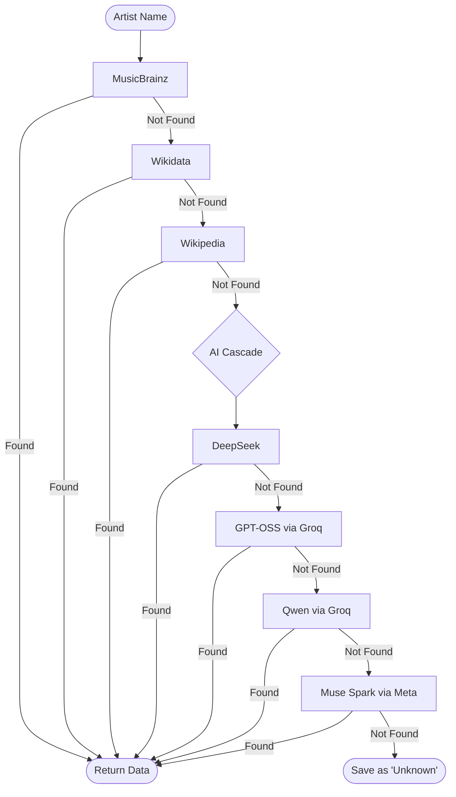

# 🎵 Script 2_1.: Artist Country + Genre Detection System, Intelligent Enrichment

   

        


## 📋 General Description

This script is the **second component** of the YouTube Charts intelligence system. It takes raw artist names extracted by Script 1 and **enriches them with geographic and genre metadata** by querying multiple open knowledge bases. The result is a structured, cumulative database of artists with their country of origin and primary music genre.

### Why a Modular Architecture?

The original script [`2_1.build_artist_db.py`](https://github.com/adroguetth/youtube-music-charts-intelligence/blob/main/scripts/2_1_build_artist_db_backup/2_1.build_artist_db_original.py) grew to **over 10,000 lines**, making it:

- **Difficult to maintain** (a single change could break multiple features)
- **Hard to test** (no isolation between components)
- **Slow to debug** (issues required tracing through massive functions)

The refactored version (`2_1.build_artist_db.py`) splits the code into **30+ focused modules**, each with a single responsibility:

| Problem                             | Solution                            |
| :---------------------------------- | :---------------------------------- |
| 10,000-line monolithic script       | 30+ small modules (<300 lines each) |
| API logic mixed with business logic | Separate `apis/` package            |
| Hard-coded country/genre data       | External `dictionaries/` package    |
| Duplicate code across functions     | Shared `utils/` package             |
| Difficult to add new data sources   | Plug-and-play API modules           |

### Key Features

- **Modular Architecture**: 30+ focused modules instead of a monolithic script (originally a 10,000+ line script)
- **Multi-Source Lookup**: Intelligent cascading queries to MusicBrainz, Wikipedia, and Wikidata
- **Layered AI Fallbacks (The Cascade)**: If open databases fail, the system cascades through 4 distinct AIs:
  - **DeepSeek**: Primary AI fallback (cost-effective, high reasoning)
  - **GPT-OSS-120B (via Groq)**: Secondary fallback (free, blazing fast)
  - **Qwen-27B (via Groq)**: Tertiary fallback (free, Asian/regional specialist)
  - **Muse Spark (via Meta)**: Final fallback (deep reasoning, niche artist resolution)
- **Smart Name Variation**: Generates up to 15 variations per artist for maximum match rate
- **Geographic Intelligence**: Country detection from 30,000+ terms (cities, demonyms, regions)
- **Genre Classification**: 200+ macro-genres and 5,000+ subgenre mappings with weighted voting
- **Country-Specific Rules**: Special handling for 50+ countries (e.g., mapping regional Brazilian genres to Brazilian Regional, K-Pop for South Korea)
- **Script Detection**: Automatic language detection for non-Latin scripts
- **Intelligent Updates**: Only fills missing data, never overwrites correct information
- **In-Memory Caching**: Avoids redundant API calls within a session
- **CI/CD Optimized**: Specifically configured for GitHub Actions


## 📁 Module Structure

```
scripts/
├── 2_1_country_genre/                        # Modular package
│   ├── __main__.py                           # Main orchestrator (Entry point)
│   ├── __init__.py                           # Public API exports
│   ├── config.py                             # Paths, logging, cache, HTTP sessions
│   ├── country_detector.py                   # Country search orchestration
│   ├── genre_detector.py                     # Genre search + weighted voting
│   │
│   ├── dictionaries/                         # Static data (updatable independently)
│   │   ├── __init__.py
│   │   ├── countries.py                      # 30,000+ country variants → canonical names
│   │   ├── genres.py                         # 5,000+ genre variants → macro-genres
│   │   ├── macro_genres.py                   # List of all 200+ valid macro-genres
│   │   ├── country_rules.py                  # Country genre priorities + specific rules
│   │   └── stopwords.py                      # Words to filter from genre extraction
│   │
│   ├── utils/                                # Reusable utilities
│   │   ├── __init__.py
│   │   ├── text_utils.py                     # Normalization, variations, script detection
│   │   ├── cache.py                          # Access to global cache (re-export)
│   │   ├── db_utils.py                       # SQLite create, read, insert, update
│   │   └── artist_parser.py                  # Split multi-artist strings
│   │
│   └── apis/                                 # External API clients (pluggable)
│       ├── __init__.py
│       ├── musicbrainz.py                    # MusicBrainz API client
│       ├── wikidata.py                       # Wikidata API client
│       ├── wikipedia.py                      # Wikipedia API client
│       ├── deepseek.py                       # DeepSeek AI fallback client
│       ├── gpt_oss.py                        # GPT-OSS (via Groq) fallback client
│       ├── qwen.py                           # Qwen (via Groq) fallback client
│       └── muse.py                           # Muse Spark (Meta AI) fallback client
```

------

## 🔍 Detailed Module Analysis

### 1. Main Orchestrator (`__main__.py`)

**Purpose**: Entry point that coordinates all other modules. It's the only file executed directly (via `python -m scripts.2_1_country_genre`).

```python
#!/usr/bin/env python3
"""
Artist Country + Genre Detection System - Main Orchestrator
============================================================================
Intelligent enricher that adds geographic and genre metadata to artists.
"""

import sys
from pathlib import Path

# Add project root to sys.path for module imports
PROJECT_ROOT = Path(__file__).parent.parent.parent.absolute()
if str(PROJECT_ROOT) not in sys.path:
    sys.path.insert(0, str(PROJECT_ROOT))

# Imports from modular package
from .config import CHARTS_DB_DIR, ARTIST_DB_PATH, setup_logging
from .utils.db_utils import (
    create_database, artist_in_database, insert_artist,
    count_artists_in_database, get_latest_chart_database, get_artists_from_chart_db,
)
from .country_detector import search_country
from .genre_detector import search_artist_genre

logger = setup_logging()

def main() -> None:
    """Main execution function."""
    logger.info("🎵 Artist Country + Genre Detection System - MODULAR MODE")
    
    # 1. Initialize database
    create_database()
    
    # 2. Find latest chart database
    chart_db = get_latest_chart_database()
    if not chart_db:
        logger.error("❌ Could not obtain chart database")
        sys.exit(1)
    
    # 3. Extract unique artists
    chart_artists = get_artists_from_chart_db(chart_db)
    
    # 4. Process each artist
    for artist in sorted(chart_artists):
        exists, db_country, db_genre = artist_in_database(artist)
        
        if exists and db_country and db_genre:
            logger.info(f"  ✅ {artist} → {db_country} | {db_genre}")
            continue
        
        # Search for missing information (triggers the 4-AI cascade)
        country, country_source = search_country(artist)
        genre, genre_source = search_artist_genre(artist, country)
        
        # Update database
        insert_artist(artist, country or "Unknown", genre, f"{country_source} | {genre_source}")
    
    # 5. Final summary
    logger.info(f"📈 Total artists in database: {count_artists_in_database()}")

if __name__ == "__main__":
    main()
```

**What makes this module special:**
- **Thin orchestrator**: It doesn't contain any business logic. It just calls the detectors.
- **Easy to test**: You can mock `search_country` and `search_artist_genre` to test the loop logic.
- **Idempotent**: If an artist already has both country and genre, it skips the API calls entirely.

---

### 2. Core Logic Modules

#### 2.1 Country Detector (`country_detector.py`)

**Purpose**: Orchestrates the cascading search for an artist's country of origin. It queries structured sources first, then falls back to the 4-tier AI cascade.

```python
"""
Country detection logic for artists.
"""

import time
from typing import Optional, Tuple

from .config import logger
from .utils.text_utils import generate_all_variations, detect_script_from_name
from .apis.musicbrainz import search_musicbrainz_country_cached
from .apis.wikipedia import (
    search_wikipedia_summary_country_cached,
    search_wikipedia_infobox_country_cached,
)
from .apis.wikidata import search_wikidata_country_cached
from .apis.deepseek import search_deepseek_fallback
from .apis.gpt_oss import search_groq_fallback  # Opción A: función interna
from .apis.qwen import search_qwen_fallback
from .apis.muse import search_muse_fallback

def search_country(artist: str) -> Tuple[Optional[str], str]:
    """
    Determine country of origin using the 4-AI cascade.
    """
    variations = generate_all_variations(artist)
    
    # 1. MusicBrainz
    for var in variations[:3]:
        country, source = search_musicbrainz_country_cached(var)
        if country:
            info = f" (var: {var})" if var != artist else ""
            return country, f"MusicBrainz{info}"
    time.sleep(0.8)
    
    # 2. Wikidata
    for var in variations[:3]:
        country = search_wikidata_country_cached(var)
        if country:
            info = f" (var: {var})" if var != artist else ""
            return country, f"Wikidata{info}"
    
    # 3. Wikipedia EN
    for var in variations[:3]:
        country = search_wikipedia_summary_country_cached(var, 'en')
        if country:
            info = f" (var: {var})" if var != artist else ""
            return country, f"Wikipedia EN summary{info}"
        country = search_wikipedia_infobox_country_cached(var, 'en')
        if country:
            info = f" (var: {var})" if var != artist else ""
            return country, f"Wikipedia EN infobox{info}"
    time.sleep(0.3)
    
    # 4. Wikipedia priority languages
    detected_lang = detect_script_from_name(artist)
    priority_langs = []
    if detected_lang:
        priority_langs.append(detected_lang)
    priority_langs.extend(['es', 'pt', 'fr', 'de', 'it', 'hi', 'ko', 'ja', 'zh', 'ar', 'tr', 'ru'])
    priority_langs = list(dict.fromkeys(priority_langs))
    
    for lang in priority_langs:
        for var in variations[:2]:
            country = search_wikipedia_summary_country_cached(var, lang)
            if country:
                info = f" (var: {var})" if var != artist else ""
                return country, f"Wikipedia {lang.upper()}{info}"
            time.sleep(0.2)
    
    # --- 5. AI CASCADE ---
    
    # 5.1 DeepSeek
    logger.debug(f"  🔍 Using DeepSeek fallback for country: {artist}")
    deepseek_country, _, _ = search_deepseek_fallback(artist)
    if deepseek_country:
        return deepseek_country, "DeepSeek API"
    
    # 5.2 GPT-OSS via Groq
    logger.debug(f"  🔍 Using GPT-OSS fallback for country: {artist}")
    gpt_oss_country, _, _ = search_groq_fallback(artist)
    if gpt_oss_country:
        return gpt_oss_country, "GPT-OSS API"
    
    # 5.3 Qwen via Groq
    logger.debug(f"  🔍 Using Qwen fallback for country: {artist}")
    qwen_country, _, _ = search_qwen_fallback(artist)
    if qwen_country:
        return qwen_country, "Qwen API"
    
    # 5.4 Muse Spark via Meta
    logger.debug(f"  🔍 Using Muse Spark fallback for country: {artist}")
    muse_country, _, _ = search_muse_fallback(artist)
    if muse_country:
        return muse_country, "Muse Spark API"
    
    return None, "Not found"
```

#### 2.2 Genre Detector (`genre_detector.py`)

**Purpose**: Orchestrates genre search with a **weighted voting system**. It also includes the 4-AI cascade for when structured sources yield too few candidates.

```python
"""
Genre detection and voting system for artists.
"""

import time
from collections import defaultdict
from typing import Optional, Tuple, List

from .config import logger
from .utils.text_utils import generate_all_variations, detect_script_from_name
from .apis.musicbrainz import search_musicbrainz_genre_cached
from .apis.wikidata import search_wikidata_genre_cached
from .apis.wikipedia import (
    search_wikipedia_infobox_genre_cached,
    search_wikipedia_summary_genre_cached,
)
from .apis.deepseek import search_deepseek_fallback
from .apis.gpt_oss import search_groq_fallback
from .apis.qwen import search_qwen_fallback
from .apis.muse import search_muse_fallback
from .dictionaries.genres import GENRE_MAPPINGS
from .dictionaries.macro_genres import MACRO_GENRES, GENERIC_MACROS
from .dictionaries.country_rules import COUNTRY_GENRE_PRIORITY, COUNTRY_SPECIFIC_RULES, DEFAULT_GENRE_PRIORITY
from .dictionaries.stopwords import GENRE_STOPWORDS

def normalize_genre(genre_text: str) -> Tuple[Optional[str], Optional[str]]:
    """Map raw genre string to (macro_genre, subgenre)."""
    # ... (implementation as before) ...

def select_primary_genre(artist: str, genre_candidates: List[Tuple[str, int, str]],
                         country: Optional[str] = None, detected_lang: Optional[str] = None) -> Optional[str]:
    """Select primary macro-genre using weighted voting system."""
    # ... (implementation as before) ...

def _try_ai_fallback(artist: str, country: Optional[str], fallback_name: str, fallback_fn, source_label: str) -> Optional[Tuple[str, str]]:
    """Helper to invoke an AI fallback and normalize its result."""
    logger.debug(f"  🔍 Using {fallback_name} fallback for genre: {artist}")
    _, genre, _ = fallback_fn(artist, context_country=country)
    if not genre:
        return None
    
    macro, _ = normalize_genre(genre)
    if macro:
        return macro, f"{source_label} (genre: {genre})"
    return genre, f"{source_label} (raw: {genre})"

def search_artist_genre(artist: str, country: Optional[str] = None) -> Tuple[Optional[str], str]:
    """Determine primary genre using cascading sources."""
    all_candidates = []
    variations = generate_all_variations(artist)
    detected_lang = detect_script_from_name(artist)
    
    # 1. MusicBrainz
    for var in variations[:2]:
        candidates = search_musicbrainz_genre_cached(var)
        all_candidates.extend(candidates)
        if candidates:
            break
        time.sleep(0.5)
    
    # 2. Wikidata
    if not all_candidates:
        for var in variations[:2]:
            candidates = search_wikidata_genre_cached(var)
            all_candidates.extend(candidates)
            if candidates:
                break
            time.sleep(0.5)
    
    MIN_CANDIDATES = 3
    
    # 3. Wikipedia in priority languages
    # ... (implementation as before) ...
    
    # --- 4. AI CASCADE ---
    if not all_candidates:
        # Try DeepSeek
        result = _try_ai_fallback(artist, country, "DeepSeek", search_deepseek_fallback, "DeepSeek API")
        if result: return result
        
        # Try GPT-OSS
        result = _try_ai_fallback(artist, country, "GPT-OSS", search_groq_fallback, "GPT-OSS API")
        if result: return result
        
        # Try Qwen
        result = _try_ai_fallback(artist, country, "Qwen", search_qwen_fallback, "Qwen API")
        if result: return result
        
        # Try Muse Spark
        result = _try_ai_fallback(artist, country, "Muse Spark", search_muse_fallback, "Muse Spark API")
        if result: return result
    
    # 5. Country fallback
    if not all_candidates and country:
        priority = COUNTRY_GENRE_PRIORITY.get(country, DEFAULT_GENRE_PRIORITY)
        if priority:
            return priority[0], f"Genre: country fallback ({country})"
    
    # 6. Weighted voting (if we have structured candidates)
    if all_candidates:
        primary_genre = select_primary_genre(artist, all_candidates, country, detected_lang)
        sources = set(s for _, _, s in all_candidates)
        return primary_genre, f"Genre: {', '.join(sources)}"
    
    return None, "Genre not found"
```

---

### 3. API Clients (`apis/`)

#### 3.1 DeepSeek (`deepseek.py`)

**Purpose**: Primary AI fallback. Uses the OpenAI SDK pointed to DeepSeek.

```python
"""
DeepSeek API client for fallback country and genre detection.
"""

import os
import json
import re
import time
from typing import Optional, Tuple
from openai import OpenAI

from ..config import logger
from ..utils.country_utils import validate_and_normalize_country

_DEEPSEEK_CLIENT = None
_DEEPSEEK_CACHE = {}

def _get_deepseek_client() -> Optional[OpenAI]:
    """Lazy initialization of DeepSeek client."""
    global _DEEPSEEK_CLIENT
    if _DEEPSEEK_CLIENT is None:
        api_key = os.getenv("DEEPSEEK_API_KEY")
        if not api_key:
            return None
        try:
            _DEEPSEEK_CLIENT = OpenAI(api_key=api_key, base_url="https://api.deepseek.com")
        except Exception as e:
            logger.debug(f"Failed to initialize DeepSeek client: {e}")
            return None
    return _DEEPSEEK_CLIENT

def search_deepseek_fallback(artist: str, context_country: Optional[str] = None) -> Tuple[Optional[str], Optional[str], str]:
    """Use DeepSeek API as fallback to get country and/or genre."""
    if artist in _DEEPSEEK_CACHE:
        return _DEEPSEEK_CACHE[artist]
    
    client = _get_deepseek_client()
    if not client:
        return None, None, "DeepSeek not available"
    
    time.sleep(0.5)
    
    # ... (build prompt as before) ...
    
    try:
        response = client.chat.completions.create(
            model="deepseek-chat",
            messages=[{"role": "user", "content": prompt}],
            temperature=0.1,
            max_tokens=200
        )
        content = response.choices[0].message.content.strip()
        logger.info(f"  🤖 DeepSeek raw response for {artist}: {content}")
        
        # ... (parse JSON and normalize as before) ...
        
    except Exception as e:
        logger.debug(f"DeepSeek error for {artist}: {e}")
    
    return None, None, "DeepSeek failed"
```

#### 3.2 GPT-OSS (`gpt_oss.py`)

**Purpose**: Secondary AI fallback. Uses the official Groq SDK to query `openai/gpt-oss-120b`.

```python
"""
GPT-OSS API client (via Groq).
"""

import json
import os
import re
import time
from typing import Optional, Tuple
from groq import Groq

from ..config import logger
from ..utils.country_utils import validate_and_normalize_country

_GROQ_CLIENT = None
_GROQ_CACHE = {}

def _get_groq_client() -> Optional[Groq]:
    """Lazy initialization of Groq client."""
    global _GROQ_CLIENT
    if _GROQ_CLIENT is None:
        api_key = os.getenv("GROQ_API_KEY")
        if not api_key:
            return None
        try:
            _GROQ_CLIENT = Groq(api_key=api_key)
        except Exception as e:
            logger.debug(f"Failed to initialize Groq client: {e}")
            return None
    return _GROQ_CLIENT

def search_groq_fallback(artist: str, context_country: Optional[str] = None) -> Tuple[Optional[str], Optional[str], str]:
    """Use GPT-OSS (via Groq) as fallback to get country and/or genre."""
    if artist in _GROQ_CACHE:
        return _GROQ_CACHE[artist]
    
    client = _get_groq_client()
    if not client:
        return None, None, "Groq not available"
    
    time.sleep(0.3)
    
    # ... (build prompt as before) ...
    
    try:
        response = client.chat.completions.create(
            model="openai/gpt-oss-120b",
            messages=[{"role": "user", "content": prompt}],
            temperature=0.1,
            max_tokens=300
        )
        content = response.choices[0].message.content.strip()
        logger.info(f"  🤖 GPT-OSS raw response for {artist}: {content}")
        
        # ... (parse JSON and normalize as before) ...
        
    except Exception as e:
        logger.error(f"  ❌ GPT-OSS API error for {artist}: {e}")
    
    return None, None, "Groq failed"
```

#### 3.3 Qwen (`qwen.py`)

**Purpose**: Tertiary AI fallback, specialized in Asian and regional artists. Also uses Groq SDK but queries `qwen/qwen3.8-27b`.

```python
"""
Qwen API client (via Groq).
"""

import json
import os
import re
import time
from typing import Optional, Tuple
from groq import Groq

from ..config import logger
from ..utils.country_utils import validate_and_normalize_country

_QWEN_CLIENT = None
_QWEN_CACHE = {}

def _get_qwen_client() -> Optional[Groq]:
    """Lazy initialization of Groq client for Qwen."""
    global _QWEN_CLIENT
    if _QWEN_CLIENT is None:
        api_key = os.getenv("GROQ_API_KEY")
        if not api_key:
            return None
        try:
            _QWEN_CLIENT = Groq(api_key=api_key)
        except Exception as e:
            logger.debug(f"Failed to initialize Groq client for Qwen: {e}")
            return None
    return _QWEN_CLIENT

def search_qwen_fallback(artist: str, context_country: Optional[str] = None) -> Tuple[Optional[str], Optional[str], str]:
    """Use Qwen (via Groq) as fallback to get country and/or genre."""
    if artist in _QWEN_CACHE:
        return _QWEN_CACHE[artist]
    
    client = _get_qwen_client()
    if not client:
        return None, None, "Qwen not available"
    
    time.sleep(0.3)
    
    # ... (build prompt as before) ...
    
    try:
        response = client.chat.completions.create(
            model="qwen/qwen3.8-27b",
            messages=[{"role": "user", "content": prompt}],
            temperature=0.1,
            max_tokens=300
        )
        content = response.choices[0].message.content.strip()
        logger.info(f"  🤖 Qwen raw response for {artist}: {content}")
        
        # ... (parse JSON and normalize as before) ...
        
    except Exception as e:
        logger.error(f"  ❌ Qwen API error for {artist}: {e}")
    
    return None, None, "Qwen failed"
```

#### 3.4 Muse Spark (`muse.py`)

**Purpose**: Final AI fallback. Uses raw `requests.post()` to the Meta API (`/v1/responses`).

```python
"""
Muse Spark (Meta AI) API client.
"""

import json
import os
import re
import time
from typing import Optional, Tuple
import requests

from ..config import logger
from ..utils.country_utils import validate_and_normalize_country

_API_URL = "https://api.meta.ai/v1/responses"
_MODEL_NAME = "muse-spark-1.3-contributor"
_REQUEST_TIMEOUT_SECONDS = 30
_RATE_LIMIT_SECONDS = 0.5

_MUSE_CACHE = {}

def _extract_text_from_response(response_data: dict) -> str:
    """Extract output text from Meta API response blocks."""
    content = ""
    if "output" not in response_data:
        return content
    for block in response_data["output"]:
        if block.get("type") != "message" or "content" not in block:
            continue
        for content_block in block["content"]:
            if content_block.get("type") == "output_text":
                content += content_block.get("text", "")
    return content

def search_muse_fallback(artist: str, context_country: Optional[str] = None) -> Tuple[Optional[str], Optional[str], str]:
    """Use Muse Spark (Meta) as final fallback."""
    if artist in _MUSE_CACHE:
        return _MUSE_CACHE[artist]
    
    api_key = os.getenv("META_API_KEY")
    if not api_key:
        return None, None, "Muse not available"
    
    time.sleep(_RATE_LIMIT_SECONDS)
    
    # ... (build prompt as before) ...
    
    headers = {
        "Authorization": f"Bearer {api_key}",
        "Content-Type": "application/json",
    }
    
    payload = {
        "model": _MODEL_NAME,
        "input": [
            {"role": "user", "content": [{"type": "input_text", "text": prompt}]}
        ],
        # "reasoning_effort": "high",  <-- REMOVED: Not supported by Contributor
        "stream": False,
    }
    
    try:
        response = requests.post(_API_URL, headers=headers, json=payload, timeout=_REQUEST_TIMEOUT_SECONDS)
        
        if response.status_code != 200:
            logger.error(f"  ❌ Muse API error for {artist}: {response.status_code} - {response.text[:150]}")
            return None, None, f"Muse HTTP {response.status_code}"
        
        response_data = response.json()
        content = _extract_text_from_response(response_data)
        
        if not content:
            return None, None, "Muse empty response"
        
        logger.info(f"  🤖 Muse raw response for {artist}: {content}")
        
        # ... (parse JSON and normalize as before) ...
        
    except Exception as e:
        logger.error(f"  ❌ Muse API error for {artist}: {e}")
    
    return None, None, "Muse failed"
```

---
## 📊 Data Flow Diagram

## ⚙️ GitHub Actions Workflow Analysis (`2_1_update_artist_db.yml`)

### Workflow Structure

```yaml
name: 2.1 - Update Artist Database

on:
  schedule:
    - cron: '0 13 * * 1' # Mondays at 13:00 UTC
  
  workflow_dispatch:

env:
  RETENTION_DAYS: 30
  FORCE_JAVASCRIPT_ACTIONS_TO_NODE24: true
```
### Job Steps

| Step | Name                                  | Purpose                                     |
| :--- | :------------------------------------ | :------------------------------------------ |
| 1    | 📚 Checkout repository                 | Clone repository with full history          |
| 2    | 🐍 Setup Python                        | Install Python 3.12 with pip cache          |
| 3    | 📦 Install dependencies                | Install requirements (no Playwright needed) |
| 4    | 📁 Ensure directory structure          | Create input and output folders             |
| 5    | 🔑 Check AI API keys                   | Verify DeepSeek, Groq, and Meta keys        |
| 6    | 🚀 Build artist database (modular)     | Execute modular enrichment script           |
| 7    | ✅ Verify database integrity           | Check database exists and is valid          |
| 8    | 📤 Commit and push changes             | Push changes to GitHub (with rebase)        |
| 9    | 📦 Upload debug artifacts (on failure) | Upload debug data for troubleshooting       |
| 10   | 📋 Generate final report               | Generate execution summary                  |

### Detailed Steps

#### **1. 📚 Checkout Repository**

```yaml
- name: 📚 Checkout repository
  uses: actions/checkout@v4
  with:
    fetch-depth: 0  # Full history for git operations
```

Clones the repository with full history to allow for safe rebasing during the commit step.

#### **2. 🐍 Setup Python**

```yaml
- name: 🐍 Setup Python
  uses: actions/setup-python@v5
  with:
    python-version: "3.12"
    cache: 'pip'  # Dependency caching for faster builds
```

Installs Python 3.12 and enables `pip` caching to speed up subsequent runs.

#### **3. 📦 Install Dependencies**

```yaml
- name: 📦 Install dependencies
  run: |
    pip install -r requirements.txt
```

> **Note**: This modular version has **no dependency on Playwright**, unlike Script 1. It relies on `requests`, `openai` (for DeepSeek), `groq` (for GPT-OSS and Qwen), and `sqlite3` (built-in).

#### **4. 📁 Ensure Directory Structure**

```yaml
- name: 📁 Ensure directory structure
  run: |
    mkdir -p charts_archive/1_download-chart/databases
    mkdir -p charts_archive/2_1.countries-genres-artist
```

Creates the necessary folders if they don't exist (especially important on a fresh clone where empty directories aren't tracked by Git).

#### **5. 🔑 Check AI API Keys**

```yaml
- name: 🔑 Check AI API Keys
  env:
    DEEPSEEK_API_KEY: ${{ secrets.DEEPSEEK_API_KEY }}
    GROQ_API_KEY: ${{ secrets.GROQ_API_KEY }}
    META_API_KEY: ${{ secrets.META_API_KEY }}
  run: |
    if [ -z "$DEEPSEEK_API_KEY" ]; then echo "::warning::DEEPSEEK_API_KEY not set"; else echo "✅ DEEPSEEK_API_KEY is set"; fi
    if [ -z "$GROQ_API_KEY" ]; then echo "::warning::GROQ_API_KEY not set"; else echo "✅ GROQ_API_KEY is set"; fi
    if [ -z "$META_API_KEY" ]; then echo "::warning::META_API_KEY not set"; else echo "✅ META_API_KEY is set"; fi
```

**Why this step exists:**
Since the pipeline uses a **4-tier AI cascade**, it's crucial to verify which keys are available. If a key is missing, the workflow logs a warning but **does not fail** — the script will gracefully skip that AI and move to the next one.

#### **6. 🚀 Build Artist Database (Modular)**

```yaml
- name: 🚀 Build artist database (modular)
  timeout-minutes: 55
  run: |
    python -m scripts.2_1_country_genre
  env:
    GITHUB_ACTIONS: true
    DEEPSEEK_API_KEY: ${{ secrets.DEEPSEEK_API_KEY }}
    GROQ_API_KEY: ${{ secrets.GROQ_API_KEY }}
    META_API_KEY: ${{ secrets.META_API_KEY }}
```

**Key features of this step:**

- **`python -m scripts.2_1_country_genre`**: Because the script is now a **modular package**, it must be invoked with the `-m` flag (not `python scripts/2_1.build_artist_db.py`). This tells Python to execute the `__main__.py` file inside the `2_1_country_genre` folder.
- **`timeout-minutes: 55`**: Allows enough time for API rate limiting (MusicBrainz, Wikipedia) and AI reasoning.
- **Environment Variables**: All three API keys are injected here. The script's internal logic will cascade through DeepSeek → GPT-OSS → Qwen → Muse.
- **`GITHUB_ACTIONS: true`**: Disables interactive prompts and enables CI/CD-specific logging.

#### **7. ✅ Verify Database Integrity**

```yaml
- name: ✅ Verify database integrity
  run: |
    echo "📊 Verifying artist database..."
    DB_PATH="charts_archive/2_1.countries-genres-artist/artist_countries_genres.db"
    
    echo "📂 Directory contents:"
    ls -la charts_archive/2_1.countries-genres-artist/
    
    if [ -f "$DB_PATH" ]; then
      SIZE=$(stat -c%s "$DB_PATH")
      echo "✅ Database found: $((SIZE / 1024)) KB"
      
      if command -v sqlite3 &> /dev/null; then
        echo "🔍 Checking database integrity..."
        sqlite3 "$DB_PATH" "PRAGMA integrity_check;"
      fi
    else
      echo "❌ Database not found!"
      exit 1
    fi
```

**Why this matters:**
Ensures the database was created and is not corrupted before committing it. The `PRAGMA integrity_check;` command verifies the SQLite file's internal structure.

#### **8. 📤 Commit and Push Changes**

```yaml
- name: 📤 Commit and push changes
  run: |
    echo "📝 Preparing commit..."
    
    git config --global user.name "github-actions[bot]"
    git config --global user.email "github-actions[bot]@users.noreply.github.com"
    
    git add charts_archive/2_1.countries-genres-artist/
    
    if git diff --cached --quiet; then
      echo "🔭 No changes to commit"
    else
      DATE=$(date +'%Y-%m-%d')
      WEEK=$(python3 -c "from datetime import datetime; y,w,_ = datetime.now().isocalendar(); print(f'{y}-W{w:02d}')")
      git commit -m "🤖 Update artist database ${DATE} (Week ${WEEK}) [Automated]"
      
      echo "⬇️ Pulling latest changes with rebase..."
      git pull --rebase --autostash origin main || true
      
      echo "⬆️ Pushing changes to repository..."
      git push origin HEAD:main
      echo "✅ Changes pushed successfully"
    fi
```

**Key improvements:**
- **`WEEK` with `isocalendar()`**: Ensures the commit message uses the ISO week (e.g., `2026-W45`), matching the naming convention of the database files.
- **`--autostash`**: If there are uncommitted changes, Git will stash them automatically during the rebase (avoids failures).
- **`|| true`**: Prevents the workflow from failing if the rebase hits a minor conflict (the push will still happen if possible).

#### **9. 📦 Upload Debug Artifacts (on failure)**

```yaml
- name: 📦 Upload debug artifacts
  if: failure()
  uses: actions/upload-artifact@v4
  with:
    name: artist-db-debug-${{ github.run_number }}
    path: |
      charts_archive/2_1.countries-genres-artist/
    retention-days: 7
    if-no-files-found: ignore
```

**Purpose:**
If the workflow fails (e.g., due to an API error or a Python exception), the current state of the database is uploaded as an artifact. This allows you to download it and inspect which artists were processed before the failure.

#### **10. 📋 Generate Final Report**

```yaml
- name: 📋 Generate final report
  if: always()
  run: |
    echo "========================================"
    echo "🎵 FINAL EXECUTION REPORT"
    echo "========================================"
    echo "📅 Date: $(date)"
    echo "📌 Trigger: ${{ github.event_name }}"
    echo "🔗 Commit: ${{ github.sha }}"
    echo "🧠 AI Cascade: DeepSeek -> GPT-OSS -> Qwen -> Muse Spark"
    echo ""
    
    if [ "${{ job.status }}" != "success" ]; then
      echo "❌ Job failed before completing. Check previous steps."
      exit 0
    fi

    DB_FILE="charts_archive/2_1.countries-genres-artist/artist_countries_genres.db"
    if [ -f "$DB_FILE" ]; then
      SIZE=$(stat -c%s "$DB_FILE")
      echo "✅ Artist database: $((SIZE / 1024)) KB"
      
      if command -v sqlite3 &> /dev/null; then
        ARTIST_COUNT=$(sqlite3 "$DB_FILE" "SELECT COUNT(*) FROM artist;" 2>/dev/null || echo "N/A")
        UNKNOWN_COUNT=$(sqlite3 "$DB_FILE" "SELECT COUNT(*) FROM artist WHERE country = 'Unknown' OR macro_genre IS NULL OR macro_genre = 'Unknown';" 2>/dev/null || echo "N/A")
        echo "👤 Artists processed: ${ARTIST_COUNT}"
        echo "❓ Artists with missing info: ${UNKNOWN_COUNT}"
      fi
    else
      echo "⚠️ Artist database not found"
    fi
    
    echo ""
    echo "📊 Trigger details:"
    if [ "${{ github.event_name }}" = "schedule" ]; then
      echo "   • Triggered by: Scheduled cron (Monday 13:00 UTC)"
    elif [ "${{ github.event_name }}" = "workflow_dispatch" ]; then
      echo "   • Triggered by: Manual dispatch"
    fi
    
    echo ""
    echo "✅ Process completed"
    echo "========================================"
```

**Key improvements:**
- **AI Cascade label**: Explicitly logs the order of the AI fallbacks for clarity.
- **`job.status` check**: If the job failed before reaching this step, the report exits early with a clear message instead of misleadingly showing "Artist database not found."
- **`UNKNOWN_COUNT` metric**: Shows exactly how many artists are still missing info, giving you a real-time health indicator of the database.

---

## ⏰ Cron Schedule

```
cron'0 13 * * 6'  # Minute 0, Hour 13, Any day of month, Any month, Sunday

```

- **Execution**: Every Sunday at **13:00 UTC**.
- **Offset**: 1 hour after Script 1 (12:00 UTC).
- **Purpose**: Allows the download workflow (Script 1) to finish completely before the enrichment pipeline starts, ensuring the latest chart data is available.

### Execution Triggers

This workflow runs **only** on:
- **Scheduled execution**: Every Sunday at 13:00 UTC.
- **Manual execution**: Via `workflow_dispatch` from the GitHub Actions UI.

> **Note**: Automatic execution on `git push` is not configured for this workflow. Changes to scripts do not trigger this workflow automatically. To test changes, use manual dispatch or wait for the next scheduled run.

### Execution Flow Timeline (Sunday)

```text
12:00 UTC ─→ Script 1: Download charts
    ↓
13:00 UTC ─→ Script 2.1: Artist enrichment (THIS WORKFLOW)
    ↓
14:00 UTC ─→ Script 2.2: Build song catalog
    ↓
15:00 UTC ─→ Script 3: Chart enrichment
    ↓
16:00 UTC ─→ Script 4: Notebook generation
    ↓
Tuesday 12:00 UTC ─→ Script 5: Export to PDF + Drive
```

---

## 🔑 Required Secrets

Since this workflow uses a **4-tier AI fallback cascade**, you can configure up to 3 API keys. **All are optional**, but having at least one ensures better resolution rates.

| Secret | Used By | Purpose |
| :--- | :--- | :--- |
| `DEEPSEEK_API_KEY` | Script 2.1 | **Primary AI fallback**. Handles most difficult artists. Optional; if missing, the script skips to GPT-OSS. |
| `GROQ_API_KEY` | Script 2.1 | **Secondary/Tertiary AI fallback** (GPT-OSS and Qwen). Free tier is very generous. Optional; if missing, the script skips to Muse. |
| `META_API_KEY` | Script 2.1 | **Final AI fallback** (Muse Spark). Used only for the most obscure artists. Optional; if missing, the script logs "Not found". |

> **💡 Recommendation:** At minimum, configure `GROQ_API_KEY`. It's free, extremely fast, and covers the vast majority of artists that the structured sources miss.

### Environment Variables

| Variable | Value | Purpose |
| :--- | :--- | :--- |
| `GITHUB_ACTIONS` | `true` | Disables interactive prompts, enables CI/CD mode. |
| `RETENTION_DAYS` | `30` | Days to retain debug artifacts. |

---

## 🚀 Installation and Local Setup

### Prerequisites

- Python 3.12+ (3.12 recommended).
- Git installed.
- Internet access for API queries.
- (Optional) API keys for DeepSeek, Groq, or Meta.

### Step-by-Step Installation

#### **1. Clone the Repository**

```bash
git clone https://github.com/adroguetth/youtube-music-charts-intelligence.git
cd youtube-music-charts-intelligence
```

#### **2. Create Virtual Environment (recommended)**

```bash
python -m venv venv

# Windows
venv\Scripts\activate

# Linux/Mac
source venv/bin/activate
```

#### **3. Install Dependencies**

```bash
pip install -r requirements.txt
```

The modular script requires the following packages:

| Package | Purpose |
| :--- | :--- |
| `requests` | HTTP calls to MusicBrainz, Wikipedia, Wikidata, and Meta API. |
| `openai` | DeepSeek API client. |
| `groq` | GPT-OSS and Qwen API clients (via Groq). |
| `sqlite3` | Database operations (included in Python). |

> **Note**: Playwright is **not** required for this script. That dependency is only for Script 1.

#### **4. Set API Keys (Optional)**

You can set any or all of the following keys. The script will use them in the order of the cascade (DeepSeek → GPT-OSS → Qwen → Muse).

```bash
# Linux/Mac
export DEEPSEEK_API_KEY="your-deepseek-key"
export GROQ_API_KEY="your-groq-key"
export META_API_KEY="your-meta-key"

# Windows (Command Prompt)
set DEEPSEEK_API_KEY=your-deepseek-key
set GROQ_API_KEY=your-groq-key
set META_API_KEY=your-meta-key

# Windows (PowerShell)
$env:DEEPSEEK_API_KEY="your-deepseek-key"
$env:GROQ_API_KEY="your-groq-key"
$env:META_API_KEY="your-meta-key"
```

#### **5. Verify Script 1 Output Exists**

```bash
# Ensure there's at least one weekly chart database
ls -la charts_archive/1_download-chart/databases/
# Should show: youtube_charts_2026-W45.db (or similar)
```

#### **6. Run the Script**

Because the script is now a **modular package**, it must be executed using the `-m` flag:

```bash
python -m scripts.2_1_country_genre
```

*(If you try to run `python scripts/2_1.build_artist_db.py`, you will get a `ModuleNotFoundError`.)*

### Development Configuration

```bash
# Simulate GitHub Actions environment (disables interactive prompts)
export GITHUB_ACTIONS=true

# Enable detailed debugging (shows genre candidates and voting details)
export LOG_LEVEL=DEBUG
```

> **Note**: The script automatically finds the most recent chart database by ISO week identifier (e.g., `youtube_charts_2026-W45.db`). You do not need to specify the database path manually.

---

## 📋 Expected First Run Output

```text
================================================================================
🎵 Artist Country + Genre Detection System - MODULAR MODE
📁 Chart DB directory: /path/to/charts_archive/1_download-chart/databases
💾 Artist DB path: /path/to/charts_archive/2_1.countries-genres-artist/artist_countries_genres.db
================================================================================
✅ Table 'artist' ready
📁 Using database: youtube_charts_2026-W45.db
📊 160 unique artists in the chart database
🎯 160 unique artists to process

  🔍 Artist Name (new, searching...)
  🤖 DeepSeek raw response for Artist Name: {"country": "Brazil", "genre": "Forró"}
  ➕ Artist Name → Country: Brazil | Genre: Brazilian Regional (DeepSeek API)
  
  🔍 Another Artist (new, searching...)
  🤖 GPT-OSS raw response for Another Artist: {"country": "United States", "genre": "Pop"}
  ➕ Another Artist → Country: United States | Genre: Pop (GPT-OSS API)
  
  🔍 Difficult Artist (in DB - Country: Unknown | Genre: ?, searching missing info...)
  🤖 Qwen raw response for Difficult Artist: {"country": "India", "genre": "Punjabi"}
  🔄 Difficult Artist → Country: India | Genre: Indian Pop (Qwen API)

================================================================================
📈 EXECUTION SUMMARY
   Total artists processed: 160
   ✅ Already complete (country+genre): 137 (85.6%)
   🔍 New country found: 9 (5.6%)
   🎵 New genre found: 6 (3.8%)
   ❌ No information found: 14 (8.8%)
   🗃️  Total artists in database: 2705
================================================================================
```
--- 
## 🔧 Customization and Configuration

### Adjustable Parameters in Script

#### 1. Project Paths (`config.py`)
These control where the script looks for input and where it saves the output.

```python
# In scripts/2_1_country_genre/config.py
PROJECT_ROOT = Path(__file__).parent.parent.parent.absolute()
CHARTS_DB_DIR = PROJECT_ROOT / "charts_archive" / "1_download-chart" / "databases"
ARTIST_DB_PATH = PROJECT_ROOT / "charts_archive" / "2_1.countries-genres-artist" / "artist_countries_genres.db"
```

#### 2. Genre Detection Logic (`genre_detector.py`)
These constants control the voting system and Wikipedia search thresholds.

```python
# In scripts/2_1_country_genre/genre_detector.py

# Minimum number of structured candidates before skipping AI fallback
_MIN_CANDIDATES = 3

# Delays between API calls (in seconds) to avoid rate limiting
_MUSICBRAINZ_RATE_LIMIT_SECONDS = 0.5
_WIKIDATA_RATE_LIMIT_SECONDS = 0.5
_WIKIPEDIA_RATE_LIMIT_SECONDS = 0.3

# Source multipliers applied during the weighted voting process
_SOURCE_MULTIPLIERS = {
    "musicbrainz": 1.5,
    "wikidata": 1.3,
    "infobox": 1.2,
}
```

#### 3. AI Fallback Delays (in each API client)
Each AI client has its own rate limit to prevent `429 Too Many Requests` errors.

```python
# In scripts/2_1_country_genre/apis/deepseek.py
time.sleep(0.5)  # DeepSeek is paid, but needs pacing

# In scripts/2_1_country_genre/apis/gpt_oss.py
time.sleep(0.3)  # GPT-OSS via Groq is fast

# In scripts/2_1_country_genre/apis/qwen.py
time.sleep(0.3)  # Qwen via Groq is fast

# In scripts/2_1_country_genre/apis/muse.py
time.sleep(0.5)  # Muse via Meta is slower due to reasoning
```

#### 4. Wikipedia Language Priorities (`country_detector.py`)
These lists control which Wikipedia editions are queried when the artist's country is unknown or when the artist's script is non-Latin.

```python
# In scripts/2_1_country_genre/country_detector.py

# Default language priority for non-English Wikipedia lookups
_PRIORITY_LANGUAGES = [
    "es", "pt", "fr", "de", "it", "hi", 
    "ko", "ja", "zh", "ar", "tr", "ru",
]
```

---

### Workflow Configuration

```yaml
# In .github/workflows/2_1_update_artist_db.yml
env:
  RETENTION_DAYS: 30       # Days to retain debug artifacts

jobs:
  build-artist-database:
    timeout-minutes: 60    # Total job timeout (allows for API rate limits)
```

---

### Adding New Countries

To add a new country to the detection system, extend `dictionaries/countries.py`.

```python
# In scripts/2_1_country_genre/dictionaries/countries.py
COUNTRIES_CANONICAL["New Country"] = {
    # Country names (lowercase)
    'new country', 'newcountry', 'official name',
    
    # Demonyms
    'new country citizen', 'newcountryian',
    
    # Major cities (lowercase)
    'capital city', 'major city 1', 'major city 2',
    
    # Regional references
    'region name', 'province name',
}
```

**Why this matters:** The detector uses this dictionary to convert city names (e.g., "NYC") or demonyms (e.g., "Brazilian") into canonical country names (e.g., "United States", "Brazil").

---

### Adding New Genre Mappings

To add a new genre or subgenre, extend `dictionaries/genres.py`.

```python
# In scripts/2_1_country_genre/dictionaries/genres.py
GENRE_MAPPINGS = {
    # ... existing mappings ...
    
    # New subgenre example
    'new subgenre': ('Macro-Genre', 'new subgenre'),
    'subgenre variant': ('Macro-Genre', 'new subgenre'),
    'subgenre in spanish': ('Macro-Genre', 'new subgenre'),
}
```

**Why this matters:** If an AI (like DeepSeek or Qwen) returns a raw genre that is not in this dictionary, the script will save it as a "raw" string (e.g., `Forró`). Adding it here ensures it gets normalized to the correct macro-genre (e.g., `Brazilian Regional`).

---

### Adjusting Country Genre Priorities

To change the genre priority for a specific country, modify `dictionaries/country_rules.py`.

```python
# In scripts/2_1_country_genre/dictionaries/country_rules.py
COUNTRY_GENRE_PRIORITY["Country Name"] = [
    "Priority Genre 1",   # Gets 2.0x multiplier in voting
    "Priority Genre 2",   # Gets 1.5x multiplier
    "Priority Genre 3",   # Gets 1.2x multiplier
    "Priority Genre 4",
]
```

**Why this matters:** When multiple genres are detected, the voting system uses this list to break ties. A genre in the first position gets a `2.0x` boost, making it much more likely to win.

---

### Adding Country-Specific Rules

For countries with unique genre quirks, you can define specific rules in `dictionaries/country_rules.py`.

```python
# In scripts/2_1_country_genre/dictionaries/country_rules.py
COUNTRY_SPECIFIC_RULES["Country Name"] = {
    "keywords": ["keyword1", "keyword2"],      # Triggers bonus when found
    "bonus_extra": 1.5,                        # Multiplier for matches
    "force_macro": "Specific Macro-Genre",     # Forces this genre for the country
    "map_generic_to": "Regional Macro-Genre",  # Maps "Pop" → "K-Pop" for Korea
    "prefer_genre": "Preferred Genre",         # Prefers this genre in ties
}
```

**Example from the codebase (South Korea):**
```python
"South Korea": {
    "keywords": ["k-pop", "kpop", "korean pop", "idol group"],
    "bonus_extra": 1.5,
    "force_macro": "K-Pop/K-Rock",
    "map_generic_to": "K-Pop/K-Rock"
}
```
This ensures that if an AI returns "Pop" for a Korean artist, it gets remapped to `K-Pop/K-Rock`.

---

### Adding a New API Source

To add a new data source (e.g., Spotify API or Last.fm), follow these steps:

#### Step 1: Create the client file
Create a new file in `apis/` (e.g., `spotify.py`).

```python
# In scripts/2_1_country_genre/apis/spotify.py
from ..config import get_cache, logger

def search_spotify_country_cached(artist: str):
    """Search Spotify for artist country."""
    cache = get_cache()
    if artist in cache.get('spotify_country', {}):
        return cache['spotify_country'][artist]
    
    # API call logic here
    # ...
    
    cache['spotify_country'][artist] = result
    return result
```

#### Step 2: Register the client in `apis/__init__.py`
```python
# In scripts/2_1_country_genre/apis/__init__.py
from .spotify import search_spotify_country_cached
# ... add to __all__ list
```

#### Step 3: Add it to the cascade
Update `country_detector.py` or `genre_detector.py` to call the new function before or after the existing sources.

```python
# In scripts/2_1_country_genre/country_detector.py
from .apis.spotify import search_spotify_country_cached

# ... inside search_country ...
spotify_country = search_spotify_country_cached(artist)
if spotify_country:
    return spotify_country, "Spotify API"
```

---

### Modifying Name Variation Generation

To change how artist names are normalized before querying APIs, edit `utils/text_utils.py`.

#### 1. Add new prefixes to remove
```python
# In scripts/2_1_country_genre/utils/text_utils.py
ARTIST_PREFIXES = {
    'dj': ['DJ', 'Dj', 'dj'],
    'mc': ['MC', 'Mc', 'mc'],
    'lil': ['Lil', 'lil', 'LIL'],
    'saint': ['Saint', 'St.', 'St'],  # New prefix added
    # ... add more
}
```

#### 2. Adjust the maximum variations
```python
# In scripts/2_1_country_genre/utils/text_utils.py
def generate_all_variations(name: str) -> List[str]:
    # ... existing code ...
    return result[:15]  # Change 15 to desired limit (default: 15)
```

**Why this matters:** Generating too many variations can slow down the script and hit API rate limits. The default (`15`) is a balance between coverage and speed.

---

### Changing the AI Cascade Order

If you want to change which AI is tried first, edit `country_detector.py` and `genre_detector.py`. The current order is:

1. **Structured Sources**: MusicBrainz → Wikidata → Wikipedia.
2. **AI Cascade**: DeepSeek → GPT-OSS → Qwen → Muse.

To, for example, swap DeepSeek and Groq (if you want to use the free Groq first), just change the order of the `if` blocks:

```python
# In scripts/2_1_country_genre/country_detector.py

# --- 5. GPT-OSS fallback (Free) ---
gpt_oss_country, _, _ = search_groq_fallback(artist)
if gpt_oss_country:
    return gpt_oss_country, "GPT-OSS API"

# --- 6. DeepSeek fallback (Paid) ---
deepseek_country, _, _ = search_deepseek_fallback(artist)
if deepseek_country:
    return deepseek_country, "DeepSeek API"
```

**Note**: Remember to also update the order in `genre_detector.py` to keep them in sync.

---

## 🐛 Troubleshooting

### Common Issues and Solutions

| Error | Likely Cause | Solution |
| :--- | :--- | :--- |
| `No chart databases found` | Script 1 hasn't run yet | Run `1_download.py` first. Ensure `charts_archive/1_download-chart/databases/` contains at least one `.db` file. |
| `ModuleNotFoundError: No module named 'scripts'` | Incorrect execution path | You must run the package from the project root using the `-m` flag: `python -m scripts.2_1_country_genre`. Do not run the file directly. |
| `ModuleNotFoundError: No module named 'groq'` | Missing dependency | Run `pip install -r requirements.txt` (ensure `groq` and `openai` are installed). |
| `ImportError: cannot import name 'search_gpt_oss_fallback'` | Renamed file mismatch | If you renamed `groq.py` to `gpt_oss.py`, ensure the function inside is still named `search_groq_fallback` (Opción A) or update the imports in `__init__.py` and the detectors. |
| `402 Payment Required` (DeepSeek) | DeepSeek account has no credits | The script will log the error and automatically skip to GPT-OSS. No action needed, or recharge your DeepSeek account. |
| `429 Too Many Requests` (Groq) | Rate limit exceeded on free tier | Increase the `time.sleep()` value in `gpt_oss.py` and `qwen.py` (e.g., from `0.3` to `1.0`). |
| `400 Bad Request` (Meta/Muse) | Invalid payload parameter (e.g., `reasoning_effort`) | Ensure you removed the `"reasoning_effort"` line from the payload in `muse.py`. The Contributor model does not support it. |
| `DeepSeek API key not set` | Missing environment variable | Set `DEEPSEEK_API_KEY` env var. Optional; the script skips to the next AI. |
| `MusicBrainz rate limiting` (503 errors) | Too many requests | Script includes delays; be patient or increase `_MUSICBRAINZ_RATE_LIMIT_SECONDS` in `country_detector.py` and `genre_detector.py`. |
| `Wikipedia page not found` | Artist name spelling or non-existent page | Check artist name; script falls back to other sources. |
| `API timeout` | Slow network or API issues | Increase the timeout in `config.py` (default: 10 seconds) or in `muse.py` (`_REQUEST_TIMEOUT_SECONDS`). |
| `Database locked` | Concurrent access | Wait and retry; script uses short transactions. Ensure no other process is writing to the `.db` file. |
| `Artist not found in any source` | Very obscure artist | Add fallback rules in `country_rules.py` or ensure at least one AI API key is configured. |

---

### Debugging with Logs

The script provides detailed logs at every step of the cascade. To see the raw JSON response from each AI, you don't need to change anything — the `logger.info` calls are active by default.

**To enable even more verbose output (DEBUG level):**

```bash
# Set debug level before running
export LOG_LEVEL=DEBUG

# Run the package
python -m scripts.2_1_country_genre
```

**Debug output example (showing the 4-AI cascade):**

```text
  🔍 Searching country for "Zé Vaqueiro"...
    MusicBrainz query: No result.
    Wikipedia EN: No result.
  🔍 Using DeepSeek fallback for country: Zé Vaqueiro
  🤖 DeepSeek raw response for Zé Vaqueiro: {
      "country": "Brazil",
      "genre": "Forró"
  }
  ➕ Zé Vaqueiro → Country: Brazil | Genre: Brazilian Regional (DeepSeek API)
```

**Example showing a Groq (GPT-OSS) response:**

```text
  🔍 Using GPT-OSS fallback for country: GAVIND
  🤖 GPT-OSS raw response for GAVIND: {
      "country": null,
      "genre": null
  }
  🔍 Using Qwen fallback for country: GAVIND
  🤖 Qwen raw response for GAVIND: {
      "country": "India",
      "genre": "Punjabi"
  }
  ➕ GAVIND → Country: India | Genre: Indian Pop (Qwen API)
```

---

### Inspecting the Database

#### 1. Quick check (Python)
```python
import sqlite3

conn = sqlite3.connect("charts_archive/2_1.countries-genres-artist/artist_countries_genres.db")
cursor = conn.cursor()

# Show 10 random artists
cursor.execute("SELECT name, country, macro_genre FROM artist LIMIT 10")
for row in cursor.fetchall():
    print(f"{row[0]} → {row[1]} | {row[2]}")

conn.close()
```

#### 2. Verify Integrity (SQLite CLI)
```bash
# Open the database
sqlite3 charts_archive/2_1.countries-genres-artist/artist_countries_genres.db

# Run integrity check
PRAGMA integrity_check;

# Count total records
SELECT COUNT(*) FROM artist;

# Show the top 10 countries by number of artists
SELECT country, COUNT(*) as cnt FROM artist GROUP BY country ORDER BY cnt DESC LIMIT 10;

# Show how many artists still have missing info
SELECT COUNT(*) FROM artist WHERE country = 'Unknown' OR macro_genre IS NULL OR macro_genre = 'Unknown';
```

---

### GitHub Actions Debug Mode

If a workflow fails, you can add a debug step to inspect the database and file structure before the job exits.

```yaml
- name: 🐛 Debug - List files and check database
  if: failure()
  run: |
    echo "📂 Charts archive structure:"
    tree charts_archive/ -L 2 || ls -la charts_archive/
    
    echo "📊 Artist database content:"
    if [ -f "charts_archive/2_1.countries-genres-artist/artist_countries_genres.db" ]; then
      sqlite3 charts_archive/2_1.countries-genres-artist/artist_countries_genres.db \
        "SELECT COUNT(*) FROM artist;" 2>/dev/null || echo "Database not ready"
    else
      echo "❌ Database file not found."
    fi
```

---

### Common AI-Specific Errors

#### DeepSeek (`402 Payment Required`)
This means your DeepSeek account has run out of credits. The script will automatically skip to GPT-OSS. If you want to silence the error, simply remove or comment out the `DEEPSEEK_API_KEY` in your environment (or GitHub secrets).

#### Groq (`429 Too Many Requests`)
Groq's free tier has a rate limit (requests per minute). If you process a large batch of artists, you might hit this limit. The script includes a `time.sleep(0.3)` between calls. If the error persists, increase this to `1.0` or `1.5` in `gpt_oss.py` and `qwen.py`.

#### Meta / Muse (`400 Bad Request: unknown parameter 'reasoning_effort'`)
The `muse-spark-1.3-contributor` model does not support the `reasoning_effort` parameter. Ensure the `payload` in `muse.py` does **not** contain that line. The script should have it removed already.

#### Groq (`404 Not Found: model not found`)
The model name has been deprecated by Groq. The current stable models are `openai/gpt-oss-120b` and `qwen/qwen3.8-27b`. If Groq deprecates one of them in the future, update the `model` parameter in the corresponding file (`gpt_oss.py` or `qwen.py`).

---

Aquí tienes las secciones **"Monitoring, Maintenance y License"** completamente actualizadas. He incorporado las métricas para la cascada de 4 IAs, los comandos SQL correctos para la nueva arquitectura y las licencias de las nuevas dependencias (Groq, Meta).

***

## 📈 Monitoring and Maintenance

### Health Indicators

| Metric | Expected Range | Notes |
| :--- | :--- | :--- |
| Database size | +10–50 records/week | Grows slowly over time as new artists chart. |
| Overall success rate | >90% | For established artists. |
| API response time | <2 seconds | Average across structured sources. |
| Cache hit rate | 30–70% | Increases as the database grows. |
| AI fallback usage | <15% | Percentage of artists that reach any AI. |
| DeepSeek usage | <10% | Only for cases where structured sources fail. |
| GPT-OSS/Qwen usage | <5% | Only for niche/regional artists (e.g., Indian, Brazilian). |
| Muse usage | <1% | Final safety net; rarely invoked. |

### Performance Metrics

| Metric | Expected Range | Notes |
| :--- | :--- | :--- |
| Artists processed/hour | 500–1000 | Depends heavily on API response times. |
| Genre detection rate | 85–95% | Lower for niche/underground artists. |
| Country detection rate | 80–90% | Lower for obscure or misspelled artist names. |
| Cost per 100 artists | ~$0.002 | With the AI cascade enabled (assuming DeepSeek is available). |

### Logging Levels

The script uses Python's built-in `logging` module and outputs all logs to `stdout` (which GitHub Actions captures).

| Level | When | Details |
| :--- | :--- | :--- |
| **Basic (INFO)** | Normal execution | Progress, results, and raw AI responses (`🤖 ... raw response`). |
| **Debug (DEBUG)** | `LOG_LEVEL=DEBUG` | Shows genre candidates, voting weights, API queries, and full cache contents. |
| **GitHub Actions** | `GITHUB_ACTIONS=true` | Disables interactive prompts. |
| **Error (ERROR)** | API failures or exceptions | Shows the exact HTTP status code and error message (e.g., `402`, `429`, `404`). |

### Regular Maintenance Tasks

#### 1. Weekly: Check Database Growth
```bash
sqlite3 charts_archive/2_1.countries-genres-artist/artist_countries_genres.db \
  "SELECT COUNT(*) FROM artist;"
```
*Expected: A steady increase as new artists chart.*

#### 2. Monthly: Verify Data Quality
Check how many artists are still missing info:
```bash
sqlite3 charts_archive/2_1.countries-genres-artist/artist_countries_genres.db \
  "SELECT COUNT(*) FROM artist WHERE country = 'Unknown' OR macro_genre IS NULL OR macro_genre = 'Unknown';"
```
Check the top 10 countries by number of artists:
```bash
sqlite3 charts_archive/2_1.countries-genres-artist/artist_countries_genres.db \
  "SELECT country, COUNT(*) as cnt FROM artist GROUP BY country ORDER BY cnt DESC LIMIT 10;"
```

#### 3. Quarterly: Optimize the Database
SQLite databases can become fragmented over time. `VACUUM` rebuilds the file, reducing its size and improving performance.
```bash
sqlite3 charts_archive/2_1.countries-genres-artist/artist_countries_genres.db "VACUUM;"
```

#### 4. AI-Specific Monitoring
If you want to see **which AI resolved the most artists**, you can grep the raw logs from GitHub Actions:
```bash
# On your local machine (after downloading logs)
grep "DeepSeek API" log.txt | wc -l
grep "GPT-OSS API" log.txt | wc -l
grep "Qwen API" log.txt | wc -l
grep "Muse Spark API" log.txt | wc -l
```
*A healthy cascade should show most resolutions from MusicBrainz/Wikipedia, with DeepSeek covering the rest, and only a small fraction hitting Groq or Muse.*

---

## 📄 License and Attribution

### License

This project is licensed under the **MIT License**.

### Author

- **Name**: Alfonso Droguett
- 🔗 **LinkedIn**: [Alfonso Droguett](https://www.linkedin.com/in/adroguetth/)
- 🌐 **Web portfolio**: [adroguett-portfolio.cl](https://www.adroguett-portfolio.cl/)
- 📧 **Email**: adroguett.consultor@gmail.com

### External Data Sources

| Source | License | Used For |
| :--- | :--- | :--- |
| **MusicBrainz** | GPL (open data) | Artist country, genre tags. |
| **Wikipedia** | CC BY-SA | Country from infobox/summary, genre hints. |
| **Wikidata** | CC0 (Public Domain) | Country (P27, P19), genre (P136). |
| **DeepSeek** | Commercial API | Primary AI fallback. |
| **Groq (GPT-OSS / Qwen)** | Commercial API (Free Tier) | Secondary AI fallbacks. |
| **Meta (Muse Spark)** | Commercial API | Final AI fallback. |

### Key Dependencies

| Dependency | License | Purpose |
| :--- | :--- | :--- |
| `requests` | Apache 2.0 | HTTP API calls (MusicBrainz, Wikipedia, Wikidata, Meta). |
| `openai` | MIT | DeepSeek API client. |
| `groq` | MIT | GPT-OSS and Qwen API clients. |
| `sqlite3` | Public Domain (Python stdlib) | Local database storage. |

### Data License

The **generated database** (`artist_countries_genres.db`) is considered a derivative work. While the *code* is MIT, the *data* should respect the licenses of the sources:
- **Attribution**: If you publish analyses based on this data, you should attribute MusicBrainz, Wikipedia, and Wikidata.
- **Commercial Use**: The AI-generated data (from DeepSeek, Groq, Meta) is subject to the terms of service of those providers. For most analytical projects, this is fine, but check their terms if you plan to redistribute the enriched database commercially.

---

## 🤝 Contribution

### How to Contribute

We welcome contributions that improve the accuracy, coverage, or performance of the pipeline.

- **Report issues** with complete logs (include the artist name, the AI that failed, and the error message).
- **Propose improvements** with concrete use cases.
- **Add new genre mappings** with examples of artists that use them (e.g., "Forró" → `Brazilian Regional`).
- **Contribute country variants** (especially for underrepresented regions in `countries.py`).
- **Improve Wikipedia pattern matching** in `wikipedia.py` for better extraction.
- **Add new AI clients** to the `apis/` folder (e.g., Mistral, Anthropic, Gemini).
- **Maintain backward compatibility** with the existing database schema.

### Quick Contribution Guide

```bash
# 1. Fork the repository on GitHub
# 2. Clone your fork
git clone https://github.com/your-username/youtube-music-charts-intelligence.git
cd youtube-music-charts-intelligence

# 3. Create a branch for your contribution
git checkout -b feature/new-genre-mapping

# 4. Make changes to dictionaries or logic
# Example: Add a new genre mapping in the Brazilian Regional section
echo "    'new subgenre': ('Brazilian Regional', 'new subgenre')," >> scripts/2_1_country_genre/dictionaries/genres.py

# 5. Test locally (remember: it's a package now!)
python -m scripts.2_1_country_genre

# 6. Commit with a descriptive message
git commit -m "Add genre mapping for 'new subgenre' → Brazilian Regional"

# 7. Push and create Pull Request
git push origin feature/new-genre-mapping
```

### Priority Contribution Areas

- ✅ Expand `COUNTRIES_CANONICAL` for missing countries (especially smaller nations).
- ✅ Add genre mappings for emerging genres (hyperpop, phonk, regional Brazilian genres, etc.).
- ✅ Improve script detection for more languages (Thai, Hebrew, Greek, etc.).
- ✅ Add new API sources (Spotify, Last.fm, Genius) in the `apis/` folder.
- ✅ Optimize Wikipedia query patterns for better infobox extraction.
- ✅ Add confidence scoring to the AI voting system (e.g., "DeepSeek is 90% confident").
- ✅ Add retry logic with exponential backoff for rate-limited APIs.

---

## 🧪 Known Limitations and Future Improvements

### Current Limitations

- **API Dependency**: The system relies on external services (MusicBrainz, Wikipedia, Wikidata, DeepSeek, Groq, Meta) that may change their API, rate-limit you, or go down.
- **New Artists**: Recently emerging artists may not appear in any knowledge base. The AIs (DeepSeek, GPT-OSS, Qwen, Muse) handle this better than structured sources, but they can still miss ultra-niche artists.
- **Niche Genres**: Some micro-genres may not have mappings yet. For example, "Forró" was not mapped until recently (now it maps to `Brazilian Regional`).
- **Script Detection**: The regex-based heuristic (`text_utils.py`) may occasionally misidentify scripts (e.g., confusing Ukrainian and Russian, or Urdu and Arabic).
- **AI Costs**: While minimal, DeepSeek requires credits. Groq's free tier has rate limits. Meta's API requires a payment method on file (even if usage is tiny).
- **Wikipedia Rate Limits**: Bulk processing can be slow due to Wikimedia's burst limits.
- **Collaboration Resolution**: Complex collaborations (5+ artists) may not resolve accurately (e.g., "Artist A & Artist B feat. Artist C" may be split into 3 artists, but the country and genre may be assigned based on the first one).

### Known Edge Cases

| Case | Current Behavior | Proposed Improvement |
| :--- | :--- | :--- |
| **K-Pop groups with foreign members** | Assigned to South Korea | Detect individual member countries (e.g., LISA → Thailand, but BLACKPINK → South Korea). |
| **Brazilian MCs (Funk)** | May fall back to `Brazilian Regional` | Prioritize `Funk Brasileiro` if AI returns "Funk" or "Baile Funk". |
| **Indian regional genres** | AI returns "Punjabi" or "Tamil" | Map to `Indian Pop` (already implemented via `genres.py`). |
| **Latin collaborations with lead from another country** | May yield `Multi-country` | Analyze the order of mention (usually the lead artist is first). |
| **Artists with multiple nationalities** | First detected country wins | Weight by prominence/activity (e.g., where they were born vs. where they live). |
| **Obscure regional genres** | Mapped to generic macro-genre | Add more specific mappings (e.g., "Haryanvi" → `Indian Pop`, "Piseiro" → `Brazilian Regional`). |
| **AI returning null** | Saved as `Unknown` | AI cascade tries the next model. If all fail, save `Unknown` and move on. |
| **AI hallucinating a country** | Saved as-is | Validate against `countries.py` (already implemented via `validate_and_normalize_country`). |

### Future Improvements

- **Add Spotify API** as an additional source (Spotify has artist country metadata).
- **Implement confidence scoring** for all detections (e.g., "DeepSeek is 95% confident, GPT-OSS is 60% confident").
- **Add batch processing mode** for large catalogs (send multiple artists in a single prompt to reduce API calls).
- **Improve script detection** with ML models (e.g., `langdetect` or `fasttext`).
- **Add persistence for cache** between runs (e.g., save cache to a JSON file to avoid re-querying).
- **Support for more Wikipedia languages** (currently supports ~12 languages).
- **Add geocoding** for city names without country context (e.g., "Springfield" could be in multiple countries).
- **Implement genre hierarchy** (subgenre → genre → macro-genre). Currently, the system only uses macro-genres.
- **Add export functionality** (JSON, CSV, Parquet) for easier integration with other tools.
- **Add a "review mode"** where artists with `Unknown` country/genre are output to a CSV for manual review.

---

## 📊 Performance Reference

The script's performance depends heavily on API response times and whether the artist is already cached.

| Scenario | Time | Bottleneck |
| :--- | :--- | :--- |
| **New artist (cache miss, structured sources succeed)** | 2–5 seconds | API response times (MusicBrainz, Wikipedia). |
| **New artist (cache miss, requires AI cascade)** | 5–15 seconds | AI response times (DeepSeek, GPT-OSS, Qwen, Muse). |
| **Cached artist** | <0.1 seconds | In-memory lookup (`config._CACHE`). |
| **100 artists (new, structured sources only)** | 5–10 minutes | API rate limits (MusicBrainz: 1 req/s, Wikipedia: burst limits). |
| **100 artists (new, AI cascade)** | 15–30 minutes | AI rate limits (Groq: 30 RPM, DeepSeek: 60 RPM). |
| **100 artists (cached)** | <10 seconds | Mostly local processing. |

### Bottleneck Analysis

- **MusicBrainz**: The biggest bottleneck for bulk processing. It's limited to **1 request per second**. The script includes a `time.sleep(0.8)` after MusicBrainz queries to respect this.
- **Wikipedia**: Wikimedia's API has burst limits but is generally faster than MusicBrainz.
- **Groq**: Fast (~280 tokens/sec), but has a **30 requests per minute** limit on the free tier. The script includes a `time.sleep(0.3)` between calls.
- **DeepSeek**: Slower but reliable. Rate limits depend on your account tier.
- **Muse**: The slowest (due to deep reasoning), but only used as a last resort.

### Optimization Tips

1. **Increase the cache hit rate** by running the script frequently (weekly, as scheduled). Artists already in the database are skipped instantly.
2. **Use the AI cascade wisely**: If you have DeepSeek credits, it will handle most cases. If not, Groq's free tier covers the rest.
3. **Batch processing**: If you have thousands of artists, consider running the script in chunks to avoid hitting rate limits.
4. **Persistent cache**: Currently, the cache is in-memory (lost b

---

**⭐ If you find this project useful, please consider starring it on GitHub!**

