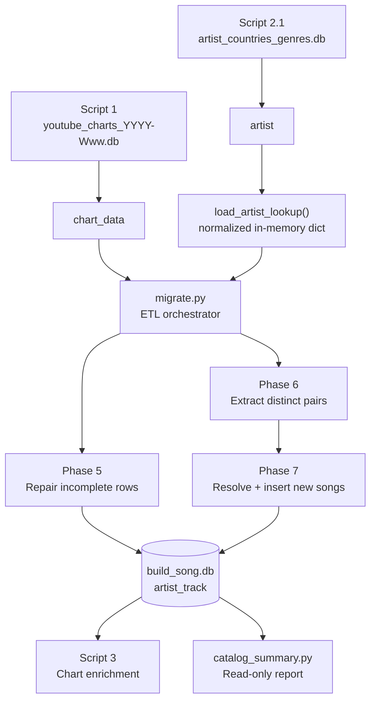
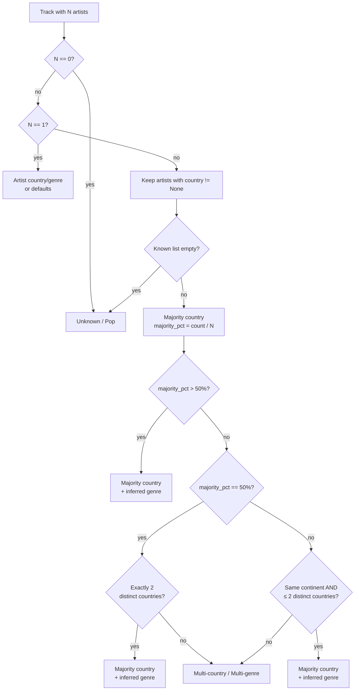

# Script 2_2: Song Catalog Builder

  
   


> **Pipeline position:** `1_download_chart` → `2_1_country_genre` → **`2_2_song_catalog`** → `3_chart_enrichment` → `4_notebooks` → `5_export`

> **Execution model:** GitHub Actions, every **Monday at 14:00 UTC**, with manual `workflow_dispatch` support. The package can also be run locally from the repository root.

## 📋 General Description

Script 2.2 is the **third stage** of the YouTube Charts intelligence system. It takes two inputs produced by earlier stages:

1. The **most recent weekly chart database** from Script 1 (`chart_data` table).
2. The **artist metadata database** from Script 2.1 (`artist` table with country and macro-genre).

It then builds and maintains a single, cumulative **canonical song catalog** in SQLite:

```text
charts_archive/2_2.build-song-catalog/build_song.db
└── artist_track
    ├── id
    ├── artist_names
    ├── track_name
    ├── artist_country
    ├── macro_genre
    └── artists_found
```

The catalog stores **one row per unique `(artist_names, track_name)` pair**, not one row per chart appearance. A song that stays on the chart for several weeks is stored once, with its resolved country and genre.

Every run performs two independent jobs:

| Phase | What it does | Why it matters |
| :--- | :--- | :--- |
| **Historical repair** | Finds existing catalog rows with missing or `Unknown` country/genre and re-resolves them. | New artist metadata from Script 2.1 can fix old records without re-inserting them. |
| **New-song ingestion** | Extracts distinct artist–track pairs from the latest chart and inserts only the ones not already in the catalog. | Keeps the catalog current without duplicates. |

The pipeline is **idempotent**: running it twice on the same chart produces the same catalog. It is also **deterministic**: the same inputs always produce the same country and genre decisions.

### What this stage produces

| Item | Location | Format |
| :--- | :--- | :--- |
| **Canonical catalog** | `charts_archive/2_2.build-song-catalog/build_song.db` | SQLite (`artist_track`) |
| **Workflow artifact** | `song-catalog-<run_number>` | ZIP containing the catalog and the package source |

---
## ✨ Key Features

### ETL and data quality

- **Two-phase enrichment**: repairs historical incomplete records and inserts new songs in the same run.
- **Idempotent by design**: the natural key `(artist_names, track_name)` prevents duplicate songs.
- **Read-only source**: the weekly chart database is opened with `mode=ro`, so Script 1 data cannot be modified.
- **Schema auto-migration**: adds missing columns (`artist_country`, `macro_genre`, `artists_found`) to older catalogs without losing data.
- **Graceful degradation**: a single failed row is logged and skipped; it does not abort the whole pipeline.
- **Integrity verification**: compares the expected record count with the actual count after insertion.

### Resolution logic

- **Collaboration weight algorithm**: four deterministic rules for multi-artist tracks.
- **Continent-aware fallback**: uses `COUNTRY_TO_CONTINENT` to resolve relative majorities inside one continent.
- **Genre hierarchy inference**: walks a country-specific priority list when artist-level genres are tied or missing.
- **Unicode-aware normalization**: matches artist names regardless of case, punctuation, or extra whitespace.
- **O(1) artist lookup**: loads the entire Script 2.1 database into an in-memory dictionary once per run.
- **Transparent provenance**: the `artists_found` column stores `matched/total` (e.g., `2/3`).

### Operations

- **Zero external dependencies**: only the Python standard library is used.
- **No AI, no secrets, no network**: fully reproducible and cheap to run.
- **CI/CD ready**: clean exit codes, stdout logging, GitHub Actions workflow included.
- **Artifact on every run**: the catalog and source package are uploaded for inspection.

---

## 📁 Module Structure

```text
scripts/2_2_song_catalog/
├── __init__.py                 # Package metadata and public API
├── __main__.py                 # CLI entry point (python -m ...)
├── config.py                   # Paths, regex, logger, directory creation
├── migrate.py                  # ETL orchestrator (phases 1–9)
├── resolver.py                 # Collaboration weight + genre inference
├── catalog_summary.py          # Read-only catalog report
│
├── dictionaries/               # Pure static data (no logic)
│   ├── __init__.py
│   ├── continent_map.py        # Country → continent
│   └── genre_hierarchy.py      # Country → ordered macro-genre priorities
│
└── utils/                      # Reusable helpers
    ├── __init__.py
    ├── artist_parser.py        # Name normalization + artist-list splitting
    └── db_utils.py             # Schema, statistics, artist lookup
```

### Responsibilities at a glance

| File | Responsibility | Side effects |
| :--- | :--- | :--- |
| `__main__.py` | Run the ETL and print the summary | Calls `migrate_data()` |
| `config.py` | Define paths, regex, logger; create target directory | Creates `charts_archive/2_2.build-song-catalog/` at import |
| `migrate.py` | Orchestrate the nine ETL phases | Reads source, writes target |
| `resolver.py` | Decide country/genre for a track | None (pure functions) |
| `catalog_summary.py` | Print catalog statistics | Read-only |
| `utils/artist_parser.py` | Normalize and split artist names | None (pure functions) |
| `utils/db_utils.py` | Create/migrate schema, load lookup, get stats | Reads artist DB; writes schema |
| `dictionaries/continent_map.py` | Country → continent | None |
| `dictionaries/genre_hierarchy.py` | Country → genre priorities | None |

---

## 🔍 Detailed Module Analysis

### 1. Entry Point — `__main__.py`

**Purpose:** thin orchestrator. It runs the ETL pipeline, prints the catalog summary if the migration succeeded, and returns a process exit code.

```python
def main() -> int:
    try:
        exit_code = migrate_data()

        if exit_code == 0:
            try:
                list_catalog_summary()
            except Exception as e:
                logger.warning(f"\n   ⚠️  Could not generate catalog summary: {e}")
        else:
            logger.error("\n❌ Migration failed. See errors above.")

        return exit_code

    except KeyboardInterrupt:
        logger.warning("\n\n⚠️  Process interrupted by user (Ctrl+C).")
        return 130

    except Exception as e:
        logger.error(f"\n❌ Unexpected error during execution: {e}")
        return 1
```

**Exit codes:**

| Code | Meaning |
| :--- | :--- |
| `0` | Catalog updated successfully (or no new data to process). |
| `1` | Missing input, database error, schema error, extraction error, or unexpected exception. |
| `130` | Interrupted by the user (`Ctrl+C` / SIGINT). |

**Design note:** a failure in `list_catalog_summary()` is caught and logged as a warning. A reporting problem must not turn a successful migration into a failed workflow.

---

### 2. Configuration — `config.py`

**Purpose:** centralize every path and constant used by the package.

```python
REPO_ROOT = Path(__file__).parent.parent.parent

SOURCE_DIR = REPO_ROOT / "charts_archive" / "1_download-chart" / "databases"

ARTIST_DB_PATH = (
    REPO_ROOT
    / "charts_archive"
    / "2_1.countries-genres-artist"
    / "artist_countries_genres.db"
)

TARGET_DIR = REPO_ROOT / "charts_archive" / "2_2.build-song-catalog"
TARGET_DB_NAME = "build_song.db"

DB_FILENAME_PATTERN = re.compile(r"youtube_charts_20\d{2}-W\d{1,2}\.db$")
```

| Constant | Value / meaning |
| :--- | :--- |
| `REPO_ROOT` | Repository root, resolved from `__file__` (portable across local and CI). |
| `SOURCE_DIR` | Script 1 weekly databases. |
| `ARTIST_DB_PATH` | Script 2.1 artist metadata database. |
| `TARGET_DIR` | Script 2.2 output directory. |
| `TARGET_DB_NAME` | `build_song.db`. |
| `DB_FILENAME_PATTERN` | Matches `youtube_charts_20YY-Www.db` (e.g., `youtube_charts_2026-W47.db`). |

The module also creates `TARGET_DIR` at import time:

```python
TARGET_DIR.mkdir(parents=True, exist_ok=True)
```

This is safe and idempotent. It also means that importing `config.py` has a small filesystem side effect. On a fresh clone, the directory exists before the ETL starts.

**Logging:** a single `logger` named `2_2_catalog` writes to `sys.stdout` with a plain `%(message)s` format. This matches Script 2.1 and keeps GitHub Actions logs readable. `propagate = False` prevents duplicate lines.

---

### 3. ETL Orchestrator — `migrate.py`

**Purpose:** implement the full pipeline. `migrate_data()` is the only public function and returns `0` on success or `1` on failure.

The function is organized into **nine phases**:

| Phase | Name | Main action |
| :--- | :--- | :--- |
| 1 | Locate most recent source database | Scan `SOURCE_DIR` and pick the latest week. |
| 2 | Load artist metadata | Build an in-memory lookup from Script 2.1. |
| 3 | Establish connections | Open source read-only and target read-write. |
| 4 | Initialize/migrate schema | Create or upgrade `artist_track`. |
| 5 | Repair historical records | Re-resolve rows with missing/`Unknown` data. |
| 6 | Extract artist–track pairs | `SELECT DISTINCT` from `chart_data`. |
| 7 | Insert new songs | Resolve and insert only unseen pairs. |
| 8 | Verify and report | Compare counts, show growth and samples. |
| 9 | Cleanup | Close both SQLite connections. |

#### Phase 1 — Source database selection

```python
def _get_most_recent_database(directory: Path) -> Optional[Path]:
    matching_files: List[Tuple[str, Path]] = []

    for file_path in directory.glob("youtube_charts_*.db"):
        week_id = _get_week_identifier_from_filename(file_path.name)
        if week_id:
            matching_files.append((week_id, file_path))

    if not matching_files:
        return None

    matching_files.sort(key=lambda x: x[0], reverse=True)
    return matching_files[0][1]
```

The week identifier is extracted with:

```python
re.search(r"youtube_charts_(\d{4}-W\d{1,2})\.db", filename)
```

Files are sorted lexicographically by `YYYY-Www`, descending. This correctly handles year boundaries (`2025-W52` < `2026-W01`) **provided the week is zero-padded**, which Script 1 guarantees (`f"{year}-W{week:02d}"`). If a non-padded file such as `2026-W9.db` existed next to `2026-W10.db`, lexicographic order would be wrong (`W9` > `W10`). Keep the Script 1 naming convention.

#### Phase 2 — Artist metadata lookup

```python
artist_lookup = load_artist_lookup()
```

`load_artist_lookup()` reads `SELECT name, country, macro_genre FROM artist` and builds:

```python
{
    "bad bunny": ("Puerto Rico", "Reggaetón/Trap Latino"),
    "the weeknd": ("Canada", "Pop"),
    ...
}
```

Keys are normalized with `normalize_name()`, so lookups are case- and punctuation-insensitive. If the artist database is missing, the function logs a clear error and calls `sys.exit(1)`.

#### Phase 3 — Database connections

```python
source_uri = f"file:{source_path}?mode=ro"
source_conn = sqlite3.connect(source_uri, uri=True)
source_conn.row_factory = sqlite3.Row
source_cursor = source_conn.cursor()

target_conn = sqlite3.connect(target_path)
target_cursor = target_conn.cursor()
```

- The source connection is **read-only** (`mode=ro`). Script 1 data is never modified.
- The source must contain a `chart_data` table; otherwise the pipeline exits with code `1`.
- The target connection is read-write and creates `build_song.db` if it does not exist.
- `sqlite3.Row` allows column access by name (`row["artist_names"]`).

#### Phase 4 — Schema initialization / migration

```python
initialize_target_schema(target_conn)
initial_count, initial_max_id = get_catalog_statistics(target_conn)
```

`initialize_target_schema()` creates the table on first run and adds missing columns to older catalogs. See [Data model and schemas](#-data-model-and-schemas).

#### Phase 5 — Repair historical incomplete records

```sql
SELECT artist_names, track_name
FROM artist_track
WHERE artist_country IS NULL
   OR artist_country = ''
   OR artist_country = 'Unknown'
   OR macro_genre IS NULL
   OR macro_genre = ''
   OR macro_genre = 'Unknown'
```

For every incomplete row:

1. Split `artist_names` into individual artists.
2. Resolve each artist against the in-memory lookup.
3. Apply the collaboration weight algorithm.
4. `UPDATE` the row with the resolved country, genre, and `artists_found`.

```sql
UPDATE artist_track
SET artist_country = ?, macro_genre = ?, artists_found = ?
WHERE artist_names = ? AND track_name = ?
```

Progress is logged every 25% of the batch. The phase commits once at the end. A failed row is counted and logged (the first five errors include the artist/track prefix); it does not abort the run.

**Important:** this phase updates by the natural key `(artist_names, track_name)`. If the catalog somehow contains duplicate rows with the same key, all of them are updated.

#### Phase 6 — Extract artist–track pairs from the current chart

```sql
SELECT DISTINCT
    "Artist Names" AS artist_names,
    "Track Name"   AS track_name
FROM chart_data
WHERE "Artist Names" IS NOT NULL
  AND "Track Name" IS NOT NULL
  AND TRIM("Artist Names") != ''
  AND TRIM("Track Name") != ''
ORDER BY "Artist Names", "Track Name"
```

This produces at most one pair per song in the weekly chart. Script 1 charts contain 100 rows, so this is normally ~100 pairs. If the chart has no valid rows, the pipeline logs a warning and returns `0` (nothing to do, not an error).

#### Phase 7 — Idempotent insertion

For each extracted pair:

```sql
SELECT 1 FROM artist_track
WHERE artist_names = ? AND track_name = ?
LIMIT 1
```

- If the pair **does not exist**, resolve country/genre and `INSERT`.
- If the pair **already exists**, skip it. Existing valid data is never overwritten in this phase.
- If an insert fails, count the error and continue.

```sql
INSERT INTO artist_track (
    artist_names, track_name, artist_country, macro_genre, artists_found
) VALUES (?, ?, ?, ?, ?)
```

The phase commits once at the end and reports inserted/skipped/error counts.

#### Phase 8 — Verification and statistics

```python
final_count, final_max_id = get_catalog_statistics(target_conn)
expected_final = initial_count + inserted_count

if final_count == expected_final:
    logger.info(f"   ✅ Integrity check passed: {final_count:,} total records")
else:
    logger.warning(
        f"   ⚠️  Count mismatch: Expected {expected_final:,}, "
        f"Found {final_count:,}"
    )
```

The phase also reports:

- Catalog growth percentage (when the initial catalog was not empty).
- Latest auto-incremented ID.
- Database path and size.
- The last five rows, for a quick visual check.

#### Phase 9 — Cleanup

Both connections are closed explicitly. SQLite commits already happened after the repair and insert phases.

---

### 4. Resolution Engine — `resolver.py`

**Purpose:** turn a list of artists with known `(country, genre)` into a single `(country, genre)` for the track. This is the only place where collaboration decisions are made.

#### `get_continent(country)`

```python
def get_continent(country: str) -> str:
    return COUNTRY_TO_CONTINENT.get(country, "Unknown")
```

Returns `Asia`, `America`, `Europe`, `Africa`, `Oceania`, or `Unknown`.

#### `infer_genre_by_country(artists_info)`

Given the artists that belong to the winning country:

1. Anchor to the first artist's country.
2. If a single genre has an **absolute majority** (>50%), return it.
3. Otherwise, walk `GENRE_HIERARCHY[country]` from top to bottom and return the first genre present in the known set.
4. If nothing matches, return the top of the hierarchy, or `DEFAULT_GENRE` (`Pop`).

```python
counter = Counter(known_genres)
most_common_genre, most_common_count = counter.most_common(1)[0]

if most_common_count > len(known_genres) / 2:
    return most_common_genre

for priority_genre in hierarchy:
    if priority_genre in known_genres:
        return priority_genre

return hierarchy[0] if hierarchy else DEFAULT_GENRE
```

**Contract with Script 2.1:** the genre names in `GENRE_HIERARCHY` must match the macro-genres produced by Script 2.1 exactly (spelling, accents, spaces around `/`). If a genre is not in the hierarchy, the hierarchy walk cannot select it; the resolver falls back to the top priority genre.

#### `resolve_country_and_genre(artists_info)`

The decision tree:

| Rule | Condition | Result |
| :--- | :--- | :--- |
| **0** | No artists | `Unknown` / `Pop` |
| **Single** | Exactly one artist | That artist's country/genre, or defaults if missing |
| **1** | Absolute majority (>50%) | Majority country + inferred genre |
| **2** | Exact 50/50 and exactly 2 distinct countries | Majority country + inferred genre |
| **3** | Relative majority (<50%), same continent, ≤2 distinct countries | Majority country + inferred genre |
| **4** | Everything else | `Multi-country` / `Multi-genre` |

A few implementation details matter:

- `majority_pct` is computed over **all** artists (`majority_count / total_artists`), including artists whose country is unknown.
- The `known` list filters only `country is None`. A literal string `"Unknown"` from Script 2.1 is treated as a known country value. This is a deliberate conservative choice: the resolver does not guess when the metadata says `Unknown`.
- In a 50/50 tie, `Counter.most_common(1)` returns the first country encountered in the artist list. The result is deterministic for a given `Artist Names` order, but it is **order-dependent**: `"Bad Bunny & Rosalía"` and `"Rosalía & Bad Bunny"` can resolve differently.
- Rule 3 requires `distinct_continents == 1`. A country missing from `COUNTRY_TO_CONTINENT` contributes the continent `"Unknown"`, which increases the distinct-continent count and can push the track to Rule 4.

#### `get_artist_info(artist_names, artist_lookup)`

```python
names = parse_artist_list(artist_names)
result = []

for name in names:
    key = normalize_name(name)
    country, genre = artist_lookup.get(key, (None, None))
    result.append({"name": name, "country": country, "genre": genre})

return result
```

Each artist not found in the lookup gets `None` for country and genre. The caller decides what to do with unknown artists.

---

### 5. Catalog Summary — `catalog_summary.py`

**Purpose:** print a read-only summary after a successful migration. It never modifies the database.

It reports:

- Total unique songs.
- Highest ID.
- Database file size.
- Top 5 artists by unique song count.
- The 5 most recent additions.

The function is safe to call even if the catalog or the `artist_track` table does not exist: it logs an informational message and returns. All SQLite errors are caught and logged as warnings, so reporting cannot crash the pipeline.

---

### 6. Artist Parser — `utils/artist_parser.py`

**Purpose:** normalize artist names and split collaboration strings.

#### `normalize_name(name)`

The actual behavior:

1. Converts to lowercase.
2. Collapses repeated whitespace into one space.
3. Removes every character that is not a Unicode word character or whitespace (punctuation, symbols).
4. Strips leading/trailing whitespace.

```python
name = re.sub(r"\s+", " ", str(name)).strip().lower()
name = re.sub(r"[^\w\s]", "", name)
return name
```

Because Python's `\w` is Unicode-aware, **accented letters are preserved**, not stripped:

| Input | Output |
| :--- | :--- |
| `"Bad Bunny"` | `"bad bunny"` |
| `"bad bunny"` | `"bad bunny"` |
| `"Bad Bunny!"` | `"bad bunny"` |
| `"ROSÉ"` | `"rosé"` |
| `"Beyoncé"` | `"beyoncé"` |
| `"A.B."` | `"ab"` |
| `"AC/DC"` | `"acdc"` |
| `"Tyler, The Creator"` | `"tyler the creator"` |
| `"A$AP Rocky"` | `"aap rocky"` |

This works because both the chart names and the Script 2.1 names pass through the same normalization. If one side stored `"Rosé"` and the other stored `"Rose"`, they would **not** match; the current design assumes Script 2.1 preserves the same Unicode form.

#### `parse_artist_list(artist_names)`

The parser:

1. Removes parentheses.
2. Replaces known separators with `|`.
3. Splits on `|`.
4. Strips each part.
5. Discards empty strings, single-character names, and placeholders.

Recognized separators:

```text
" feat. ", " feat ", " featuring ", " ft. ", " ft ",
" & ", " and ", " y ", " with ", " x ", " vs ",
", ", ","
```

Placeholders discarded:

```text
various, various artists, unknown, varios, varios artistas
```

Examples:

| Input | Output |
| :--- | :--- |
| `"Alice feat. Bob"` | `["Alice", "Bob"]` |
| `"Alice & Bob"` | `["Alice", "Bob"]` |
| `"Alice, Bob"` | `["Alice", "Bob"]` |
| `"Alice and Bob"` | `["Alice", "Bob"]` |
| `"Alice y Bob"` | `["Alice", "Bob"]` |
| `"Alice x Bob"` | `["Alice", "Bob"]` |
| `"Alice vs Bob"` | `["Alice", "Bob"]` |
| `"Alice (feat. Bob)"` | `["Alice", "Bob"]` |
| `"Various Artists"` | `[]` |
| `"Alice/Bob"` | `["Alice/Bob"]` (slash is not a separator) |

**Design note:** splitting is intentionally permissive. If a chart uses an unusual separator that is not listed, the full string is kept as one artist. That is the safest fallback: it avoids inventing artists, even if it reduces the match rate.

---

### 7. Database Utilities — `utils/db_utils.py`

**Purpose:** all SQLite schema and lookup operations. This module contains **no business logic**.

#### `initialize_target_schema(connection)`

Creates the table on first run:

```sql
CREATE TABLE artist_track (
    id             INTEGER PRIMARY KEY AUTOINCREMENT,
    artist_names   VARCHAR(200) NOT NULL,
    track_name     VARCHAR(200) NOT NULL,
    artist_country TEXT NOT NULL,
    macro_genre    TEXT NOT NULL,
    artists_found  TEXT
)
```

If the table already exists, it checks `PRAGMA table_info(artist_track)` and adds any missing columns:

| Missing column | Definition added |
| :--- | :--- |
| `artist_country` | `TEXT NOT NULL DEFAULT "Unknown"` |
| `macro_genre` | `TEXT NOT NULL DEFAULT "Pop"` |
| `artists_found` | `TEXT` |

Existing rows are preserved. The defaults are safe fallbacks for old catalogs.

#### `get_catalog_statistics(connection)`

```sql
SELECT COUNT(*), COALESCE(MAX(id), 0) FROM artist_track
```

Returns `(total_records, latest_id)`.

#### `load_artist_lookup()`

Reads the Script 2.1 database:

```sql
SELECT name, country, macro_genre FROM artist
```

Builds `{normalized_name: (country, macro_genre)}`. If the artist database is missing or unreadable, it logs a clear error and calls `sys.exit(1)`.

**Expected Script 2.1 schema:**

```sql
CREATE TABLE artist (
    name TEXT NOT NULL PRIMARY KEY,
    country TEXT NOT NULL,
    macro_genre TEXT
)
```

If Script 2.1 changes these column names, `load_artist_lookup()` must be updated in lockstep.

---

### 8. Static Dictionaries — `dictionaries/`

These modules are **pure data**. They contain no logic and no I/O.

#### `continent_map.py`

`COUNTRY_TO_CONTINENT` maps **188 canonical country names** to five continent labels:

| Continent | Countries |
| :--- | ---: |
| Asia | 50 |
| Europe | 43 |
| Africa | 43 |
| America | 37 |
| Oceania | 15 |

Notes:

- `"America"` covers North, Central, South America, and the Caribbean.
- `"Russia"` is mapped to `"Asia"` for chart grouping.
- `"Hawaii"` is mapped to `"Oceania"`.
- Countries missing from the map return `"Unknown"` from `get_continent()`.

#### `genre_hierarchy.py`

`GENRE_HIERARCHY` maps **185 countries** to ordered lists of macro-genres (645 total entries, 96 distinct genres). The order is **semantic**: the first genre is the most culturally dominant default for that country.

```python
"Brazil": [
    "Brazilian Regional", "Funk Brasileiro", "Reggaetón/Trap Latino",
    "Pop", "Rock", "Hip-Hop/Rap", "Classical"
],
```

Defaults:

```python
DEFAULT_GENRE = "Pop"
DEFAULT_COUNTRY = "Unknown"
```

The hierarchy is used only when artist-level genres do not produce an absolute majority. It is **not** a classifier: Script 2.1 remains responsible for assigning genres to individual artists.

---

### 9. Package API — `__init__.py` and subpackage `__init__.py`

The package root exposes:

```python
__version__ = "1.0.0"

from .migrate import migrate_data
from .catalog_summary import list_catalog_summary

__all__ = ["__version__", "migrate_data", "list_catalog_summary"]
```

`utils/__init__.py` re-exports the five helper functions, and `dictionaries/__init__.py` re-exports the two dictionaries and the two defaults. This keeps imports stable if the internal file layout changes.

---

## 📊 Data Flow



### Request lifecycle in words

1. **Read the latest week.** `_get_most_recent_database()` scans the Script 1 output directory and picks the highest `YYYY-Www`.
2. **Load artist metadata.** The entire Script 2.1 `artist` table becomes an in-memory dictionary keyed by normalized name.
3. **Open connections.** Source is read-only; target is read-write.
4. **Ensure schema.** Create `artist_track` or add missing columns.
5. **Repair old rows.** Any row with missing/`Unknown` country or genre is re-resolved.
6. **Read the chart.** Distinct `(Artist Names, Track Name)` pairs are extracted.
7. **Insert new rows.** For each unseen pair, split artists, resolve country/genre, and insert.
8. **Verify.** Compare expected and actual counts; print growth, size, and samples.
9. **Close.** Both connections are closed and the process exits with `0`.

---

## 🗃 Data Model and Schemas

### Source: Script 1 `chart_data`

Script 2.2 reads only two columns, but the full table produced by Script 1 is:

| Column | Type | Notes |
| :--- | :--- | :--- |
| `Rank` | INTEGER | Chart position (1–100). |
| `Previous Rank` | INTEGER | Previous week position. |
| `Track Name` | TEXT | Song title. |
| `Artist Names` | TEXT | Raw artist string, possibly with collaborations. |
| `Periods on Chart` | INTEGER | Weeks on chart. |
| `Views` | INTEGER | View count. |
| `Views Raw` | TEXT | Original formatted view string. |
| `Growth` | TEXT | Week-over-week growth. |
| `YouTube URL` | TEXT | Video URL. |
| `download_date` | TEXT | Ingestion date. |
| `download_time` | TEXT | Ingestion time. |
| `week_id` | TEXT | ISO week, e.g., `2026-W47`. |
| `timestamp` | TEXT | Full ingestion timestamp. |
| `is_synthetic` | INTEGER | `1` for fallback/synthetic rows. |

Script 2.2 does **not** filter on `is_synthetic`. If Script 1 writes a synthetic fallback chart, those rows can enter the catalog. Check Script 1's fallback policy before relying on a run.

### Source: Script 2.1 `artist`

```sql
CREATE TABLE artist (
    name TEXT NOT NULL PRIMARY KEY,
    country TEXT NOT NULL,
    macro_genre TEXT
)
```

- `name` is the canonical artist name.
- `country` is a canonical country name (must match `COUNTRY_TO_CONTINENT` keys for continent logic).
- `macro_genre` should be one of the canonical macro-genres used by `GENRE_HIERARCHY`.

### Target: Script 2.2 `artist_track`

```sql
CREATE TABLE artist_track (
    id             INTEGER PRIMARY KEY AUTOINCREMENT,
    artist_names   VARCHAR(200) NOT NULL,
    track_name     VARCHAR(200) NOT NULL,
    artist_country TEXT NOT NULL,
    macro_genre    TEXT NOT NULL,
    artists_found  TEXT
)
```

| Column | Meaning |
| :--- | :--- |
| `id` | Surrogate key, auto-incremented. Stable reference for later stages. |
| `artist_names` | Raw `Artist Names` string from the chart. Part of the natural key. |
| `track_name` | Raw `Track Name` from the chart. Part of the natural key. |
| `artist_country` | Resolved country, `Multi-country`, or `Unknown`. |
| `macro_genre` | Resolved macro-genre, `Multi-genre`, or `Pop` fallback. |
| `artists_found` | `matched/total`, e.g., `2/3`. |

#### `artists_found` semantics

`matched` counts artists whose lookup country is **not `None`**. A lookup value of `"Unknown"` counts as matched because it is a string, not `None`. `total` is the number of artists returned by `parse_artist_list()` (or `1` if the list is empty, to avoid division by zero).

Examples:

| `Artist Names` | Parsed artists | `artists_found` |
| :--- | :--- | :--- |
| `"Bad Bunny"` | 1 | `1/1` |
| `"Bad Bunny & Rosalía"` | 2 | `2/2` if both are found |
| `"Bad Bunny & Rosalía & Rauw Alejandro"` | 3 | `3/3` if all are found, `2/3` if one is missing |
| `"Unknown Artist"` | 1 (kept as a name) | `0/1` if not found in the artist database |

#### Uniqueness

The schema does **not** declare a `UNIQUE` constraint on `(artist_names, track_name)`. Uniqueness is enforced by the application-level existence check in Phase 7. This is sufficient for a single-writer workflow, but it is not a database-level guarantee. See [Known limitations](#-known-limitations-and-future-improvements).

---

## 🧠 The Collaboration Weight Algorithm

### Decision tree



### Worked examples

All examples below were produced by the actual `resolve_country_and_genre()` function.

| Scenario | Artists (country / genre) | Result | Why |
| :--- | :--- | :--- | :--- |
| Single artist | Brazil / Pop | `Brazil` / `Pop` | Trivial case. |
| Rule 1 | Brazil / Sertanejo, Brazil / Sertanejo, Portugal / Pop | `Brazil` / `Sertanejo` | 2/3 = 66.7% absolute majority; both Brazilian artists share the same genre. |
| Rule 2 | Colombia / Reggaetón, Puerto Rico / Reggaetón | `Colombia` / `Reggaetón` | 1/2 = 50%, exactly 2 countries; first country wins the tie. |
| Rule 3 | Brazil / Sertanejo, Argentina / Rock, unknown | `Brazil` / `Sertanejo` | 1/3 = 33.3%, same continent (`America`), 2 countries. |
| Rule 4 | United States / Pop, United Kingdom / Pop, Brazil / Pop | `Multi-country` / `Multi-genre` | 1/3 = 33.3%, three continents. |
| Rule 2 → Multi | United States / Pop, Canada / Pop, United Kingdom / Pop, Brazil / Pop | `Multi-country` / `Multi-genre` | 2/4 = 50%, but 4 distinct countries. |
| Rule 2 tie | United States / Pop, United States / Pop, Canada / Pop, Canada / Pop | `United States` / `Pop` | 2/4 = 50%, exactly 2 countries; first encountered country wins. |
| Rule 3 → Multi | Brazil / Pop, Brazil / Pop, Argentina / Pop, Argentina / Pop, Chile / Pop | `Multi-country` / `Multi-genre` | 2/5 = 40%, same continent, but 3 distinct countries. |

### Genre inference examples

Assume the winning country is Brazil, whose hierarchy starts with:

```python
["Brazilian Regional", "Funk Brasileiro", "Reggaetón/Trap Latino", "Pop", "Rock", "Hip-Hop/Rap", "Classical"]
```

| Artist genres in the winning country | Result | Why |
| :--- | :--- | :--- |
| `["Sertanejo", "Sertanejo"]` | `Sertanejo` | Absolute majority (>50%). |
| `["Sertanejo", "Forró"]` | `Brazilian Regional` | No absolute majority; neither genre is in the hierarchy, so the top priority is used. |
| `["Pop", "Rock"]` | `Pop` | No absolute majority; `Pop` appears before `Rock` in the hierarchy. |
| `[]` | `Brazilian Regional` | No known genre; top of the hierarchy. |
| Country not in hierarchy | `Pop` | `DEFAULT_GENRE`. |

**Takeaway:** the hierarchy is a tiebreaker, not a classifier. For best results, Script 2.1 should write canonical macro-genres that also appear in `GENRE_HIERARCHY`.

---

## 🔁 Idempotency and Transactional Behavior

### Why it is idempotent

1. **Natural key:** `(artist_names, track_name)` identifies a song.
2. **Existence check:** Phase 7 runs `SELECT 1 ... LIMIT 1` before every insert.
3. **No overwrite of valid data:** Phase 5 only touches rows with missing/`Unknown` country or genre.
4. **Stable resolution:** `resolve_country_and_genre()` is pure and deterministic for a given artist order.

Running the same chart twice produces:

- The same number of rows.
- No duplicates.
- The same country/genre values.

### Transaction boundaries

| Phase | Commit |
| :--- | :--- |
| Phase 5 (repair) | One commit after the whole repair batch. |
| Phase 7 (insert) | One commit after the whole insert batch. |
| Schema creation | Each DDL statement uses its own context manager (`with connection:`). |

If the process is killed between phases, the last committed phase remains in the database. The next run is safe: the repair phase is idempotent, and the insert phase skips existing pairs.

### Error isolation

A failed `UPDATE` or `INSERT` is caught as `sqlite3.Error`:

- The error counter increases.
- The first five errors are logged with a truncated artist/track prefix.
- The pipeline continues with the next row.
- The final report shows the error count.

This is intentional: one malformed row should not discard a whole weekly run.

---

## ⚙️ GitHub Actions Workflow Analysis

The workflow file is [`.github/workflows/2_2.build_song_catalog.yml`](https://github.com/adroguetth/youtube-music-charts-intelligence/blob/main/.github/workflows/2_2.build_song_catalog.yml).

### Workflow Structure

```yaml
name: 2.2 - Build Song Catalog

on:
  schedule:
    # Se ejecuta todos los lunes a las 14:00 UTC
    - cron: '0 14 * * 1'

  workflow_dispatch:

env:
  RETENTION_DAYS: 90

jobs:
  build-catalog:
    name: Build and Enrich Song Catalog
    runs-on: ubuntu-latest
    timeout-minutes: 15

    permissions:
      contents: write
```

### Job Steps

| Step | Name | Purpose |
| :--- | :--- | :--- |
| 1 | 📚 Checkout repository | Clone the repository with full history. |
| 2 | 🐍 Setup Python | Install Python 3.12 with pip cache. |
| 3 | 📦 Install dependencies | No-op: the package uses only the standard library. |
| 4 | 📁 Create directory structure | Ensure the target catalog directory exists. |
| 5 | 🔍 Verify prerequisites | Check the Script 2.1 database and at least one Script 1 chart database. |
| 6 | 📊 Pre-execution catalog status | Record baseline size, row count, and incomplete rows. |
| 7 | 🚀 Run song catalog builder | Execute `python -m scripts.2_2_song_catalog`. |
| 8 | 📊 Post-execution catalog status | Verify the catalog exists and report completeness and top values. |
| 9 | 📂 List output directory | Show the files produced by the run. |
| 10 | 📤 Commit and push changes | Commit the updated catalog back to `main`. |
| 11 | 📦 Upload catalog artifact | Upload the catalog and package source (always). |
| 12 | 📋 Final report | Print a human-readable summary (always). |

### Detailed Steps

#### 1. 📚 Checkout Repository

```yaml
- name: 📚 Checkout repository
  uses: actions/checkout@v4
  with:
    fetch-depth: 0
```

Clones the repository with full history to allow for safe rebasing during the commit step.

#### 2. 🐍 Setup Python

```yaml
- name: 🐍 Setup Python
  uses: actions/setup-python@v5
  with:
    python-version: "3.12"
    cache: 'pip'
```

Installs Python 3.12 and enables `pip` caching. The cache is not strictly necessary because the workflow installs no packages, but it keeps the workflow consistent with the other stages.

#### 3. 📦 Install Dependencies

```yaml
- name: 📦 Install dependencies
  run: |
    echo "✅ No external dependencies required"
    echo "Python version: $(python --version)"
```

This is intentionally a **no-op**. Script 2.2 imports only:

```text
sqlite3, pathlib, re, sys, logging, collections, datetime, typing
```

There is no `requirements.txt` installation, no `pip install`, no `openai`, no `groq`, no `requests`, and no Playwright. This is the main operational difference from Scripts 1 and 2.1.

#### 4. 📁 Create Directory Structure

```yaml
- name: 📁 Create directory structure
  run: |
    mkdir -p charts_archive/2_2.build-song-catalog
```

Ensures the target directory exists on a fresh clone. Empty directories are not tracked by Git, and `config.py` also creates the directory at import time; this step makes the intent explicit and fails early if the workspace is read-only.

#### 5. 🔍 Verify Prerequisites

```yaml
- name: 🔍 Verify prerequisites
  run: |
    echo "🔍 Checking prerequisite files..."

    if [ ! -f "charts_archive/2_1.countries-genres-artist/artist_countries_genres.db" ]; then
      echo "❌ Artist metadata database not found at charts_archive/2_1.countries-genres-artist/artist_countries_genres.db"
      echo "   Please ensure script 2_1 has run successfully before this workflow."
      exit 1
    fi
    echo "✅ Artist metadata database found"

    DB_COUNT=$(find charts_archive/1_download-chart/databases -name "*.db" 2>/dev/null | wc -l)
    if [ "$DB_COUNT" -eq 0 ]; then
      echo "❌ No chart databases found in charts_archive/1_download-chart/databases/"
      echo "   Please ensure script 1 has run successfully before this workflow."
      exit 1
    fi
    echo "✅ Found $DB_COUNT chart database(s)"

    LATEST_DB=$(ls -t charts_archive/1_download-chart/databases/*.db 2>/dev/null | head -1)
    echo "📆 Latest chart database: $(basename "$LATEST_DB")"
```

**Why this step exists:** Script 2.2 cannot run without both inputs. Failing here gives a clear, actionable error instead of a Python traceback. The step also prints the most recently modified chart file for orientation.

**Note:** the check uses `find` for the count but `ls -t` for the "latest" display. Script 2.2 itself selects the latest **ISO week**, not the most recently modified file. The displayed file is informational only.

#### 6. 📊 Pre-Execution Catalog Status

```yaml
- name: 📊 Pre-execution catalog status
  run: |
    echo "📊 Current catalog status (before execution):"
    if [ -f "charts_archive/2_2.build-song-catalog/build_song.db" ]; then
      SIZE=$(stat -c%s "charts_archive/2_2.build-song-catalog/build_song.db")
      echo "   📀 Database size: $((SIZE / 1024)) KB"

      COUNT=$(sqlite3 charts_archive/2_2.build-song-catalog/build_song.db "SELECT COUNT(*) FROM artist_track;" 2>/dev/null || echo "N/A")
      echo "   🎵 Total songs: $COUNT"

      if [ "$COUNT" != "N/A" ] && [ "$COUNT" -gt 0 ]; then
        INCOMPLETE=$(sqlite3 charts_archive/2_2.build-song-catalog/build_song.db "
          SELECT COUNT(*) FROM artist_track
          WHERE artist_country IS NULL
             OR artist_country = ''
             OR artist_country = 'Unknown'
             OR macro_genre IS NULL
             OR macro_genre = ''
             OR macro_genre = 'Unknown';
        " 2>/dev/null || echo "0")
        echo "   ⚠️  Incomplete records: $INCOMPLETE"
      fi
    else
      echo "   ℹ️  Catalog does not exist yet - will be created"
    fi
```

This step records the baseline before the ETL. It is useful for comparing before/after counts in the same run log. If the catalog does not exist yet, it says so instead of failing.

**Dependency:** `sqlite3` CLI. GitHub-hosted `ubuntu-latest` runners include it. Local environments may not; see [Troubleshooting](#-troubleshooting).

#### 7. 🚀 Run Song Catalog Builder

```yaml
- name: 🚀 Run song catalog builder
  run: |
    python -m scripts.2_2_song_catalog
  env:
    GITHUB_ACTIONS: true
```

**Key features of this step:**

- **`python -m scripts.2_2_song_catalog`**: the package is executed as a module, so `__main__.py` runs and relative imports (`.config`, `.migrate`, etc.) resolve correctly. Do **not** run `python scripts/2_2_song_catalog/__main__.py`; that breaks relative imports.
- **`GITHUB_ACTIONS: true`**: passed for consistency with the rest of the pipeline. Script 2.2 does **not** read this variable; it has no interactive prompts and no CI-specific branches.
- **No secrets**: the step injects no API keys. The script makes no network calls.
- **Job-level timeout**: the 15-minute limit is defined on the job, not on this step. A normal run takes seconds.

#### 8. 📊 Post-Execution Catalog Status

```yaml
- name: 📊 Post-execution catalog status
  run: |
    echo "📊 Updated catalog status (after execution):"
    if [ -f "charts_archive/2_2.build-song-catalog/build_song.db" ]; then
      SIZE=$(stat -c%s "charts_archive/2_2.build-song-catalog/build_song.db")
      echo "   📀 Database size: $((SIZE / 1024)) KB"

      COUNT=$(sqlite3 charts_archive/2_2.build-song-catalog/build_song.db "SELECT COUNT(*) FROM artist_track;")
      echo "   🎵 Total songs: $COUNT"

      COMPLETE=$(sqlite3 charts_archive/2_2.build-song-catalog/build_song.db "
        SELECT COUNT(*) FROM artist_track
        WHERE artist_country IS NOT NULL
          AND artist_country != ''
          AND artist_country != 'Unknown'
          AND macro_genre IS NOT NULL
          AND macro_genre != ''
          AND macro_genre != 'Unknown';
      ")
      echo "   ✅ Complete records: $COMPLETE ($(( COMPLETE * 100 / COUNT ))%)"

      echo "   🌍 Top 5 countries:"
      sqlite3 charts_archive/2_2.build-song-catalog/build_song.db "
        SELECT artist_country, COUNT(*) as cnt
        FROM artist_track
        WHERE artist_country NOT IN ('Unknown', 'Multi-country')
        GROUP BY artist_country
        ORDER BY cnt DESC
        LIMIT 5;
      " | while IFS='|' read country cnt; do
        echo "      • $country: $cnt songs"
      done

      echo "   🎵 Top 5 genres:"
      sqlite3 charts_archive/2_2.build-song-catalog/build_song.db "
        SELECT macro_genre, COUNT(*) as cnt
        FROM artist_track
        WHERE macro_genre NOT IN ('Unknown', 'Multi-genre')
        GROUP BY macro_genre
        ORDER BY cnt DESC
        LIMIT 5;
      " | while IFS='|' read genre cnt; do
        echo "      • $genre: $cnt songs"
      done
    else
      echo "   ❌ Catalog database not created"
      exit 1
    fi
```

This is the workflow's main quality gate. If `build_song.db` does not exist after the ETL, the step fails the job. If it exists, the step reports:

- Database size.
- Total songs.
- Complete records and percentage.
- Top 5 countries (excluding `Unknown` and `Multi-country`).
- Top 5 genres (excluding `Unknown` and `Multi-genre`).

**Caveat:** `$(( COMPLETE * 100 / COUNT ))` performs integer division. If `COUNT` is `0`, the shell reports a division-by-zero error and the step fails. In practice the chart has 100 rows, so this only matters for an empty or corrupted source.

#### 9. 📂 List Output Directory

```yaml
- name: 📂 List output directory
  run: |
    echo "📂 Contents of charts_archive/2_2.build-song-catalog/:"
    ls -lah charts_archive/2_2.build-song-catalog/
```

A quick diagnostic listing. It shows the database file and any SQLite journal/WAL files left by an interrupted run.

#### 10. 📤 Commit and Push Changes

```yaml
- name: 📤 Commit and push changes
  run: |
    echo "📝 Preparing commit..."

    git config --global user.name "github-actions[bot]"
    git config --global user.email "github-actions[bot]@users.noreply.github.com"

    git add charts_archive/2_2.build-song-catalog/

    if git diff --cached --quiet; then
      echo "🔭 No changes to commit"
    else
      if [ -f "charts_archive/2_2.build-song-catalog/build_song.db" ]; then
        TOTAL=$(sqlite3 charts_archive/2_2.build-song-catalog/build_song.db "SELECT COUNT(*) FROM artist_track;")
        NEW=$(git diff --cached --numstat | awk '{sum+=$1} END {print sum}')
      else
        TOTAL="N/A"
        NEW="N/A"
      fi

      DATE=$(date +'%Y-%m-%d')
      WEEK=$(date +'%Y-W%W')
      git commit -m "🤖 Update song catalog ${DATE} (Week ${WEEK}) [Automated]

      📊 Catalog statistics:
      • Total songs: ${TOTAL}
      • Changes detected: ${NEW} modifications

      🔄 This update includes:
      • New songs added from latest weekly chart
      • Country/genre resolution for incomplete records"

      echo "⬇️ Pulling latest changes with rebase..."
      git pull --rebase origin main

      echo "⬆️ Pushing changes to repository..."
      git push origin HEAD:main
      echo "✅ Changes pushed successfully"
    fi
```

**What it does:**

- Configures the `github-actions[bot]` identity.
- Stages only `charts_archive/2_2.build-song-catalog/`.
- Skips the commit if the staged diff is empty.
- Builds a commit message with the total song count and a "changes detected" number.
- Rebases on the latest `main` and pushes.

**Notes and caveats:**

- **`WEEK=$(date +'%Y-W%W')`** uses `%W` (Monday-based week number), not the ISO week. At year boundaries this can differ from `YYYY-Www` used in Script 1 filenames and in the 2.1 workflow (which uses `isocalendar()`). The commit message is informational, but it can be inconsistent.
- **`NEW=$(git diff --cached --numstat | awk '{sum+=$1} END {print sum}')`** sums **added lines**. For a binary SQLite file, `--numstat` reports `-` for added/deleted lines, so `NEW` will often be `0` even when the database changed. The commit still happens because `git diff --cached --quiet` detects the binary change. Use the catalog counts if you need a meaningful change metric.
- **`git pull --rebase origin main`** has no `--autostash` and no `|| true`, unlike the 2.1 workflow. If the working tree has unexpected changes or the rebase conflicts, the step fails. In normal operation only the catalog is staged and committed, so this is usually fine.
- **No `concurrency` block** is defined. A manual dispatch that overlaps the scheduled run can race on the same branch. The second push may fail or require a rebase.
- **Only the catalog directory is committed.** Changes to the package source are not committed by this workflow; they must be committed by a developer.

#### 11. 📦 Upload Catalog Artifact

```yaml
- name: 📦 Upload catalog artifact
  if: always()
  uses: actions/upload-artifact@v4
  with:
    name: song-catalog-${{ github.run_number }}
    path: |
      charts_archive/2_2.build-song-catalog/
      scripts/2_2_song_catalog/
    retention-days: ${{ env.RETENTION_DAYS }}
```

**Purpose:** preserve the catalog and the exact package source for every run, whether it succeeds or fails.

- Artifact name: `song-catalog-<run_number>`.
- Retention: `RETENTION_DAYS = 90` days.
- Includes the SQLite catalog and the `scripts/2_2_song_catalog/` source snapshot.
- `if: always()` ensures the artifact is uploaded even if an earlier step failed.
- There is no `if-no-files-found: ignore`; if both paths are missing, the action emits a warning. In practice the source path always exists.

#### 12. 📋 Final Report

```yaml
- name: 📋 Final report
  if: always()
  run: |
    echo "========================================"
    echo "🎵 SONG CATALOG BUILD REPORT"
    echo "========================================"
    echo "📅 Date: $(date)"
    echo "📌 Trigger: ${{ github.event_name }}"
    echo "🔗 Run ID: ${{ github.run_id }}"
    echo ""

    if [ -f "charts_archive/2_2.build-song-catalog/build_song.db" ]; then
      echo "📊 CATALOG STATISTICS:"

      TOTAL=$(sqlite3 charts_archive/2_2.build-song-catalog/build_song.db "SELECT COUNT(*) FROM artist_track;")
      echo "   🎵 Total unique songs: $TOTAL"

      COMPLETE=$(sqlite3 charts_archive/2_2.build-song-catalog/build_song.db "
        SELECT COUNT(*) FROM artist_track
        WHERE artist_country NOT IN ('Unknown', '')
          AND macro_genre NOT IN ('Unknown', '');
      " 2>/dev/null || echo "0")
      echo "   ✅ Complete records: $COMPLETE ($(( COMPLETE * 100 / TOTAL ))%)"

      MULTI=$(sqlite3 charts_archive/2_2.build-song-catalog/build_song.db "
        SELECT COUNT(*) FROM artist_track WHERE artist_country = 'Multi-country';
      ")
      echo "   🌐 Multi-country collaborations: $MULTI ($(( MULTI * 100 / TOTAL ))%)"

      UNIQUE_COUNTRIES=$(sqlite3 charts_archive/2_2.build-song-catalog/build_song.db "
        SELECT COUNT(DISTINCT artist_country) FROM artist_track
        WHERE artist_country NOT IN ('Unknown', 'Multi-country');
      ")
      echo "   🌍 Distinct countries represented: $UNIQUE_COUNTRIES"

      UNIQUE_GENRES=$(sqlite3 charts_archive/2_2.build-song-catalog/build_song.db "
        SELECT COUNT(DISTINCT macro_genre) FROM artist_track
        WHERE macro_genre NOT IN ('Unknown', 'Multi-genre');
      ")
      echo "   🎵 Distinct genres: $UNIQUE_GENRES"

      echo ""
      echo "📀 DATABASE INFO:"
      echo "   📂 Location: charts_archive/2_2.build-song-catalog/build_song.db"
      echo "   💾 Size: $(du -h charts_archive/2_2.build-song-catalog/build_song.db | cut -f1)"
      echo "   🔑 Highest ID: $(sqlite3 charts_archive/2_2.build-song-catalog/build_song.db "SELECT MAX(id) FROM artist_track;")"

      echo ""
      echo "🏆 TOP 3 ARTISTS BY SONG COUNT:"
      sqlite3 charts_archive/2_2.build-song-catalog/build_song.db "
        SELECT artist_names, COUNT(*) as cnt
        FROM artist_track
        GROUP BY artist_names
        ORDER BY cnt DESC
        LIMIT 3;
      " | while IFS='|' read artist cnt; do
        ARTIST_SHORT=$(echo "$artist" | cut -c1-50)
        echo "   • $ARTIST_SHORT: $cnt songs"
      done
    else
      echo "❌ Catalog database not found"
    fi

    echo ""
    echo "📁 ARTIFACT INFO:"
    echo "   📦 Artifact name: song-catalog-${{ github.run_number }}"
    echo "   💾 Retention: ${{ env.RETENTION_DAYS }} days"
    echo "========================================"
```

**Purpose:** a single, self-contained summary at the end of every run. It reports the catalog's size, completeness, collaboration share, distinct countries/genres, top artists, and artifact details. `if: always()` means it runs even after a failure, which helps debugging.

**Caveats:**

- The `COMPLETE` query uses `NOT IN ('Unknown', '')`. SQL `NOT IN` with a `NULL` value evaluates to `NULL` (not true), so rows with `NULL` country/genre are excluded from the complete count. This is the intended behavior, but it is worth knowing when reading the number.
- Like Step 8, the percentage calculations use integer division. `TOTAL` should be greater than zero after a successful run.
- The report does not run `PRAGMA integrity_check`. It validates presence and queryability, not the internal B-tree structure. Add an explicit integrity check if you need stronger guarantees.

### Workflow design summary

| Aspect | Value |
| :--- | :--- |
| Trigger | `schedule` (`0 14 * * 1`) + `workflow_dispatch` |
| Runner | `ubuntu-latest` |
| Python | 3.12 |
| Job timeout | 15 minutes |
| Permissions | `contents: write` |
| Secrets | **None** |
| AI / external API calls | **None** (the script itself makes no network requests) |
| External Python packages | **None** |
| Artifact retention | 90 days |
| Commit target | `charts_archive/2_2.build-song-catalog/` only |

---

## ⏰ Cron Schedule and Pipeline Timeline

```yaml
on:
  schedule:
    - cron: '0 14 * * 1'
  workflow_dispatch:
```

```text
┌───────────── minute (0)
│ ┌─────────── hour (14)
│ │ ┌───────── day of month (*)
│ │ │ ┌─────── month (*)
│ │ │ │ ┌───── day of week (1 = Monday)
│ │ │ │ │
0 14 * * 1
```

- **Execution:** every **Monday at 14:00 UTC**.
- **Manual execution:** `workflow_dispatch` from the GitHub Actions UI or API.
- **No `push` trigger:** changing the script does not run the workflow automatically. Use manual dispatch to test changes.
- **No DST:** GitHub Actions cron is always UTC.

### Execution timeline (Monday)

| Time (UTC) | Stage | Where |
| :--- | :--- | :--- |
| 12:00 | Script 1 — download weekly charts | Local host (not CI) |
| 13:00 | Script 2.1 — update artist database | GitHub Actions |
| **14:00** | **Script 2.2 — build song catalog (this workflow)** | **GitHub Actions** |
| 15:00 | Script 3 — enrich chart data | GitHub Actions |
| Manual | Script 4 — generate reports/notebooks | GitHub Actions |

Script 2.2 starts **one hour after** Script 2.1, which gives the artist database workflow time to finish and commit. Script 3 starts one hour after Script 2.2, so it sees the updated catalog.

> **GitHub Actions scheduling note:** scheduled workflows can start a few minutes late during periods of high load. The times above are targets, not hard guarantees. If strict ordering is required, trigger the next workflow explicitly or add a readiness check.

---

## 🔑 Secrets, Permissions and Environment Variables

### Required secrets

**None.** The workflow contains no `secrets.*` references. Script 2.2 does not read environment variables for credentials, and it makes no network requests.

### Optional secrets

**None.** Unlike Script 2.1, there is no AI cascade, so there is nothing to configure.

### Workflow environment

| Variable | Value | Used by |
| :--- | :--- | :--- |
| `RETENTION_DAYS` | `90` | `actions/upload-artifact@v4` |
| `GITHUB_ACTIONS` | `true` | Passed to the script but **not read** by Script 2.2 |

### Permissions

```yaml
permissions:
  contents: write
```

`contents: write` is required to commit and push the updated `build_song.db` back to `main`. No other permissions are requested. If the repository uses branch protection, the bot may need an exemption or a pull-request-based flow.

### What the script imports

```text
Standard library only:
  sqlite3, pathlib, re, sys, logging, collections, datetime, typing
```

There is no `requirements.txt` step, no `pip install`, and no third-party package. This is why the workflow's dependency step is a no-op.

---

## 🚀 Installation and Local Setup

### Prerequisites

| Requirement | Why |
| :--- | :--- |
| Python **3.12** recommended (3.7+ works) | The package uses standard-library features available since 3.7. |
| Script 1 output | At least one `youtube_charts_YYYY-Www.db` in `charts_archive/1_download-chart/databases/`. |
| Script 2.1 output | `artist_countries_genres.db` in `charts_archive/2_1.countries-genres-artist/`. |
| SQLite CLI (optional) | Only for manual inspection; the Python code uses the `sqlite3` module. |

### Step-by-step

#### 1. Clone the repository

```bash
git clone https://github.com/adroguetth/youtube-music-charts-intelligence.git
cd youtube-music-charts-intelligence
```

#### 2. Create a virtual environment (recommended)

```bash
# Linux / macOS
python3 -m venv .venv
source .venv/bin/activate

# Windows (PowerShell)
python -m venv .venv
.venv\Scripts\Activate.ps1
```

#### 3. Install dependencies

There are none. Confirm the interpreter:

```bash
python --version
# Python 3.12.x
```

#### 4. Verify the inputs exist

```bash
ls -lah charts_archive/1_download-chart/databases/*.db
ls -lah charts_archive/2_1.countries-genres-artist/artist_countries_genres.db
```

You should see at least one weekly database and the artist database. If either is missing, run the corresponding upstream stage first.

#### 5. Run the pipeline

```bash
python -m scripts.2_2_song_catalog
```

The command must be run from the **repository root** so that `scripts` is importable as a namespace package and `config.py` resolves `REPO_ROOT` correctly.

### Why `-m` and not a file path?

```bash
# Correct
python -m scripts.2_2_song_catalog

# Incorrect: relative imports fail
python scripts/2_2_song_catalog/__main__.py
```

`__main__.py` uses relative imports such as `from .config import logger`. Those imports only work when the package is executed as a module. Running the file directly raises:

```text
ImportError: attempted relative import with no known parent package
```

Also, the package directory starts with a digit (`2_2_song_catalog`), so a normal `import 2_2_song_catalog` statement is a syntax error. Use `python -m` or `importlib.import_module("scripts.2_2_song_catalog")`.

### First run

On the first run, the target database does not exist. The pipeline will:

1. Create `charts_archive/2_2.build-song-catalog/build_song.db`.
2. Create the `artist_track` table.
3. Skip the repair phase (no rows yet).
4. Insert every distinct song from the latest chart.
5. Print the catalog summary.

Subsequent runs repair any incomplete rows and insert only new songs.

---
## ▶️ Running the Pipeline

### Common commands

```bash
# Standard run from the repository root
python -m scripts.2_2_song_catalog

# Check the Python version first
python --version

# Inspect the output directory
ls -lah charts_archive/2_2.build-song-catalog/

# Inspect the catalog with Python (sqlite3 CLI is optional)
python - <<'PY'
import sqlite3
conn = sqlite3.connect("charts_archive/2_2.build-song-catalog/build_song.db")
print(conn.execute("SELECT COUNT(*) FROM artist_track").fetchone()[0])
for row in conn.execute("SELECT * FROM artist_track ORDER BY id DESC LIMIT 5"):
    print(row)
conn.close()
PY
```

### Exit codes

| Code | Meaning | Typical cause |
| :--- | :--- | :--- |
| `0` | Success | Catalog updated, or no valid chart rows. |
| `1` | Failure | Missing source/artist DB, missing `chart_data`, schema error, extraction error, unexpected exception. |
| `130` | Interrupted | `Ctrl+C` / SIGINT. |

### What happens if there is no new data?

If the latest chart contains only songs already in the catalog:

- Phase 5 repairs any incomplete rows (if needed).
- Phase 7 inserts `0` new songs and skips the rest.
- The process exits `0`.
- The workflow's commit step sees no staged changes (unless the repair changed rows) and skips the commit.

### What happens if the artist database is missing?

`load_artist_lookup()` logs:

```text
❌ Artist database not found at: .../artist_countries_genres.db
   Please ensure Script 2.1 has run successfully.
```

and calls `sys.exit(1)`. The workflow fails before any chart processing.

---

## 📤 Expected Output

### Console output

The pipeline prints a banner and eight logged phases (the ninth phase, cleanup, is silent):

```text
======================================================================
🎵 YOUTUBE CHARTS - SONG CATALOG BUILDER
   IDEMPOTENT ETL PIPELINE FOR ARTIST-TRACK CATALOG
📅 2026-11-23 14:00:12
======================================================================

1. 🔍 LOCATING MOST RECENT SOURCE DATABASE...
   ✅ Source identified: youtube_charts_2026-W48.db
   📆 Week identifier: 2026-W48
   📊 File size: 44.0 KB

2. 🌍 LOADING ARTIST METADATA DATABASE...
   🌍 Loading artist metadata database from local path...
   ✅ Loaded 2,725 artists from local DB.

3. 🔗 ESTABLISHING DATABASE CONNECTIONS...
   ✅ Source connection established (read-only mode).
   ✅ Target connection established (existing: 32.0 KB).

4. 📋 INITIALIZING TARGET SCHEMA...
   ✅ Schema already up to date.
   📊 Current catalog size: 164 records

5. 🔧 REPAIRING HISTORICAL INCOMPLETE RECORDS...
   📋 Found 3 records with incomplete data.
   📈 Repair progress: 3/3 (100.0%) - Repaired: 3

   ✅ Phase 5 completed:
      🔧 Records repaired: 3

6. 📤 EXTRACTING ARTIST-TRACK PAIRS FROM CURRENT CHART...
   ✅ Extracted 100 distinct artist-track pairs from chart.

7. 💾 PROCESSING CURRENT CHART (INSERT NEW SONGS ONLY)...
   📈 Chart progress: 100/100 (100.0%) - Inserted: 0, Skipped: 100

   ✅ Phase 7 completed:
      🆕 New songs inserted: 0
      ⏭️  Already in catalog: 100

8. 📊 VERIFICATION AND STATISTICS...
   ✅ Integrity check passed: 164 total records
   📈 Catalog growth: +0.00%
   🔑 Latest ID: 293
   💾 Database location: .../charts_archive/2_2.build-song-catalog/build_song.db
   📀 Database size: 32.0 KB

   📋 Sample of recent catalog entries:
      [ 293] Wiz Khalifa — See You Again (feat. Charlie...
            🌍 United States | 🎵 Hip-Hop/Rap | 👥 1/1
      ...

======================================================================
✅ CATALOG UPDATE COMPLETE: Repaired 3 records, Inserted 0 new songs
======================================================================
```

The exact counts depend on the chart and catalog state.

### Files written

| File | When | Notes |
| :--- | :--- | :--- |
| `charts_archive/2_2.build-song-catalog/build_song.db` | Every run | Created if missing; updated in place. |
| SQLite journal/WAL files | Transient | Normally removed after commit. |
| GitHub Actions artifact | Every workflow run | ZIP with the catalog and package source. |

Script 2.2 does **not** write CSV files, logs to disk, or per-week databases.

### Catalog summary

After a successful migration, `catalog_summary.py` prints:

```text
📀 SONG CATALOG SUMMARY:
   📊 Total unique songs: 164
   🔑 Highest ID: 293
   💾 File size: 32.0 KB

   🏆 Top artists by unique songs:
      • KATSEYE: 4 songs
      • ...

   🆕 Most recent additions:
      [ 293] Wiz Khalifa — See You Again (feat. Charlie...
            🌍 United States | 🎵 Hip-Hop/Rap
      ...
```

---

## 🔧 Configuration and Customization

### 1. Paths (`config.py`)

| Setting | Default | Change when |
| :--- | :--- | :--- |
| `SOURCE_DIR` | `charts_archive/1_download-chart/databases` | Script 1 output moves. |
| `ARTIST_DB_PATH` | `charts_archive/2_1.countries-genres-artist/artist_countries_genres.db` | Script 2.1 output moves or is renamed. |
| `TARGET_DIR` | `charts_archive/2_2.build-song-catalog` | You want a different catalog location. |
| `TARGET_DB_NAME` | `build_song.db` | You want a different database filename. |

All paths are relative to `REPO_ROOT`, which is computed from the location of `config.py`. Moving the package without moving the repository will change the resolved paths.

### 2. Source filename pattern (`config.py`)

```python
DB_FILENAME_PATTERN = re.compile(r"youtube_charts_20\d{2}-W\d{1,2}\.db$")
```

The constant is exported as part of the public API. The current pipeline does not call `DB_FILENAME_PATTERN` directly: `_get_most_recent_database()` uses the glob `youtube_charts_*.db`, and `_get_week_identifier_from_filename()` uses its own inline regex. If Script 1 changes the naming convention, update all three places. Keep the week zero-padded if you rely on lexicographic sorting.

### 3. Defaults (`dictionaries/genre_hierarchy.py`)

```python
DEFAULT_GENRE = "Pop"
DEFAULT_COUNTRY = "Unknown"
```

These are used when:

- There are no artists.
- No artist has a known country.
- The country has no genre hierarchy and no known genre.

Change them only if you want a different fallback policy. A more informative default might be `"Unknown"` for genre as well, but `"Pop"` is the current contract.

### 4. Genre hierarchy (`dictionaries/genre_hierarchy.py`)

To change the priority for a country, reorder its list. The first matching genre wins after the absolute-majority check.

```python
"Mexico": [
    "Regional Mexicano", "Reggaetón/Trap Latino", "Pop",
    "Bachata", "Cumbia", "Rock",
    "Tropical/Salsa/Merengue/Bolero", "Classical"
],
```

**Critical:** genre strings must match Script 2.1's `MACRO_GENRES` exactly. Common mismatches:

- `"K-Pop/K-Rock"` vs `"K-Pop / K-Rock"` (spaces around `/`).
- `"Reggaetón/Trap Latino"` vs `"Reggaeton/Trap Latino"` (accent).
- `"Electrónica/Dance"` vs `"Electronica/Dance"` (accent).
- `"Folklore/Raíces"` vs `"Folklore/Raices"` (accent).
- `"Regional Mexicano"` vs `"Regional Mexican"` (language).

If a genre is not in the hierarchy, the resolver cannot select it during the hierarchy walk and falls back to the top priority.

### 5. Continent map (`dictionaries/continent_map.py`)

Add or correct entries when a country is missing or mapped to the wrong continent. This directly affects Rule 3 (same-continent relative majority).

```python
"Morocco": "Africa",
"Egypt": "Africa",
```

Keep the map aligned with the countries that Script 2.1 can output. A missing country returns `"Unknown"` and can push a track to `Multi-country`.

### 6. Artist-name separators (`utils/artist_parser.py`)

To recognize a new collaboration separator, add it to `_SEPARATORS` **before** shorter/overlapping separators:

```python
_SEPARATORS = [
    " feat. ",
    " feat ",
    " featuring ",
    " ft. ",
    " ft ",
    " & ",
    " and ",
    " y ",
    " with ",
    " x ",
    " vs ",
    ", ",
    ",",
]
```

Order matters: `" feat. "` must be checked before `" feat "`, and longer phrases before shorter ones. Add a test case for every new separator.

### 7. Placeholder names (`utils/artist_parser.py`)

Add values to `_PLACEHOLDERS` to discard non-artist strings:

```python
_PLACEHOLDERS = {
    "various",
    "various artists",
    "unknown",
    "varios",
    "varios artistas",
}
```

Matching is exact after lowercasing and trimming, so add variants explicitly.

### 8. Schema migration (`utils/db_utils.py`)

If you add a new column to `artist_track`, update both:

1. The `CREATE TABLE` statement.
2. The `new_columns` list used for `ALTER TABLE` on existing databases.

Use a safe default so old rows remain valid. Example:

```python
new_columns.append(("spotify_id", "TEXT"))
```

### 9. Workflow schedule and retention (`2_2.build_song_catalog.yml`)

```yaml
on:
  schedule:
    - cron: '0 14 * * 1'

env:
  RETENTION_DAYS: 90
```

- Change the cron expression to move the run.
- Keep it after Script 2.1 (13:00 UTC) and before Script 3 (15:00 UTC).
- Adjust `RETENTION_DAYS` to control artifact storage.

### 10. Add a new country end-to-end

Adding a country is a cross-stage change. At minimum:

1. **Script 2.1:** add country variants and genre mappings (`countries.py`, `genres.py`, `country_rules.py`, `macro_genres.py`).
2. **Script 2.2:** add the country to `continent_map.py`.
3. **Script 2.2:** add a genre hierarchy entry in `genre_hierarchy.py`.
4. **Script 2.2:** verify the genre strings match Script 2.1's macro-genres.
5. Run both stages locally and inspect the catalog.

If you skip step 2, Rule 3 treats the country's continent as `"Unknown"`. If you skip step 3, genre inference falls back to `"Pop"`.

---

## 🐛 Troubleshooting

### Common issues and solutions

| Symptom | Likely cause | Solution |
| :--- | :--- | :--- |
| `❌ Artist database not found` | Script 2.1 has not run or the path changed. | Run Script 2.1 or fix `ARTIST_DB_PATH`. |
| `❌ Source directory does not exist` | Script 1 output is missing. | Run Script 1 or fix `SOURCE_DIR`. |
| `❌ No database files found matching pattern` | Filenames do not match `youtube_charts_YYYY-Www.db`. | Check Script 1 naming; keep weeks zero-padded. |
| `❌ Source database missing 'chart_data' table` | Wrong or corrupted source database. | Verify with `sqlite3 <db> ".tables"`. |
| `database is locked` | Another process is writing the target. | Stop the other process and retry. |
| Every record is `Unknown` / `Pop` | Artist lookup is empty or names do not match. | Check Script 2.1 completeness and `normalize_name()` behavior. |
| Many `Multi-country` records | Mixed-continent collaborations or missing continent entries. | Inspect the artists; add missing countries to `continent_map.py`. |
| Genre looks wrong | Hierarchy order or genre-name mismatch. | Align `genre_hierarchy.py` with Script 2.1's macro-genres. |
| Workflow fails at "Verify prerequisites" | Inputs are not committed or paths are wrong. | Confirm both databases exist in the repository. |
| Workflow fails at commit/push | Branch protection, permissions, or rebase conflict. | Check `contents: write`, branch rules, and the run log. |
| `sqlite3: command not found` | Local environment lacks the CLI. | Install `sqlite3` or use Python's `sqlite3` module. |
| `division by zero` in status/report | Catalog has zero rows. | Check the ETL output and source chart. |
| Artifact upload warning | Paths are missing. | Verify `charts_archive/2_2.build-song-catalog/` exists. |

### Debugging with logs

The pipeline logs every phase to stdout. In GitHub Actions:

1. Open the failed run.
2. Expand the `🚀 Run song catalog builder` step.
3. Look for the last `📈` progress line and the phase summary.
4. Check the `📦 Upload catalog artifact` artifact for the database state at failure.

Locally, redirect output to a file if needed:

```bash
python -m scripts.2_2_song_catalog 2>&1 | tee catalog_run.log
```

### Inspecting the database

Using Python (works everywhere):

```python
import sqlite3

conn = sqlite3.connect("charts_archive/2_2.build-song-catalog/build_song.db")
cur = conn.cursor()

print("Total:", cur.execute("SELECT COUNT(*) FROM artist_track").fetchone()[0])
print("Incomplete:", cur.execute("""
    SELECT COUNT(*) FROM artist_track
    WHERE artist_country IN ('Unknown', '')
       OR macro_genre IN ('Unknown', '')
""").fetchone()[0])

for row in cur.execute("""
    SELECT artist_names, track_name, artist_country, macro_genre, artists_found
    FROM artist_track
    ORDER BY id DESC
    LIMIT 10
"""):
    print(row)

conn.close()
```

Using the `sqlite3` CLI (if installed):

```bash
sqlite3 charts_archive/2_2.build-song-catalog/build_song.db

.tables
PRAGMA integrity_check;
SELECT COUNT(*) FROM artist_track;
SELECT artist_country, COUNT(*) FROM artist_track GROUP BY 1 ORDER BY 2 DESC;
SELECT macro_genre, COUNT(*) FROM artist_track GROUP BY 1 ORDER BY 2 DESC;
```

### Workflow debug checklist

- Did Script 2.1 finish and commit before 14:00 UTC?
- Does the repository contain `charts_archive/2_1.countries-genres-artist/artist_countries_genres.db`?
- Does `charts_archive/1_download-chart/databases/` contain at least one `.db`?
- Did the `🚀 Run song catalog builder` step exit `0`?
- Did the post-execution step find `build_song.db`?
- Did the commit step skip because there were no changes?
- Is the artifact present under the run's **Artifacts** section?

---

## 📈 Monitoring and Maintenance

### Health indicators

| Indicator | Query | Healthy signal |
| :--- | :--- | :--- |
| Total songs | `SELECT COUNT(*) FROM artist_track;` | Grows over time, never shrinks unexpectedly. |
| Completeness | `%` of rows with valid country and genre | High and stable (aim for >95%). |
| Unknown country | `artist_country = 'Unknown'` | Low; investigate new unmatched artists. |
| Unknown genre | `macro_genre = 'Unknown'` | Low; check Script 2.1 genre coverage. |
| Multi-country share | `artist_country = 'Multi-country'` | Expected for collaborations; watch for sudden spikes. |
| Multi-genre share | `macro_genre = 'Multi-genre'` | Should track the multi-country share. |
| Distinct countries | `COUNT(DISTINCT artist_country)` | Grows as the chart becomes more global. |
| Distinct genres | `COUNT(DISTINCT macro_genre)` | Stable unless Script 2.1 changes its taxonomy. |
| Highest ID | `SELECT MAX(id) FROM artist_track;` | Increases only when new songs are inserted. |
| Repair count | Phase 5 log | Drops as historical records are fixed. |
| Insert/skip count | Phase 7 log | `inserted + skipped + errors = extracted`. |

### Useful SQL

```sql
-- Completeness percentage
SELECT
  ROUND(100.0 * SUM(
    CASE
      WHEN artist_country NOT IN ('Unknown', '')
       AND macro_genre NOT IN ('Unknown', '')
      THEN 1 ELSE 0
    END
  ) / COUNT(*), 2) AS complete_pct
FROM artist_track;

-- Top 10 countries
SELECT artist_country, COUNT(*) AS songs
FROM artist_track
WHERE artist_country NOT IN ('Unknown', 'Multi-country')
GROUP BY artist_country
ORDER BY songs DESC
LIMIT 10;

-- Top 10 genres
SELECT macro_genre, COUNT(*) AS songs
FROM artist_track
WHERE macro_genre NOT IN ('Unknown', 'Multi-genre')
GROUP BY macro_genre
ORDER BY songs DESC
LIMIT 10;

-- Records still missing data
SELECT id, artist_names, track_name, artist_country, macro_genre, artists_found
FROM artist_track
WHERE artist_country IN ('Unknown', '')
   OR macro_genre IN ('Unknown', '')
ORDER BY id;

-- Collaboration transparency
SELECT artists_found, COUNT(*) AS songs
FROM artist_track
GROUP BY artists_found
ORDER BY songs DESC;
```

### Regular maintenance

#### Weekly

- Check the workflow run status and duration.
- Confirm the catalog grew or stayed stable.
- Review the "Complete records" percentage.
- Download the artifact if you need an offline copy.

#### Monthly

- Inspect the top unmatched artists (`artist_country = 'Unknown'`).
- Check whether new collaborations are being classified as `Multi-country` correctly.
- Verify that Script 2.1's macro-genre names still match `GENRE_HIERARCHY`.
- Run `PRAGMA integrity_check;` on a copy of the catalog.

#### Quarterly

- Review `continent_map.py` and `genre_hierarchy.py` for missing countries or outdated priorities.
- Check the catalog size and consider `VACUUM` if it has grown significantly.
- Review artifact retention (90 days by default) and storage usage.
- Update the workflow if the upstream schedule changes.

#### Yearly

- Revisit the fallback defaults (`Unknown` / `Pop`).
- Consider adding a per-artist table if collaboration analytics become important.
- Re-run a full historical backfill if the artist database has improved substantially.

---

## 🧪 Testing and Validation

### 1. Compile every module

```bash
python -m compileall -q scripts/2_2_song_catalog
```

This catches syntax errors without executing the ETL.

### 2. Import smoke test

Because the package name starts with a digit, use `importlib`:

```bash
python - <<'PY'
import importlib

pkg = importlib.import_module("scripts.2_2_song_catalog")
print("version:", pkg.__version__)
print("migrate_data:", callable(pkg.migrate_data))
print("list_catalog_summary:", callable(pkg.list_catalog_summary))
PY
```

### 3. Resolver unit checks

The resolver is pure, so it can be tested without a database:

```bash
python - <<'PY'
import importlib

r = importlib.import_module("scripts.2_2_song_catalog.resolver")

cases = {
    "single": [
        {"name": "A", "country": "Brazil", "genre": "Pop"},
    ],
    "rule1": [
        {"name": "A", "country": "Brazil", "genre": "Sertanejo"},
        {"name": "B", "country": "Brazil", "genre": "Sertanejo"},
        {"name": "C", "country": "Portugal", "genre": "Pop"},
    ],
    "rule2": [
        {"name": "A", "country": "Colombia", "genre": "Reggaetón/Trap Latino"},
        {"name": "B", "country": "Puerto Rico", "genre": "Reggaetón/Trap Latino"},
    ],
    "rule3": [
        {"name": "A", "country": "Brazil", "genre": "Sertanejo"},
        {"name": "B", "country": "Argentina", "genre": "Rock"},
        {"name": "C", "country": None, "genre": None},
    ],
    "rule4": [
        {"name": "A", "country": "United States", "genre": "Pop"},
        {"name": "B", "country": "United Kingdom", "genre": "Pop"},
        {"name": "C", "country": "Brazil", "genre": "Pop"},
    ],
}

for name, artists in cases.items():
    print(name, "->", r.resolve_country_and_genre(artists))
PY
```

Expected results:

```text
single -> ('Brazil', 'Pop')
rule1  -> ('Brazil', 'Sertanejo')
rule2  -> ('Colombia', 'Reggaetón/Trap Latino')
rule3  -> ('Brazil', 'Sertanejo')
rule4  -> ('Multi-country', 'Multi-genre')
```

### 4. Parser checks

```bash
python - <<'PY'
import importlib

p = importlib.import_module("scripts.2_2_song_catalog.utils.artist_parser")

assert p.normalize_name("Bad Bunny!") == "bad bunny"
assert p.normalize_name("A.B.") == "ab"
assert p.normalize_name("ROSÉ") == "rosé"

assert p.parse_artist_list("Alice feat. Bob") == ["Alice", "Bob"]
assert p.parse_artist_list("Alice & Bob") == ["Alice", "Bob"]
assert p.parse_artist_list("Alice (feat. Bob)") == ["Alice", "Bob"]
assert p.parse_artist_list("Various Artists") == []
assert p.parse_artist_list("Alice/Bob") == ["Alice/Bob"]

print("parser checks passed")
PY
```

### 5. Idempotency test

Use a temporary copy of the repository so the real catalog is untouched:

```bash
cp -a . /tmp/2_2_idempotency_test
cd /tmp/2_2_idempotency_test

python -m scripts.2_2_song_catalog
python -m scripts.2_2_song_catalog

python - <<'PY'
import sqlite3

conn = sqlite3.connect("charts_archive/2_2.build-song-catalog/build_song.db")
duplicates = conn.execute("""
    SELECT artist_names, track_name, COUNT(*) AS n
    FROM artist_track
    GROUP BY artist_names, track_name
    HAVING n > 1
""").fetchall()
print("duplicates:", duplicates)
conn.close()
PY
```

Expected: `duplicates: []` and the second run inserts `0` new songs.

### 6. Schema and integrity checks

```bash
python - <<'PY'
import sqlite3

conn = sqlite3.connect("charts_archive/2_2.build-song-catalog/build_song.db")
print(conn.execute("PRAGMA integrity_check").fetchone()[0])
print(conn.execute("PRAGMA table_info(artist_track)").fetchall())
conn.close()
PY
```

### 7. Workflow dry run

1. Push the branch.
2. Open **Actions → 2.2 - Build Song Catalog → Run workflow**.
3. Select the branch and run.
4. Inspect each step, especially the pre/post status and the final report.
5. Download the artifact and open the database locally.

---

## ❓ FAQ

### Does this stage use AI?

**No.** Script 2.2 contains no AI client, no prompts, no model names, no API keys, and no network calls. Country and genre metadata come from Script 2.1.

### Does it need API keys or GitHub secrets?

**No.** The workflow has no `secrets.*` references. `GITHUB_ACTIONS: true` is passed to the script for consistency but is not read.

### Why does the workflow have a "pip install" step if there are no dependencies?

For consistency with the other stages and to print the Python version. The step is an intentional no-op. Script 2.2 uses only the standard library.

### Why one cumulative database instead of one per week?

The catalog is a **canonical song catalog**, not a weekly snapshot. Later stages need one stable row per song, with a stable `id`, to join chart data and generate reports. Weekly snapshots already exist in Script 1.

### How are duplicates prevented?

By the natural key `(artist_names, track_name)`. Phase 7 checks for an existing row before inserting. The schema does not enforce a `UNIQUE` constraint, so this is an application-level guarantee.

### Why does the catalog store raw `artist_names` instead of a normalized name?

The raw string preserves the chart's original collaboration formatting. The normalized form is used only for matching against Script 2.1. This keeps the catalog faithful to the source while still allowing fuzzy lookups.

### Why is `artists_found` stored as `"2/3"`?

It makes collaboration resolution transparent. You can see at a glance whether all artists in a track were found in the artist database. A value of `1/3` means two artists were missing or unresolved.

### Why does a 50/50 collaboration pick one country instead of `Multi-country`?

Rule 2 treats an exact 50/50 split between two countries as a strong enough signal to pick the first country in the artist list. This avoids labeling many duets as `Multi-country`. The choice is deterministic for a given artist order, but it is order-dependent. If you prefer `Multi-country` for all ties, change Rule 2 in `resolver.py`.

### Why are some records `Multi-country`?

Rule 4 applies in two situations:

- The majority is below 50%, and the same-continent / at-most-two-country exception (Rule 3) does not apply, **or**
- The majority is exactly 50%, but there are more than two distinct countries (Rule 2 requires exactly two).

This is intentional: a track with three countries on three continents has no single representative country.

### Why are some records `Unknown`?

The artist was not found in Script 2.1, or Script 2.1 itself returned `Unknown` for country/genre. The next run will retry the repair phase after Script 2.1 improves its data.

### Why does the repair phase update rows every week?

It only selects rows with missing/`Unknown` country or genre. If Script 2.1 has learned a new artist, the repair phase fixes the old catalog row without re-inserting the song. Rows with valid data are untouched.

### Can I reprocess an older week?

Not directly. The pipeline always selects the most recent `youtube_charts_YYYY-Www.db`. To backfill, you can:

1. Temporarily move older databases out of `SOURCE_DIR` so the desired week is the newest, or
2. Extend the script with a `--week` / `--all-weeks` option.

The repair phase will still enrich existing rows; new songs from the older week are inserted only if they are not already present.

### Can I run this on Windows?

Yes. The code uses `pathlib` and the standard library. The workflow targets Linux, and the shell snippets in the workflow use Bash, but the Python package itself is cross-platform.

### Does it modify Script 1 data?

No. The source connection uses `file:...?mode=ro`, which opens SQLite in read-only mode.

### Does it overwrite valid country/genre values?

No. Phase 7 skips existing pairs entirely. Phase 5 only updates rows where country or genre is `NULL`, empty, or `Unknown`.

### What if Script 2.1 changes its schema?

`load_artist_lookup()` expects `artist(name, country, macro_genre)`. If the table or columns are renamed, update `utils/db_utils.py` accordingly.

### Why does the workflow commit a binary database?

The catalog is cumulative and must persist between runs. Committing `build_song.db` is the simplest way to keep state in a stateless GitHub Actions runner. The artifact provides an additional backup.

### Is the database human-readable?

Yes, with any SQLite client. Use the `sqlite3` CLI, DB Browser for SQLite, or Python's `sqlite3` module.

### Why is the commit week sometimes different from the chart week?

The workflow uses `date +'%Y-W%W'`, which is the current date's Monday-based week, not necessarily the ISO week of the chart. This is cosmetic: it affects the commit message, not the data. Script 2.1 uses `isocalendar()` for a true ISO week.

---

## 🧱 Known Limitations and Future Improvements

### Current limitations

1. **Latest chart only for new inserts.** The pipeline does not iterate over historical weekly databases. It always reads the most recent one. Historical songs are added only if they appear in that latest chart or already exist in the catalog.
2. **Application-level uniqueness.** There is no `UNIQUE(artist_names, track_name)` constraint or index. A bug or concurrent writer could create duplicates. The existence check is sufficient for the current single-writer workflow.
3. **`Unknown` is treated as a known country.** In the resolver, `known` filters only `None`. A literal `"Unknown"` from Script 2.1 participates in majority calculations and can affect Rule 3. This is conservative but can produce surprising results.
4. **Tie-breaking is order-dependent.** In a 50/50 tie, the first country in the `Artist Names` string wins. `"Bad Bunny & Rosalía"` and `"Rosalía & Bad Bunny"` can resolve differently.
5. **Dictionaries are not fully aligned.** `genre_hierarchy.py` contains six countries that are missing from `continent_map.py` (`Algeria`, `Egypt`, `Libya`, `Macau`, `Morocco`, `Tunisia`), and nine countries in the continent map have no genre hierarchy (`Afghanistan`, `Andorra`, `Cyprus`, `Liechtenstein`, `Luxembourg`, `Malta`, `Monaco`, `Palestine`, `San Marino`). The resolver degrades gracefully, but Rule 3 and genre fallbacks are less accurate for these countries.
6. **Genre-name contract is implicit.** `GENRE_HIERARCHY` must match Script 2.1's macro-genres exactly. A mismatch silently falls back to the top priority genre; there is no import-time validation.
7. **No per-artist breakdown.** The catalog stores one aggregate country/genre per track. It does not preserve each collaborator's individual country/genre.
8. **No retry/backoff.** A transient SQLite error is logged and skipped. There is no retry loop.
9. **No test suite in the repository.** The package is testable (pure resolver and parser), but tests are not checked in.
10. **Workflow caveats.** `%W` is not ISO; `NEW` counts added lines and is usually `0` for a binary DB; `git pull --rebase` has no `--autostash`/`|| true`; there is no `concurrency` block; there is no explicit `PRAGMA integrity_check`.
11. **Import-time directory creation.** `config.py` creates the target directory when imported. This is convenient but is a side effect that tests must account for.
12. **Source selection relies on zero-padded weeks.** Lexicographic sorting is correct for `YYYY-Www` with two-digit weeks, as produced by Script 1. Non-padded names would sort incorrectly.
13. **`artists_found` counts `"Unknown"` as matched.** `matched` checks `country is not None`, so a lookup value of `"Unknown"` counts. This can make a track look fully matched even when the metadata is unknown.
14. **Synthetic chart rows are not filtered.** If Script 1 writes a synthetic fallback chart (`is_synthetic = 1`), Script 2.2 can ingest those rows because it does not check that column.

### Future improvements

- **Database-level uniqueness:** add `CREATE UNIQUE INDEX ... ON artist_track(artist_names, track_name)` and use `INSERT ... ON CONFLICT DO NOTHING`.
- **Per-artist table:** add `track_artist(track_id, artist_name, country, genre, matched)` for full collaboration analytics.
- **Historical backfill mode:** add `--all-weeks` or `--week YYYY-Www` to process older charts.
- **CLI options:** `--dry-run`, `--verbose`, `--limit`, `--report-json`.
- **Structured metrics:** emit a JSON summary for dashboards and alerting.
- **Automatic dictionary validation:** assert at import time that every genre in `GENRE_HIERARCHY` is in Script 2.1's `MACRO_GENRES`, and that every country in the hierarchy has a continent.
- **Tests:** add `pytest` tests for the resolver, parser, schema migration, and idempotency.
- **Workflow hardening:** use `isocalendar()` for the commit week, add `--autostash` and `|| true` to the rebase, add a `concurrency` group, and run `PRAGMA integrity_check`.
- **Retry policy:** retry transient `sqlite3.OperationalError` (e.g., `database is locked`) with backoff.
- **Batch inserts:** use `executemany` or a temporary table for large backfills.
- **Synthetic-row guard:** optionally exclude `is_synthetic = 1` from extraction.

---

## 📊 Performance Reference

### Typical run

| Metric | Typical value |
| :--- | :--- |
| Chart rows | 100 |
| Distinct artist–track pairs | ~100 |
| Artist lookup rows | ~2,700 (depends on Script 2.1) |
| Catalog size | Tens to hundreds of KB for the first weeks |
| Runtime | A few seconds |
| Workflow job timeout | 15 minutes (very generous) |
| Artifact retention | 90 days |

### Complexity

| Operation | Complexity | Notes |
| :--- | :--- | :--- |
| Load artist lookup | O(A) | One `SELECT` over the artist table. |
| Extract chart pairs | O(C) | One `SELECT DISTINCT` over ~100 rows. |
| Repair phase | O(I × P) | `I` incomplete rows; `P` artists per track. |
| Insert phase | O(N × P) | `N` extracted pairs; one existence check per pair. |
| Genre inference | O(G) | `G` genres in the country hierarchy (small). |

### Bottlenecks

- **Per-row existence checks** in Phase 7 (`SELECT 1 ... LIMIT 1`). For ~100 rows this is negligible. For a large backfill, load existing keys into a set or use a `UNIQUE` index with `INSERT OR IGNORE`.
- **Repair phase** scans all incomplete rows every run. Once the catalog is healthy, this is a cheap `COUNT`/`SELECT`.
- **Artist lookup** is loaded once per run, not per row. This is the main memory cost (~2,700 tuples in the current data).

### Optimization tips

- Add an index on `(artist_names, track_name)` to speed up existence checks.
- Use `PRAGMA journal_mode=WAL` if you introduce concurrent readers.
- Batch commits for very large backfills, but keep the current phase-level commits for normal weekly runs.
- Avoid loading the full artist table if it grows to millions of rows; query only the names present in the chart.

---

## 📄 License and Attribution

### License

MIT License. See the repository's [`LICENSE`](https://github.com/adroguetth/youtube-music-charts-intelligence/blob/main/LICENSE) file.

### Author

**Alfonso Droguett**

- Repository: [adroguetth/youtube-music-charts-intelligence](https://github.com/adroguetth/youtube-music-charts-intelligence)
- Email: [adroguett.consultor@gmail.com](mailto:adroguett.consultor@gmail.com)

### External data sources

| Source | Producer | Use in this stage |
| :--- | :--- | :--- |
| YouTube Charts weekly ranking | Script 1 | `chart_data` (artist and track names). |
| Artist country + macro-genre metadata | Script 2.1 | `artist` lookup for resolution. |

### Key dependencies

**None beyond the Python standard library.** The package imports:

```text
sqlite3, pathlib, re, sys, logging, collections, datetime, typing
```

### Data license

The catalog is derived from YouTube Charts data and the artist metadata produced by Script 2.1. Review YouTube's terms of service and the repository's data-usage policy before redistributing the catalog.

---

## 🤝 Contribution

### How to contribute

1. Fork the repository.
2. Create a feature branch.
3. Make the change.
4. Run the validation commands in [Testing and validation](#-testing-and-validation).
5. Commit with a descriptive message.
6. Open a pull request.

### Quick contribution guide

```bash
# 1. Fork and clone
git clone https://github.com/<your-user>/youtube-music-charts-intelligence.git
cd youtube-music-charts-intelligence

# 2. Create a branch
git checkout -b feature/improve-collaboration-resolution

# 3. Make the change
#    - keep the module header block
#    - keep the section banners
#    - keep NumPy-style docstrings
#    - keep logs and docs in English

# 4. Validate
python -m compileall -q scripts/2_2_song_catalog
python - <<'PY'
import importlib
pkg = importlib.import_module("scripts.2_2_song_catalog")
print(pkg.__version__)
PY

# 5. Commit and push
git add scripts/2_2_song_catalog/
git commit -m "Improve collaboration resolution for X"
git push origin feature/improve-collaboration-resolution
```

### Code conventions

- One responsibility per module.
- Pure functions in `resolver.py` and `utils/artist_parser.py` (no I/O).
- SQL only in `utils/db_utils.py` and `migrate.py`.
- Static data only in `dictionaries/`.
- Logs and documentation in English.
- Keep the module header and section banners consistent with the rest of the repository.

### Priority contribution areas

1. **Dictionary alignment:** add the missing continent entries and genre hierarchies.
2. **Tests:** add `pytest` coverage for the resolver, parser, and schema migration.
3. **Historical backfill:** add a `--week` / `--all-weeks` mode.
4. **Database integrity:** add a unique index and `ON CONFLICT` handling.
5. **Per-artist analytics:** add a normalized `track_artist` table.
6. **Workflow hardening:** ISO week in the commit message, concurrency group, explicit integrity check.

---

*Documentation for Script 2.2 — Song Catalog Builder. Last updated: 2026-11-26.*
