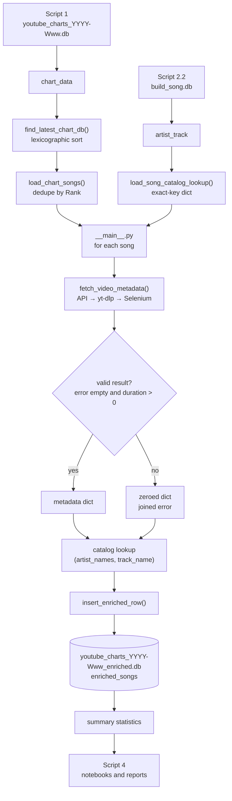
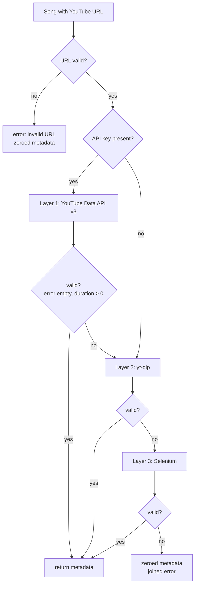

# 🎵 Script 3 — Chart Data Enrichment, Three-Layer YouTube Metadata


 


> **Pipeline position:** `1_download_chart` → `2_1_country_genre` → `2_2_song_catalog` → **`3_enrich_chart_data`** → `4_notebooks` → `5_export`


> **Execution model:** GitHub Actions, every **Monday at 15:00 UTC**. The package is environment-driven: `YOUTUBE_API_KEY` enables the API layer, and `GITHUB_ACTIONS=true` suppresses the interactive prompt.

## 📋 General Description

Script 3 is the **enrichment stage** of the YouTube Charts intelligence system. It joins three sources of information and writes one derived SQLite database per chart week:

```text
Script 1 ──► chart_data ──────┐
                              ├──► Script 3 ──► enriched_songs
Script 2.2 ─► artist_track ───┘
YouTube ─────► video metadata ┘
```

The inputs are:

1. The **latest weekly chart database** produced by Script 1 (`charts_archive/1_download-chart/databases/youtube_charts_YYYY-Www.db`, table `chart_data`).
2. The **canonical song catalog** produced by Script 2.2 (`charts_archive/2_2.build-song-catalog/build_song.db`, table `artist_track`).
3. **YouTube video metadata**, retrieved at run time through a three-layer fallback: official Data API v3 → yt-dlp → Selenium.

The output is:

```text
charts_archive/3_enrich-chart-data/
└── youtube_charts_YYYY-Www_enriched.db
    └── enriched_songs
        ├── rank, id, artist_names, track_name, periods_on_chart, views, youtube_url
        ├── duration_s, duration_ms, upload_date, likes, comment_count, audio_language
        ├── is_official_video, is_lyric_video, is_live_performance
        ├── upload_season, channel_type, is_collaboration, artist_count
        ├── region_restricted, artist_country, macro_genre, artists_found
        ├── error
        └── processed_at
```

Every chart row becomes exactly one enriched row. The table is **fully derived**: it is dropped and recreated on every run, so a re-run never appends duplicates.

### What this stage adds

| Group | Fields | Source |
| :--- | :--- | :--- |
| **Chart identity** | `rank`, `artist_names`, `track_name`, `periods_on_chart`, `views`, `youtube_url` | Script 1 `chart_data` |
| **Catalog identity** | `id`, `artist_country`, `macro_genre`, `artists_found` | Script 2.2 `artist_track` |
| **Video metadata** | `duration_s`, `duration_ms`, `upload_date`, `likes`, `comment_count`, `audio_language` | YouTube Data API, yt-dlp, Selenium |
| **Classification** | `is_official_video`, `is_lyric_video`, `is_live_performance`, `upload_season`, `channel_type`, `is_collaboration`, `artist_count`, `region_restricted` | Pure heuristics + API |
| **Diagnostics** | `error`, `processed_at` | Pipeline |

### Why three layers?

No single YouTube retrieval method is reliable enough on its own:

| Method | Strength | Weakness |
| :--- | :--- | :--- |
| **YouTube Data API v3** | Fast, structured, full metadata | Requires an API key and quota |
| **yt-dlp** | Fast, no key, multi-client rotation | YouTube bot checks and extractor changes |
| **Selenium** | Independent browser path | Slow, fragile against layout changes |

The pipeline tries them in order and stops at the first **valid** result. A result is valid only when `error` is empty and `duration_s > 0`. If every layer fails, the chart row is still written with zeroed metadata and a joined error message. Losing a chart row because YouTube was slow would be worse than storing a row with an explicit error.

### Design principles

1. **The chart row is never lost.** A metadata failure produces a row with `error`, not a skipped row.
2. **The output is derived, not cumulative.** Dropping and recreating `enriched_songs` guarantees one row per chart entry.
3. **The catalog join is exact and transparent.** The key is the raw `(artist_names, track_name)` pair. A miss is visible as `id = NULL`, not hidden behind fuzzy matching.
4. **Classification is pure.** Title/description heuristics live in one module with no I/O, so they are testable in isolation.
5. **The package is environment-driven.** There is no argument parser; behavior is controlled by `YOUTUBE_API_KEY` and `GITHUB_ACTIONS`.

---

## ✨ Key Features

### Enrichment

- **Three-layer metadata fallback** — YouTube Data API v3 → yt-dlp → Selenium.
- **Full API coverage** — duration, likes, comments, audio language, upload date, region restriction, video type, channel type, and collaboration.
- **Multi-client yt-dlp rotation** — `android` → `ios` → `android+web` → `web`.
- **Strict layer validation** — a layer succeeds only if it returns an empty `error` and `Duration (s) > 0`.
- **Catalog integration** — `id`, `artist_country`, `macro_genre`, and `artists_found` are joined from Script 2.2.
- **Graceful catalog degradation** — if the catalog is missing, the run continues with `id = NULL`, `Unknown`, `Pop`, and `0/0`.
- **25 enriched fields** plus `processed_at`.

### Classification

- **Official / lyric / live detection** from title and description keywords.
- **Collaboration detection** from title patterns plus delimiter counting.
- **Channel type classification** — `VEVO`, `Topic`, `Label/Studio`, `Artist Channel`, `User Channel`, `General`.
- **Upload season** — `Q1`–`Q4` from the ISO publish date.
- **Region restriction flag** from the API's `contentDetails.regionRestriction`.
- **Deterministic, pure functions** — no network, no database, no global state.

### Resilience

- **Invalid URL pre-validation** — empty, `None`, or non-string URLs return an error immediately.
- **Error accumulation** — every failed layer contributes to the final `error` string.
- **Row preservation** — a metadata failure never removes the chart row.
- **Driver cleanup** — Selenium always calls `driver.quit()` in a `finally` block.
- **Catalog fallback** — a missing or unreadable catalog does not abort the run.
- **Idempotent output** — `DROP TABLE IF EXISTS` + `CREATE TABLE` on every run.
- **Per-row commits** — a crash leaves the rows already processed.

### Operations

- **No AI, no prompts, no model dependencies.**
- **No mandatory secrets** — the API key is optional.
- **CI-aware** — `GITHUB_ACTIONS=true` skips the interactive prompt.
- **Stdout logging** — compatible with GitHub Actions and shell redirection.
- **Auto-created output directory** — `config.py` creates `charts_archive/3_enrich-chart-data/`.
- **Portable paths** — anchored at the repository root via `__file__`.
- **No CLI flags** — the pipeline always processes the latest chart database.

---

## 📁 Module Structure

```text
scripts/3_enrich_chart_data/                     1,859 lines / 10 files
├── __init__.py                                    52   package metadata, public API
├── __main__.py                                   322   entry point and pipeline
├── config.py                                     121   paths, environment, logger
│
├── metadata/                                   1,040
│   ├── __init__.py                               227   fallback orchestrator
│   ├── api.py                                    167   YouTube Data API v3 layer
│   ├── detector.py                               256   pure classification helpers
│   ├── selenium.py                               199   headless browser layer
│   └── yt_dlp.py                                 191   yt-dlp layer
│
└── utils/                                        324
    ├── __init__.py                                14
    └── db_utils.py                               310   SQLite read/write
```

The package directory starts with a digit, so a normal `import` statement is invalid. The supported invocation is:

```bash
python -m scripts.3_enrich_chart_data
```

`python scripts/3_enrich_chart_data/__main__.py` breaks the relative imports (`from .config import ...`) and is not supported.

> **Naming note:** the Python package is `3_enrich_chart_data` (underscores), while the archive directory is `charts_archive/3_enrich-chart-data/` (hyphens). This follows the existing repository convention.

The CI workflow lives outside the package at `.github/workflows/3_enrich-chart-data.yml`; it is not part of the Python package. 

---

## 
## 🔍 Detailed Module Analysis

### 1. Entry Point — `__main__.py`

**Purpose:** coordinate the pipeline. It locates the latest chart, loads the catalog, checks dependencies, reads the chart rows, creates the output table, enriches every song, and prints a summary. It contains no retrieval, classification, or SQL logic of its own.

**The seven phases:**

| Phase | Log label | Main action |
| :-: | :--- | :--- |
| 1 | `📂 LOCATING LATEST CHART DATABASE...` | `find_latest_chart_db()` |
| 2 | `📀 LOADING SONG CATALOG...` | `load_song_catalog_lookup()` |
| 3 | `🔧 CHECKING DEPENDENCIES...` | `_ensure_ytdlp()` |
| 4 | `📖 READING CHART DATA FROM ...` | `load_chart_songs()` |
| 5 | `🗃️ PREPARING OUTPUT DATABASE...` | `create_output_table()` |
| 6 | `🎬 ENRICHING N SONGS...` | Metadata fallback + catalog lookup + insert |
| 7 | `📊 FINAL SUMMARY:` | Counts, percentages, output path |

The core loop is deliberately small:

```python
for i, song in enumerate(songs, 1):
    url = song["YouTube URL"]
    track = song["Track Name"][:30]
    artists_csv = song.get("Artist Names", "")

    print(f"   [{i:2d}/{len(songs)}] {track:30}... ", end="", flush=True)

    metadata = fetch_video_metadata(url, artists_csv, YOUTUBE_API_KEY)

    catalog_entry = song_catalog_lookup.get((artists_csv, song["Track Name"]))
    if catalog_entry:
        song_id, artist_country, macro_genre, artists_found = catalog_entry
    else:
        song_id, artist_country, macro_genre, artists_found = None, "Unknown", "Pop", "0/0"

    row = {
        "rank": song.get("Rank"),
        "id": song_id,
        "artist_names": artists_csv,
        "track_name": song.get("Track Name"),
        "periods_on_chart": song.get("Periods on Chart"),
        "views": song.get("Views"),
        "youtube_url": url,
        "duration_s": metadata["Duration (s)"],
        "duration_ms": metadata["duration (m:s)"],
        "upload_date": metadata["upload_date"],
        "likes": metadata["likes"],
        "comment_count": metadata["comment_count"],
        "audio_language": metadata["audio_language"],
        "is_official_video": metadata["is_official_video"],
        "is_lyric_video": metadata["is_lyric_video"],
        "is_live_performance": metadata["is_live_performance"],
        "upload_season": metadata["upload_season"],
        "channel_type": metadata["channel_type"],
        "is_collaboration": metadata["is_collaboration"],
        "artist_count": metadata["artist_count"],
        "region_restricted": metadata["region_restricted"],
        "artist_country": artist_country,
        "macro_genre": macro_genre,
        "artists_found": artists_found,
        "error": metadata["error"],
    }

    insert_enriched_row(conn_out, row)
    print(_format_status_badges({**metadata, "_macro_genre": macro_genre},
                                artist_country, song_id))
    time.sleep(0.1)
```

**Dependency bootstrap:** `_ensure_ytdlp()` imports `yt_dlp` and installs it with `pip` only if the import fails. The heavier layers install their own dependencies lazily (see below).

**Status badges:** `_format_status_badges()` builds a compact line such as:

```text
(⏱️3:47 📀 👥2 🌍Ch 🆔293) → Chile, Pop
```

| Badge | Meaning |
| :--- | :--- |
| `⏱️3:47` | Duration in `m:ss` |
| `📀` | Official video |
| `📝` | Lyric video |
| `🎤` | Live performance |
| `👥2` | Collaboration with two artists |
| `🌍Ch` | Resolved country (first two characters of the country name, not an ISO code) |
| `🌐` | `Multi-country` |
| `🆔293` | Catalog ID |

If no badge is available, the function prints the first 20 characters of `error`, or `No data`.

**Interactive prompt:** the module-level entry point asks for confirmation only when the run is local and no API key is configured:

```python
if __name__ == "__main__":
    if not IN_GITHUB_ACTIONS and not YOUTUBE_API_KEY:
        logger.warning("\n⚠️  YOUTUBE_API_KEY environment variable is not set.")
        logger.warning("   Metadata will be fetched via Selenium and yt-dlp (slower).")
        answer = input("Continue anyway? (y/n): ").strip().lower()
        if answer not in ["y", "yes"]:
            logger.info("Process cancelled.")
            sys.exit(0)

    sys.exit(main())
```

This is convenient on a desktop and **dangerous in cron**: a non-interactive shell has no stdin, so `input()` raises `EOFError`. Set `GITHUB_ACTIONS=true` or provide `YOUTUBE_API_KEY` for unattended runs.

**Exit codes:**

| Code | Meaning | Emitted by |
| :-: | :--- | :--- |
| `0` | Pipeline completed | Normal path |
| `1` | Chart database missing/unreadable, chart table error, or unhandled exception | Phases 1 and 4 explicitly; other phases via traceback |
| `130` | `Ctrl+C` | Python's default `KeyboardInterrupt` behavior; not caught explicitly |

There is **no argument parser**. `sys.argv` is not read. Flags such as `--week`, `--limit`, `--dry-run`, `--force`, or `--help` do nothing; the process simply starts the pipeline.

> **Cosmetic inconsistency:** the banner prints `API → Selenium → yt-dlp`, but the actual fallback order is **API → yt-dlp → Selenium**. The banner is wrong; the code and this document describe the real order.

> **Zero-row caveat:** the summary divides by `total` (for example, `multi_country / total * 100`). If `chart_data` is empty, Phase 7 raises `ZeroDivisionError` and the process exits `1` after writing an empty table.

---

### 2. Configuration — `config.py`

**Purpose:** the single source of truth for paths, environment variables, and the shared logger.

```python
REPO_ROOT: Path = Path(__file__).parent.parent.parent

INPUT_DB_DIR: Path = REPO_ROOT / "charts_archive" / "1_download-chart" / "databases"

SONG_CATALOG_DB_PATH: Path = (
    REPO_ROOT / "charts_archive" / "2_2.build-song-catalog" / "build_song.db"
)

OUTPUT_DIR: Path = REPO_ROOT / "charts_archive" / "3_enrich-chart-data"

OUTPUT_DIR.mkdir(parents=True, exist_ok=True)
```

| Constant | Default | Meaning |
| :--- | :--- | :--- |
| `REPO_ROOT` | three levels above `config.py` | Repository root |
| `INPUT_DB_DIR` | `charts_archive/1_download-chart/databases` | Script 1 weekly databases |
| `SONG_CATALOG_DB_PATH` | `charts_archive/2_2.build-song-catalog/build_song.db` | Script 2.2 catalog |
| `OUTPUT_DIR` | `charts_archive/3_enrich-chart-data` | Enriched output directory |
| `YOUTUBE_API_KEY` | `""` | Optional Data API v3 key |
| `IN_GITHUB_ACTIONS` | `False` | True only when `GITHUB_ACTIONS == "true"` |

**Environment variables:**

```python
YOUTUBE_API_KEY: str = os.environ.get("YOUTUBE_API_KEY", "")
IN_GITHUB_ACTIONS: bool = os.environ.get("GITHUB_ACTIONS") == "true"
```

Both values are read **at import time**. Exporting the key after the module is imported does not change the already-bound constant.

**Logging:** a single logger named `3_enrich_chart_data` writes to `sys.stdout` with a plain `%(message)s` format:

```python
log = logging.getLogger("3_enrich_chart_data")
if not log.handlers:
    log.setLevel(logging.INFO)
    handler = logging.StreamHandler(sys.stdout)
    handler.setFormatter(logging.Formatter('%(message)s'))
    log.addHandler(handler)
    log.propagate = False
```

This matches Scripts 2.1 and 2.2 and keeps CI logs readable. There is no file handler; redirect stdout if you need a log file.

**Import-time side effect:** importing `config.py` creates `OUTPUT_DIR`. This is idempotent and makes a fresh clone work immediately, but tests must account for it.

---

### 3. Metadata Orchestrator — `metadata/__init__.py`

**Purpose:** define the metadata schema, enforce the validity rule, try the layers in order, and accumulate errors.

#### The metadata schema

`_empty_metadata()` is the canonical 15-field schema:

```python
{
    "Duration (s)": 0,
    "duration (m:s)": "0:00",
    "upload_date": "",
    "likes": 0,
    "comment_count": 0,
    "audio_language": "",
    "is_official_video": False,
    "is_lyric_video": False,
    "is_live_performance": False,
    "upload_season": "unknown",
    "channel_type": "unknown",
    "is_collaboration": False,
    "artist_count": 1,
    "region_restricted": False,
    "error": "",
}
```

| Field | Type | Default | Filled by |
| :--- | :--- | :--- | :--- |
| `Duration (s)` | int | `0` | API, yt-dlp, Selenium |
| `duration (m:s)` | str | `"0:00"` | API, yt-dlp, Selenium |
| `upload_date` | str | `""` | API, yt-dlp, Selenium |
| `likes` | int | `0` | API, yt-dlp |
| `comment_count` | int | `0` | API only |
| `audio_language` | str | `""` | API only |
| `is_official_video` | bool | `False` | All layers |
| `is_lyric_video` | bool | `False` | All layers |
| `is_live_performance` | bool | `False` | All layers |
| `upload_season` | str | `"unknown"` | API, yt-dlp, Selenium |
| `channel_type` | str | `"unknown"` | API, yt-dlp, Selenium |
| `is_collaboration` | bool | `False` | All layers |
| `artist_count` | int | `1` | All layers |
| `region_restricted` | bool | `False` | API only |
| `error` | str | `""` | All layers on failure |

The schema is **duplicated by design** in `api.py`, `yt_dlp.py`, and `selenium.py`. Adding a field requires editing all four locations plus the output row and the SQLite DDL. See [Configuration and customization](#-configuration-and-customization).

#### The validity rule

```python
def _is_valid_result(metadata: dict) -> bool:
    if not metadata:
        return False
    if metadata.get("error"):
        return False
    if metadata.get("Duration (s)", 0) <= 0:
        return False
    return True
```

A layer is accepted only if:

1. The dict is non-empty.
2. `error` is empty.
3. `Duration (s)` is greater than zero.

This rejects empty dicts, bot-check responses, and partial Selenium results where the duration selector failed. It also means a legitimate zero-duration video is treated as a failure; the row is written with zeroed metadata and an error.

#### The fallback flow

```python
metadata = _empty_metadata()
errors = []

if not url or not isinstance(url, str) or not url.strip():
    metadata["error"] = "Invalid input: URL is empty, None, or not a string"
    return metadata

# Layer 1: API (only when a key is provided)
if api_key:
    try:
        api_metadata = fetch_metadata_via_api(url, artists_csv, api_key)
        if _is_valid_result(api_metadata):
            return api_metadata
        errors.append(api_metadata.get("error", "API returned incomplete data"))
    except Exception as e:
        errors.append(f"API layer exception: {e}")

# Layer 2: yt-dlp
try:
    ytdlp_metadata = fetch_metadata_via_ytdlp(url, artists_csv)
    if _is_valid_result(ytdlp_metadata):
        metadata.update(ytdlp_metadata)
        return metadata
    errors.append(ytdlp_metadata.get("error", "yt-dlp returned no data (empty dict)"))
except Exception as e:
    errors.append(f"yt-dlp layer exception: {e}")

# Layer 3: Selenium
try:
    sel_metadata = fetch_metadata_via_selenium(url, artists_csv)
    if _is_valid_result(sel_metadata):
        metadata.update(sel_metadata)
        return metadata
    errors.append(sel_metadata.get("error", "Selenium returned no data"))
except Exception as e:
    errors.append(f"Selenium layer exception: {e}")

if errors:
    metadata["error"] = " | ".join(errors)

return metadata
```

**Error accumulation example:**

```text
API error: quota exceeded | yt-dlp failed: Sign in to confirm you're not a bot | Selenium error: ...
```

The `error` column in SQLite receives this string verbatim. It is useful for diagnosis but can be long; see [Known limitations](#-known-limitations-and-future-improvements).

> **Docstring typo:** the module notes say a layer succeeds when it returns a **non-empty** `error` field. The code (and the correct rule) requires an **empty** `error` field. Trust the code.

---

### 4. Layer 1 — YouTube Data API v3 (`metadata/api.py`)

**Purpose:** retrieve full video metadata from the official API. This is the preferred layer because it is fast, structured, and does not depend on page layout.

**Requirements:**

- `YOUTUBE_API_KEY` set in the environment.
- `google-api-python-client` installed.
- `isodate` installed (the layer auto-installs it if missing).

> **Important:** the module docstring says `googleapiclient` is auto-installed. It is not. Only `isodate` is auto-installed. If `googleapiclient` is missing, the import raises and the orchestrator records `API layer exception: ...`, then falls back to yt-dlp.

**Video ID extraction:**

```python
vid_match = re.search(r"(?:v=|\/)([0-9A-Za-z_-]{11})", url)
if not vid_match:
    metadata["error"] = "API: could not extract video_id from URL"
    return metadata

video_id = vid_match.group(1)
```

This handles `watch?v=...`, `youtu.be/...`, and path-style URLs.

**API request:**

```python
youtube = build("youtube", "v3", developerKey=api_key)
response = youtube.videos().list(
    part="snippet,contentDetails,statistics",
    id=video_id,
).execute()
```

**Parsing:**

| Field | API source | Transformation |
| :--- | :--- | :--- |
| `Duration (s)` | `contentDetails.duration` (ISO 8601) | `isodate.parse_duration(...).total_seconds()` |
| `duration (m:s)` | Derived | `f"{dur_s // 60}:{dur_s % 60:02d}"` |
| `likes` | `statistics.likeCount` | `int(...)`, default `0` |
| `comment_count` | `statistics.commentCount` | `int(...)`, default `0` |
| `audio_language` | `snippet.defaultAudioLanguage` | First two characters, uppercase |
| `region_restricted` | `contentDetails.regionRestriction` | True if `blocked` or `allowed` exists |
| `upload_date` | `snippet.publishedAt` | First 10 characters |
| `upload_season` | Derived from `upload_date` | `Q1`–`Q4` |
| `is_official_video` | `snippet.title` + `description` | Keyword heuristic |
| `is_lyric_video` | Title + description | Keyword heuristic |
| `is_live_performance` | Title + description | Keyword heuristic |
| `channel_type` | `snippet.channelTitle` | Classifier |
| `is_collaboration` | Title + `artists_csv` | Regex + delimiter count |
| `artist_count` | `artists_csv` | Delimiter count, capped at 10 |

**Error handling:** any exception inside the request/parse block becomes `API error: ...` in the returned dict. The orchestrator treats it as a failed layer and continues.

**Quota:** `videos.list` costs **1 unit per call**. A 100-song chart costs about 100 units, well below the default 10,000 units/day. Repeated runs and retries consume additional quota.

**Caveats:**

- Hidden like/comment counts are indistinguishable from real zeroes: missing keys become `0`.
- `defaultAudioLanguage` may be absent even when the video has audio.
- `is_special_version` is returned by the detector but is **not** stored in the output table.
- The `region_restricted` logic is duplicated inline; `detect_region_restrictions()` in `detector.py` is unused.

---

### 5. Layer 2 — yt-dlp (`metadata/yt_dlp.py`)

**Purpose:** retrieve metadata without a browser and without an API key. It is the preferred fallback because it is significantly faster and lighter than Selenium.

**Client rotation:** YouTube treats player clients differently; a request that fails for one client often succeeds for another.

| Attempt | `player_client` | Why |
| :-: | :--- | :--- |
| 1 | `android` | Often bypasses web bot checks |
| 2 | `ios` | Independent client fingerprint |
| 3 | `android` + `web` | Mixed fallback |
| 4 | `web` | Last standard client |

```python
client_options = [
    {"player_client": ["android"]},
    {"player_client": ["ios"]},
    {"player_client": ["android", "web"]},
    {"player_client": ["web"]},
]
```

**Configuration:**

```python
ydl_config = {
    "quiet": True,
    "no_warnings": True,
    "skip_download": True,
    "ignoreerrors": False,
    "extract_flat": False,
    "user_agent": (
        "Mozilla/5.0 (Windows NT 10.0; Win64; x64) "
        "AppleWebKit/537.36 (KHTML, like Gecko) Chrome/120.0.0.0 Safari/537.36"
    ),
    "extractor_retries": 5,
    "fragment_retries": 5,
    "retry_sleep_functions": {"extractor": 2},
    "sleep_interval": 2,
    "sleep_interval_requests": 2,
    **opts,
}
```

**Strict validation:** yt-dlp can return an empty dict or a dict without `duration` when YouTube blocks the request (for example, "Sign in to confirm you're not a bot"). The layer rejects those and tries the next client:

```python
if info and info.get("duration") is not None:
    break
else:
    last_error = "yt-dlp returned incomplete info (missing duration)"
    info = None
```

A result with `duration = 0` passes this check (it is not `None`), but the orchestrator's `Duration (s) > 0` rule rejects it and falls through to Selenium.

**Date conversion:** yt-dlp returns `upload_date` as `YYYYMMDD`; the layer converts it to `YYYY-MM-DD` before calling `parse_upload_season()`.

**Fields produced:**

| Field | yt-dlp source |
| :--- | :--- |
| `Duration (s)` | `info["duration"]` |
| `duration (m:s)` | Derived |
| `upload_date` | `info["upload_date"]` converted to ISO |
| `upload_season` | Derived from the ISO date |
| `likes` | `info["like_count"]` (may be `None`) |
| `is_official_video` | `detect_video_type(title, description)` |
| `is_lyric_video` | Same |
| `is_live_performance` | Same |
| `channel_type` | `detect_channel_type(info["channel"])` |
| `is_collaboration` | `detect_collaboration(title, artists_csv)` |
| `artist_count` | Same |

**Not produced:** `comment_count`, `audio_language`, and `region_restricted` remain at their defaults (`0`, `""`, `False`).

**Dependency behavior:** if `yt_dlp` is missing, it installs it. Then, on **every call**, it runs:

```python
subprocess.run(
    [sys.executable, "-m", "pip", "install", "--upgrade", "yt-dlp"],
    capture_output=True,
    check=False,
)
```

This keeps the extractor current, because YouTube changes frequently, but it is a major performance cost: with 100 songs, the pipeline can attempt 100 pip upgrades. In CI or offline environments, preinstall and pin yt-dlp, and consider removing this per-call upgrade. See [Performance reference](#-performance-reference).

**Caveats:**

- `like_count` can be `None`; SQLite stores it as `NULL`, not `0`.
- `retry_sleep_functions` is not a documented yt-dlp option; it may be ignored by the installed version.
- The 2-second sleeps are applied per request, which adds up on a full chart.
- No `comment_count`, `audio_language`, or region restriction.

---

### 6. Layer 3 — Selenium (`metadata/selenium.py`)

**Purpose:** extract basic metadata with a headless Chromium browser when the API and yt-dlp both fail.

> **Docstring inconsistency:** the module says it is "Layer 2" and that it runs "before falling back to yt-dlp". The actual orchestrator order is **API → yt-dlp → Selenium**, so Selenium is Layer 3 and runs **after** yt-dlp. The code is authoritative.

**Setup:**

```python
chrome_options = Options()
chrome_options.add_argument("--headless=new")
chrome_options.add_argument("--no-sandbox")
chrome_options.add_argument("--disable-dev-shm-usage")
chrome_options.add_argument("--disable-gpu")
chrome_options.add_argument("--window-size=1920,1080")
chrome_options.add_argument(
    "--user-agent=Mozilla/5.0 (Windows NT 10.0; Win64; x64) "
    "AppleWebKit/537.36 (KHTML, like Gecko) Chrome/120.0.0.0 Safari/537.36"
)
```

The layer auto-installs `selenium` and `webdriver-manager` if missing, then obtains ChromeDriver with `ChromeDriverManager().install()`. Chrome or Chromium must be installed on the host.

**Selectors:**

| Data | Selector | Notes |
| :--- | :--- | :--- |
| Title | `h1.ytd-video-primary-info-renderer` | Old YouTube layout selector; may fail on current pages |
| Duration | `span.ytp-time-duration` | Player progress label |
| Channel | `a.ytd-channel-name` | Used for channel type |
| Upload date | `meta[itemprop='datePublished']` | Structured data; more stable |

**Parsing:**

```python
parts = dur_el.text.split(":")
if len(parts) == 2:
    duration_s = int(parts[0]) * 60 + int(parts[1])
elif len(parts) == 3:
    duration_s = int(parts[0]) * 3600 + int(parts[1]) * 60 + int(parts[2])
else:
    duration_s = 0
```

`duration (m:s)` is always total minutes and seconds, even when the source showed `h:mm:ss`.

**Fields produced:**

| Field | Selenium source |
| :--- | :--- |
| `Duration (s)` | `span.ytp-time-duration` |
| `duration (m:s)` | Derived |
| `upload_date` | `meta[itemprop='datePublished']` |
| `upload_season` | Derived |
| `is_official_video` | Title heuristic |
| `is_lyric_video` | Title heuristic |
| `is_live_performance` | Title heuristic |
| `channel_type` | Channel name |
| `is_collaboration` | Title + `artists_csv` |
| `artist_count` | `artists_csv` |

**Not produced:** `likes`, `comment_count`, `audio_language`, `region_restricted`.

**Cleanup:** the driver is always closed in a `finally` block, which prevents zombie Chrome processes on CI runners:

```python
finally:
    if driver is not None:
        try:
            driver.quit()
        except Exception:
            pass
```

**Caveats:**

- The title selector is from an older YouTube layout. If it is not found within 10 seconds, the layer raises a timeout, records an error, and returns zeroed metadata.
- Because the orchestrator requires `Duration (s) > 0`, a page that loads but whose duration selector fails is treated as a failed layer.
- `ChromeDriverManager().install()` requires network access and a compatible Chrome version. It can fail behind a proxy or in a minimal container.
- `--no-sandbox` is common in CI but reduces process isolation. Use it only where required.
- Selenium is the slowest layer: roughly 5–10 seconds per video plus driver startup.

---

### 7. Classification Helpers — `metadata/detector.py`

**Purpose:** pure, deterministic functions shared by all three layers. This module contains **no I/O**, **no network calls**, and **no database access**.

#### `detect_video_type(title, description="")`

Scans the title and description for keyword families:

| Flag | Keywords (examples) |
| :--- | :--- |
| `is_official_video` | `official`, `video oficial`, `official video`, `official music video`, `vídeo oficial` |
| `is_lyric_video` | `lyric`, `lyrics`, `letra`, `letras`, `karaoke`, `lyric video`, `letra oficial` |
| `is_live_performance` | `live`, `en vivo`, `concert`, `performance`, `show`, `live performance`, `en concierto`, `directo` |
| `is_special_version` | `remix`, `version`, `edit`, `mix`, `bootleg`, `rework`, `sped up`, `slowed`, `reverb`, `acoustic`, `acústico`, `piano version`, `instrumental` |

`is_special_version` is returned by the function but **not stored** in `enriched_songs`; the output row and DDL do not include it.

**Known false positives:** the checks are substring-based. `"official"` matches `"unofficial"`, `"live"` matches `"delivery"`, and `"show"` matches `"shower"`. Treat the flags as signals, not ground truth.

#### `detect_collaboration(title, artists_csv)`

Title patterns:

```python
collab_patterns = [
    r"\sft\.\s", r"\sfeat\.\s", r"\sfeaturing\s", r"\sft\s",
    r"\scon\s", r"\swith\s", r"\s&\s", r"\sx\s", r"\s×\s",
    r"\(feat\.", r"\(ft\.", r"\(with", r"\[feat\.", r"\[ft\.",
]
```

Artist count:

```python
artist_count = artists_csv.count("&") + artists_csv.count(",") + 1
```

- If `artists_csv` is empty, the count starts at `1` and is increased by `" & "` and `" x "` occurrences when a collaboration pattern matched.
- The result is capped at **10** to prevent outliers from malformed CSV strings.

**Inconsistency:** a title with `feat.` but a CSV without `&` or `,` can produce `is_collaboration = True` and `artist_count = 1`. The two signals are related but not identical.

#### `detect_channel_type(channel_title)`

The checks are ordered; the first match wins:

| Priority | Category | Trigger examples |
| :-: | :--- | :--- |
| 1 | `VEVO` | `vevo` in the channel name |
| 2 | `Topic` | `topic` in the channel name |
| 3 | `Label/Studio` | `records`, `music`, `label`, `entertainment`, `studios`, `production`, `presents`, `network` |
| 4 | `Artist Channel` | `official`, `oficial`, `artist`, `band`, `singer`, `musician`, `rapper`, `dj`, `producer` |
| 5 | `User Channel` | `channel`, `tv`, `hd`, `video`, `videos` |
| 6 | `Artist Channel` | Channel name contains `" - "` or `" \| "` |
| 7 | `General` | No match |
| — | `unknown` | Empty channel title |

Because `"music"` is checked before `"artist"`, a channel named `"Artist Music"` becomes `Label/Studio`, not `Artist Channel`. This is a deliberate but coarse ordering.

#### `parse_upload_season(publish_date)`

```python
date = datetime.strptime(publish_date[:10], "%Y-%m-%d")
quarter = (date.month - 1) // 3 + 1
return {"upload_season": f"Q{quarter}"}
```

| Months | Season |
| :--- | :--- |
| January–March | `Q1` |
| April–June | `Q2` |
| July–September | `Q3` |
| October–December | `Q4` |
| Invalid or missing date | `unknown` |

#### `detect_region_restrictions(content_details)`

```python
region = content_details.get("regionRestriction", {})
return {
    "region_restricted": bool(region.get("blocked") or region.get("allowed"))
}
```

This function is **unused** in the current pipeline. The API layer duplicates the logic inline; yt-dlp and Selenium do not set the field.

---

### 8. Database Utilities — `utils/db_utils.py`

**Purpose:** all SQLite operations. This module contains no metadata retrieval and no classification logic.

#### `find_latest_chart_db()`

```python
if not INPUT_DB_DIR.exists():
    raise FileNotFoundError(f"Input directory not found: {INPUT_DB_DIR}")

db_files = list(INPUT_DB_DIR.glob("*.db"))
if not db_files:
    raise FileNotFoundError(f"No .db files found in {INPUT_DB_DIR}")

db_files.sort(key=lambda p: p.name, reverse=True)
return db_files[0]
```

- It sorts **all** `.db` files by filename, descending.
- It does **not** filter on `youtube_charts_*.db`. Any `.db` file in the input directory can win.
- Lexicographic order is correct only when weeks are zero-padded (`2026-W09` < `2026-W10`). Script 1 guarantees this.
- If an enriched output or a catalog database is copied into the input directory, it can be selected by mistake.

#### `load_chart_songs(db_path)`

```python
cursor.execute("""
    SELECT * FROM chart_data
    WHERE rowid IN (
        SELECT MIN(rowid) FROM chart_data GROUP BY Rank
    )
    ORDER BY Rank
""")
```

- Verifies that `chart_data` exists.
- Deduplicates by `Rank`, keeping the first `rowid` for each rank. This guards against a week written twice by Script 1.
- Requires the columns `Rank`, `Artist Names`, `Track Name`, and `YouTube URL` **only when at least one row exists**. An empty table returns `[]` without a column check.
- `GROUP BY Rank` also collapses multiple `NULL` ranks into one row.
- It does not filter `is_synthetic`. Synthetic fallback rows from Script 1 can enter the enriched output.

#### `load_song_catalog_lookup()`

```python
cursor.execute("""
    SELECT artist_names, track_name, id, artist_country, macro_genre, artists_found
    FROM artist_track
""")

for artist_names, track_name, song_id, country, genre, found in rows:
    catalog_lookup[(artist_names, track_name)] = (song_id, country, genre, found)
```

- The key is the **exact** raw `(artist_names, track_name)` pair. There is no lowercasing, trimming, or Unicode normalization.
- If the catalog file is missing, the function logs three warnings and returns `{}`. The pipeline continues with `id = NULL`, `Unknown`, `Pop`, and `0/0`.
- If the `artist_track` table is missing, it logs an error and returns `{}`.
- If SQLite raises an error, it logs the error and returns `{}`.
- If the catalog contains duplicate keys, the last row wins in the dictionary.

#### `create_output_table(conn)`

```sql
DROP TABLE IF EXISTS enriched_songs;

CREATE TABLE enriched_songs (
    rank INTEGER,
    id INTEGER UNIQUE,
    artist_names TEXT,
    track_name TEXT,
    periods_on_chart INTEGER,
    views INTEGER,
    youtube_url TEXT,
    duration_s INTEGER,
    duration_ms TEXT,
    upload_date TEXT,
    likes INTEGER,
    comment_count INTEGER,
    audio_language TEXT,
    is_official_video BOOLEAN,
    is_lyric_video BOOLEAN,
    is_live_performance BOOLEAN,
    upload_season TEXT,
    channel_type TEXT,
    is_collaboration BOOLEAN,
    artist_count INTEGER,
    region_restricted BOOLEAN,
    artist_country TEXT,
    macro_genre TEXT,
    artists_found TEXT,
    error TEXT,
    processed_at TIMESTAMP DEFAULT CURRENT_TIMESTAMP,
    FOREIGN KEY (id) REFERENCES artist_track(id)
);

CREATE INDEX idx_country ON enriched_songs(artist_country);
CREATE INDEX idx_genre ON enriched_songs(macro_genre);
CREATE INDEX idx_upload_date ON enriched_songs(upload_date);
CREATE INDEX idx_error ON enriched_songs(error);
```

**Schema notes:**

- `id` is the **catalog ID**, not a primary key for the enriched row. It is `UNIQUE` so a catalog song cannot appear twice, but it allows multiple `NULL` values (SQLite treats `NULL`s as distinct in a `UNIQUE` index). This is what lets unmatched songs coexist.
- The `FOREIGN KEY` clause is **declarative only**. SQLite does not enforce foreign keys unless `PRAGMA foreign_keys = ON`, and the referenced `artist_track` table lives in a different database file anyway. Do not rely on it.
- `duration_ms` is a **misnomer**: it stores `"m:ss"` text, not milliseconds.
- `processed_at` uses SQLite's `CURRENT_TIMESTAMP`, which is UTC.
- There is no `week_id` column. The week is encoded in the filename only.
- There is no `previous_rank`, `views_raw`, `growth`, `download_date`, `download_time`, `timestamp`, or `is_synthetic`. Script 3 intentionally projects a subset of `chart_data`.

#### `insert_enriched_row(conn, row)`

```python
cursor.execute("""
    INSERT INTO enriched_songs (
        rank, id, artist_names, track_name, periods_on_chart, views, youtube_url,
        duration_s, duration_ms, upload_date, likes, comment_count,
        audio_language, is_official_video, is_lyric_video, is_live_performance,
        upload_season, channel_type, is_collaboration, artist_count,
        region_restricted, artist_country, macro_genre,
        artists_found, error
    ) VALUES (?, ?, ?, ?, ?, ?, ?, ?, ?, ?, ?, ?, ?, ?, ?, ?, ?, ?, ?, ?, ?, ?, ?, ?, ?)
""", (...))
conn.commit()
```

- Exactly **25** values are bound; `processed_at` uses its default.
- The insert commits **per row**. This preserves progress but is slower than a single batch transaction.
- If two chart rows resolve to the same catalog `id`, the second insert raises `UNIQUE constraint failed: enriched_songs.id` and aborts the pipeline. See [Idempotency and transactional behavior](#-idempotency-and-transactional-behavior).

---

### 9. Package API — `__init__.py` and `utils/__init__.py`

The package root exposes:

```python
__version__ = "1.0.0"

from .metadata import fetch_video_metadata

__all__ = [
    "__version__",
    "fetch_video_metadata",
]
```

`utils/__init__.py` documents the subpackage and sets `__all__ = []`; it does not re-export the database functions. Import them explicitly:

```python
from .utils.db_utils import (
    create_output_table,
    find_latest_chart_db,
    insert_enriched_row,
    load_chart_songs,
    load_song_catalog_lookup,
)
```

Because the package name starts with a digit, use `importlib.import_module("scripts.3_enrich_chart_data")` for programmatic access, or run it with `python -m`.

---

## 📊 Data Flow



### Request lifecycle in words

1. **Locate the chart.** `find_latest_chart_db()` scans `charts_archive/1_download-chart/databases/` and picks the lexicographically highest `.db` filename.
2. **Load the catalog.** The entire `artist_track` table becomes a dictionary keyed by the exact raw `(artist_names, track_name)` pair. A missing catalog produces an empty dictionary and a warning, not a failure.
3. **Check yt-dlp.** `_ensure_ytdlp()` imports it or installs it with pip.
4. **Read the chart.** `load_chart_songs()` verifies `chart_data`, deduplicates by `Rank`, and returns a list of dictionaries ordered by rank.
5. **Prepare the output.** `create_output_table()` opens (or creates) `youtube_charts_YYYY-Www_enriched.db` and drops/recreates `enriched_songs`.
6. **Enrich each song.** For every row, the pipeline calls `fetch_video_metadata()`, looks up the catalog, assembles a 25-field row, inserts it, prints a status line, and sleeps 100 ms.
7. **Summarize.** Phase 7 counts total rows, multi-country collaborations, distinct countries, distinct genres, unknown countries, metadata errors, and rows with a catalog ID.
8. **Exit.** The process returns `0`. A failure in Phases 1 or 4 returns `1`; other failures propagate as tracebacks.

---

## 🗃 Data Model and Schemas

### Source: Script 1 `chart_data`

Script 3 reads the full table but only uses six columns in the output. The complete Script 1 schema is:

| Column | Type | Used by Script 3? | Notes |
| :--- | :--- | :---: | :--- |
| `Rank` | INTEGER | ✅ | Chart position; deduplication key |
| `Previous Rank` | INTEGER | ❌ | Not projected |
| `Track Name` | TEXT | ✅ | Catalog key and output |
| `Artist Names` | TEXT | ✅ | Catalog key and output |
| `Periods on Chart` | INTEGER | ✅ | Output |
| `Views` | INTEGER | ✅ | Output |
| `Views Raw` | TEXT | ❌ | Not projected |
| `Growth` | TEXT | ❌ | Not projected |
| `YouTube URL` | TEXT | ✅ | Metadata input and output |
| `download_date` | TEXT | ❌ | Not projected |
| `download_time` | TEXT | ❌ | Not projected |
| `week_id` | TEXT | ❌ | Not projected; week is in the filename |
| `timestamp` | TEXT | ❌ | Not projected |
| `is_synthetic` | INTEGER | ❌ | **Not filtered**; synthetic rows can enter |

> **Data quality warning:** Script 3 does not filter `is_synthetic = 1`. If Script 1 wrote a synthetic fallback chart, those placeholder rows are enriched and written to `enriched_songs` just like real rows. Check Script 1's fallback policy before relying on a run.

### Source: Script 2.2 `artist_track`

```sql
CREATE TABLE artist_track (
    id             INTEGER PRIMARY KEY AUTOINCREMENT,
    artist_names   VARCHAR(200) NOT NULL,
    track_name     VARCHAR(200) NOT NULL,
    artist_country TEXT NOT NULL,
    macro_genre    TEXT NOT NULL,
    artists_found  TEXT
)
```

| Column | Meaning | Script 3 use |
| :--- | :--- | :--- |
| `id` | Catalog surrogate key | Written as `enriched_songs.id` |
| `artist_names` | Raw chart artist string | First half of the exact lookup key |
| `track_name` | Raw chart title | Second half of the exact lookup key |
| `artist_country` | Resolved country, `Multi-country`, or `Unknown` | Output |
| `macro_genre` | Resolved genre, `Multi-genre`, or `Pop` | Output |
| `artists_found` | `matched/total`, e.g. `2/3` | Output |

Script 3 does **not** modify this table. It opens the catalog with a normal read-write connection but issues only `SELECT` statements.

### Target: `enriched_songs`

The full DDL is shown in [Database Utilities](#8-database-utilities--utilsdb_utilspy). The column semantics are:

| Column | Type | Meaning | Source |
| :--- | :--- | :--- | :--- |
| `rank` | INTEGER | Chart position | Script 1 |
| `id` | INTEGER UNIQUE | Catalog ID; `NULL` when unmatched | Script 2.2 |
| `artist_names` | TEXT | Raw chart artist string | Script 1 |
| `track_name` | TEXT | Raw chart title | Script 1 |
| `periods_on_chart` | INTEGER | Weeks on chart | Script 1 |
| `views` | INTEGER | Chart view count | Script 1 |
| `youtube_url` | TEXT | Video URL | Script 1 |
| `duration_s` | INTEGER | Duration in seconds | Metadata |
| `duration_ms` | TEXT | Duration as `"m:ss"` (misnamed) | Metadata |
| `upload_date` | TEXT | `YYYY-MM-DD` | Metadata |
| `likes` | INTEGER | Like count, when available | API / yt-dlp |
| `comment_count` | INTEGER | Comment count, API only | API |
| `audio_language` | TEXT | Two-letter language, API only | API |
| `is_official_video` | BOOLEAN | Official-video heuristic | Metadata |
| `is_lyric_video` | BOOLEAN | Lyric-video heuristic | Metadata |
| `is_live_performance` | BOOLEAN | Live-performance heuristic | Metadata |
| `upload_season` | TEXT | `Q1`–`Q4` or `unknown` | Metadata |
| `channel_type` | TEXT | Channel classification | Metadata |
| `is_collaboration` | BOOLEAN | Collaboration heuristic | Metadata |
| `artist_count` | INTEGER | Delimiter-based count, capped at 10 | Metadata |
| `region_restricted` | BOOLEAN | Geo-restriction flag, API only | API |
| `artist_country` | TEXT | Catalog country | Script 2.2 |
| `macro_genre` | TEXT | Catalog genre | Script 2.2 |
| `artists_found` | TEXT | Catalog match ratio | Script 2.2 |
| `error` | TEXT | Joined layer errors; empty on success | Pipeline |
| `processed_at` | TIMESTAMP | Row insertion time (UTC) | SQLite default |

### Field provenance matrix

| Field group | API | yt-dlp | Selenium | Unmatched catalog |
| :--- | :-: | :-: | :-: | :-: |
| `duration_s`, `duration_ms` | ✅ | ✅ | ✅ (if selector works) | — |
| `upload_date`, `upload_season` | ✅ | ✅ | ✅ (if meta tag works) | — |
| `likes` | ✅ | ✅ (may be `NULL`) | ❌ | — |
| `comment_count` | ✅ | ❌ | ❌ | — |
| `audio_language` | ✅ | ❌ | ❌ | — |
| `region_restricted` | ✅ | ❌ | ❌ | — |
| Video type flags | ✅ | ✅ | ✅ | — |
| `channel_type` | ✅ | ✅ | ✅ (if selector works) | — |
| `is_collaboration`, `artist_count` | ✅ | ✅ | ✅ | — |
| `id`, `artist_country`, `macro_genre`, `artists_found` | — | — | — | `NULL`, `Unknown`, `Pop`, `0/0` |

### Schema notes and caveats

- **`id` is not a row primary key.** It is the catalog ID and is declared `UNIQUE`. Multiple `NULL`s are allowed; duplicate non-`NULL` values abort the run.
- **No `week_id` column.** The week is only in the filename (`youtube_charts_2026-W48_enriched.db`). If the file is renamed, provenance is lost.
- **No `is_synthetic` column.** Synthetic chart rows are not marked in the output.
- **`duration_ms` is text.** It contains `"m:ss"`, not milliseconds. The name is historical.
- **The foreign key is not enforced.** SQLite ignores it by default, and the referenced table is in a different database.
- **`processed_at` is UTC.** SQLite's `CURRENT_TIMESTAMP` does not use the host timezone.
- **The output is a projection.** `Previous Rank`, `Views Raw`, `Growth`, and the Script 1 ingestion metadata are intentionally dropped.

---

## 🔁 The Three-Layer Fallback Strategy



### Acceptance criteria

| Condition | Result |
| :--- | :--- |
| Empty, `None`, or non-string URL | Immediate error; no layer is tried |
| Layer returns empty dict | Layer rejected |
| Layer returns a non-empty `error` | Layer rejected |
| `Duration (s)` is `0`, negative, or missing | Layer rejected |
| Layer returns valid data | Accepted; later layers are skipped |
| All layers fail | Zeroed dict with `" \| "`-joined errors |

### Layer comparison

| Aspect | API (Layer 1) | yt-dlp (Layer 2) | Selenium (Layer 3) |
| :--- | :--- | :--- | :--- |
| **Speed** | Fast | Medium | Slow |
| **Requires** | API key, `googleapiclient`, `isodate` | `yt-dlp` | Chrome, `selenium`, `webdriver-manager` |
| **Full metadata** | ✅ | Partial | Basic |
| **Likes** | ✅ | ✅ (may be `NULL`) | ❌ |
| **Comments** | ✅ | ❌ | ❌ |
| **Audio language** | ✅ | ❌ | ❌ |
| **Region restriction** | ✅ | ❌ | ❌ |
| **Bot resistance** | High (official) | Medium (client rotation) | Low–medium |
| **Layout fragility** | Low | Medium | High |
| **Typical failure** | Missing key, quota, hidden stats | "Sign in to confirm", extractor changes | Selector timeout, driver download |

### Worked examples

| Scenario | Layer 1 | Layer 2 | Layer 3 | Final result |
| :--- | :--- | :--- | :--- | :--- |
| API key valid, video public | ✅ | skipped | skipped | Full metadata |
| No API key | skipped | ✅ | skipped | Most metadata, no comments/audio/region |
| API quota exhausted | ❌ | ✅ | skipped | yt-dlp metadata |
| API fails, yt-dlp blocked | ❌ | ❌ | ✅ | Basic metadata |
| All layers fail | ❌ | ❌ | ❌ | Zeroed metadata + joined error |
| Invalid URL | — | — | — | Zeroed metadata + `Invalid input` |
| Video is a live stream with duration 0 | ❌ | ❌ | ❌ | Zeroed metadata; duration rule rejects all |

### Error accumulation

The final `error` is a pipe-separated concatenation of every layer's failure:

```text
API error: quota exceeded | yt-dlp failed: Sign in to confirm you're not a bot | Selenium error: Message: timeout
```

This is stored verbatim in `enriched_songs.error`. Empty `error` means the row has valid metadata from one of the layers. Because the successful layer's fields are merged into the zeroed dict, fields that the layer does not provide remain at their defaults.

### Why not Selenium first?

Selenium is the slowest and most fragile layer. It depends on Chrome, ChromeDriver, a page layout that changes frequently, and a 10-second title wait. yt-dlp is much faster, lighter, and easier to run in CI. The API is faster and more complete than both. The order is therefore a direct trade-off between **data quality**, **speed**, and **resilience**.

### API quota and rate limits

- `videos.list` costs 1 unit per call.
- A 100-song chart costs about 100 units.
- The default daily quota is 10,000 units, so roughly 100 full-chart runs per day.
- The pipeline does not inspect quota errors specially; a quota failure is just an API error and the fallback continues.
- There is a fixed `time.sleep(0.1)` between songs, which is a courtesy delay, not a rate-limit guarantee.

---

## 🧠 Classification Heuristics

The implementation lives in `metadata/detector.py`; this section summarizes the decision rules and their known edge cases.

### Video type

| Flag | Search space | Example matches | Example false positives |
| :--- | :--- | :--- | :--- |
| `is_official_video` | Title + description | `Official Video`, `Video Oficial` | `Unofficial remix` |
| `is_lyric_video` | Title + description | `Lyric Video`, `Letra Oficial` | `Lyrics in description` (intended) |
| `is_live_performance` | Title + description | `Live`, `En Vivo`, `Concert` | `Delivery`, `Shower` |
| `is_special_version` | Title only | `Remix`, `Sped Up`, `Acoustic` | Not stored in the output |

### Collaboration

| Input | `is_collaboration` | `artist_count` | Why |
| :--- | :-: | :-: | :--- |
| `"A feat. B"`, `"A, B"` | ✅ | 2 | `feat.` pattern + one comma |
| `"A & B"`, `"A & B"` | ✅ | 2 | `&` pattern + one ampersand |
| `"A x B"`, `"A x B"` | ✅ | 1 | `x` pattern, but no `&` or `,` in the CSV |
| `"A"`, `"A"` | ❌ | 1 | No pattern, no delimiter |
| `"A, B, C"`, `"A, B, C"` | ❌ | 3 | Count is correct, but no collaboration pattern in the title |
| `"A feat. B, C, D"`, `"A, B, C, D"` | ✅ | 4 | Pattern + three delimiters |
| 12 delimited artists | — | 10 | Capped at 10 |

### Channel type

| Channel title | Result | Why |
| :--- | :--- | :--- |
| `ArtistVEVO` | `VEVO` | First check |
| `Artist - Topic` | `Topic` | Second check |
| `Universal Music Group` | `Label/Studio` | `music` |
| `Artist Official` | `Artist Channel` | `official` |
| `Fan TV` | `User Channel` | `tv` (no earlier keyword) |
| `Beyoncé - Extra` | `Artist Channel` | Separator fallback |
| `Some Name` | `General` | No match |
| `""` | `unknown` | Empty input |

### Upload season

| Month | Season |
| :--- | :--- |
| 1–3 | `Q1` |
| 4–6 | `Q2` |
| 7–9 | `Q3` |
| 10–12 | `Q4` |
| Invalid/missing | `unknown` |

### Region restriction

A video is flagged when the API's `contentDetails.regionRestriction` contains either a `blocked` or an `allowed` list. An empty object, a missing object, or a non-API layer produces `False`. The standalone `detect_region_restrictions()` helper is currently unused.

### Practical interpretation

These are **heuristics**, not labels from YouTube. They are useful for aggregate analysis (for example, "what share of the chart is official videos?") but should not be treated as ground truth for individual rows. The substring checks are intentionally simple and fast; improving them is a good contribution area.

---

## 🔒 Idempotency and Transactional Behavior

### Why the output is idempotent

1. **Drop and recreate.** `create_output_table()` runs `DROP TABLE IF EXISTS enriched_songs` before `CREATE TABLE`. Every run starts from an empty table.
2. **One row per chart entry.** The loop iterates over the deduplicated chart rows and inserts one row per song.
3. **Stable input selection.** The same latest chart database produces the same set of rows.
4. **Exact catalog join.** The same `(artist_names, track_name)` pairs resolve to the same catalog IDs.

Running the same chart twice produces:

- The same number of rows.
- No duplicate rows across runs.
- The same chart and catalog fields.
- Potentially different metadata fields, because YouTube metadata can change between runs.
- A new `processed_at` timestamp for every row.

The output is **idempotent in shape**, not byte-identical.

### Transaction boundaries

| Operation | Commit behavior |
| :--- | :--- |
| `DROP TABLE` / `CREATE TABLE` / `CREATE INDEX` | One commit at the end of `create_output_table()` |
| Each `INSERT` | `conn.commit()` after every row |
| Run-level transaction | None |

The per-row commit is a deliberate trade-off: if the process is killed after 60 songs, those 60 rows are already durable. The next run drops the table and starts over, so partial output is never treated as final.

### What happens on a crash

- The output database file remains, possibly with a partial `enriched_songs` table.
- The next run drops and recreates the table, so the partial state is discarded.
- The input chart and catalog are unaffected.
- If the crash happened during an insert, SQLite's journal/WAL recovery handles the current statement.

### Duplicate catalog IDs

`enriched_songs.id` is `UNIQUE`. If two chart rows resolve to the same catalog `id`, the second insert fails:

```text
sqlite3.IntegrityError: UNIQUE constraint failed: enriched_songs.id
```

This can happen when:

- The chart contains the same song twice (different ranks or duplicate rows that survived rank deduplication).
- The catalog contains duplicate `(artist_names, track_name)` keys that map to different IDs (the dictionary keeps the last one, so both chart rows get the same ID).
- Two different chart rows share the same raw artist/title key but are actually different recordings.

The pipeline does **not** catch this error; it propagates and aborts the run. The previously inserted rows remain committed. To recover, inspect the chart for duplicate songs and either clean the input or change the insert to `INSERT OR IGNORE` / remove the `UNIQUE` constraint, depending on the intended semantics.

### Upstream read-only behavior

- Script 3 issues only `SELECT` statements against `chart_data` and `artist_track`.
- However, both connections are opened with `sqlite3.connect(...)` in read-write mode, not with `file:...?mode=ro`.
- No writes are performed, but the read-only guarantee is behavioral, not enforced by SQLite. Opening the inputs with `mode=ro` would make the guarantee explicit.

### What is not idempotent

- **Metadata values.** Likes, comments, titles, and channel names can change between runs.
- **`processed_at`.** Every row gets a new timestamp.
- **Network side effects.** Each run re-fetches metadata; there is no cache or checkpoint.
- **API quota.** Re-running consumes quota again.

---
## ⚙️ CI/CD Integration

### Workflow file

The CI workflow is **`.github/workflows/3_enrich-chart-data.yml`** (workflow name `3 - Enrich Chart Data`). It is the source of truth for scheduled and manual runs.

| Trigger | Value | Effect |
| :--- | :--- | :--- |
| `schedule` | `00 15 * * 1` | Every Monday at 15:00 UTC |
| `workflow_dispatch` | — | Manual run from the Actions UI or with `gh workflow run` |

### Environment contract

The package runs in CI without code changes:

| Variable | Value in CI | Effect |
| :--- | :--- | :--- |
| `GITHUB_ACTIONS` | `"true"` | Skips the interactive prompt; enables per-song metadata warnings in the orchestrator |
| `YOUTUBE_API_KEY` | Secret (optional) | Enables Layer 1 |
| `YOUTUBE_API_KEY` unset | Empty | Layer 1 is skipped; yt-dlp and Selenium are used |

| Workflow setting | Value | Effect |
| :--- | :--- | :--- |
| `RETENTION_WEEKS` | `78` | Cleanup threshold: 78 weeks, or 546 days |
| `timeout-minutes` | `60` | Hard job limit |
| `permissions` | `contents: write` | Required to commit and push the enriched DB |

> **Dependency contract:** the workflow installs dependencies with `pip install -r requirements.txt` from the repository root. The repository-level `requirements.txt` is therefore a hard prerequisite for CI.

---

## ⚙️ CI/CD Integration

### Workflow Structure

The workflow lives at **`.github/workflows/3_enrich-chart-data.yml`** (workflow name `3 - Enrich Chart Data`). It is triggered by a weekly schedule and by manual dispatch:

```yaml
name: 3 - Enrich Chart Data

on:
  schedule:
    - cron: '00 15 * * 1'

  workflow_dispatch:

env:
  RETENTION_WEEKS: 78

jobs:
  enrich-chart-data:
    name: Enrich YouTube Chart Data
    runs-on: ubuntu-latest
    timeout-minutes: 60

    permissions:
      contents: write
```

**Key structure:**

- **Trigger:** every Monday at 15:00 UTC (`00 15 * * 1`) plus `workflow_dispatch`.
- **Runner:** `ubuntu-latest`, Python 3.12.
- **Job timeout:** 60 minutes.
- **Permissions:** `contents: write` to commit and push the enriched DB.
- **Workflow env:** `RETENTION_WEEKS=78`, used by the cleanup and report steps. Python never reads it.
- **Secrets:** `YOUTUBE_API_KEY` is optional. Without it, Layer 1 is skipped and the run falls back to yt-dlp and Selenium.

| Variable | Value in CI | Effect |
| :--- | :--- | :--- |
| `GITHUB_ACTIONS` | `"true"` | Skips the interactive prompt; enables per-song metadata warnings |
| `YOUTUBE_API_KEY` | Secret (optional) | Enables Layer 1 |
| `YOUTUBE_API_KEY` unset | Empty | Layer 1 is skipped; yt-dlp and Selenium are used |
| `RETENTION_WEEKS` | `78` | Cleanup threshold: 78 weeks (546 days) |

> **Dependency contract:** the workflow installs dependencies with `pip install -r requirements.txt` from the repository root. The repository-level file is a hard prerequisite for CI. For a Script 3-only environment, install the five packages listed in [Installation and local setup](#-installation-and-local-setup).

### Job Steps

| Step | Name | Purpose |
| :--- | :--- | :--- |
| 1 | 📚 Checkout repository | Clone with full history for the rebase push. |
| 2 | 🐍 Setup Python | Install Python 3.12 with pip cache. |
| 3 | 📦 Install dependencies | Install the repository-level `requirements.txt`. |
| 4 | 📁 Create directory structure | Ensure the Script 1 input and Script 3 output directories exist. |
| 5 | 🔍 Verify song catalog database exists | Fail fast if the Script 2.2 catalog is missing. |
| 6 | 🚀 Run enrichment script | Execute `python -m scripts.3_enrich_chart_data`. |
| 7 | ✅ Verify results | List the output files and enriched databases. |
| 8 | 📤 Commit and push changes | Commit the enriched DB back to `main`. |
| 9 | 📦 Upload artifacts (on failure) | Upload a debug bundle when the job fails. |
| 10 | 🧹 Clean old databases | Delete enriched DBs older than 78 weeks. |
| 11 | 📋 Final report | Print a human-readable summary (always). |

### Detailed Steps

#### 1. 📚 Checkout Repository

```yaml
- name: 📚 Checkout repository
  uses: actions/checkout@v4
  with:
    fetch-depth: 0
```

Clones the repository with full history so the later `git pull --rebase` and `git push` have the commits they need.

**Notes:**

- `fetch-depth: 0` fetches all branches and tags. A shallow clone (`fetch-depth: 1`) can make rebase or push fail when the runner needs common ancestors.
- The workflow commits a binary SQLite database. Checkout and commit times grow with repository size; see Step 8.
- The checkout uses the default `GITHUB_TOKEN`; no extra token or PAT is configured. `permissions: contents: write` is enough for a same-repository push, but branch protection may still reject it.

#### 2. 🐍 Setup Python

```yaml
- name: 🐍 Setup Python
  uses: actions/setup-python@v5
  with:
    python-version: "3.12"
    cache: 'pip'
```

Installs Python 3.12 and enables the `pip` cache.

**Notes:**

- The package requires **Python 3.10+** because `__main__.py` uses `int | None`; 3.12 matches the other workflows.
- `cache: 'pip'` makes `setup-python` cache pip downloads. The cache key includes the runner OS, Python version, and dependency files; it speeds up repeated runs but does not pin versions.
- The cache is less effective here than in a Script 3-only workflow because `requirements.txt` is repository-wide.

#### 3. 📦 Install Dependencies

```yaml
- name: 📦 Install dependencies
  run: |
    pip install -r requirements.txt
```

Installs the repository-level `requirements.txt`.

**What the file contains for this stage:**

- `google-api-python-client` (pinned `2.149.0`) — API layer.
- `isodate` (pinned `0.7.2`) — ISO 8601 duration parsing.
- `yt-dlp` (**unpinned**) — yt-dlp layer.
- `selenium` (pinned `4.27.1`) — Selenium layer.
- `webdriver-manager` (pinned `4.0.2`) — ChromeDriver download.
- The same file also covers Scripts 1, 2.1, 4, and 5; Script 2.2 is standard-library only.

**Notes and caveats:**

- **`requirements.txt` is a hard prerequisite.** If the file is missing at the repository root, this step fails before the pipeline starts. The package snapshot alone is not enough.
- **The install is repository-wide, not Script 3-only.** It pulls Playwright, OpenAI, Groq, Matplotlib, Jupyter, and other unrelated dependencies. This increases install time and attack surface.
- **`yt-dlp` is unpinned.** CI can pick up a new release without a code change. The code also runs `pip install --upgrade yt-dlp` once per song, so CI may install yt-dlp twice: once here and again during the run.
- **No `pip install --upgrade pip`.** The runner's default pip is used. That is normally fine, but an old pip can fail on newer wheel metadata.
- **No constraints or lock file.** Two runs on different dates can resolve different transitive versions. Pin or hash the file if reproducibility matters.
- **PEP 668 is not an issue on GitHub-hosted runners** because the install is inside the runner's Python environment, but the same command can fail on a managed local Python.

#### 4. 📁 Create Directory Structure

```yaml
- name: 📁 Create directory structure
  run: |
    mkdir -p charts_archive/1_download-chart/databases
    mkdir -p charts_archive/3_enrich-chart-data
```

Ensures the Script 1 input directory and the Script 3 output directory exist on a fresh clone.

**Notes and caveats:**

- `mkdir -p` is idempotent and succeeds if the directories already exist.
- **This step can mask a missing upstream.** It creates `charts_archive/1_download-chart/databases` even when Script 1 produced nothing. The pipeline then fails later in `find_latest_chart_db()` with `No .db files found in ...` instead of failing here with a clear "Script 1 output missing" message.
- The output directory is also created by `config.py` at import time. This step makes the intent explicit and fails early if the workspace is read-only.
- The catalog directory is not created here; Step 5 checks for the catalog file.

#### 5. 🔍 Verify Song Catalog Database Exists

```yaml
- name: 🔍 Verify song catalog database exists
  run: |
    if [ ! -f "charts_archive/2_2.build-song-catalog/build_song.db" ]; then
      echo "❌ Song catalog database not found at charts_archive/2_2.build-song-catalog/build_song.db"
      echo "   Please ensure script 2_2 has run successfully before this workflow."
      exit 1
    fi
    echo "✅ Song catalog database found"
    SIZE=$(stat -c%s "charts_archive/2_2.build-song-catalog/build_song.db")
    echo "   Size: $((SIZE / 1024)) KB"
```

Fails fast if the Script 2.2 catalog is missing and prints its size.

**Notes and caveats:**

- **Only the catalog is checked.** There is no equivalent check for a weekly chart DB. Combined with Step 4, the workflow can start with an empty input directory and fail later.
- **File existence is not schema validation.** A zero-byte or corrupt `build_song.db` passes this check. `load_song_catalog_lookup()` then logs an error and returns an empty lookup, so every song gets `id = NULL`, `Unknown`, `Pop`, and `0/0` instead of failing the job.
- **`stat -c%s` is GNU coreutils syntax.** It works on `ubuntu-latest` but not on macOS/BSD without `stat -f%z`. The workflow is Ubuntu-only.
- **The size is integer KB.** `SIZE / 1024` truncates; a 500-byte file prints `0 KB`.
- **No checksum or freshness check.** An old catalog from a previous week passes. The workflow assumes Script 2.2 ran at 14:00 UTC.

#### 6. 🚀 Run Enrichment Script

```yaml
- name: 🚀 Run enrichment script
  run: |
    python -m scripts.3_enrich_chart_data
  env:
    YOUTUBE_API_KEY: ${{ secrets.YOUTUBE_API_KEY }}
    GITHUB_ACTIONS: true
```

Executes the package with `GITHUB_ACTIONS=true` and the optional API key.

**Key features:**

- **`python -m scripts.3_enrich_chart_data`** — the package is executed as a module, so `__main__.py` runs and relative imports (`.config`, `.metadata`, `.utils`) resolve correctly. Do not run `python scripts/3_enrich_chart_data/__main__.py`; that breaks relative imports.
- **`GITHUB_ACTIONS: true`** — skips the interactive `Continue anyway?` prompt and enables per-song metadata warnings in the orchestrator. The value must be exactly `"true"`.
- **`YOUTUBE_API_KEY`** — injected from `secrets.YOUTUBE_API_KEY`. If the secret is not configured, the value is empty and Layer 1 is skipped; the run continues with yt-dlp and Selenium. There is no failure.
- **No CLI arguments** — the script always processes the latest chart DB. `--week`, `--limit`, `--dry-run`, and `--force` do nothing.
- **Job-level timeout** — the 60-minute limit is on the job, not this step.
- **Runtime installs** — despite Step 3, the code may still install `yt-dlp`, `selenium`, and `webdriver-manager` if an import fails, and it upgrades `yt-dlp` once per song. Preinstallation reduces but does not eliminate this behavior.
- **Chrome** — Selenium uses headless Chrome. `ubuntu-latest` includes Google Chrome; a custom runner may not.

**Failure behavior:**

- Missing chart DB or unreadable `chart_data` table: exits `1` before the loop.
- Metadata failure for a song: the row is still written with zeroed metadata and an `error` string; the process continues.
- Zero-row chart: Phase 7 divides by zero and exits `1` after writing an empty table.
- Invalid API key or quota error: the API layer records the error and falls back; it does not abort the run.
- `KeyboardInterrupt`/SIGINT: Python exits `130`; the runner marks the job as cancelled/failed.

**Caveat:** the step inherits the workflow's `bash -e` behavior. A non-zero exit from the Python process fails the step and skips Steps 7, 8, and 10. Step 9 (`if: failure()`) and Step 11 (`if: always()`) still run.

#### 7. ✅ Verify Results

```yaml
- name: ✅ Verify results
  run: |
    echo "📊 Verifying execution results..."
    
    echo "📂 Contents of charts_archive/3_enrich-chart-data/:"
    ls -lah charts_archive/3_enrich-chart-data/
    
    echo -e "\n🗃️ Enriched databases:"
    ls -lah charts_archive/3_enrich-chart-data/*_enriched.db 2>/dev/null || echo "No enriched databases found"
    
    echo -e "\n📈 File statistics:"
    find charts_archive/3_enrich-chart-data -type f -exec ls -lh {} \; | awk '{print $5, $9}' 2>/dev/null || echo "No files found"
```

Lists the output directory, the enriched databases, and file sizes.

**Notes and caveats:**

- **Informational only.** The step does not fail when no `*_enriched.db` exists: both `ls` and `find` are guarded with `|| echo`, so the step exits `0`.
- **Skipped on failure.** There is no `if: always()`, so a failed Step 6 skips this step. The final report still runs.
- **No row-count or schema check.** It reports file presence and size, not whether the table has 100 rows or the expected 26 columns. The final report adds a few `sqlite3` counts.
- **`find ... -exec ls -lh` is not sorted.** The output order is filesystem-dependent. Use `ls -lh` or `find -printf` if order matters.
- **SQLite journal/WAL files may appear.** They are transient; the pipeline commits per row, so a clean run normally leaves only the `.db`.
- **No artifact is produced here.** The DB is committed in Step 8; the failure artifact is Step 9.

#### 8. 📤 Commit and Push Changes

```yaml
- name: 📤 Commit and push changes
  run: |
    echo "📝 Preparing commit..."
    
    git config --global user.name "github-actions[bot]"
    git config --global user.email "github-actions[bot]@users.noreply.github.com"
    
    git add charts_archive/3_enrich-chart-data/
    
    if git diff --cached --quiet; then
      echo "🔭 No changes to commit"
    else
      DATE=$(date +'%Y-%m-%d')
      WEEK=$(date +'%Y-W%W')
      git commit -m "🤖 Enriched chart data (catalog-linked) ${DATE} (Week ${WEEK}) [Automated]"
      
      echo "⬇️ Pulling latest changes with rebase..."
      git pull --rebase origin main
      
      echo "⬆️ Pushing changes to repository..."
      git push origin HEAD:main
      echo "✅ Changes pushed successfully"
    fi
```

Configures the `github-actions[bot]` identity, stages the output directory, commits if there is a diff, rebases on `main`, and pushes.

**What it does:**

- Configures the bot identity.
- Stages only `charts_archive/3_enrich-chart-data/`.
- Skips the commit when the staged diff is empty.
- Builds a commit message with the date and `%Y-W%W` week.
- Rebases on the latest `main` and pushes `HEAD` to `main`.

**Notes and caveats:**

- **Only the archive directory is committed.** Package source changes are not committed by this workflow.
- **`WEEK=$(date +'%Y-W%W')` is not ISO week.** `%W` is Monday-based but can differ from `YYYY-Www` at year boundaries. The commit message is informational; the DB filename comes from the chart DB stem.
- **`git pull --rebase origin main` has no `--autostash`.** Unexpected working-tree changes can make the step fail. The workflow stages only the archive, so this is usually clean.
- **No `concurrency` block.** A manual dispatch can overlap a scheduled run. Both jobs write the same output DB and push to `main`; the second push may fail or require a rebase.
- **`git push origin HEAD:main` pushes the current HEAD to `main`.** If a manual dispatch runs from a feature branch, that branch's HEAD is pushed to `main`. Run manual dispatches from `main`.
- **Branch protection may reject the push.** `contents: write` is necessary but not sufficient; required reviews or protected branches can block the bot.
- **The DB is binary.** Every weekly file is committed, so the repository grows over time. An artifact-only policy avoids this but requires changing the workflow.
- **No `if: always()`.** A failed enrichment skips the commit. The failure artifact in Step 9 captures the DB for debugging.
- **The commit includes the output DB even if metadata errors are high.** There is no quality gate.

#### 9. 📦 Upload Artifacts (on Failure)

```yaml
- name: 📦 Upload artifacts (on failure)
  if: failure()
  uses: actions/upload-artifact@v4
  with:
    name: enrich-debug-${{ github.run_number }}
    path: |
      scripts/3_enrich_chart_data.py.log
      scripts/3_enrich_chart_data/
      charts_archive/3_enrich-chart-data/
    retention-days: 7
```

Uploads a debug bundle only when the job fails.

**What it includes:**

- `scripts/3_enrich_chart_data.py.log` — **never created** by the code. `config.py` logs to stdout only. `upload-artifact` warns and continues.
- `scripts/3_enrich_chart_data/` — the package source at the run's commit.
- `charts_archive/3_enrich-chart-data/` — the output directory, including any DB written before the failure.

**Notes and caveats:**

- **`if: failure()` means no artifact on success.** Successful runs persist the DB through the commit step.
- **Retention is 7 days.** Download it promptly; it is not a long-term archive.
- **The artifact name is `enrich-debug-<run_number>`.** It is unique per run.
- **No `if-no-files-found: ignore`.** If the DB and log are both missing, the action emits a warning. The source path usually exists.
- **The log path is stale.** Either add a file handler that writes that path or remove it from the artifact list.
- **The artifact can be large.** It includes the package source and every enriched DB in the output directory, not only the current week.
- **It runs after the commit step.** If the commit fails, the artifact still uploads the DB.

#### 10. 🧹 Clean Old Databases

```yaml
- name: 🧹 Clean old databases
  run: |
    echo "🧹 Cleaning enriched databases older than ${{ env.RETENTION_WEEKS }} weeks..."
    
    find charts_archive/3_enrich-chart-data/ \
      -name "*_enriched.db" \
      -type f \
      -mtime +$((RETENTION_WEEKS * 7)) \
      -delete
    
    echo "✅ Cleanup completed"
```

Deletes enriched databases older than 78 weeks by modification time.

**Notes and caveats:**

- **`RETENTION_WEEKS=78` is 546 days (~1.5 years).** The workflow-level env is available to the shell; `$((RETENTION_WEEKS * 7))` computes the day threshold.
- **The cleanup runs after the commit/push.** The deletions are not staged or committed. On the next ephemeral runner, checkout restores the files from Git, so the 78-week policy does not shrink the repository.
- **`-mtime` is the wrong clock for weekly files.** A fresh checkout gives every DB the checkout timestamp, so `-mtime +546` normally matches nothing. Use the `YYYY-Www` in the filename for deterministic retention, or delete and commit explicitly.
- **No `if: always()`.** If enrichment or commit fails, cleanup is skipped.
- **`-delete` is GNU find.** It works on `ubuntu-latest`; a BSD/macOS runner would need different syntax.
- **No `-maxdepth`.** The find is recursive; nested `*_enriched.db` files would also be deleted.
- **Read-only files or permissions** can make `-delete` fail and fail the step.
- **The final report runs after cleanup**, so its DB count reflects the post-cleanup directory.

#### 11. 📋 Final Report

```yaml
- name: 📋 Final report
  if: always()
  run: |
    echo "========================================"
    echo "🎵 ENRICHMENT EXECUTION REPORT"
    echo "========================================"
    echo "📅 Date: $(date)"
    echo "📌 Trigger: ${{ github.event_name }}"
    echo "🔗 Commit: ${{ github.sha }}"
    echo ""
    
    LATEST_DB=$(ls -t charts_archive/3_enrich-chart-data/*_enriched.db 2>/dev/null | head -1)
    
    if [ -f "$LATEST_DB" ]; then
      echo "✅ Latest enriched database: $(basename $LATEST_DB)"
      SIZE=$(stat -c%s "$LATEST_DB")
      echo "📊 Size: $((SIZE / 1024)) KB"
      
      if command -v sqlite3 &> /dev/null; then
        echo ""
        echo "📊 Database statistics:"
        TOTAL=$(sqlite3 "$LATEST_DB" "SELECT COUNT(*) FROM enriched_songs;" 2>/dev/null || echo "N/A")
        LINKED=$(sqlite3 "$LATEST_DB" "SELECT COUNT(*) FROM enriched_songs WHERE id IS NOT NULL;" 2>/dev/null || echo "N/A")
        MULTI=$(sqlite3 "$LATEST_DB" "SELECT COUNT(*) FROM enriched_songs WHERE artist_country = 'Multi-country';" 2>/dev/null || echo "N/A")
        ERROR=$(sqlite3 "$LATEST_DB" "SELECT COUNT(*) FROM enriched_songs WHERE error != '';" 2>/dev/null || echo "N/A")
        
        echo "   • Total songs: $TOTAL"
        if [ "$LINKED" != "N/A" ] && [ "$TOTAL" != "N/A" ] && [ "$TOTAL" -gt 0 ]; then
          LINKED_PCT=$(( LINKED * 100 / TOTAL ))
          echo "   • Linked to catalog: $LINKED ($LINKED_PCT%)"
        else
          echo "   • Linked to catalog: $LINKED"
        fi
        echo "   • Multi-country: $MULTI"
        echo "   • With errors: $ERROR"
      fi
    else
      echo "⚠️ No enriched database found"
    fi
    
    TOTAL_DBS=$(find charts_archive/3_enrich-chart-data -name "*_enriched.db" 2>/dev/null | wc -l)
    if [ "$TOTAL_DBS" -gt 0 ]; then
      echo ""
      echo "📦 Total enriched databases: $TOTAL_DBS"
      echo "📊 Retention policy: ${{ env.RETENTION_WEEKS }} weeks (1.5 years)"
    fi
    
    echo ""
    echo "✅ Process completed"
    echo "========================================"
```

Prints a self-contained summary at the end of every run.

**What it reports:**

- Date, trigger, commit SHA.
- Latest enriched DB by `ls -t` (mtime), its size.
- If `sqlite3` is available: total songs, linked-to-catalog count and percentage, multi-country count, error count.
- Total number of enriched DBs and the retention policy.

**Notes and caveats:**

- **`if: always()`** runs after success or failure, which makes it useful for debugging.
- **`ls -t | head -1` uses mtime, not the chart week.** On a fresh checkout, all DBs can share the checkout timestamp, so "latest" may be arbitrary. Sort by filename (`ls -1 | sort | tail -1`) for determinism.
- **`sqlite3` is optional.** The `command -v sqlite3` guard skips the statistics if the CLI is missing; the step still succeeds. GitHub-hosted `ubuntu-latest` includes it.
- **Integer percentages.** `LINKED_PCT=$(( LINKED * 100 / TOTAL ))` truncates; it is guarded by `TOTAL -gt 0`.
- **No `PRAGMA integrity_check`.** The report checks presence and basic queries, not B-tree integrity.
- **No quality gate.** A high error count or a low catalog match rate is printed but does not fail the job.
- **The "1.5 years" text is hardcoded.** If `RETENTION_WEEKS` changes, the label becomes stale.
- **The DB count is post-cleanup.** Because Step 10 deletes files first, the count may be lower than the number of committed DBs.

### Job Timeout and Layer Choice

The workflow sets `timeout-minutes: 60`.

| Scenario | Typical duration | Recommended timeout |
| :--- | :--- | :--- |
| API for all songs | 1–3 minutes | 15 minutes |
| yt-dlp for all songs | 5–15 minutes | 30 minutes |
| Selenium for all songs | 10–25 minutes | 45 minutes |
| Mixed / retries / pip upgrades | Highly variable | 60 minutes (workflow default) |

The per-call `pip install --upgrade yt-dlp` is the biggest risk for CI runtime. Preinstall a pinned yt-dlp and remove the per-call upgrade if you control the code.

### Workflow Design Summary

| Aspect | Value |
| :--- | :--- |
| Trigger | `schedule` (`00 15 * * 1`) + `workflow_dispatch` |
| Runner | `ubuntu-latest` |
| Python | 3.12 |
| Job timeout | 60 minutes |
| Permissions | `contents: write` |
| Secrets | `YOUTUBE_API_KEY` (optional) |
| External network calls | YouTube Data API v3 (optional), yt-dlp, Selenium |
| External Python packages | Repository-level `requirements.txt` |
| Artifact retention | 7 days (failure only) |
| Commit target | `charts_archive/3_enrich-chart-data/` only |
| Cleanup policy | 78 weeks (546 days), mtime-based |
| AI / LLM calls | None |
| Tests in CI | None; the workflow runs the pipeline only |

---


