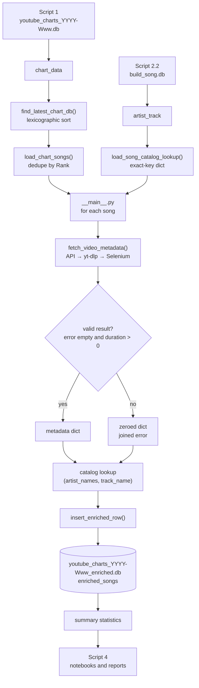
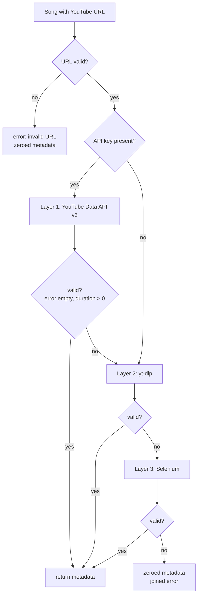

# 🎵 Script 3 — Chart Data Enrichment, Three-Layer YouTube Metadata


 


> **Pipeline position:** `1_download_chart` → `2_1_country_genre` → `2_2_song_catalog` → **`3_enrich_chart_data`** → `4_notebooks` → `5_export`


> **Execution model:** GitHub Actions, every **Monday at 15:00 UTC**. The package is environment-driven: `YOUTUBE_API_KEY` enables the API layer, and `GITHUB_ACTIONS=true` suppresses the interactive prompt.

## 📋 General Description

Script 3 is the **enrichment stage** of the YouTube Charts intelligence system. It joins three sources of information and writes one derived SQLite database per chart week:

```text
Script 1 ──► chart_data ──────┐
                              ├──► Script 3 ──► enriched_songs
Script 2.2 ─► artist_track ───┘
YouTube ─────► video metadata ┘
```

The inputs are:

1. The **latest weekly chart database** produced by Script 1 (`charts_archive/1_download-chart/databases/youtube_charts_YYYY-Www.db`, table `chart_data`).
2. The **canonical song catalog** produced by Script 2.2 (`charts_archive/2_2.build-song-catalog/build_song.db`, table `artist_track`).
3. **YouTube video metadata**, retrieved at run time through a three-layer fallback: official Data API v3 → yt-dlp → Selenium.

The output is:

```text
charts_archive/3_enrich-chart-data/
└── youtube_charts_YYYY-Www_enriched.db
    └── enriched_songs
        ├── rank, id, artist_names, track_name, periods_on_chart, views, youtube_url
        ├── duration_s, duration_ms, upload_date, likes, comment_count, audio_language
        ├── is_official_video, is_lyric_video, is_live_performance
        ├── upload_season, channel_type, is_collaboration, artist_count
        ├── region_restricted, artist_country, macro_genre, artists_found
        ├── error
        └── processed_at
```

Every chart row becomes exactly one enriched row. The table is **fully derived**: it is dropped and recreated on every run, so a re-run never appends duplicates.

### What this stage adds

| Group | Fields | Source |
| :--- | :--- | :--- |
| **Chart identity** | `rank`, `artist_names`, `track_name`, `periods_on_chart`, `views`, `youtube_url` | Script 1 `chart_data` |
| **Catalog identity** | `id`, `artist_country`, `macro_genre`, `artists_found` | Script 2.2 `artist_track` |
| **Video metadata** | `duration_s`, `duration_ms`, `upload_date`, `likes`, `comment_count`, `audio_language` | YouTube Data API, yt-dlp, Selenium |
| **Classification** | `is_official_video`, `is_lyric_video`, `is_live_performance`, `upload_season`, `channel_type`, `is_collaboration`, `artist_count`, `region_restricted` | Pure heuristics + API |
| **Diagnostics** | `error`, `processed_at` | Pipeline |

### Why three layers?

No single YouTube retrieval method is reliable enough on its own:

| Method | Strength | Weakness |
| :--- | :--- | :--- |
| **YouTube Data API v3** | Fast, structured, full metadata | Requires an API key and quota |
| **yt-dlp** | Fast, no key, multi-client rotation | YouTube bot checks and extractor changes |
| **Selenium** | Independent browser path | Slow, fragile against layout changes |

The pipeline tries them in order and stops at the first **valid** result. A result is valid only when `error` is empty and `duration_s > 0`. If every layer fails, the chart row is still written with zeroed metadata and a joined error message. Losing a chart row because YouTube was slow would be worse than storing a row with an explicit error.

### Design principles

1. **The chart row is never lost.** A metadata failure produces a row with `error`, not a skipped row.
2. **The output is derived, not cumulative.** Dropping and recreating `enriched_songs` guarantees one row per chart entry.
3. **The catalog join is exact and transparent.** The key is the raw `(artist_names, track_name)` pair. A miss is visible as `id = NULL`, not hidden behind fuzzy matching.
4. **Classification is pure.** Title/description heuristics live in one module with no I/O, so they are testable in isolation.
5. **The package is environment-driven.** There is no argument parser; behavior is controlled by `YOUTUBE_API_KEY` and `GITHUB_ACTIONS`.

---

## ✨ Key Features

### Enrichment

- **Three-layer metadata fallback** — YouTube Data API v3 → yt-dlp → Selenium.
- **Full API coverage** — duration, likes, comments, audio language, upload date, region restriction, video type, channel type, and collaboration.
- **Multi-client yt-dlp rotation** — `android` → `ios` → `android+web` → `web`.
- **Strict layer validation** — a layer succeeds only if it returns an empty `error` and `Duration (s) > 0`.
- **Catalog integration** — `id`, `artist_country`, `macro_genre`, and `artists_found` are joined from Script 2.2.
- **Graceful catalog degradation** — if the catalog is missing, the run continues with `id = NULL`, `Unknown`, `Pop`, and `0/0`.
- **25 enriched fields** plus `processed_at`.

### Classification

- **Official / lyric / live detection** from title and description keywords.
- **Collaboration detection** from title patterns plus delimiter counting.
- **Channel type classification** — `VEVO`, `Topic`, `Label/Studio`, `Artist Channel`, `User Channel`, `General`.
- **Upload season** — `Q1`–`Q4` from the ISO publish date.
- **Region restriction flag** from the API's `contentDetails.regionRestriction`.
- **Deterministic, pure functions** — no network, no database, no global state.

### Resilience

- **Invalid URL pre-validation** — empty, `None`, or non-string URLs return an error immediately.
- **Error accumulation** — every failed layer contributes to the final `error` string.
- **Row preservation** — a metadata failure never removes the chart row.
- **Driver cleanup** — Selenium always calls `driver.quit()` in a `finally` block.
- **Catalog fallback** — a missing or unreadable catalog does not abort the run.
- **Idempotent output** — `DROP TABLE IF EXISTS` + `CREATE TABLE` on every run.
- **Per-row commits** — a crash leaves the rows already processed.

### Operations

- **No AI, no prompts, no model dependencies.**
- **No mandatory secrets** — the API key is optional.
- **CI-aware** — `GITHUB_ACTIONS=true` skips the interactive prompt.
- **Stdout logging** — compatible with GitHub Actions and shell redirection.
- **Auto-created output directory** — `config.py` creates `charts_archive/3_enrich-chart-data/`.
- **Portable paths** — anchored at the repository root via `__file__`.
- **No CLI flags** — the pipeline always processes the latest chart database.

---

## 📁 Module Structure

```text
scripts/3_enrich_chart_data/                     1,859 lines / 10 files
├── __init__.py                                    52   package metadata, public API
├── __main__.py                                   322   entry point and pipeline
├── config.py                                     121   paths, environment, logger
│
├── metadata/                                   1,040
│   ├── __init__.py                               227   fallback orchestrator
│   ├── api.py                                    167   YouTube Data API v3 layer
│   ├── detector.py                               256   pure classification helpers
│   ├── selenium.py                               199   headless browser layer
│   └── yt_dlp.py                                 191   yt-dlp layer
│
└── utils/                                        324
    ├── __init__.py                                14
    └── db_utils.py                               310   SQLite read/write
```

The package directory starts with a digit, so a normal `import` statement is invalid. The supported invocation is:

```bash
python -m scripts.3_enrich_chart_data
```

`python scripts/3_enrich_chart_data/__main__.py` breaks the relative imports (`from .config import ...`) and is not supported.

> **Naming note:** the Python package is `3_enrich_chart_data` (underscores), while the archive directory is `charts_archive/3_enrich-chart-data/` (hyphens). This follows the existing repository convention.

The CI workflow lives outside the package at `.github/workflows/3_enrich-chart-data.yml`; it is not part of the Python package. 

---

## 
## 🔍 Detailed Module Analysis

### 1. Entry Point — `__main__.py`

**Purpose:** coordinate the pipeline. It locates the latest chart, loads the catalog, checks dependencies, reads the chart rows, creates the output table, enriches every song, and prints a summary. It contains no retrieval, classification, or SQL logic of its own.

**The seven phases:**

| Phase | Log label | Main action |
| :-: | :--- | :--- |
| 1 | `📂 LOCATING LATEST CHART DATABASE...` | `find_latest_chart_db()` |
| 2 | `📀 LOADING SONG CATALOG...` | `load_song_catalog_lookup()` |
| 3 | `🔧 CHECKING DEPENDENCIES...` | `_ensure_ytdlp()` |
| 4 | `📖 READING CHART DATA FROM ...` | `load_chart_songs()` |
| 5 | `🗃️ PREPARING OUTPUT DATABASE...` | `create_output_table()` |
| 6 | `🎬 ENRICHING N SONGS...` | Metadata fallback + catalog lookup + insert |
| 7 | `📊 FINAL SUMMARY:` | Counts, percentages, output path |

The core loop is deliberately small:

```python
for i, song in enumerate(songs, 1):
    url = song["YouTube URL"]
    track = song["Track Name"][:30]
    artists_csv = song.get("Artist Names", "")

    print(f"   [{i:2d}/{len(songs)}] {track:30}... ", end="", flush=True)

    metadata = fetch_video_metadata(url, artists_csv, YOUTUBE_API_KEY)

    catalog_entry = song_catalog_lookup.get((artists_csv, song["Track Name"]))
    if catalog_entry:
        song_id, artist_country, macro_genre, artists_found = catalog_entry
    else:
        song_id, artist_country, macro_genre, artists_found = None, "Unknown", "Pop", "0/0"

    row = {
        "rank": song.get("Rank"),
        "id": song_id,
        "artist_names": artists_csv,
        "track_name": song.get("Track Name"),
        "periods_on_chart": song.get("Periods on Chart"),
        "views": song.get("Views"),
        "youtube_url": url,
        "duration_s": metadata["Duration (s)"],
        "duration_ms": metadata["duration (m:s)"],
        "upload_date": metadata["upload_date"],
        "likes": metadata["likes"],
        "comment_count": metadata["comment_count"],
        "audio_language": metadata["audio_language"],
        "is_official_video": metadata["is_official_video"],
        "is_lyric_video": metadata["is_lyric_video"],
        "is_live_performance": metadata["is_live_performance"],
        "upload_season": metadata["upload_season"],
        "channel_type": metadata["channel_type"],
        "is_collaboration": metadata["is_collaboration"],
        "artist_count": metadata["artist_count"],
        "region_restricted": metadata["region_restricted"],
        "artist_country": artist_country,
        "macro_genre": macro_genre,
        "artists_found": artists_found,
        "error": metadata["error"],
    }

    insert_enriched_row(conn_out, row)
    print(_format_status_badges({**metadata, "_macro_genre": macro_genre},
                                artist_country, song_id))
    time.sleep(0.1)
```

**Dependency bootstrap:** `_ensure_ytdlp()` imports `yt_dlp` and installs it with `pip` only if the import fails. The heavier layers install their own dependencies lazily (see below).

**Status badges:** `_format_status_badges()` builds a compact line such as:

```text
(⏱️3:47 📀 👥2 🌍Ch 🆔293) → Chile, Pop
```

| Badge | Meaning |
| :--- | :--- |
| `⏱️3:47` | Duration in `m:ss` |
| `📀` | Official video |
| `📝` | Lyric video |
| `🎤` | Live performance |
| `👥2` | Collaboration with two artists |
| `🌍Ch` | Resolved country (first two characters of the country name, not an ISO code) |
| `🌐` | `Multi-country` |
| `🆔293` | Catalog ID |

If no badge is available, the function prints the first 20 characters of `error`, or `No data`.

**Interactive prompt:** the module-level entry point asks for confirmation only when the run is local and no API key is configured:

```python
if __name__ == "__main__":
    if not IN_GITHUB_ACTIONS and not YOUTUBE_API_KEY:
        logger.warning("\n⚠️  YOUTUBE_API_KEY environment variable is not set.")
        logger.warning("   Metadata will be fetched via Selenium and yt-dlp (slower).")
        answer = input("Continue anyway? (y/n): ").strip().lower()
        if answer not in ["y", "yes"]:
            logger.info("Process cancelled.")
            sys.exit(0)

    sys.exit(main())
```

This is convenient on a desktop and **dangerous in cron**: a non-interactive shell has no stdin, so `input()` raises `EOFError`. Set `GITHUB_ACTIONS=true` or provide `YOUTUBE_API_KEY` for unattended runs.

**Exit codes:**

| Code | Meaning | Emitted by |
| :-: | :--- | :--- |
| `0` | Pipeline completed | Normal path |
| `1` | Chart database missing/unreadable, chart table error, or unhandled exception | Phases 1 and 4 explicitly; other phases via traceback |
| `130` | `Ctrl+C` | Python's default `KeyboardInterrupt` behavior; not caught explicitly |

There is **no argument parser**. `sys.argv` is not read. Flags such as `--week`, `--limit`, `--dry-run`, `--force`, or `--help` do nothing; the process simply starts the pipeline.

> **Cosmetic inconsistency:** the banner prints `API → Selenium → yt-dlp`, but the actual fallback order is **API → yt-dlp → Selenium**. The banner is wrong; the code and this document describe the real order.

> **Zero-row caveat:** the summary divides by `total` (for example, `multi_country / total * 100`). If `chart_data` is empty, Phase 7 raises `ZeroDivisionError` and the process exits `1` after writing an empty table.

---

### 2. Configuration — `config.py`

**Purpose:** the single source of truth for paths, environment variables, and the shared logger.

```python
REPO_ROOT: Path = Path(__file__).parent.parent.parent

INPUT_DB_DIR: Path = REPO_ROOT / "charts_archive" / "1_download-chart" / "databases"

SONG_CATALOG_DB_PATH: Path = (
    REPO_ROOT / "charts_archive" / "2_2.build-song-catalog" / "build_song.db"
)

OUTPUT_DIR: Path = REPO_ROOT / "charts_archive" / "3_enrich-chart-data"

OUTPUT_DIR.mkdir(parents=True, exist_ok=True)
```

| Constant | Default | Meaning |
| :--- | :--- | :--- |
| `REPO_ROOT` | three levels above `config.py` | Repository root |
| `INPUT_DB_DIR` | `charts_archive/1_download-chart/databases` | Script 1 weekly databases |
| `SONG_CATALOG_DB_PATH` | `charts_archive/2_2.build-song-catalog/build_song.db` | Script 2.2 catalog |
| `OUTPUT_DIR` | `charts_archive/3_enrich-chart-data` | Enriched output directory |
| `YOUTUBE_API_KEY` | `""` | Optional Data API v3 key |
| `IN_GITHUB_ACTIONS` | `False` | True only when `GITHUB_ACTIONS == "true"` |

**Environment variables:**

```python
YOUTUBE_API_KEY: str = os.environ.get("YOUTUBE_API_KEY", "")
IN_GITHUB_ACTIONS: bool = os.environ.get("GITHUB_ACTIONS") == "true"
```

Both values are read **at import time**. Exporting the key after the module is imported does not change the already-bound constant.

**Logging:** a single logger named `3_enrich_chart_data` writes to `sys.stdout` with a plain `%(message)s` format:

```python
log = logging.getLogger("3_enrich_chart_data")
if not log.handlers:
    log.setLevel(logging.INFO)
    handler = logging.StreamHandler(sys.stdout)
    handler.setFormatter(logging.Formatter('%(message)s'))
    log.addHandler(handler)
    log.propagate = False
```

This matches Scripts 2.1 and 2.2 and keeps CI logs readable. There is no file handler; redirect stdout if you need a log file.

**Import-time side effect:** importing `config.py` creates `OUTPUT_DIR`. This is idempotent and makes a fresh clone work immediately, but tests must account for it.

---

### 3. Metadata Orchestrator — `metadata/__init__.py`

**Purpose:** define the metadata schema, enforce the validity rule, try the layers in order, and accumulate errors.

#### The metadata schema

`_empty_metadata()` is the canonical 15-field schema:

```python
{
    "Duration (s)": 0,
    "duration (m:s)": "0:00",
    "upload_date": "",
    "likes": 0,
    "comment_count": 0,
    "audio_language": "",
    "is_official_video": False,
    "is_lyric_video": False,
    "is_live_performance": False,
    "upload_season": "unknown",
    "channel_type": "unknown",
    "is_collaboration": False,
    "artist_count": 1,
    "region_restricted": False,
    "error": "",
}
```

| Field | Type | Default | Filled by |
| :--- | :--- | :--- | :--- |
| `Duration (s)` | int | `0` | API, yt-dlp, Selenium |
| `duration (m:s)` | str | `"0:00"` | API, yt-dlp, Selenium |
| `upload_date` | str | `""` | API, yt-dlp, Selenium |
| `likes` | int | `0` | API, yt-dlp |
| `comment_count` | int | `0` | API only |
| `audio_language` | str | `""` | API only |
| `is_official_video` | bool | `False` | All layers |
| `is_lyric_video` | bool | `False` | All layers |
| `is_live_performance` | bool | `False` | All layers |
| `upload_season` | str | `"unknown"` | API, yt-dlp, Selenium |
| `channel_type` | str | `"unknown"` | API, yt-dlp, Selenium |
| `is_collaboration` | bool | `False` | All layers |
| `artist_count` | int | `1` | All layers |
| `region_restricted` | bool | `False` | API only |
| `error` | str | `""` | All layers on failure |

The schema is **duplicated by design** in `api.py`, `yt_dlp.py`, and `selenium.py`. Adding a field requires editing all four locations plus the output row and the SQLite DDL. See [Configuration and customization](#-configuration-and-customization).

#### The validity rule

```python
def _is_valid_result(metadata: dict) -> bool:
    if not metadata:
        return False
    if metadata.get("error"):
        return False
    if metadata.get("Duration (s)", 0) <= 0:
        return False
    return True
```

A layer is accepted only if:

1. The dict is non-empty.
2. `error` is empty.
3. `Duration (s)` is greater than zero.

This rejects empty dicts, bot-check responses, and partial Selenium results where the duration selector failed. It also means a legitimate zero-duration video is treated as a failure; the row is written with zeroed metadata and an error.

#### The fallback flow

```python
metadata = _empty_metadata()
errors = []

if not url or not isinstance(url, str) or not url.strip():
    metadata["error"] = "Invalid input: URL is empty, None, or not a string"
    return metadata

# Layer 1: API (only when a key is provided)
if api_key:
    try:
        api_metadata = fetch_metadata_via_api(url, artists_csv, api_key)
        if _is_valid_result(api_metadata):
            return api_metadata
        errors.append(api_metadata.get("error", "API returned incomplete data"))
    except Exception as e:
        errors.append(f"API layer exception: {e}")

# Layer 2: yt-dlp
try:
    ytdlp_metadata = fetch_metadata_via_ytdlp(url, artists_csv)
    if _is_valid_result(ytdlp_metadata):
        metadata.update(ytdlp_metadata)
        return metadata
    errors.append(ytdlp_metadata.get("error", "yt-dlp returned no data (empty dict)"))
except Exception as e:
    errors.append(f"yt-dlp layer exception: {e}")

# Layer 3: Selenium
try:
    sel_metadata = fetch_metadata_via_selenium(url, artists_csv)
    if _is_valid_result(sel_metadata):
        metadata.update(sel_metadata)
        return metadata
    errors.append(sel_metadata.get("error", "Selenium returned no data"))
except Exception as e:
    errors.append(f"Selenium layer exception: {e}")

if errors:
    metadata["error"] = " | ".join(errors)

return metadata
```

**Error accumulation example:**

```text
API error: quota exceeded | yt-dlp failed: Sign in to confirm you're not a bot | Selenium error: ...
```

The `error` column in SQLite receives this string verbatim. It is useful for diagnosis but can be long; see [Known limitations](#-known-limitations-and-future-improvements).

> **Docstring typo:** the module notes say a layer succeeds when it returns a **non-empty** `error` field. The code (and the correct rule) requires an **empty** `error` field. Trust the code.

---

### 4. Layer 1 — YouTube Data API v3 (`metadata/api.py`)

**Purpose:** retrieve full video metadata from the official API. This is the preferred layer because it is fast, structured, and does not depend on page layout.

**Requirements:**

- `YOUTUBE_API_KEY` set in the environment.
- `google-api-python-client` installed.
- `isodate` installed (the layer auto-installs it if missing).

> **Important:** the module docstring says `googleapiclient` is auto-installed. It is not. Only `isodate` is auto-installed. If `googleapiclient` is missing, the import raises and the orchestrator records `API layer exception: ...`, then falls back to yt-dlp.

**Video ID extraction:**

```python
vid_match = re.search(r"(?:v=|\/)([0-9A-Za-z_-]{11})", url)
if not vid_match:
    metadata["error"] = "API: could not extract video_id from URL"
    return metadata

video_id = vid_match.group(1)
```

This handles `watch?v=...`, `youtu.be/...`, and path-style URLs.

**API request:**

```python
youtube = build("youtube", "v3", developerKey=api_key)
response = youtube.videos().list(
    part="snippet,contentDetails,statistics",
    id=video_id,
).execute()
```

**Parsing:**

| Field | API source | Transformation |
| :--- | :--- | :--- |
| `Duration (s)` | `contentDetails.duration` (ISO 8601) | `isodate.parse_duration(...).total_seconds()` |
| `duration (m:s)` | Derived | `f"{dur_s // 60}:{dur_s % 60:02d}"` |
| `likes` | `statistics.likeCount` | `int(...)`, default `0` |
| `comment_count` | `statistics.commentCount` | `int(...)`, default `0` |
| `audio_language` | `snippet.defaultAudioLanguage` | First two characters, uppercase |
| `region_restricted` | `contentDetails.regionRestriction` | True if `blocked` or `allowed` exists |
| `upload_date` | `snippet.publishedAt` | First 10 characters |
| `upload_season` | Derived from `upload_date` | `Q1`–`Q4` |
| `is_official_video` | `snippet.title` + `description` | Keyword heuristic |
| `is_lyric_video` | Title + description | Keyword heuristic |
| `is_live_performance` | Title + description | Keyword heuristic |
| `channel_type` | `snippet.channelTitle` | Classifier |
| `is_collaboration` | Title + `artists_csv` | Regex + delimiter count |
| `artist_count` | `artists_csv` | Delimiter count, capped at 10 |

**Error handling:** any exception inside the request/parse block becomes `API error: ...` in the returned dict. The orchestrator treats it as a failed layer and continues.

**Quota:** `videos.list` costs **1 unit per call**. A 100-song chart costs about 100 units, well below the default 10,000 units/day. Repeated runs and retries consume additional quota.

**Caveats:**

- Hidden like/comment counts are indistinguishable from real zeroes: missing keys become `0`.
- `defaultAudioLanguage` may be absent even when the video has audio.
- `is_special_version` is returned by the detector but is **not** stored in the output table.
- The `region_restricted` logic is duplicated inline; `detect_region_restrictions()` in `detector.py` is unused.

---

### 5. Layer 2 — yt-dlp (`metadata/yt_dlp.py`)

**Purpose:** retrieve metadata without a browser and without an API key. It is the preferred fallback because it is significantly faster and lighter than Selenium.

**Client rotation:** YouTube treats player clients differently; a request that fails for one client often succeeds for another.

| Attempt | `player_client` | Why |
| :-: | :--- | :--- |
| 1 | `android` | Often bypasses web bot checks |
| 2 | `ios` | Independent client fingerprint |
| 3 | `android` + `web` | Mixed fallback |
| 4 | `web` | Last standard client |

```python
client_options = [
    {"player_client": ["android"]},
    {"player_client": ["ios"]},
    {"player_client": ["android", "web"]},
    {"player_client": ["web"]},
]
```

**Configuration:**

```python
ydl_config = {
    "quiet": True,
    "no_warnings": True,
    "skip_download": True,
    "ignoreerrors": False,
    "extract_flat": False,
    "user_agent": (
        "Mozilla/5.0 (Windows NT 10.0; Win64; x64) "
        "AppleWebKit/537.36 (KHTML, like Gecko) Chrome/120.0.0.0 Safari/537.36"
    ),
    "extractor_retries": 5,
    "fragment_retries": 5,
    "retry_sleep_functions": {"extractor": 2},
    "sleep_interval": 2,
    "sleep_interval_requests": 2,
    **opts,
}
```

**Strict validation:** yt-dlp can return an empty dict or a dict without `duration` when YouTube blocks the request (for example, "Sign in to confirm you're not a bot"). The layer rejects those and tries the next client:

```python
if info and info.get("duration") is not None:
    break
else:
    last_error = "yt-dlp returned incomplete info (missing duration)"
    info = None
```

A result with `duration = 0` passes this check (it is not `None`), but the orchestrator's `Duration (s) > 0` rule rejects it and falls through to Selenium.

**Date conversion:** yt-dlp returns `upload_date` as `YYYYMMDD`; the layer converts it to `YYYY-MM-DD` before calling `parse_upload_season()`.

**Fields produced:**

| Field | yt-dlp source |
| :--- | :--- |
| `Duration (s)` | `info["duration"]` |
| `duration (m:s)` | Derived |
| `upload_date` | `info["upload_date"]` converted to ISO |
| `upload_season` | Derived from the ISO date |
| `likes` | `info["like_count"]` (may be `None`) |
| `is_official_video` | `detect_video_type(title, description)` |
| `is_lyric_video` | Same |
| `is_live_performance` | Same |
| `channel_type` | `detect_channel_type(info["channel"])` |
| `is_collaboration` | `detect_collaboration(title, artists_csv)` |
| `artist_count` | Same |

**Not produced:** `comment_count`, `audio_language`, and `region_restricted` remain at their defaults (`0`, `""`, `False`).

**Dependency behavior:** if `yt_dlp` is missing, it installs it. Then, on **every call**, it runs:

```python
subprocess.run(
    [sys.executable, "-m", "pip", "install", "--upgrade", "yt-dlp"],
    capture_output=True,
    check=False,
)
```

This keeps the extractor current, because YouTube changes frequently, but it is a major performance cost: with 100 songs, the pipeline can attempt 100 pip upgrades. In CI or offline environments, preinstall and pin yt-dlp, and consider removing this per-call upgrade. See [Performance reference](#-performance-reference).

**Caveats:**

- `like_count` can be `None`; SQLite stores it as `NULL`, not `0`.
- `retry_sleep_functions` is not a documented yt-dlp option; it may be ignored by the installed version.
- The 2-second sleeps are applied per request, which adds up on a full chart.
- No `comment_count`, `audio_language`, or region restriction.

---

### 6. Layer 3 — Selenium (`metadata/selenium.py`)

**Purpose:** extract basic metadata with a headless Chromium browser when the API and yt-dlp both fail.

> **Docstring inconsistency:** the module says it is "Layer 2" and that it runs "before falling back to yt-dlp". The actual orchestrator order is **API → yt-dlp → Selenium**, so Selenium is Layer 3 and runs **after** yt-dlp. The code is authoritative.

**Setup:**

```python
chrome_options = Options()
chrome_options.add_argument("--headless=new")
chrome_options.add_argument("--no-sandbox")
chrome_options.add_argument("--disable-dev-shm-usage")
chrome_options.add_argument("--disable-gpu")
chrome_options.add_argument("--window-size=1920,1080")
chrome_options.add_argument(
    "--user-agent=Mozilla/5.0 (Windows NT 10.0; Win64; x64) "
    "AppleWebKit/537.36 (KHTML, like Gecko) Chrome/120.0.0.0 Safari/537.36"
)
```

The layer auto-installs `selenium` and `webdriver-manager` if missing, then obtains ChromeDriver with `ChromeDriverManager().install()`. Chrome or Chromium must be installed on the host.

**Selectors:**

| Data | Selector | Notes |
| :--- | :--- | :--- |
| Title | `h1.ytd-video-primary-info-renderer` | Old YouTube layout selector; may fail on current pages |
| Duration | `span.ytp-time-duration` | Player progress label |
| Channel | `a.ytd-channel-name` | Used for channel type |
| Upload date | `meta[itemprop='datePublished']` | Structured data; more stable |

**Parsing:**

```python
parts = dur_el.text.split(":")
if len(parts) == 2:
    duration_s = int(parts[0]) * 60 + int(parts[1])
elif len(parts) == 3:
    duration_s = int(parts[0]) * 3600 + int(parts[1]) * 60 + int(parts[2])
else:
    duration_s = 0
```

`duration (m:s)` is always total minutes and seconds, even when the source showed `h:mm:ss`.

**Fields produced:**

| Field | Selenium source |
| :--- | :--- |
| `Duration (s)` | `span.ytp-time-duration` |
| `duration (m:s)` | Derived |
| `upload_date` | `meta[itemprop='datePublished']` |
| `upload_season` | Derived |
| `is_official_video` | Title heuristic |
| `is_lyric_video` | Title heuristic |
| `is_live_performance` | Title heuristic |
| `channel_type` | Channel name |
| `is_collaboration` | Title + `artists_csv` |
| `artist_count` | `artists_csv` |

**Not produced:** `likes`, `comment_count`, `audio_language`, `region_restricted`.

**Cleanup:** the driver is always closed in a `finally` block, which prevents zombie Chrome processes on CI runners:

```python
finally:
    if driver is not None:
        try:
            driver.quit()
        except Exception:
            pass
```

**Caveats:**

- The title selector is from an older YouTube layout. If it is not found within 10 seconds, the layer raises a timeout, records an error, and returns zeroed metadata.
- Because the orchestrator requires `Duration (s) > 0`, a page that loads but whose duration selector fails is treated as a failed layer.
- `ChromeDriverManager().install()` requires network access and a compatible Chrome version. It can fail behind a proxy or in a minimal container.
- `--no-sandbox` is common in CI but reduces process isolation. Use it only where required.
- Selenium is the slowest layer: roughly 5–10 seconds per video plus driver startup.

---

### 7. Classification Helpers — `metadata/detector.py`

**Purpose:** pure, deterministic functions shared by all three layers. This module contains **no I/O**, **no network calls**, and **no database access**.

#### `detect_video_type(title, description="")`

Scans the title and description for keyword families:

| Flag | Keywords (examples) |
| :--- | :--- |
| `is_official_video` | `official`, `video oficial`, `official video`, `official music video`, `vídeo oficial` |
| `is_lyric_video` | `lyric`, `lyrics`, `letra`, `letras`, `karaoke`, `lyric video`, `letra oficial` |
| `is_live_performance` | `live`, `en vivo`, `concert`, `performance`, `show`, `live performance`, `en concierto`, `directo` |
| `is_special_version` | `remix`, `version`, `edit`, `mix`, `bootleg`, `rework`, `sped up`, `slowed`, `reverb`, `acoustic`, `acústico`, `piano version`, `instrumental` |

`is_special_version` is returned by the function but **not stored** in `enriched_songs`; the output row and DDL do not include it.

**Known false positives:** the checks are substring-based. `"official"` matches `"unofficial"`, `"live"` matches `"delivery"`, and `"show"` matches `"shower"`. Treat the flags as signals, not ground truth.

#### `detect_collaboration(title, artists_csv)`

Title patterns:

```python
collab_patterns = [
    r"\sft\.\s", r"\sfeat\.\s", r"\sfeaturing\s", r"\sft\s",
    r"\scon\s", r"\swith\s", r"\s&\s", r"\sx\s", r"\s×\s",
    r"\(feat\.", r"\(ft\.", r"\(with", r"\[feat\.", r"\[ft\.",
]
```

Artist count:

```python
artist_count = artists_csv.count("&") + artists_csv.count(",") + 1
```

- If `artists_csv` is empty, the count starts at `1` and is increased by `" & "` and `" x "` occurrences when a collaboration pattern matched.
- The result is capped at **10** to prevent outliers from malformed CSV strings.

**Inconsistency:** a title with `feat.` but a CSV without `&` or `,` can produce `is_collaboration = True` and `artist_count = 1`. The two signals are related but not identical.

#### `detect_channel_type(channel_title)`

The checks are ordered; the first match wins:

| Priority | Category | Trigger examples |
| :-: | :--- | :--- |
| 1 | `VEVO` | `vevo` in the channel name |
| 2 | `Topic` | `topic` in the channel name |
| 3 | `Label/Studio` | `records`, `music`, `label`, `entertainment`, `studios`, `production`, `presents`, `network` |
| 4 | `Artist Channel` | `official`, `oficial`, `artist`, `band`, `singer`, `musician`, `rapper`, `dj`, `producer` |
| 5 | `User Channel` | `channel`, `tv`, `hd`, `video`, `videos` |
| 6 | `Artist Channel` | Channel name contains `" - "` or `" \| "` |
| 7 | `General` | No match |
| — | `unknown` | Empty channel title |

Because `"music"` is checked before `"artist"`, a channel named `"Artist Music"` becomes `Label/Studio`, not `Artist Channel`. This is a deliberate but coarse ordering.

#### `parse_upload_season(publish_date)`

```python
date = datetime.strptime(publish_date[:10], "%Y-%m-%d")
quarter = (date.month - 1) // 3 + 1
return {"upload_season": f"Q{quarter}"}
```

| Months | Season |
| :--- | :--- |
| January–March | `Q1` |
| April–June | `Q2` |
| July–September | `Q3` |
| October–December | `Q4` |
| Invalid or missing date | `unknown` |

#### `detect_region_restrictions(content_details)`

```python
region = content_details.get("regionRestriction", {})
return {
    "region_restricted": bool(region.get("blocked") or region.get("allowed"))
}
```

This function is **unused** in the current pipeline. The API layer duplicates the logic inline; yt-dlp and Selenium do not set the field.

---

### 8. Database Utilities — `utils/db_utils.py`

**Purpose:** all SQLite operations. This module contains no metadata retrieval and no classification logic.

#### `find_latest_chart_db()`

```python
if not INPUT_DB_DIR.exists():
    raise FileNotFoundError(f"Input directory not found: {INPUT_DB_DIR}")

db_files = list(INPUT_DB_DIR.glob("*.db"))
if not db_files:
    raise FileNotFoundError(f"No .db files found in {INPUT_DB_DIR}")

db_files.sort(key=lambda p: p.name, reverse=True)
return db_files[0]
```

- It sorts **all** `.db` files by filename, descending.
- It does **not** filter on `youtube_charts_*.db`. Any `.db` file in the input directory can win.
- Lexicographic order is correct only when weeks are zero-padded (`2026-W09` < `2026-W10`). Script 1 guarantees this.
- If an enriched output or a catalog database is copied into the input directory, it can be selected by mistake.

#### `load_chart_songs(db_path)`

```python
cursor.execute("""
    SELECT * FROM chart_data
    WHERE rowid IN (
        SELECT MIN(rowid) FROM chart_data GROUP BY Rank
    )
    ORDER BY Rank
""")
```

- Verifies that `chart_data` exists.
- Deduplicates by `Rank`, keeping the first `rowid` for each rank. This guards against a week written twice by Script 1.
- Requires the columns `Rank`, `Artist Names`, `Track Name`, and `YouTube URL` **only when at least one row exists**. An empty table returns `[]` without a column check.
- `GROUP BY Rank` also collapses multiple `NULL` ranks into one row.
- It does not filter `is_synthetic`. Synthetic fallback rows from Script 1 can enter the enriched output.

#### `load_song_catalog_lookup()`

```python
cursor.execute("""
    SELECT artist_names, track_name, id, artist_country, macro_genre, artists_found
    FROM artist_track
""")

for artist_names, track_name, song_id, country, genre, found in rows:
    catalog_lookup[(artist_names, track_name)] = (song_id, country, genre, found)
```

- The key is the **exact** raw `(artist_names, track_name)` pair. There is no lowercasing, trimming, or Unicode normalization.
- If the catalog file is missing, the function logs three warnings and returns `{}`. The pipeline continues with `id = NULL`, `Unknown`, `Pop`, and `0/0`.
- If the `artist_track` table is missing, it logs an error and returns `{}`.
- If SQLite raises an error, it logs the error and returns `{}`.
- If the catalog contains duplicate keys, the last row wins in the dictionary.

#### `create_output_table(conn)`

```sql
DROP TABLE IF EXISTS enriched_songs;

CREATE TABLE enriched_songs (
    rank INTEGER,
    id INTEGER UNIQUE,
    artist_names TEXT,
    track_name TEXT,
    periods_on_chart INTEGER,
    views INTEGER,
    youtube_url TEXT,
    duration_s INTEGER,
    duration_ms TEXT,
    upload_date TEXT,
    likes INTEGER,
    comment_count INTEGER,
    audio_language TEXT,
    is_official_video BOOLEAN,
    is_lyric_video BOOLEAN,
    is_live_performance BOOLEAN,
    upload_season TEXT,
    channel_type TEXT,
    is_collaboration BOOLEAN,
    artist_count INTEGER,
    region_restricted BOOLEAN,
    artist_country TEXT,
    macro_genre TEXT,
    artists_found TEXT,
    error TEXT,
    processed_at TIMESTAMP DEFAULT CURRENT_TIMESTAMP,
    FOREIGN KEY (id) REFERENCES artist_track(id)
);

CREATE INDEX idx_country ON enriched_songs(artist_country);
CREATE INDEX idx_genre ON enriched_songs(macro_genre);
CREATE INDEX idx_upload_date ON enriched_songs(upload_date);
CREATE INDEX idx_error ON enriched_songs(error);
```

**Schema notes:**

- `id` is the **catalog ID**, not a primary key for the enriched row. It is `UNIQUE` so a catalog song cannot appear twice, but it allows multiple `NULL` values (SQLite treats `NULL`s as distinct in a `UNIQUE` index). This is what lets unmatched songs coexist.
- The `FOREIGN KEY` clause is **declarative only**. SQLite does not enforce foreign keys unless `PRAGMA foreign_keys = ON`, and the referenced `artist_track` table lives in a different database file anyway. Do not rely on it.
- `duration_ms` is a **misnomer**: it stores `"m:ss"` text, not milliseconds.
- `processed_at` uses SQLite's `CURRENT_TIMESTAMP`, which is UTC.
- There is no `week_id` column. The week is encoded in the filename only.
- There is no `previous_rank`, `views_raw`, `growth`, `download_date`, `download_time`, `timestamp`, or `is_synthetic`. Script 3 intentionally projects a subset of `chart_data`.

#### `insert_enriched_row(conn, row)`

```python
cursor.execute("""
    INSERT INTO enriched_songs (
        rank, id, artist_names, track_name, periods_on_chart, views, youtube_url,
        duration_s, duration_ms, upload_date, likes, comment_count,
        audio_language, is_official_video, is_lyric_video, is_live_performance,
        upload_season, channel_type, is_collaboration, artist_count,
        region_restricted, artist_country, macro_genre,
        artists_found, error
    ) VALUES (?, ?, ?, ?, ?, ?, ?, ?, ?, ?, ?, ?, ?, ?, ?, ?, ?, ?, ?, ?, ?, ?, ?, ?, ?)
""", (...))
conn.commit()
```

- Exactly **25** values are bound; `processed_at` uses its default.
- The insert commits **per row**. This preserves progress but is slower than a single batch transaction.
- If two chart rows resolve to the same catalog `id`, the second insert raises `UNIQUE constraint failed: enriched_songs.id` and aborts the pipeline. See [Idempotency and transactional behavior](#-idempotency-and-transactional-behavior).

---

### 9. Package API — `__init__.py` and `utils/__init__.py`

The package root exposes:

```python
__version__ = "1.0.0"

from .metadata import fetch_video_metadata

__all__ = [
    "__version__",
    "fetch_video_metadata",
]
```

`utils/__init__.py` documents the subpackage and sets `__all__ = []`; it does not re-export the database functions. Import them explicitly:

```python
from .utils.db_utils import (
    create_output_table,
    find_latest_chart_db,
    insert_enriched_row,
    load_chart_songs,
    load_song_catalog_lookup,
)
```

Because the package name starts with a digit, use `importlib.import_module("scripts.3_enrich_chart_data")` for programmatic access, or run it with `python -m`.

---

## 📊 Data Flow



### Request lifecycle in words

1. **Locate the chart.** `find_latest_chart_db()` scans `charts_archive/1_download-chart/databases/` and picks the lexicographically highest `.db` filename.
2. **Load the catalog.** The entire `artist_track` table becomes a dictionary keyed by the exact raw `(artist_names, track_name)` pair. A missing catalog produces an empty dictionary and a warning, not a failure.
3. **Check yt-dlp.** `_ensure_ytdlp()` imports it or installs it with pip.
4. **Read the chart.** `load_chart_songs()` verifies `chart_data`, deduplicates by `Rank`, and returns a list of dictionaries ordered by rank.
5. **Prepare the output.** `create_output_table()` opens (or creates) `youtube_charts_YYYY-Www_enriched.db` and drops/recreates `enriched_songs`.
6. **Enrich each song.** For every row, the pipeline calls `fetch_video_metadata()`, looks up the catalog, assembles a 25-field row, inserts it, prints a status line, and sleeps 100 ms.
7. **Summarize.** Phase 7 counts total rows, multi-country collaborations, distinct countries, distinct genres, unknown countries, metadata errors, and rows with a catalog ID.
8. **Exit.** The process returns `0`. A failure in Phases 1 or 4 returns `1`; other failures propagate as tracebacks.

---

## 🗃 Data Model and Schemas

### Source: Script 1 `chart_data`

Script 3 reads the full table but only uses six columns in the output. The complete Script 1 schema is:

| Column | Type | Used by Script 3? | Notes |
| :--- | :--- | :---: | :--- |
| `Rank` | INTEGER | ✅ | Chart position; deduplication key |
| `Previous Rank` | INTEGER | ❌ | Not projected |
| `Track Name` | TEXT | ✅ | Catalog key and output |
| `Artist Names` | TEXT | ✅ | Catalog key and output |
| `Periods on Chart` | INTEGER | ✅ | Output |
| `Views` | INTEGER | ✅ | Output |
| `Views Raw` | TEXT | ❌ | Not projected |
| `Growth` | TEXT | ❌ | Not projected |
| `YouTube URL` | TEXT | ✅ | Metadata input and output |
| `download_date` | TEXT | ❌ | Not projected |
| `download_time` | TEXT | ❌ | Not projected |
| `week_id` | TEXT | ❌ | Not projected; week is in the filename |
| `timestamp` | TEXT | ❌ | Not projected |
| `is_synthetic` | INTEGER | ❌ | **Not filtered**; synthetic rows can enter |

> **Data quality warning:** Script 3 does not filter `is_synthetic = 1`. If Script 1 wrote a synthetic fallback chart, those placeholder rows are enriched and written to `enriched_songs` just like real rows. Check Script 1's fallback policy before relying on a run.

### Source: Script 2.2 `artist_track`

```sql
CREATE TABLE artist_track (
    id             INTEGER PRIMARY KEY AUTOINCREMENT,
    artist_names   VARCHAR(200) NOT NULL,
    track_name     VARCHAR(200) NOT NULL,
    artist_country TEXT NOT NULL,
    macro_genre    TEXT NOT NULL,
    artists_found  TEXT
)
```

| Column | Meaning | Script 3 use |
| :--- | :--- | :--- |
| `id` | Catalog surrogate key | Written as `enriched_songs.id` |
| `artist_names` | Raw chart artist string | First half of the exact lookup key |
| `track_name` | Raw chart title | Second half of the exact lookup key |
| `artist_country` | Resolved country, `Multi-country`, or `Unknown` | Output |
| `macro_genre` | Resolved genre, `Multi-genre`, or `Pop` | Output |
| `artists_found` | `matched/total`, e.g. `2/3` | Output |

Script 3 does **not** modify this table. It opens the catalog with a normal read-write connection but issues only `SELECT` statements.

### Target: `enriched_songs`

The full DDL is shown in [Database Utilities](#8-database-utilities--utilsdb_utilspy). The column semantics are:

| Column | Type | Meaning | Source |
| :--- | :--- | :--- | :--- |
| `rank` | INTEGER | Chart position | Script 1 |
| `id` | INTEGER UNIQUE | Catalog ID; `NULL` when unmatched | Script 2.2 |
| `artist_names` | TEXT | Raw chart artist string | Script 1 |
| `track_name` | TEXT | Raw chart title | Script 1 |
| `periods_on_chart` | INTEGER | Weeks on chart | Script 1 |
| `views` | INTEGER | Chart view count | Script 1 |
| `youtube_url` | TEXT | Video URL | Script 1 |
| `duration_s` | INTEGER | Duration in seconds | Metadata |
| `duration_ms` | TEXT | Duration as `"m:ss"` (misnamed) | Metadata |
| `upload_date` | TEXT | `YYYY-MM-DD` | Metadata |
| `likes` | INTEGER | Like count, when available | API / yt-dlp |
| `comment_count` | INTEGER | Comment count, API only | API |
| `audio_language` | TEXT | Two-letter language, API only | API |
| `is_official_video` | BOOLEAN | Official-video heuristic | Metadata |
| `is_lyric_video` | BOOLEAN | Lyric-video heuristic | Metadata |
| `is_live_performance` | BOOLEAN | Live-performance heuristic | Metadata |
| `upload_season` | TEXT | `Q1`–`Q4` or `unknown` | Metadata |
| `channel_type` | TEXT | Channel classification | Metadata |
| `is_collaboration` | BOOLEAN | Collaboration heuristic | Metadata |
| `artist_count` | INTEGER | Delimiter-based count, capped at 10 | Metadata |
| `region_restricted` | BOOLEAN | Geo-restriction flag, API only | API |
| `artist_country` | TEXT | Catalog country | Script 2.2 |
| `macro_genre` | TEXT | Catalog genre | Script 2.2 |
| `artists_found` | TEXT | Catalog match ratio | Script 2.2 |
| `error` | TEXT | Joined layer errors; empty on success | Pipeline |
| `processed_at` | TIMESTAMP | Row insertion time (UTC) | SQLite default |

### Field provenance matrix

| Field group | API | yt-dlp | Selenium | Unmatched catalog |
| :--- | :-: | :-: | :-: | :-: |
| `duration_s`, `duration_ms` | ✅ | ✅ | ✅ (if selector works) | — |
| `upload_date`, `upload_season` | ✅ | ✅ | ✅ (if meta tag works) | — |
| `likes` | ✅ | ✅ (may be `NULL`) | ❌ | — |
| `comment_count` | ✅ | ❌ | ❌ | — |
| `audio_language` | ✅ | ❌ | ❌ | — |
| `region_restricted` | ✅ | ❌ | ❌ | — |
| Video type flags | ✅ | ✅ | ✅ | — |
| `channel_type` | ✅ | ✅ | ✅ (if selector works) | — |
| `is_collaboration`, `artist_count` | ✅ | ✅ | ✅ | — |
| `id`, `artist_country`, `macro_genre`, `artists_found` | — | — | — | `NULL`, `Unknown`, `Pop`, `0/0` |

### Schema notes and caveats

- **`id` is not a row primary key.** It is the catalog ID and is declared `UNIQUE`. Multiple `NULL`s are allowed; duplicate non-`NULL` values abort the run.
- **No `week_id` column.** The week is only in the filename (`youtube_charts_2026-W48_enriched.db`). If the file is renamed, provenance is lost.
- **No `is_synthetic` column.** Synthetic chart rows are not marked in the output.
- **`duration_ms` is text.** It contains `"m:ss"`, not milliseconds. The name is historical.
- **The foreign key is not enforced.** SQLite ignores it by default, and the referenced table is in a different database.
- **`processed_at` is UTC.** SQLite's `CURRENT_TIMESTAMP` does not use the host timezone.
- **The output is a projection.** `Previous Rank`, `Views Raw`, `Growth`, and the Script 1 ingestion metadata are intentionally dropped.

---

## 🔁 The Three-Layer Fallback Strategy



### Acceptance criteria

| Condition | Result |
| :--- | :--- |
| Empty, `None`, or non-string URL | Immediate error; no layer is tried |
| Layer returns empty dict | Layer rejected |
| Layer returns a non-empty `error` | Layer rejected |
| `Duration (s)` is `0`, negative, or missing | Layer rejected |
| Layer returns valid data | Accepted; later layers are skipped |
| All layers fail | Zeroed dict with `" \| "`-joined errors |

### Layer comparison

| Aspect | API (Layer 1) | yt-dlp (Layer 2) | Selenium (Layer 3) |
| :--- | :--- | :--- | :--- |
| **Speed** | Fast | Medium | Slow |
| **Requires** | API key, `googleapiclient`, `isodate` | `yt-dlp` | Chrome, `selenium`, `webdriver-manager` |
| **Full metadata** | ✅ | Partial | Basic |
| **Likes** | ✅ | ✅ (may be `NULL`) | ❌ |
| **Comments** | ✅ | ❌ | ❌ |
| **Audio language** | ✅ | ❌ | ❌ |
| **Region restriction** | ✅ | ❌ | ❌ |
| **Bot resistance** | High (official) | Medium (client rotation) | Low–medium |
| **Layout fragility** | Low | Medium | High |
| **Typical failure** | Missing key, quota, hidden stats | "Sign in to confirm", extractor changes | Selector timeout, driver download |

### Worked examples

| Scenario | Layer 1 | Layer 2 | Layer 3 | Final result |
| :--- | :--- | :--- | :--- | :--- |
| API key valid, video public | ✅ | skipped | skipped | Full metadata |
| No API key | skipped | ✅ | skipped | Most metadata, no comments/audio/region |
| API quota exhausted | ❌ | ✅ | skipped | yt-dlp metadata |
| API fails, yt-dlp blocked | ❌ | ❌ | ✅ | Basic metadata |
| All layers fail | ❌ | ❌ | ❌ | Zeroed metadata + joined error |
| Invalid URL | — | — | — | Zeroed metadata + `Invalid input` |
| Video is a live stream with duration 0 | ❌ | ❌ | ❌ | Zeroed metadata; duration rule rejects all |

### Error accumulation

The final `error` is a pipe-separated concatenation of every layer's failure:

```text
API error: quota exceeded | yt-dlp failed: Sign in to confirm you're not a bot | Selenium error: Message: timeout
```

This is stored verbatim in `enriched_songs.error`. Empty `error` means the row has valid metadata from one of the layers. Because the successful layer's fields are merged into the zeroed dict, fields that the layer does not provide remain at their defaults.

### Why not Selenium first?

Selenium is the slowest and most fragile layer. It depends on Chrome, ChromeDriver, a page layout that changes frequently, and a 10-second title wait. yt-dlp is much faster, lighter, and easier to run in CI. The API is faster and more complete than both. The order is therefore a direct trade-off between **data quality**, **speed**, and **resilience**.

### API quota and rate limits

- `videos.list` costs 1 unit per call.
- A 100-song chart costs about 100 units.
- The default daily quota is 10,000 units, so roughly 100 full-chart runs per day.
- The pipeline does not inspect quota errors specially; a quota failure is just an API error and the fallback continues.
- There is a fixed `time.sleep(0.1)` between songs, which is a courtesy delay, not a rate-limit guarantee.

---

## 🧠 Classification Heuristics

The implementation lives in `metadata/detector.py`; this section summarizes the decision rules and their known edge cases.

### Video type

| Flag | Search space | Example matches | Example false positives |
| :--- | :--- | :--- | :--- |
| `is_official_video` | Title + description | `Official Video`, `Video Oficial` | `Unofficial remix` |
| `is_lyric_video` | Title + description | `Lyric Video`, `Letra Oficial` | `Lyrics in description` (intended) |
| `is_live_performance` | Title + description | `Live`, `En Vivo`, `Concert` | `Delivery`, `Shower` |
| `is_special_version` | Title only | `Remix`, `Sped Up`, `Acoustic` | Not stored in the output |

### Collaboration

| Input | `is_collaboration` | `artist_count` | Why |
| :--- | :-: | :-: | :--- |
| `"A feat. B"`, `"A, B"` | ✅ | 2 | `feat.` pattern + one comma |
| `"A & B"`, `"A & B"` | ✅ | 2 | `&` pattern + one ampersand |
| `"A x B"`, `"A x B"` | ✅ | 1 | `x` pattern, but no `&` or `,` in the CSV |
| `"A"`, `"A"` | ❌ | 1 | No pattern, no delimiter |
| `"A, B, C"`, `"A, B, C"` | ❌ | 3 | Count is correct, but no collaboration pattern in the title |
| `"A feat. B, C, D"`, `"A, B, C, D"` | ✅ | 4 | Pattern + three delimiters |
| 12 delimited artists | — | 10 | Capped at 10 |

### Channel type

| Channel title | Result | Why |
| :--- | :--- | :--- |
| `ArtistVEVO` | `VEVO` | First check |
| `Artist - Topic` | `Topic` | Second check |
| `Universal Music Group` | `Label/Studio` | `music` |
| `Artist Official` | `Artist Channel` | `official` |
| `Fan TV` | `User Channel` | `tv` (no earlier keyword) |
| `Beyoncé - Extra` | `Artist Channel` | Separator fallback |
| `Some Name` | `General` | No match |
| `""` | `unknown` | Empty input |

### Upload season

| Month | Season |
| :--- | :--- |
| 1–3 | `Q1` |
| 4–6 | `Q2` |
| 7–9 | `Q3` |
| 10–12 | `Q4` |
| Invalid/missing | `unknown` |

### Region restriction

A video is flagged when the API's `contentDetails.regionRestriction` contains either a `blocked` or an `allowed` list. An empty object, a missing object, or a non-API layer produces `False`. The standalone `detect_region_restrictions()` helper is currently unused.

### Practical interpretation

These are **heuristics**, not labels from YouTube. They are useful for aggregate analysis (for example, "what share of the chart is official videos?") but should not be treated as ground truth for individual rows. The substring checks are intentionally simple and fast; improving them is a good contribution area.

---

## 🔒 Idempotency and Transactional Behavior

### Why the output is idempotent

1. **Drop and recreate.** `create_output_table()` runs `DROP TABLE IF EXISTS enriched_songs` before `CREATE TABLE`. Every run starts from an empty table.
2. **One row per chart entry.** The loop iterates over the deduplicated chart rows and inserts one row per song.
3. **Stable input selection.** The same latest chart database produces the same set of rows.
4. **Exact catalog join.** The same `(artist_names, track_name)` pairs resolve to the same catalog IDs.

Running the same chart twice produces:

- The same number of rows.
- No duplicate rows across runs.
- The same chart and catalog fields.
- Potentially different metadata fields, because YouTube metadata can change between runs.
- A new `processed_at` timestamp for every row.

The output is **idempotent in shape**, not byte-identical.

### Transaction boundaries

| Operation | Commit behavior |
| :--- | :--- |
| `DROP TABLE` / `CREATE TABLE` / `CREATE INDEX` | One commit at the end of `create_output_table()` |
| Each `INSERT` | `conn.commit()` after every row |
| Run-level transaction | None |

The per-row commit is a deliberate trade-off: if the process is killed after 60 songs, those 60 rows are already durable. The next run drops the table and starts over, so partial output is never treated as final.

### What happens on a crash

- The output database file remains, possibly with a partial `enriched_songs` table.
- The next run drops and recreates the table, so the partial state is discarded.
- The input chart and catalog are unaffected.
- If the crash happened during an insert, SQLite's journal/WAL recovery handles the current statement.

### Duplicate catalog IDs

`enriched_songs.id` is `UNIQUE`. If two chart rows resolve to the same catalog `id`, the second insert fails:

```text
sqlite3.IntegrityError: UNIQUE constraint failed: enriched_songs.id
```

This can happen when:

- The chart contains the same song twice (different ranks or duplicate rows that survived rank deduplication).
- The catalog contains duplicate `(artist_names, track_name)` keys that map to different IDs (the dictionary keeps the last one, so both chart rows get the same ID).
- Two different chart rows share the same raw artist/title key but are actually different recordings.

The pipeline does **not** catch this error; it propagates and aborts the run. The previously inserted rows remain committed. To recover, inspect the chart for duplicate songs and either clean the input or change the insert to `INSERT OR IGNORE` / remove the `UNIQUE` constraint, depending on the intended semantics.

### Upstream read-only behavior

- Script 3 issues only `SELECT` statements against `chart_data` and `artist_track`.
- However, both connections are opened with `sqlite3.connect(...)` in read-write mode, not with `file:...?mode=ro`.
- No writes are performed, but the read-only guarantee is behavioral, not enforced by SQLite. Opening the inputs with `mode=ro` would make the guarantee explicit.

### What is not idempotent

- **Metadata values.** Likes, comments, titles, and channel names can change between runs.
- **`processed_at`.** Every row gets a new timestamp.
- **Network side effects.** Each run re-fetches metadata; there is no cache or checkpoint.
- **API quota.** Re-running consumes quota again.

---
## ⚙️ CI/CD Integration

### Workflow file

The CI workflow is **`.github/workflows/3_enrich-chart-data.yml`** (workflow name `3 - Enrich Chart Data`). It is the source of truth for scheduled and manual runs.

| Trigger | Value | Effect |
| :--- | :--- | :--- |
| `schedule` | `00 15 * * 1` | Every Monday at 15:00 UTC |
| `workflow_dispatch` | — | Manual run from the Actions UI or with `gh workflow run` |

### Environment contract

The package runs in CI without code changes:

| Variable | Value in CI | Effect |
| :--- | :--- | :--- |
| `GITHUB_ACTIONS` | `"true"` | Skips the interactive prompt; enables per-song metadata warnings in the orchestrator |
| `YOUTUBE_API_KEY` | Secret (optional) | Enables Layer 1 |
| `YOUTUBE_API_KEY` unset | Empty | Layer 1 is skipped; yt-dlp and Selenium are used |

| Workflow setting | Value | Effect |
| :--- | :--- | :--- |
| `RETENTION_WEEKS` | `78` | Cleanup threshold: 78 weeks, or 546 days |
| `timeout-minutes` | `60` | Hard job limit |
| `permissions` | `contents: write` | Required to commit and push the enriched DB |

> **Dependency contract:** the workflow installs dependencies with `pip install -r requirements.txt` from the repository root. The repository-level `requirements.txt` is therefore a hard prerequisite for CI.

---

## ⚙️ CI/CD Integration

### Workflow Structure

The workflow lives at **`.github/workflows/3_enrich-chart-data.yml`** (workflow name `3 - Enrich Chart Data`). It is triggered by a weekly schedule and by manual dispatch:

```yaml
name: 3 - Enrich Chart Data

on:
  schedule:
    - cron: '00 15 * * 1'

  workflow_dispatch:

env:
  RETENTION_WEEKS: 78

jobs:
  enrich-chart-data:
    name: Enrich YouTube Chart Data
    runs-on: ubuntu-latest
    timeout-minutes: 60

    permissions:
      contents: write
```

**Key structure:**

- **Trigger:** every Monday at 15:00 UTC (`00 15 * * 1`) plus `workflow_dispatch`.
- **Runner:** `ubuntu-latest`, Python 3.12.
- **Job timeout:** 60 minutes.
- **Permissions:** `contents: write` to commit and push the enriched DB.
- **Workflow env:** `RETENTION_WEEKS=78`, used by the cleanup and report steps. Python never reads it.
- **Secrets:** `YOUTUBE_API_KEY` is optional. Without it, Layer 1 is skipped and the run falls back to yt-dlp and Selenium.

| Variable | Value in CI | Effect |
| :--- | :--- | :--- |
| `GITHUB_ACTIONS` | `"true"` | Skips the interactive prompt; enables per-song metadata warnings |
| `YOUTUBE_API_KEY` | Secret (optional) | Enables Layer 1 |
| `YOUTUBE_API_KEY` unset | Empty | Layer 1 is skipped; yt-dlp and Selenium are used |
| `RETENTION_WEEKS` | `78` | Cleanup threshold: 78 weeks (546 days) |

> **Dependency contract:** the workflow installs dependencies with `pip install -r requirements.txt` from the repository root. The repository-level file is a hard prerequisite for CI. For a Script 3-only environment, install the five packages listed in [Installation and local setup](#-installation-and-local-setup).

### Job Steps

| Step | Name | Purpose |
| :--- | :--- | :--- |
| 1 | 📚 Checkout repository | Clone with full history for the rebase push. |
| 2 | 🐍 Setup Python | Install Python 3.12 with pip cache. |
| 3 | 📦 Install dependencies | Install the repository-level `requirements.txt`. |
| 4 | 📁 Create directory structure | Ensure the Script 1 input and Script 3 output directories exist. |
| 5 | 🔍 Verify song catalog database exists | Fail fast if the Script 2.2 catalog is missing. |
| 6 | 🚀 Run enrichment script | Execute `python -m scripts.3_enrich_chart_data`. |
| 7 | ✅ Verify results | List the output files and enriched databases. |
| 8 | 📤 Commit and push changes | Commit the enriched DB back to `main`. |
| 9 | 📦 Upload artifacts (on failure) | Upload a debug bundle when the job fails. |
| 10 | 🧹 Clean old databases | Delete enriched DBs older than 78 weeks. |
| 11 | 📋 Final report | Print a human-readable summary (always). |

### Detailed Steps

#### 1. 📚 Checkout Repository

```yaml
- name: 📚 Checkout repository
  uses: actions/checkout@v4
  with:
    fetch-depth: 0
```

Clones the repository with full history so the later `git pull --rebase` and `git push` have the commits they need.

**Notes:**

- `fetch-depth: 0` fetches all branches and tags. A shallow clone (`fetch-depth: 1`) can make rebase or push fail when the runner needs common ancestors.
- The workflow commits a binary SQLite database. Checkout and commit times grow with repository size; see Step 8.
- The checkout uses the default `GITHUB_TOKEN`; no extra token or PAT is configured. `permissions: contents: write` is enough for a same-repository push, but branch protection may still reject it.

#### 2. 🐍 Setup Python

```yaml
- name: 🐍 Setup Python
  uses: actions/setup-python@v5
  with:
    python-version: "3.12"
    cache: 'pip'
```

Installs Python 3.12 and enables the `pip` cache.

**Notes:**

- The package requires **Python 3.10+** because `__main__.py` uses `int | None`; 3.12 matches the other workflows.
- `cache: 'pip'` makes `setup-python` cache pip downloads. The cache key includes the runner OS, Python version, and dependency files; it speeds up repeated runs but does not pin versions.
- The cache is less effective here than in a Script 3-only workflow because `requirements.txt` is repository-wide.

#### 3. 📦 Install Dependencies

```yaml
- name: 📦 Install dependencies
  run: |
    pip install -r requirements.txt
```

Installs the repository-level `requirements.txt`.

**What the file contains for this stage:**

- `google-api-python-client` (pinned `2.149.0`) — API layer.
- `isodate` (pinned `0.7.2`) — ISO 8601 duration parsing.
- `yt-dlp` (**unpinned**) — yt-dlp layer.
- `selenium` (pinned `4.27.1`) — Selenium layer.
- `webdriver-manager` (pinned `4.0.2`) — ChromeDriver download.
- The same file also covers Scripts 1, 2.1, 4, and 5; Script 2.2 is standard-library only.

**Notes and caveats:**

- **`requirements.txt` is a hard prerequisite.** If the file is missing at the repository root, this step fails before the pipeline starts. The package snapshot alone is not enough.
- **The install is repository-wide, not Script 3-only.** It pulls Playwright, OpenAI, Groq, Matplotlib, Jupyter, and other unrelated dependencies. This increases install time and attack surface.
- **`yt-dlp` is unpinned.** CI can pick up a new release without a code change. The code also runs `pip install --upgrade yt-dlp` once per song, so CI may install yt-dlp twice: once here and again during the run.
- **No `pip install --upgrade pip`.** The runner's default pip is used. That is normally fine, but an old pip can fail on newer wheel metadata.
- **No constraints or lock file.** Two runs on different dates can resolve different transitive versions. Pin or hash the file if reproducibility matters.
- **PEP 668 is not an issue on GitHub-hosted runners** because the install is inside the runner's Python environment, but the same command can fail on a managed local Python.

#### 4. 📁 Create Directory Structure

```yaml
- name: 📁 Create directory structure
  run: |
    mkdir -p charts_archive/1_download-chart/databases
    mkdir -p charts_archive/3_enrich-chart-data
```

Ensures the Script 1 input directory and the Script 3 output directory exist on a fresh clone.

**Notes and caveats:**

- `mkdir -p` is idempotent and succeeds if the directories already exist.
- **This step can mask a missing upstream.** It creates `charts_archive/1_download-chart/databases` even when Script 1 produced nothing. The pipeline then fails later in `find_latest_chart_db()` with `No .db files found in ...` instead of failing here with a clear "Script 1 output missing" message.
- The output directory is also created by `config.py` at import time. This step makes the intent explicit and fails early if the workspace is read-only.
- The catalog directory is not created here; Step 5 checks for the catalog file.

#### 5. 🔍 Verify Song Catalog Database Exists

```yaml
- name: 🔍 Verify song catalog database exists
  run: |
    if [ ! -f "charts_archive/2_2.build-song-catalog/build_song.db" ]; then
      echo "❌ Song catalog database not found at charts_archive/2_2.build-song-catalog/build_song.db"
      echo "   Please ensure script 2_2 has run successfully before this workflow."
      exit 1
    fi
    echo "✅ Song catalog database found"
    SIZE=$(stat -c%s "charts_archive/2_2.build-song-catalog/build_song.db")
    echo "   Size: $((SIZE / 1024)) KB"
```

Fails fast if the Script 2.2 catalog is missing and prints its size.

**Notes and caveats:**

- **Only the catalog is checked.** There is no equivalent check for a weekly chart DB. Combined with Step 4, the workflow can start with an empty input directory and fail later.
- **File existence is not schema validation.** A zero-byte or corrupt `build_song.db` passes this check. `load_song_catalog_lookup()` then logs an error and returns an empty lookup, so every song gets `id = NULL`, `Unknown`, `Pop`, and `0/0` instead of failing the job.
- **`stat -c%s` is GNU coreutils syntax.** It works on `ubuntu-latest` but not on macOS/BSD without `stat -f%z`. The workflow is Ubuntu-only.
- **The size is integer KB.** `SIZE / 1024` truncates; a 500-byte file prints `0 KB`.
- **No checksum or freshness check.** An old catalog from a previous week passes. The workflow assumes Script 2.2 ran at 14:00 UTC.

#### 6. 🚀 Run Enrichment Script

```yaml
- name: 🚀 Run enrichment script
  run: |
    python -m scripts.3_enrich_chart_data
  env:
    YOUTUBE_API_KEY: ${{ secrets.YOUTUBE_API_KEY }}
    GITHUB_ACTIONS: true
```

Executes the package with `GITHUB_ACTIONS=true` and the optional API key.

**Key features:**

- **`python -m scripts.3_enrich_chart_data`** — the package is executed as a module, so `__main__.py` runs and relative imports (`.config`, `.metadata`, `.utils`) resolve correctly. Do not run `python scripts/3_enrich_chart_data/__main__.py`; that breaks relative imports.
- **`GITHUB_ACTIONS: true`** — skips the interactive `Continue anyway?` prompt and enables per-song metadata warnings in the orchestrator. The value must be exactly `"true"`.
- **`YOUTUBE_API_KEY`** — injected from `secrets.YOUTUBE_API_KEY`. If the secret is not configured, the value is empty and Layer 1 is skipped; the run continues with yt-dlp and Selenium. There is no failure.
- **No CLI arguments** — the script always processes the latest chart DB. `--week`, `--limit`, `--dry-run`, and `--force` do nothing.
- **Job-level timeout** — the 60-minute limit is on the job, not this step.
- **Runtime installs** — despite Step 3, the code may still install `yt-dlp`, `selenium`, and `webdriver-manager` if an import fails, and it upgrades `yt-dlp` once per song. Preinstallation reduces but does not eliminate this behavior.
- **Chrome** — Selenium uses headless Chrome. `ubuntu-latest` includes Google Chrome; a custom runner may not.

**Failure behavior:**

- Missing chart DB or unreadable `chart_data` table: exits `1` before the loop.
- Metadata failure for a song: the row is still written with zeroed metadata and an `error` string; the process continues.
- Zero-row chart: Phase 7 divides by zero and exits `1` after writing an empty table.
- Invalid API key or quota error: the API layer records the error and falls back; it does not abort the run.
- `KeyboardInterrupt`/SIGINT: Python exits `130`; the runner marks the job as cancelled/failed.

**Caveat:** the step inherits the workflow's `bash -e` behavior. A non-zero exit from the Python process fails the step and skips Steps 7, 8, and 10. Step 9 (`if: failure()`) and Step 11 (`if: always()`) still run.

#### 7. ✅ Verify Results

```yaml
- name: ✅ Verify results
  run: |
    echo "📊 Verifying execution results..."
    
    echo "📂 Contents of charts_archive/3_enrich-chart-data/:"
    ls -lah charts_archive/3_enrich-chart-data/
    
    echo -e "\n🗃️ Enriched databases:"
    ls -lah charts_archive/3_enrich-chart-data/*_enriched.db 2>/dev/null || echo "No enriched databases found"
    
    echo -e "\n📈 File statistics:"
    find charts_archive/3_enrich-chart-data -type f -exec ls -lh {} \; | awk '{print $5, $9}' 2>/dev/null || echo "No files found"
```

Lists the output directory, the enriched databases, and file sizes.

**Notes and caveats:**

- **Informational only.** The step does not fail when no `*_enriched.db` exists: both `ls` and `find` are guarded with `|| echo`, so the step exits `0`.
- **Skipped on failure.** There is no `if: always()`, so a failed Step 6 skips this step. The final report still runs.
- **No row-count or schema check.** It reports file presence and size, not whether the table has 100 rows or the expected 26 columns. The final report adds a few `sqlite3` counts.
- **`find ... -exec ls -lh` is not sorted.** The output order is filesystem-dependent. Use `ls -lh` or `find -printf` if order matters.
- **SQLite journal/WAL files may appear.** They are transient; the pipeline commits per row, so a clean run normally leaves only the `.db`.
- **No artifact is produced here.** The DB is committed in Step 8; the failure artifact is Step 9.

#### 8. 📤 Commit and Push Changes

```yaml
- name: 📤 Commit and push changes
  run: |
    echo "📝 Preparing commit..."
    
    git config --global user.name "github-actions[bot]"
    git config --global user.email "github-actions[bot]@users.noreply.github.com"
    
    git add charts_archive/3_enrich-chart-data/
    
    if git diff --cached --quiet; then
      echo "🔭 No changes to commit"
    else
      DATE=$(date +'%Y-%m-%d')
      WEEK=$(date +'%Y-W%W')
      git commit -m "🤖 Enriched chart data (catalog-linked) ${DATE} (Week ${WEEK}) [Automated]"
      
      echo "⬇️ Pulling latest changes with rebase..."
      git pull --rebase origin main
      
      echo "⬆️ Pushing changes to repository..."
      git push origin HEAD:main
      echo "✅ Changes pushed successfully"
    fi
```

Configures the `github-actions[bot]` identity, stages the output directory, commits if there is a diff, rebases on `main`, and pushes.

**What it does:**

- Configures the bot identity.
- Stages only `charts_archive/3_enrich-chart-data/`.
- Skips the commit when the staged diff is empty.
- Builds a commit message with the date and `%Y-W%W` week.
- Rebases on the latest `main` and pushes `HEAD` to `main`.

**Notes and caveats:**

- **Only the archive directory is committed.** Package source changes are not committed by this workflow.
- **`WEEK=$(date +'%Y-W%W')` is not ISO week.** `%W` is Monday-based but can differ from `YYYY-Www` at year boundaries. The commit message is informational; the DB filename comes from the chart DB stem.
- **`git pull --rebase origin main` has no `--autostash`.** Unexpected working-tree changes can make the step fail. The workflow stages only the archive, so this is usually clean.
- **No `concurrency` block.** A manual dispatch can overlap a scheduled run. Both jobs write the same output DB and push to `main`; the second push may fail or require a rebase.
- **`git push origin HEAD:main` pushes the current HEAD to `main`.** If a manual dispatch runs from a feature branch, that branch's HEAD is pushed to `main`. Run manual dispatches from `main`.
- **Branch protection may reject the push.** `contents: write` is necessary but not sufficient; required reviews or protected branches can block the bot.
- **The DB is binary.** Every weekly file is committed, so the repository grows over time. An artifact-only policy avoids this but requires changing the workflow.
- **No `if: always()`.** A failed enrichment skips the commit. The failure artifact in Step 9 captures the DB for debugging.
- **The commit includes the output DB even if metadata errors are high.** There is no quality gate.

#### 9. 📦 Upload Artifacts (on Failure)

```yaml
- name: 📦 Upload artifacts (on failure)
  if: failure()
  uses: actions/upload-artifact@v4
  with:
    name: enrich-debug-${{ github.run_number }}
    path: |
      scripts/3_enrich_chart_data.py.log
      scripts/3_enrich_chart_data/
      charts_archive/3_enrich-chart-data/
    retention-days: 7
```

Uploads a debug bundle only when the job fails.

**What it includes:**

- `scripts/3_enrich_chart_data.py.log` — **never created** by the code. `config.py` logs to stdout only. `upload-artifact` warns and continues.
- `scripts/3_enrich_chart_data/` — the package source at the run's commit.
- `charts_archive/3_enrich-chart-data/` — the output directory, including any DB written before the failure.

**Notes and caveats:**

- **`if: failure()` means no artifact on success.** Successful runs persist the DB through the commit step.
- **Retention is 7 days.** Download it promptly; it is not a long-term archive.
- **The artifact name is `enrich-debug-<run_number>`.** It is unique per run.
- **No `if-no-files-found: ignore`.** If the DB and log are both missing, the action emits a warning. The source path usually exists.
- **The log path is stale.** Either add a file handler that writes that path or remove it from the artifact list.
- **The artifact can be large.** It includes the package source and every enriched DB in the output directory, not only the current week.
- **It runs after the commit step.** If the commit fails, the artifact still uploads the DB.

#### 10. 🧹 Clean Old Databases

```yaml
- name: 🧹 Clean old databases
  run: |
    echo "🧹 Cleaning enriched databases older than ${{ env.RETENTION_WEEKS }} weeks..."
    
    find charts_archive/3_enrich-chart-data/ \
      -name "*_enriched.db" \
      -type f \
      -mtime +$((RETENTION_WEEKS * 7)) \
      -delete
    
    echo "✅ Cleanup completed"
```

Deletes enriched databases older than 78 weeks by modification time.

**Notes and caveats:**

- **`RETENTION_WEEKS=78` is 546 days (~1.5 years).** The workflow-level env is available to the shell; `$((RETENTION_WEEKS * 7))` computes the day threshold.
- **The cleanup runs after the commit/push.** The deletions are not staged or committed. On the next ephemeral runner, checkout restores the files from Git, so the 78-week policy does not shrink the repository.
- **`-mtime` is the wrong clock for weekly files.** A fresh checkout gives every DB the checkout timestamp, so `-mtime +546` normally matches nothing. Use the `YYYY-Www` in the filename for deterministic retention, or delete and commit explicitly.
- **No `if: always()`.** If enrichment or commit fails, cleanup is skipped.
- **`-delete` is GNU find.** It works on `ubuntu-latest`; a BSD/macOS runner would need different syntax.
- **No `-maxdepth`.** The find is recursive; nested `*_enriched.db` files would also be deleted.
- **Read-only files or permissions** can make `-delete` fail and fail the step.
- **The final report runs after cleanup**, so its DB count reflects the post-cleanup directory.

#### 11. 📋 Final Report

```yaml
- name: 📋 Final report
  if: always()
  run: |
    echo "========================================"
    echo "🎵 ENRICHMENT EXECUTION REPORT"
    echo "========================================"
    echo "📅 Date: $(date)"
    echo "📌 Trigger: ${{ github.event_name }}"
    echo "🔗 Commit: ${{ github.sha }}"
    echo ""
    
    LATEST_DB=$(ls -t charts_archive/3_enrich-chart-data/*_enriched.db 2>/dev/null | head -1)
    
    if [ -f "$LATEST_DB" ]; then
      echo "✅ Latest enriched database: $(basename $LATEST_DB)"
      SIZE=$(stat -c%s "$LATEST_DB")
      echo "📊 Size: $((SIZE / 1024)) KB"
      
      if command -v sqlite3 &> /dev/null; then
        echo ""
        echo "📊 Database statistics:"
        TOTAL=$(sqlite3 "$LATEST_DB" "SELECT COUNT(*) FROM enriched_songs;" 2>/dev/null || echo "N/A")
        LINKED=$(sqlite3 "$LATEST_DB" "SELECT COUNT(*) FROM enriched_songs WHERE id IS NOT NULL;" 2>/dev/null || echo "N/A")
        MULTI=$(sqlite3 "$LATEST_DB" "SELECT COUNT(*) FROM enriched_songs WHERE artist_country = 'Multi-country';" 2>/dev/null || echo "N/A")
        ERROR=$(sqlite3 "$LATEST_DB" "SELECT COUNT(*) FROM enriched_songs WHERE error != '';" 2>/dev/null || echo "N/A")
        
        echo "   • Total songs: $TOTAL"
        if [ "$LINKED" != "N/A" ] && [ "$TOTAL" != "N/A" ] && [ "$TOTAL" -gt 0 ]; then
          LINKED_PCT=$(( LINKED * 100 / TOTAL ))
          echo "   • Linked to catalog: $LINKED ($LINKED_PCT%)"
        else
          echo "   • Linked to catalog: $LINKED"
        fi
        echo "   • Multi-country: $MULTI"
        echo "   • With errors: $ERROR"
      fi
    else
      echo "⚠️ No enriched database found"
    fi
    
    TOTAL_DBS=$(find charts_archive/3_enrich-chart-data -name "*_enriched.db" 2>/dev/null | wc -l)
    if [ "$TOTAL_DBS" -gt 0 ]; then
      echo ""
      echo "📦 Total enriched databases: $TOTAL_DBS"
      echo "📊 Retention policy: ${{ env.RETENTION_WEEKS }} weeks (1.5 years)"
    fi
    
    echo ""
    echo "✅ Process completed"
    echo "========================================"
```

Prints a self-contained summary at the end of every run.

**What it reports:**

- Date, trigger, commit SHA.
- Latest enriched DB by `ls -t` (mtime), its size.
- If `sqlite3` is available: total songs, linked-to-catalog count and percentage, multi-country count, error count.
- Total number of enriched DBs and the retention policy.

**Notes and caveats:**

- **`if: always()`** runs after success or failure, which makes it useful for debugging.
- **`ls -t | head -1` uses mtime, not the chart week.** On a fresh checkout, all DBs can share the checkout timestamp, so "latest" may be arbitrary. Sort by filename (`ls -1 | sort | tail -1`) for determinism.
- **`sqlite3` is optional.** The `command -v sqlite3` guard skips the statistics if the CLI is missing; the step still succeeds. GitHub-hosted `ubuntu-latest` includes it.
- **Integer percentages.** `LINKED_PCT=$(( LINKED * 100 / TOTAL ))` truncates; it is guarded by `TOTAL -gt 0`.
- **No `PRAGMA integrity_check`.** The report checks presence and basic queries, not B-tree integrity.
- **No quality gate.** A high error count or a low catalog match rate is printed but does not fail the job.
- **The "1.5 years" text is hardcoded.** If `RETENTION_WEEKS` changes, the label becomes stale.
- **The DB count is post-cleanup.** Because Step 10 deletes files first, the count may be lower than the number of committed DBs.

### Job Timeout and Layer Choice

The workflow sets `timeout-minutes: 60`.

| Scenario | Typical duration | Recommended timeout |
| :--- | :--- | :--- |
| API for all songs | 1–3 minutes | 15 minutes |
| yt-dlp for all songs | 5–15 minutes | 30 minutes |
| Selenium for all songs | 10–25 minutes | 45 minutes |
| Mixed / retries / pip upgrades | Highly variable | 60 minutes (workflow default) |

The per-call `pip install --upgrade yt-dlp` is the biggest risk for CI runtime. Preinstall a pinned yt-dlp and remove the per-call upgrade if you control the code.

### Workflow Design Summary

| Aspect | Value |
| :--- | :--- |
| Trigger | `schedule` (`00 15 * * 1`) + `workflow_dispatch` |
| Runner | `ubuntu-latest` |
| Python | 3.12 |
| Job timeout | 60 minutes |
| Permissions | `contents: write` |
| Secrets | `YOUTUBE_API_KEY` (optional) |
| External network calls | YouTube Data API v3 (optional), yt-dlp, Selenium |
| External Python packages | Repository-level `requirements.txt` |
| Artifact retention | 7 days (failure only) |
| Commit target | `charts_archive/3_enrich-chart-data/` only |
| Cleanup policy | 78 weeks (546 days), mtime-based |
| AI / LLM calls | None |
| Tests in CI | None; the workflow runs the pipeline only |

---
## ⏰ Cron Schedule and Pipeline Timeline

### Recommended local schedule
```yaml
on:
  schedule:
    - cron: '0 15 * * 1'
  workflow_dispatch:
```

```text
┌───────────── minute (0)
│ ┌─────────── hour (15)
│ │ ┌───────── day of month (*)
│ │ │ ┌─────── month (*)
│ │ │ │ ┌───── day of week (1 = Monday)
│ │ │ │ │
0 15 * * 1
```

**Execution:** every **Monday at 15:00** in the host's local timezone, after Script 2.2 has updated the catalog.

### Cron line

```cron
00 15 * * 1 cd /home/alfonso/youtube-music-charts-intelligence && GITHUB_ACTIONS=true .venv/bin/python -m scripts.3_enrich_chart_data >> logs/enrich.log 2>&1
```

Why each part matters:

| Part | Why |
| :--- | :--- |
| `cd ...` | The package is invoked with `-m`; the repository root must be the working directory |
| `GITHUB_ACTIONS=true` | Skips the interactive prompt in a non-TTY cron environment |
| `.venv/bin/python` | Uses the operator-owned virtualenv with the dependencies installed |
| `-m scripts.3_enrich_chart_data` | Resolves the relative imports correctly |

### Execution triggers

This stage runs on:

- **Scheduled execution:** cron or a systemd timer, once per week.
- **Manual execution:** the operator runs the module from the repository root.
- **CI execution:** `.github/workflows/3_enrich-chart-data.yml` with `GITHUB_ACTIONS=true`.

It does **not** run on `git push` or pull requests unless you add such a trigger. It does **not** have a `--force` flag; every run reprocesses the latest chart.

### Suggested weekly timeline

| Time (UTC) | Stage | Where |
| :--- | :--- | :--- |
| Earlier | Script 1 — download weekly charts | Local host |
| 13:00 | Script 2.1 — artist database | GitHub Actions |
| 14:00 | Script 2.2 — song catalog | GitHub Actions |
| **15:00** | **Script 3 — chart enrichment (this stage)** | **GitHub Actions** |
| ~15:10 | Publish `charts_archive/3_enrich-chart-data/` | GitHub Actions commit |
| Manual | Script 4 — notebooks/reports | GitHub Actions |

The exact downstream times depend on your pipeline. The hard constraint is that Script 3 must run after Script 1 and Script 2.2 have finished and committed their outputs. GitHub Actions cron is UTC and can start a few minutes late under load; if strict ordering is required, add a readiness check or trigger the workflow explicitly after 2.2.

### Cron gotchas

- **No TTY, no prompt.** Without `GITHUB_ACTIONS=true` or an API key, `input()` raises `EOFError`.
- **`PATH` is minimal.** Use the absolute path to the virtualenv Python.
- **The working directory matters.** `python -m` needs the repository root.
- **Network access is required.** The API, yt-dlp, and Selenium all reach YouTube.
- **API quota is shared.** Other jobs using the same key consume the same daily quota.
- **Log rotation is your responsibility.** `logs/enrich.log` grows every run; use logrotate.
- **Concurrent runs can collide.** There is no process lock in Script 3; two runs writing the same output DB can conflict. Schedule them sequentially.

---

## 🔑 Environment Variables and Secrets

### Required secrets

**None.** The pipeline works without any secret. The API layer is optional.

### Optional secrets

| Secret | Required? | Purpose |
| :--- | :--- | :--- |
| `YOUTUBE_API_KEY` | No | Enables the YouTube Data API v3 layer |

Set it locally:

```bash
export YOUTUBE_API_KEY="your-key-here"
```

Set it in GitHub Actions:

1. Open **Settings → Secrets and variables → Actions**.
2. Create a repository secret named `YOUTUBE_API_KEY`.
3. Reference it as `${{ secrets.YOUTUBE_API_KEY }}` in the workflow.

Never commit the key. Never log it. The code does not print it.

### Environment variables

| Variable | Default | Purpose |
| :--- | :--- | :--- |
| `YOUTUBE_API_KEY` | empty | Enables Layer 1 |
| `GITHUB_ACTIONS` | empty | Must be exactly `"true"` to skip the prompt and enable CI logging |

There are **no** variables for paths, timeouts, retries, layer order, or output naming. Those are code constants. See [Configuration and customization](#-configuration-and-customization).

`RETENTION_WEEKS` appears only in the workflow. It is a shell-level retention setting used by the cleanup and report steps; the Python package never reads it.

> **Exact match:** `IN_GITHUB_ACTIONS` is `os.environ.get("GITHUB_ACTIONS") == "true"`. Values such as `"1"`, `"TRUE"`, or `"yes"` are **not** recognized.

---

## 🚀 Installation and Local Setup

### Prerequisites

| Requirement | Why |
| :--- | :--- |
| **Python 3.10+** (3.12 recommended) | The code uses `int \| None` syntax, which requires 3.10+ |
| **Script 1 output** | At least one `youtube_charts_YYYY-Www.db` in `charts_archive/1_download-chart/databases/` |
| **Script 2.2 output** | `build_song.db` in `charts_archive/2_2.build-song-catalog/` |
| **Network access** | YouTube API, yt-dlp, or Selenium |
| **Google Chrome / Chromium** (optional) | Only for the Selenium layer |
| **YouTube API key** (optional) | Only for the API layer |
| **Disk space** | A few hundred KB per enriched DB, plus dependencies |

> **Docstring discrepancy:** several module docstrings say Python 3.7+. The actual minimum is **3.10** because `__main__.py` uses `int | None`. Use 3.10+ to avoid a `SyntaxError`.

### Step-by-step installation

#### 1. Clone the repository

```bash
git clone https://github.com/adroguetth/youtube-music-charts-intelligence.git
cd youtube-music-charts-intelligence
```

#### 2. Create a virtual environment

```bash
python3 -m venv .venv
source .venv/bin/activate
```

#### 3. Install dependencies

The repository-level `requirements.txt` is the same file used by CI:

```bash
python -m pip install --upgrade pip
pip install -r requirements.txt
```

For a Script 3-only environment, install the subset:

```bash
pip install \
  google-api-python-client \
  isodate \
  yt-dlp \
  selenium \
  webdriver-manager
```

| Package | Layer | Auto-installed by the code? | Purpose |
| :--- | :--- | :-: | :--- |
| `google-api-python-client` | API | ❌ | `googleapiclient.discovery.build` |
| `isodate` | API | ✅ (if missing) | ISO 8601 duration parsing |
| `yt-dlp` | yt-dlp | ✅ (if missing, and upgraded per call) | Video metadata extraction |
| `selenium` | Selenium | ✅ (if missing) | Browser automation |
| `webdriver-manager` | Selenium | ✅ (if missing) | ChromeDriver download |
| `sqlite3` | All | stdlib | Database access |

The workflow installs the repository-wide file, which also pulls the dependencies for Scripts 1, 2.1, 4, and 5; Script 2.2 uses the standard library. The five-package subset above is enough for local Script 3 runs. Preinstalling is strongly recommended for CI and offline runs: it avoids runtime pip installs, PEP 668 failures, and the per-song yt-dlp upgrade.

#### 4. Optional: install Chrome / Chromium

Selenium needs a browser and a compatible driver:

```bash
google-chrome --version
# or
chromium --version
```

On Debian/Ubuntu:

```bash
sudo apt-get update
sudo apt-get install -y chromium-browser
```

`webdriver-manager` downloads the matching ChromeDriver on demand. If your environment blocks that download, install the driver manually and adjust the Selenium layer.

#### 5. Verify the inputs

```bash
ls -lah charts_archive/1_download-chart/databases/*.db
ls -lah charts_archive/2_2.build-song-catalog/build_song.db
```

You should see at least one weekly chart database and the catalog. If either is missing, run the corresponding upstream stage first.

#### 6. Compile and smoke-test

```bash
python -m compileall -q scripts/3_enrich_chart_data
```

There is **no `--help` flag**; the package has no argument parser. Running `python -m scripts.3_enrich_chart_data --help` starts the pipeline and ignores `--help`.

Programmatic smoke test:

```bash
python - <<'PY'
import importlib

pkg = importlib.import_module("scripts.3_enrich_chart_data")
print("version:", pkg.__version__)
print("fetch_video_metadata:", callable(pkg.fetch_video_metadata))
PY
```

### First run

```bash
export YOUTUBE_API_KEY="your-key-here"   # optional but recommended
python -m scripts.3_enrich_chart_data
```

- With an API key, Layer 1 handles the metadata and the run is fast.
- Without a key and outside CI, the script asks `Continue anyway? (y/n)`.
- Without a key in CI (`GITHUB_ACTIONS=true`), the prompt is skipped and yt-dlp/Selenium are used.
- A successful run prints the summary and writes `charts_archive/3_enrich-chart-data/youtube_charts_YYYY-Www_enriched.db`.

### Disk usage expectations

| Item | Typical size | Notes |
| :--- | :--- | :--- |
| Enriched SQLite DB | ~50–150 KB per 100 rows | Depends on text length and indexes |
| Python dependencies | tens to hundreds of MB | Mostly Selenium/Google client libraries |
| Chrome/Chromium | hundreds of MB | Only if Selenium is used |
| Logs | a few KB per run | Only if you redirect stdout |

The enriched database is small. The dependencies and browser dominate disk usage.

---

## ▶️ Running the Pipeline

### Common commands

```bash
# Recommended: API layer enabled
export YOUTUBE_API_KEY="your-key-here"
python -m scripts.3_enrich_chart_data

# Local run without a key; the script asks for confirmation
python -m scripts.3_enrich_chart_data
# Continue anyway? (y/n): y

# Non-interactive local run without a key
GITHUB_ACTIONS=true python -m scripts.3_enrich_chart_data

# CI-style run
GITHUB_ACTIONS=true YOUTUBE_API_KEY="$YOUTUBE_API_KEY" \
  python -m scripts.3_enrich_chart_data

# Inspect the output directory
ls -lah charts_archive/3_enrich-chart-data/
```

> **There are no CLI flags.** The pipeline does not read `sys.argv`. `--week`, `--limit`, `--dry-run`, `--force`, `--no-selenium`, and `--help` are silently ignored. Behavior is controlled by the environment and by editing `config.py` or the code.

### Exit codes

| Code | Meaning | Typical cause |
| :-: | :--- | :--- |
| `0` | Success | The pipeline completed and printed the summary |
| `1` | Failure | Input directory/file missing, `chart_data` missing or invalid, or an unhandled exception |
| `130` | Interrupted | `Ctrl+C` / SIGINT (Python default; not caught explicitly) |

There are no distinct codes for "catalog missing" or "metadata failed": those conditions are non-fatal and produce warnings or `error` values, not a non-zero exit.

### Scenario behavior

| Scenario | Behavior |
| :--- | :--- |
| Latest chart DB exists, catalog exists | Normal enrichment |
| Latest chart DB missing | Phase 1 logs the error and returns `1` |
| `chart_data` table missing | Phase 4 logs the error and returns `1` |
| Required chart columns missing | Phase 4 raises and returns `1` |
| Catalog DB missing | Warning; continues with `id = NULL`, `Unknown`, `Pop`, `0/0` |
| `artist_track` table missing | Error; continues with an empty lookup |
| API key missing | Layer 1 skipped; yt-dlp → Selenium |
| API key invalid/quota exhausted | Layer 1 fails; yt-dlp → Selenium |
| yt-dlp blocked | Selenium |
| Selenium unavailable | Row written with zeroed metadata and an error |
| Chart has zero rows | Summary divides by zero; process exits `1` |
| Output DB exists | Table is dropped and recreated |
| Two runs overlap | No lock; the second run can conflict with the first |

### Reprocessing an older week

The pipeline always selects the lexicographically highest `.db` in `INPUT_DB_DIR`. There is no `--week` flag. To process an older week:

1. **Isolate the desired database.** Move or copy it into a directory that contains only that chart DB and point `INPUT_DB_DIR` to it (edit `config.py` or monkeypatch the module).
2. **Temporarily move newer databases** out of `INPUT_DB_DIR`, run the pipeline, then restore them.
3. **Add a `--week` option** to the code (see [Configuration and customization](#-configuration-and-customization)).

The output filename is derived from the selected input stem, so `youtube_charts_2026-W47.db` becomes `youtube_charts_2026-W47_enriched.db`.

### Re-running after a catalog update

Script 2.2 may add new songs or repair country/genre values. To propagate those changes:

```bash
python -m scripts.3_enrich_chart_data
```

The output table is recreated, so the new catalog values are picked up. There is no incremental mode.

---

## 📤 Expected Output

### Illustrative console output

The exact counts depend on the chart, catalog, and metadata layers. A representative run looks like this:

```text
======================================================================
🎵 CHART ENRICHMENT PIPELINE (API → Selenium → yt-dlp)
   METADATA EXTRACTION + CATALOG INTEGRATION
📅 2026-11-23 15:00:12
======================================================================

1. 📂 LOCATING LATEST CHART DATABASE...
   ✅ Found: youtube_charts_2026-W48.db

2. 📀 LOADING SONG CATALOG...
📀 Loading song catalog for ID mapping from: .../charts_archive/2_2.build-song-catalog/build_song.db
   ✅ Loaded 164 songs from catalog.
   📋 Sample entries from catalog (first 5):
      1. ID  293 | Wiz Khalifa - See You Again (feat. Charlie...
         🌍 United States | 🎵 Hip-Hop/Rap | 👥 1/1
      2. ID  294 | Bad Bunny - Tití Me Preguntó
         🌍 Puerto Rico | 🎵 Reggaetón/Trap Latino | 👥 1/1
      ...

3. 🔧 CHECKING DEPENDENCIES...
   ✅ yt-dlp available

4. 📖 READING CHART DATA FROM youtube_charts_2026-W48.db...
   ✅ 100 songs loaded

5. 🗃️  PREPARING OUTPUT DATABASE...
   ✅ Output path: .../charts_archive/3_enrich-chart-data/youtube_charts_2026-W48_enriched.db

6. 🎬 ENRICHING 100 SONGS...
   ⏱️  This may take several minutes depending on the retrieval layer used...
   [ 1/100] Song Title...                    (⏱️3:47 📀 👥2 🌍Un 🆔293) → United States, Hip-Hop/Rap
   [ 2/100] Another Song...                  (⏱️2:58 📝 🌍Pu 🆔294) → Puerto Rico, Reggaetón/Trap Latino
   ...
   [100/100] Last Song...                    (⏱️4:12 🌍Ch 🆔401) → Chile, Pop

7. 📊 FINAL SUMMARY:
   💾 Output database: .../charts_archive/3_enrich-chart-data/youtube_charts_2026-W48_enriched.db
      📊 Total songs:              100
      🌐 Multi-country collabs:    6 (6.0%)
      🗺️  Distinct countries:       24
      🎵 Distinct genres:          15
      ❓ Songs with unknown country: 3 (3.0%)
      ⚠️  Songs with metadata errors: 1 (1.0%)
      🆔 Songs with catalog ID:      98 (98.0%)

======================================================================
✅ ENRICHMENT PIPELINE COMPLETED SUCCESSFULLY
======================================================================
```

> **Banner note:** the first line says `API → Selenium → yt-dlp`, but the actual order is **API → yt-dlp → Selenium**. This is a cosmetic bug in the banner, not a behavior change.

### Files written

| File | When | Notes |
| :--- | :--- | :--- |
| `charts_archive/3_enrich-chart-data/youtube_charts_YYYY-Www_enriched.db` | Every successful run | Created if missing; table recreated |
| SQLite journal/WAL files | Transient | Removed after commits |
| CI artifact | Failed workflow runs only | Debug ZIP with the DB and package source; 7-day retention |

Script 3 does **not** write CSV files, log files, or per-song JSON. It writes only the enriched SQLite database.

### Summary metrics

| Metric | Query | Interpretation |
| :--- | :--- | :--- |
| Total songs | `COUNT(*)` | Should equal the chart row count |
| Multi-country collabs | `artist_country = 'Multi-country'` | Collaborations spanning countries |
| Distinct countries | `COUNT(DISTINCT artist_country)` excluding `Unknown`/`Multi-country` | Country coverage |
| Distinct genres | `COUNT(DISTINCT macro_genre)` excluding `Multi-genre` and `NULL` | Genre coverage; `Unknown` still counts |
| Unknown country | `artist_country = 'Unknown'` | Catalog misses or unresolved artists |
| Metadata errors | `error != ''` | Rows where all layers failed or returned invalid data |
| Catalog ID present | `id IS NOT NULL` | Catalog match rate |

> **Genre caveat:** unmatched songs receive `macro_genre = 'Pop'`. The summary counts them as `Pop`, so the `Pop` genre total can be inflated. There is no separate `Unknown` genre for unmatched rows.

### Inspecting the output

Using Python:

```python
import sqlite3

db = "charts_archive/3_enrich-chart-data/youtube_charts_2026-W48_enriched.db"
conn = sqlite3.connect(db)
cur = conn.cursor()

print("rows:", cur.execute("SELECT COUNT(*) FROM enriched_songs").fetchone()[0])
print("errors:", cur.execute(
    "SELECT COUNT(*) FROM enriched_songs WHERE error != ''"
).fetchone()[0])

for row in cur.execute("""
    SELECT rank, track_name, artist_names, artist_country, macro_genre,
           duration_s, channel_type, error
    FROM enriched_songs
    ORDER BY rank
    LIMIT 5
"""):
    print(row)

conn.close()
```

Using the `sqlite3` CLI:

```bash
sqlite3 charts_archive/3_enrich-chart-data/youtube_charts_2026-W48_enriched.db

.tables
PRAGMA table_info(enriched_songs);
SELECT COUNT(*) FROM enriched_songs;
SELECT * FROM enriched_songs ORDER BY rank LIMIT 5;
```

---

## 🔧 Configuration and Customization

### 1. Paths (`config.py`)

| Setting | Default | Change when |
| :--- | :--- | :--- |
| `INPUT_DB_DIR` | `charts_archive/1_download-chart/databases` | Script 1 output moves |
| `SONG_CATALOG_DB_PATH` | `charts_archive/2_2.build-song-catalog/build_song.db` | Script 2.2 output moves |
| `OUTPUT_DIR` | `charts_archive/3_enrich-chart-data` | You want a different output location |

All paths are relative to `REPO_ROOT`, which is computed from `config.py`'s location. Moving the package without moving the repository changes the resolved paths.

### 2. Output filename (`__main__.py`)

```python
output_db_path = OUTPUT_DIR / f"{chart_db_path.stem}_enriched.db"
```

To change the naming scheme, edit this line. Keep the week identifier in the filename; the table itself does not store it.

### 3. Add a metadata field

Adding a field is a cross-cutting change. Update all of the following:

1. `metadata/__init__.py` — `_empty_metadata()`.
2. `metadata/api.py` — local defaults and assignment.
3. `metadata/yt_dlp.py` — local defaults and assignment.
4. `metadata/selenium.py` — local defaults and assignment (or leave the default).
5. `metadata/detector.py` — add or extend a detector if the field is derived.
6. `__main__.py` — add the key to the output `row` dict.
7. `utils/db_utils.py` — add the column to `CREATE TABLE` and to the `INSERT` column/value lists.
8. This README and any downstream schema documentation.

If you skip step 7, the insert fails with a “no column” or “values” error. If you skip step 6, the field is silently dropped.

### 4. Reorder the fallback layers

The order is explicit in `metadata/__init__.py`. Move the blocks, or add a configuration flag:

```python
# Current order
# 1. API
# 2. yt-dlp
# 3. Selenium
```

If you put Selenium before yt-dlp, expect much slower runs and more selector failures. If you remove a layer, also remove its import and its error-accumulation block.

### 5. Add a new retrieval layer

1. Create `metadata/my_layer.py` with a `fetch_metadata_via_my_layer(url, artists_csv) -> dict` function.
2. Return the same 15-field schema, with `error` empty on success.
3. Import it in `metadata/__init__.py`.
4. Insert a `try/except` block in the desired order.
5. Add its dependency behavior (install/check) inside the layer.
6. Document the field coverage and failure modes.

### 6. Detector keywords (`metadata/detector.py`)

- **Video type:** extend the keyword lists in `detect_video_type()`.
- **Collaboration:** extend `collab_patterns` in `detect_collaboration()`.
- **Channel type:** extend the ordered keyword lists in `detect_channel_type()`.
- **Season:** change the quarter boundaries in `parse_upload_season()` if your fiscal calendar differs.

Because the checks are substring-based, add the most specific keywords first and test false positives.

### 7. Collaboration cap

```python
"artist_count": min(artist_count, 10)
```

Change `10` to a different cap. The cap protects against malformed CSV strings with dozens of commas.

### 8. API key

Set `YOUTUBE_API_KEY` in the environment. To change the variable name, edit `config.py`. Do not hardcode the key in the source.

### 9. Selenium selectors

If YouTube changes its layout, update the selectors in `metadata/selenium.py`:

| Data | Current selector |
| :--- | :--- |
| Title | `h1.ytd-video-primary-info-renderer` |
| Duration | `span.ytp-time-duration` |
| Channel | `a.ytd-channel-name` |
| Upload date | `meta[itemprop='datePublished']` |

The title wait is 10 seconds. Increase it for slow connections, but expect slower fallback runs.

### 10. Database schema and indexes

To add an index:

```python
cursor.execute("CREATE INDEX idx_channel_type ON enriched_songs(channel_type)")
```

To change the schema, edit `create_output_table()` and `insert_enriched_row()` together. Because the table is dropped on every run, there is no migration path to preserve; the next run creates the new schema.

### 11. Add CLI arguments

There is no argparse today. A minimal addition would be:

```python
import argparse

def parse_args():
    parser = argparse.ArgumentParser(prog="python -m scripts.3_enrich_chart_data")
    parser.add_argument("--week", help="Force a chart week, e.g. 2026-W48")
    parser.add_argument("--limit", type=int, help="Process only the first N songs")
    parser.add_argument("--dry-run", action="store_true", help="Do not write the output DB")
    return parser.parse_args()
```

Then pass the selected path/limit into `main()`. Keep the existing environment-driven behavior as the default.

### 12. Rate limiting and sleeps

The pipeline sleeps `0.1` seconds after every song:

```python
time.sleep(0.1)
```

Increase it if YouTube throttles you; decrease it only if you are using the API and understand the quota. The yt-dlp layer also has its own 2-second sleeps.

---

## 🐛 Troubleshooting

### Common issues and solutions

| Symptom | Likely cause | Solution |
| :--- | :--- | :--- |
| `Input directory not found: ...` | Script 1 has not run or `INPUT_DB_DIR` is wrong | Run Script 1 or fix the path |
| `No .db files found in ...` | No chart database in the input directory | Run Script 1 |
| `Table 'chart_data' not found` | Wrong `.db` selected (catalog/output DB in the input dir) | Keep only chart DBs in `INPUT_DB_DIR` |
| `Missing columns in chart_data: {...}` | Old or corrupted Script 1 schema | Regenerate the chart DB with Script 1 |
| `Song catalog not found at ...` | Script 2.2 has not run | Run Script 2.2; the pipeline continues with `NULL` IDs |
| `Table 'artist_track' not found` | Wrong catalog database | Point `SONG_CATALOG_DB_PATH` to the correct DB |
| `ModuleNotFoundError: No module named 'googleapiclient'` | API client not installed | `pip install google-api-python-client`; the pipeline falls back |
| `ModuleNotFoundError: No module named 'isodate'` | Offline and auto-install failed | `pip install isodate` |
| `yt-dlp failed: Sign in to confirm you're not a bot` | YouTube bot check | Update yt-dlp, use an API key, or accept Selenium fallback |
| `Selenium error: Message: timeout` | Title selector not found | YouTube layout changed; update the selector or use API/yt-dlp |
| `ChromeDriver` download failure | No network or incompatible Chrome | Install Chrome/driver manually or skip Selenium |
| `UNIQUE constraint failed: enriched_songs.id` | Two chart rows matched the same catalog ID | Inspect duplicate songs; clean the chart or change the constraint |
| `ZeroDivisionError` in the summary | `chart_data` has zero rows | Fix the input chart; the output table is empty |
| `EOFError` at `input()` | Cron/non-TTY run without `GITHUB_ACTIONS` or API key | Set `GITHUB_ACTIONS=true` or provide the key |
| Process hangs at “Continue anyway?” | Local run without an API key | Answer `y`, set the key, or use `GITHUB_ACTIONS=true` |
| `database is locked` | Another process is writing the output DB | Stop the other process and retry |
| `externally-managed-environment` | System Python blocks pip installs | Use a virtualenv |
| All rows have `Unknown` / `Pop` | Catalog missing or exact-key mismatch | Run Script 2.2; compare raw artist/title strings |
| `likes` and `comment_count` are `0` | API layer not used | Set `YOUTUBE_API_KEY`; comments are API-only |
| `duration_ms` shows `3:47` | Column name is historical | It stores `m:ss`, not milliseconds |
| `id` is `NULL` | No exact catalog match | Check `(artist_names, track_name)` formatting |
| `error` is non-empty | All layers failed or returned invalid data | Read the joined message; try the API layer |
| Output DB not updated | Permissions or wrong path | Check `OUTPUT_DIR` and file ownership |
| `--help` starts the pipeline | There is no argument parser | Use `python -m compileall` for validation |

### Debugging with logs

The pipeline logs every phase to stdout. Locally:

```bash
python -m scripts.3_enrich_chart_data 2>&1 | tee enrich_run.log
```

In GitHub Actions, open the `🚀 Run enrichment` step and look for:

1. The last `[ N/100]` progress line, which identifies the failing song.
2. The `error` value in the output row.
3. The layer names in the joined error (`API`, `yt-dlp`, `Selenium`).

### Diagnosing the metadata layer

The output does not store which layer succeeded. Infer it from the populated fields:

| Observation | Likely layer |
| :--- | :--- |
| `comment_count > 0` or `audio_language != ''` | API |
| `likes > 0` but no comments/audio | API or yt-dlp |
| `region_restricted = 1` | API |
| Basic duration/date/channel only | yt-dlp or Selenium |
| All zeroes + `error` | All layers failed |

### Inspecting the database

```python
import sqlite3

conn = sqlite3.connect("charts_archive/3_enrich-chart-data/youtube_charts_2026-W48_enriched.db")
cur = conn.cursor()

print("integrity:", cur.execute("PRAGMA integrity_check").fetchone()[0])
print("columns:", [r[1] for r in cur.execute("PRAGMA table_info(enriched_songs)")])
print("rows:", cur.execute("SELECT COUNT(*) FROM enriched_songs").fetchone()[0])
print("errors:", cur.execute(
    "SELECT rank, track_name, error FROM enriched_songs WHERE error != ''"
).fetchall())

conn.close()
```

### Debug checklist

- Does `INPUT_DB_DIR` contain exactly one latest chart DB (and no output/catalog DB)?
- Does `chart_data` have the required columns?
- Does `build_song.db` exist and contain `artist_track`?
- Is `YOUTUBE_API_KEY` set and valid?
- Is the API quota exhausted?
- Is yt-dlp installed and current?
- Is Chrome/ChromeDriver available if Selenium is needed?
- Does the output DB exist after the run?
- Is the `error` column populated for the failing rows?

---

## 📈 Monitoring and Maintenance

### Health indicators

| Indicator | Query | Healthy signal |
| :--- | :--- | :--- |
| Total rows | `SELECT COUNT(*) FROM enriched_songs;` | Equals the chart row count (normally 100) |
| Catalog match rate | `id IS NOT NULL` | High and stable; investigate sudden drops |
| Metadata error rate | `error != ''` | Low; investigate layer failures |
| Unknown country | `artist_country = 'Unknown'` | Low; check catalog coverage |
| Multi-country share | `artist_country = 'Multi-country'` | Expected for collaborations; watch spikes |
| Distinct countries | `COUNT(DISTINCT artist_country)` | Grows as the chart becomes more global |
| Distinct genres | `COUNT(DISTINCT macro_genre)` | Stable unless Script 2.2 changes taxonomy |
| Duration completeness | `duration_s > 0` | High; zeroes indicate metadata failures |
| Upload date completeness | `upload_date != ''` | High |
| API-only fields | `comment_count > 0`, `audio_language != ''` | Present when the API layer is active |
| Output size | File size | Grows slowly with row count |

### Useful SQL

```sql
-- Row count and error rate
SELECT
  COUNT(*) AS total,
  SUM(CASE WHEN error != '' THEN 1 ELSE 0 END) AS errors,
  ROUND(100.0 * SUM(CASE WHEN error != '' THEN 1 ELSE 0 END) / COUNT(*), 2) AS error_pct
FROM enriched_songs;

-- Catalog match rate
SELECT
  SUM(CASE WHEN id IS NOT NULL THEN 1 ELSE 0 END) AS matched,
  COUNT(*) AS total,
  ROUND(100.0 * SUM(CASE WHEN id IS NOT NULL THEN 1 ELSE 0 END) / COUNT(*), 2) AS match_pct
FROM enriched_songs;

-- Top countries
SELECT artist_country, COUNT(*) AS songs
FROM enriched_songs
WHERE artist_country NOT IN ('Unknown', 'Multi-country')
GROUP BY artist_country
ORDER BY songs DESC
LIMIT 10;

-- Top genres
SELECT macro_genre, COUNT(*) AS songs
FROM enriched_songs
WHERE macro_genre NOT IN ('Unknown', 'Multi-genre')
GROUP BY macro_genre
ORDER BY songs DESC
LIMIT 10;

-- Channel types
SELECT channel_type, COUNT(*) AS songs
FROM enriched_songs
GROUP BY channel_type
ORDER BY songs DESC;

-- Video type distribution
SELECT
  SUM(is_official_video) AS official,
  SUM(is_lyric_video) AS lyric,
  SUM(is_live_performance) AS live,
  SUM(is_collaboration) AS collaborations,
  SUM(region_restricted) AS restricted
FROM enriched_songs;

-- Rows with metadata failures
SELECT rank, track_name, artist_names, error
FROM enriched_songs
WHERE error != ''
ORDER BY rank;

-- Rows without a catalog match
SELECT rank, track_name, artist_names
FROM enriched_songs
WHERE id IS NULL
ORDER BY rank;

-- Duration sanity
SELECT MIN(duration_s), MAX(duration_s), AVG(duration_s)
FROM enriched_songs
WHERE duration_s > 0;
```

### Regular maintenance

#### Weekly

- Confirm the enriched DB was created for the expected week.
- Check the total row count (normally 100).
- Review the metadata error count and the catalog match rate.
- Download the debug artifact after a failed workflow run; successful runs commit the DB instead.
- Check API quota usage if the API layer is active.

#### Monthly

- Inspect rows with `id IS NULL` and compare their raw `(artist_names, track_name)` strings with the catalog.
- Review the most common `error` messages.
- Verify that yt-dlp still works; update it if bot checks appear.
- Check that the Selenium selectors still match YouTube's layout (if Selenium is used).
- Run `PRAGMA integrity_check` on the latest output DB.

#### Quarterly

- Review the detector keyword lists and channel categories against current chart data.
- Check the output schema against downstream needs (Script 4).
- Consider `VACUUM` if the output DB has grown significantly.
- Review artifact retention (7 days) and repository size if the DB is committed.
- Rotate the API key if it may have been exposed.

#### Yearly

- Revisit the three-layer order and the dependency set.
- Consider adding a metadata cache to avoid re-fetching the same videos every week.
- Review YouTube's terms of service and API quota policy.
- Archive old enriched DBs if you keep more than a year.

### Alerting ideas

The process returns `0` on success and `1` on failure, so a wrapper can alert on non-zero exits:

```bash
#!/usr/bin/env bash
set -u
cd /home/alfonso/youtube-music-charts-intelligence
GITHUB_ACTIONS=true .venv/bin/python -m scripts.3_enrich_chart_data >> logs/enrich.log 2>&1
code=$?
if [ "$code" -ne 0 ]; then
  echo "chart enrichment failed with code $code" | \
    mail -s "YouTube Charts: enrichment failure" you@example.com
fi
exit "$code"
```

For a richer signal, query the output DB after the run and alert when:

- `COUNT(*)` is unexpectedly low.
- `error != ''` exceeds a threshold (for example, 5% of rows).
- `id IS NULL` exceeds a threshold.
- `duration_s = 0` exceeds a threshold.

---

## 🔒 Security and Privacy

### What is sensitive

| Artifact | Why it matters | Handling |
| :--- | :--- | :--- |
| `YOUTUBE_API_KEY` | Grants access to the Data API and consumes quota | Environment/secret only; never commit or log |
| Enriched SQLite DB | Contains public video metadata and chart data | Publishable, but respect YouTube's terms |
| `error` strings | May contain URLs, exception text, or internal paths | Review before sharing publicly |
| CI logs | May contain video URLs and titles | Public metadata, but review before sharing |
| Runtime pip installs | Pull packages from PyPI during the run | Preinstall/pin in production |

### Guidelines

- **Never hardcode the API key.** Use `YOUTUBE_API_KEY` from the environment or a GitHub secret.
- **Do not commit `.env` files.** Add them to `.gitignore`.
- **Do not print the key.** The code does not log it; keep it that way.
- **Review `error` values before publishing.** Exception messages can include local paths or full URLs.
- **Pin dependencies in CI.** Runtime `pip install` and `pip install --upgrade yt-dlp` fetch whatever PyPI serves at that moment. For reproducible and safer builds, install pinned versions before the run.
- **Understand `--no-sandbox`.** The Selenium layer uses it for CI compatibility. It reduces Chrome's process isolation; use it only in trusted environments.
- **Respect YouTube's terms.** The code is MIT, but the data belongs to YouTube and the rights holders. Do not redistribute raw chart data commercially without permission.
- **No AI data leaves the host.** There are no LLM calls, no prompts, no telemetry, and no AI API keys.
- **The output DB is not encrypted.** It contains public metadata, not personal data, but treat it as project data.

### Privacy notes

- The pipeline stores chart track names, artist names, YouTube URLs, and public video statistics.
- It does not store the raw YouTube title, description, or channel name; only the derived `channel_type`.
- It does not store user identifiers, cookies, or account data.
- Selenium runs headless and does not use a persistent profile; it does not log into YouTube.
- yt-dlp and the API make direct requests to YouTube; your egress IP is visible to YouTube.

---

## 🧪 Testing and Validation

### 1. Compile every module

```bash
python -m compileall -q scripts/3_enrich_chart_data
```

A non-zero exit code means a syntax error.

### 2. Import smoke test

Because the package name starts with a digit, use `importlib`:

```bash
python - <<'PY'
import importlib

pkg = importlib.import_module("scripts.3_enrich_chart_data")
print("version:", pkg.__version__)
print("fetch_video_metadata:", callable(pkg.fetch_video_metadata))

for name in (
    "scripts.3_enrich_chart_data.config",
    "scripts.3_enrich_chart_data.metadata",
    "scripts.3_enrich_chart_data.metadata.api",
    "scripts.3_enrich_chart_data.metadata.detector",
    "scripts.3_enrich_chart_data.metadata.selenium",
    "scripts.3_enrich_chart_data.metadata.yt_dlp",
    "scripts.3_enrich_chart_data.utils.db_utils",
):
    importlib.import_module(name)

print("imports OK")
PY
```

Importing `metadata.api` does not import `googleapiclient` until the function runs, so this smoke test works without the API client.

### 3. Detector unit checks

The detector is pure and needs no network:

```bash
python - <<'PY'
import importlib

d = importlib.import_module("scripts.3_enrich_chart_data.metadata.detector")

assert d.detect_video_type("Song (Official Video)", "")["is_official_video"] is True
assert d.detect_video_type("Song (Lyric Video)", "")["is_lyric_video"] is True
assert d.detect_video_type("Song (Live)", "")["is_live_performance"] is True
assert d.detect_video_type("Song (Remix)", "")["is_special_version"] is True

assert d.detect_collaboration("A feat. B", "A, B") == {
    "is_collaboration": True, "artist_count": 2
}
assert d.detect_collaboration("A", "A") == {
    "is_collaboration": False, "artist_count": 1
}

assert d.detect_channel_type("ArtistVEVO")["channel_type"] == "VEVO"
assert d.detect_channel_type("Artist - Topic")["channel_type"] == "Topic"
assert d.detect_channel_type("Universal Music Group")["channel_type"] == "Label/Studio"
assert d.detect_channel_type("Artist Official")["channel_type"] == "Artist Channel"
assert d.detect_channel_type("Fan TV")["channel_type"] == "User Channel"
assert d.detect_channel_type("Some Name")["channel_type"] == "General"

assert d.parse_upload_season("2026-01-15")["upload_season"] == "Q1"
assert d.parse_upload_season("2026-11-23")["upload_season"] == "Q4"
assert d.parse_upload_season("")["upload_season"] == "unknown"

assert d.detect_region_restrictions({"regionRestriction": {"blocked": ["US"]}}) == {
    "region_restricted": True
}

print("detector checks passed")
PY
```

### 4. Orchestrator invalid-URL check

This exercises the pre-validation path without network access:

```bash
python - <<'PY'
import importlib

m = importlib.import_module("scripts.3_enrich_chart_data.metadata")
out = m.fetch_video_metadata("", "Artist", None)

assert out["Duration (s)"] == 0
assert out["duration (m:s)"] == "0:00"
assert out["error"].startswith("Invalid input")
print(out["error"])
PY
```

### 5. Database-layer test with temporary files

This creates a fake chart DB and a fake catalog, then exercises the read and lookup functions:

```bash
python - <<'PY'
import importlib
import sqlite3
import tempfile
from pathlib import Path

db_utils = importlib.import_module("scripts.3_enrich_chart_data.utils.db_utils")

with tempfile.TemporaryDirectory() as tmp:
    tmp = Path(tmp)

    chart_db = tmp / "youtube_charts_2026-W48.db"
    conn = sqlite3.connect(chart_db)
    conn.execute("""
        CREATE TABLE chart_data (
            "Rank" INTEGER,
            "Artist Names" TEXT,
            "Track Name" TEXT,
            "Periods on Chart" INTEGER,
            "Views" INTEGER,
            "YouTube URL" TEXT
        )
    """)
    conn.execute("""
        INSERT INTO chart_data VALUES
        (1, 'Artist', 'Song', 3, 1000,
         'https://www.youtube.com/watch?v=abcdefghijk')
    """)
    conn.commit()
    conn.close()

    catalog_db = tmp / "build_song.db"
    conn = sqlite3.connect(catalog_db)
    conn.execute("""
        CREATE TABLE artist_track (
            id INTEGER PRIMARY KEY AUTOINCREMENT,
            artist_names TEXT,
            track_name TEXT,
            artist_country TEXT,
            macro_genre TEXT,
            artists_found TEXT
        )
    """)
    conn.execute("""
        INSERT INTO artist_track
        (artist_names, track_name, artist_country, macro_genre, artists_found)
        VALUES ('Artist', 'Song', 'Chile', 'Pop', '1/1')
    """)
    conn.commit()
    conn.close()

    db_utils.INPUT_DB_DIR = tmp
    db_utils.SONG_CATALOG_DB_PATH = catalog_db

    latest = db_utils.find_latest_chart_db()
    songs = db_utils.load_chart_songs(latest)
    lookup = db_utils.load_song_catalog_lookup()

    assert latest.name == "youtube_charts_2026-W48.db"
    assert songs[0]["Track Name"] == "Song"
    assert lookup[("Artist", "Song")] == (1, "Chile", "Pop", "1/1")

    print("database-layer checks passed")
PY
```

> The test monkeypatches `INPUT_DB_DIR` and `SONG_CATALOG_DB_PATH` inside `db_utils`. That works because the functions resolve those names from the module's global namespace.

### 6. Output schema test

```bash
python - <<'PY'
import importlib
import sqlite3

db_utils = importlib.import_module("scripts.3_enrich_chart_data.utils.db_utils")

conn = sqlite3.connect(":memory:")
db_utils.create_output_table(conn)

columns = [row[1] for row in conn.execute("PRAGMA table_info(enriched_songs)")]
assert "rank" in columns
assert "id" in columns
assert "error" in columns
assert "processed_at" in columns
assert len(columns) == 26

indexes = [row[1] for row in conn.execute("PRAGMA index_list(enriched_songs)")]
assert "idx_country" in indexes
assert "idx_genre" in indexes
assert "idx_upload_date" in indexes
assert "idx_error" in indexes

print("schema checks passed:", len(columns), "columns")
conn.close()
PY
```

### 7. Idempotency test

```bash
python - <<'PY'
import importlib
import sqlite3

db_utils = importlib.import_module("scripts.3_enrich_chart_data.utils.db_utils")

conn = sqlite3.connect(":memory:")
db_utils.create_output_table(conn)
db_utils.create_output_table(conn)  # second run must not fail

count = conn.execute("SELECT COUNT(*) FROM enriched_songs").fetchone()[0]
assert count == 0
print("idempotent schema recreation passed")
conn.close()
PY
```

For a full end-to-end idempotency test, run the pipeline twice on the same chart and compare `COUNT(*)` and the set of `(rank, artist_names, track_name)` pairs. The metadata values may differ, but the row set should not.

### 8. Proposed pytest layout

If you add an automated suite, keep the pure and database layers first:

```text
tests/
├── test_detector.py          # video type, collaboration, channel, season, region
├── test_metadata_schema.py   # _empty_metadata, _is_valid_result
├── test_db_utils.py          # find/latest, load_chart_songs, catalog lookup
├── test_output_schema.py     # create_output_table, insert_enriched_row
└── test_pipeline.py          # main() with monkeypatched metadata
```

Use `importlib.import_module("scripts.3_enrich_chart_data...")` because the package name starts with a digit. For `test_pipeline.py`, monkeypatch `__main__.fetch_video_metadata` to avoid network calls.

### 9. CI dry run

1. Push a branch.
2. Open **Actions → 3 - Enrich Chart Data → Run workflow**.
3. Select the branch and run.
4. Inspect the `🚀 Run enrichment` step.
5. If the run fails, download the `enrich-debug-*` artifact (7-day retention). On success, pull the committed DB from the branch.
6. Confirm the row and error counts in the `📋 Final report` step, or open the DB locally.

---

## ❓ FAQ

### Does this stage use AI?

**No.** There are no LLM calls, no prompts, no model names, and no AI API keys. The classification is regex and keyword based.

### Is a YouTube API key required?

**No.** Without a key, Layer 1 is skipped and the pipeline uses yt-dlp, then Selenium. A key is strongly recommended because it is faster and provides comments, audio language, and region restrictions.

### Why is the banner order “API → Selenium → yt-dlp”?

It is a cosmetic bug. The actual order is **API → yt-dlp → Selenium**. Trust the code and the logs, not the banner.

### Why does Selenium run last?

Selenium is the slowest and most fragile layer. yt-dlp is faster and lighter, and the API is faster and more complete. Selenium is the last resort.

### Why does the script install packages at runtime?

For convenience on a fresh machine. It is not ideal for production or CI: runtime installs are slow, unpinned, and can fail under PEP 668. Preinstall dependencies and remove the per-call yt-dlp upgrade for reproducible runs.

### Why is `google-api-python-client` not auto-installed?

The code auto-installs only `isodate` in the API layer. `googleapiclient` must be installed separately. If it is missing, the API layer fails and the pipeline falls back to yt-dlp.

### Why are `likes` and `comment_count` zero?

Only the API layer reliably provides comments. yt-dlp may provide likes; Selenium provides neither. Set `YOUTUBE_API_KEY` to get the full set.

### Why is `duration_ms` showing `3:47`?

The column name is historical. It stores a human-readable `"m:ss"` string, not milliseconds. Use `duration_s` for numeric calculations.

### Why is `id` NULL?

The exact `(artist_names, track_name)` pair was not found in the Script 2.2 catalog. The lookup does not normalize case, punctuation, or whitespace. Compare the raw strings in both databases.

### Why does a song that exists in the catalog not match?

Common causes:

- Different whitespace or punctuation.
- Different capitalization.
- A collaboration string formatted differently (`"A & B"` vs `"A, B"`).
- The catalog was built from a different chart week.
- The catalog contains the song under a slightly different title.

The lookup is intentionally exact; fuzzy matching would risk false positives.

### Can I process an older week?

Not directly. The pipeline always selects the lexicographically latest `.db`. Isolate the desired database or add a `--week` option.

### Can I limit the run to a few songs?

Not without editing the code. Add a `--limit` argument or slice the `songs` list in `__main__.py`.

### Does it modify Script 1 or Script 2.2 data?

No. It issues only `SELECT` statements. However, the connections are opened read-write, so the read-only guarantee is behavioral rather than enforced by SQLite.

### Is the output idempotent?

The table is dropped and recreated on every run, so the row set is stable. Metadata values and `processed_at` can change between runs. The output is idempotent in shape, not byte-identical.

### Why does it re-fetch metadata every run?

There is no cache or checkpoint. This keeps the data fresh but consumes API quota and time. A metadata cache keyed by video ID is a good future improvement.

### Can I run it on Windows?

The Python code is cross-platform, but the documented deployment targets Linux and GitHub Actions. Selenium/Chrome paths and the shell examples assume Linux.

### Does it need Chrome?

Only for the Selenium layer. The API and yt-dlp layers do not need a browser.

### What happens if the catalog is missing?

The pipeline logs warnings and continues with `id = NULL`, `artist_country = 'Unknown'`, `macro_genre = 'Pop'`, and `artists_found = '0/0'`. The chart rows are preserved.

### What happens if the chart has zero rows?

Phase 7 divides by `total` and raises `ZeroDivisionError`. The output table is empty and the process exits `1`.

### Why does the pipeline hang in cron?

It is waiting at `input()` because the run is local (not `GITHUB_ACTIONS=true`) and no API key is set. Set `GITHUB_ACTIONS=true` or provide the key.

### Why is `is_official_video` true for an “unofficial” video?

The check is substring-based: `"official"` is contained in `"unofficial"`. Treat the flag as a heuristic.

### Why is `is_live_performance` true for a studio track?

The word `"live"` can appear inside other words such as `"delivery"`, and `"show"` can appear in unrelated contexts. The heuristic is intentionally simple.

### Which layer succeeded for a given row?

The output does not store layer provenance. Infer it from the fields: comments/audio/region imply API; likes imply API or yt-dlp; basic fields only imply yt-dlp or Selenium.

### Can I run this in GitHub Actions?

Yes. The repository workflow `.github/workflows/3_enrich-chart-data.yml` does exactly that: it sets `GITHUB_ACTIONS=true`, passes `YOUTUBE_API_KEY` from secrets, installs dependencies, and allows 60 minutes. See [CI/CD integration](#-cicd-integration).

### Is the enriched database committed to Git?

The workflow commits it because it is a derived artifact that downstream stages consume. An artifact-only policy is also valid and avoids repository bloat, but the current workflow uploads an artifact only on failure.

### Is the data licensed for redistribution?

The code is MIT. The data belongs to YouTube and the rights holders. Review YouTube's terms before redistributing raw chart data commercially.

---

## 🧱 Known Limitations and Future Improvements

### Current limitations

1. **Python version mismatch in the docstrings.** Several modules say Python 3.7+, but `__main__.py` uses `int | None`, which requires **Python 3.10+**. Use 3.10+.
2. **Banner order is wrong.** The console banner says `API → Selenium → yt-dlp`; the real order is `API → yt-dlp → Selenium`.
3. **Selenium docstring is wrong.** `metadata/selenium.py` calls itself Layer 2 and says it runs before yt-dlp; it is actually Layer 3 and runs after yt-dlp.
4. **Orchestrator docstring typo.** The notes say a layer succeeds with a non-empty `error`; the code requires an empty `error`.
5. **API dependency not auto-installed.** The API docstring implies `googleapiclient` is auto-installed; only `isodate` is. Missing `googleapiclient` silently disables Layer 1.
6. **Runtime pip installs.** yt-dlp, isodate, selenium, and webdriver-manager can be installed during the run. This is slow, unpinned, and can fail under PEP 668 or offline conditions.
7. **yt-dlp is upgraded on every song.** `pip install --upgrade yt-dlp` runs inside the per-song function. For 100 songs, this can dominate the runtime and generate unnecessary network traffic.
8. **No CLI flags.** There is no `--week`, `--limit`, `--dry-run`, `--force`, `--no-selenium`, or `--help`. Behavior is environment-driven or requires code edits.
9. **Latest-DB selection is broad.** `find_latest_chart_db()` sorts every `.db` in `INPUT_DB_DIR`, without a filename pattern. A misplaced catalog or output DB can be selected.
10. **Exact catalog join only.** The lookup does not normalize case, whitespace, punctuation, or Unicode. Songs that differ slightly from the catalog are treated as unmatched.
11. **`id` UNIQUE can abort the run.** Two chart rows that resolve to the same catalog ID cause `sqlite3.IntegrityError` on the second insert.
12. **The foreign key is not enforced.** `FOREIGN KEY (id) REFERENCES artist_track(id)` is declarative only; the referenced table is in another database and SQLite foreign keys are off by default.
13. **Per-row commits.** Each insert commits individually. This is safe but slower than a batch transaction.
14. **No layer provenance.** The output does not record whether metadata came from the API, yt-dlp, or Selenium. Diagnosis relies on field inference.
15. **No pipeline-level retries.** A transient API or network failure is recorded in `error`; there is no retry with backoff at the orchestration level. yt-dlp has internal retries; the API and Selenium do not.
16. **No API quota handling.** Quota errors are treated as generic API errors. There is no preflight quota check or backoff.
17. **`duration_ms` is misnamed.** It stores `"m:ss"` text, not milliseconds.
18. **`is_special_version` is detected but not stored.** The output schema has no column for it.
19. **`detect_region_restrictions()` is unused.** The API layer duplicates the logic inline; the helper is dead code.
20. **Substring heuristics produce false positives.** `"official"` matches `"unofficial"`, `"live"` matches `"delivery"`, and so on.
21. **`artist_count` is delimiter-based.** It counts `&` and `,`, not actual artists, and caps at 10.
22. **`find_latest_chart_db()` assumes zero-padded weeks.** `2026-W9` would sort above `2026-W10` lexicographically.
23. **Interactive prompt in non-TTY environments.** Without `GITHUB_ACTIONS=true` or an API key, cron runs raise `EOFError`.
24. **Zero-row chart divides by zero.** The summary assumes `total > 0`.
25. **Inputs are not opened read-only.** The code only selects, but the connections are read-write.
26. **Synthetic chart rows are not filtered.** `is_synthetic = 1` rows from Script 1 can enter the output.
27. **No `week_id` column.** The week is only in the output filename.
28. **Output is a projection.** `Previous Rank`, `Views Raw`, `Growth`, and Script 1 ingestion metadata are dropped.
29. **No metadata cache.** The same video is re-fetched every week.
30. **No automated test suite.** The pure and database layers are testable, but tests are not checked in.
31. **No file logging.** Logs go to stdout only; the operator must redirect them.
32. **No schema versioning.** The table is dropped and recreated, so there is no migration history.
33. **No process lock.** Two concurrent runs can conflict on the same output database.
34. **Selenium selectors are stale-prone.** The title and channel selectors target older YouTube layouts.
35. **Selenium requires network for ChromeDriver.** `webdriver-manager` downloads the driver at runtime.
36. **`likes` can be NULL with yt-dlp.** The field is `info.get("like_count", 0)`, which returns `None` if the key exists with a null value.
37. **`error` can be very long.** The joined message may include full exception text.
38. **`Pop` is used as the unmatched genre default.** This inflates the `Pop` count and is indistinguishable from a real `Pop` classification.
39. **No `--all-weeks` backfill.** Only the latest chart is processed.
40. **No data-quality gate.** The pipeline writes whatever it retrieves, even if the metadata error rate is high.

### Edge cases

| Case | Current behavior | Possible improvement |
| :--- | :--- | :--- |
| Chart has 0 rows | `ZeroDivisionError` in summary | Guard the division; exit with a clear message |
| Chart has duplicate ranks | First `rowid` per rank wins | Keep the newest row or log the conflict |
| Chart has duplicate songs with different ranks | Second insert can fail on `id UNIQUE` | Use `INSERT OR IGNORE` or drop the constraint |
| Catalog missing | Warns; `NULL`/`Unknown`/`Pop`/`0/0` | Fail fast or require a catalog flag |
| Catalog has duplicate keys | Last row wins in the dict | Add a unique index in Script 2.2 |
| `YouTube URL` is empty | `fetch_video_metadata` returns an error; row is written | Skip metadata or mark the row |
| `Track Name` is `NULL` | `song["Track Name"][:30]` raises `TypeError` | Validate required values before slicing |
| API key invalid | API error; yt-dlp/Selenium fallback | Validate the key at startup |
| API quota exhausted | API error; yt-dlp/Selenium fallback | Preflight quota or backoff |
| yt-dlp bot check | All clients fail; Selenium fallback | Update yt-dlp; use API |
| Selenium title selector missing | Layer fails; row has zeroed metadata | Update selector; use API/yt-dlp |
| ChromeDriver download fails | Layer fails; row has zeroed metadata | Preinstall the driver |
| Output DB is read-only | `sqlite3.OperationalError` | Check permissions |
| Two runs overlap | No lock; possible conflict | Add a process lock |
| Week 53 | Filename handles it; lexicographic sort works if zero-padded | No action needed |
| Non-padded week (`2026-W9`) | Sorts above `2026-W10` | Normalize or parse the week |
| Synthetic chart rows | Enriched like real rows | Filter `is_synthetic` |
| Long error text | Stored verbatim | Truncate or store a structured error |
| `like_count` is `None` | Stored as `NULL` | Coerce to `0` |
| Video duration is 0 | All layers rejected; zeroed metadata | Allow zero-duration rows explicitly |

### Future improvements

- **Add a proper CLI:** `--week`, `--limit`, `--dry-run`, `--force`, `--no-selenium`, `--layer`, `--output`.
- **Preflight dependency check:** verify `googleapiclient`, `isodate`, `yt_dlp`, `selenium`, Chrome, and ChromeDriver before the loop.
- **Pin dependencies:** pin every entry in the repository-level `requirements.txt`; `yt-dlp` is currently unpinned.
- **Remove per-call pip upgrades:** update yt-dlp once at startup or rely on the pinned version.
- **Add a metadata cache:** key by video ID; avoid re-fetching the same video across weeks.
- **Add layer provenance:** `metadata_source` column with `api`, `ytdlp`, or `selenium`.
- **Add `is_special_version`:** store the flag that the detector already computes.
- **Add `week_id`:** persist the chart week in the table, not only in the filename.
- **Add `is_synthetic`:** propagate Script 1's flag to the output.
- **Filter synthetic rows:** optionally skip `is_synthetic = 1`.
- **Normalize catalog matching:** trim, casefold, and collapse whitespace; optionally add a fuzzy match with a confidence score.
- **Handle duplicate catalog IDs:** `INSERT OR IGNORE`, or allow duplicate IDs if the output is per chart row.
- **Enable foreign keys or remove the clause:** the current FK is misleading.
- **Use a batch transaction:** commit once per run, with a configurable batch size.
- **Add retries and backoff:** per layer, with jitter and a maximum attempt count.
- **Add API quota monitoring:** read quota errors and back off or switch layers.
- **Add rate limiting:** configurable delay per layer.
- **Add structured logging:** JSON lines for CI and dashboards.
- **Add file logging:** optional rotating file handler.
- **Add a process lock:** prevent concurrent runs on the same output DB.
- **Add schema versioning:** a `schema_version` table or `PRAGMA user_version`.
- **Add data-quality gates:** fail or warn when error/unknown rates exceed thresholds.
- **Add a `--all-weeks` backfill:** process every chart DB in order.
- **Add tests:** `pytest` for detector, schema, DB utils, and pipeline orchestration.
- **Add a healthcheck command:** verify inputs, dependencies, API key, and output.
- **Harden the existing workflow:** add a concurrency group, deterministic retention by chart week, an optional success artifact, and a pinned dependency install.
- **Add a Docker image:** optional, with Chrome and pinned dependencies; document the limitations.
- **Add a JSON export:** for downstream tools that do not read SQLite.
- **Add a week-over-week diff:** new entries, dropouts, metadata changes.

---

## 📊 Performance Reference

### Typical run

| Scenario | Approximate time | Notes |
| :--- | :--- | :--- |
| API, 100 songs | 1–3 minutes | Network latency + 0.1 s/song |
| yt-dlp, 100 songs | 5–15 minutes | Client rotation, 2 s sleeps, per-call pip upgrade |
| Selenium, 100 songs | 10–25 minutes | ~5–10 s per video + driver startup |
| Mixed (API + fallbacks) | 3–15 minutes | Depends on failure rate |
| Database read/write | < 1 second | 100 rows, small schema |
| Summary queries | < 1 second | Indexed aggregates |

These are estimates, not guarantees. Network conditions, YouTube throttling, API quota, and the per-call yt-dlp upgrade can change them significantly.

### Output size

| Item | Typical size |
| :--- | :--- |
| Enriched DB, 100 rows | ~50–150 KB |
| 10 enriched DBs, 100 rows each | ~0.5–1.5 MB total |
| Indexes | A few KB per index |
| SQLite journal/WAL | Transient |

### Complexity

| Operation | Complexity | Notes |
| :--- | :--- | :--- |
| Find latest DB | O(F) | `F` files in the input directory |
| Load chart rows | O(C) | `C` chart rows (~100) |
| Load catalog | O(A) | `A` catalog rows (hundreds to thousands) |
| Per-song metadata | O(L) | `L` layers attempted (1–3) |
| Catalog lookup | O(1) | Dictionary access |
| Insert | O(1) per row | Plus commit overhead |
| Summary | O(C) | Several aggregate scans |

### Bottlenecks

1. **yt-dlp pip upgrade per song.** The dominant cost in yt-dlp runs. Remove it or move it to startup.
2. **Network latency.** Each layer makes at least one request per song.
3. **yt-dlp sleeps.** `sleep_interval` and `sleep_interval_requests` add 2 seconds per request.
4. **Selenium page load and selector waits.** Up to 10 seconds for the title, plus driver startup.
5. **Per-row commits.** 100 commits are fine; 10,000 would be slow.
6. **API quota.** Not a speed bottleneck, but a hard limit on repeated runs.
7. **Runtime pip installs.** The first run may spend tens of seconds installing packages.

### Optimization tips

1. **Use the API layer.** It is the fastest and most complete path.
2. **Preinstall and pin dependencies.** Avoid runtime installs and per-call upgrades.
3. **Remove the per-call yt-dlp upgrade.** Update yt-dlp at startup or in the deployment step.
4. **Add a metadata cache.** Key by video ID; skip unchanged videos across weeks.
5. **Batch commits.** Use one transaction for the whole run or commit every N rows.
6. **Add a `--limit` option.** Test with 5–10 songs before a full run.
7. **Run during off-peak hours.** YouTube throttling is less likely.
8. **Monitor API quota.** Avoid overlapping jobs that share the same key.
9. **Use an SSD.** SQLite and browser caches benefit.
10. **Avoid concurrent runs.** There is no lock; two runs can corrupt each other's output.

---

## 📄 License and Attribution

### License

MIT License. See the repository's [`LICENSE`](https://github.com/adroguetth/youtube-music-charts-intelligence/blob/main/LICENSE) file.

### Author

**Alfonso Droguett**

- Repository: [adroguetth/youtube-music-charts-intelligence](https://github.com/adroguetth/youtube-music-charts-intelligence)
- Email: [adroguett.consultor@gmail.com](mailto:adroguett.consultor@gmail.com)

### External data sources

| Source | Producer | Use in this stage |
| :--- | :--- | :--- |
| YouTube Charts weekly ranking | Script 1 | `chart_data`: rank, artist, title, periods, views, URL |
| Artist country + macro-genre catalog | Script 2.2 | `artist_track`: id, country, genre, artists_found |
| YouTube video metadata | YouTube Data API v3 / yt-dlp / Selenium | Duration, date, likes, comments, language, channel, flags |

### Key dependencies

| Dependency | License | Purpose |
| :--- | :--- | :--- |
| `google-api-python-client` | Apache 2.0 | YouTube Data API v3 client |
| `isodate` | BSD-3-Clause | ISO 8601 duration parsing |
| `yt-dlp` | Unlicense | Video metadata extraction |
| `selenium` | Apache 2.0 | Browser automation |
| `webdriver-manager` | Apache 2.0 | ChromeDriver management |
| **Google Chrome / Chromium** | Proprietary / BSD-style | Selenium browser |
| `sqlite3` | Public domain (Python stdlib) | Local database storage |
| `logging`, `pathlib`, `subprocess`, `sys`, `re`, `datetime` | Python Software Foundation License | Standard library |

### Data license

The **code** is MIT. The **generated data** is derived from YouTube Charts and YouTube video metadata, and remains subject to YouTube's terms:

- **Attribution:** if you publish analyses, attribute YouTube Charts as the source.
- **Commercial use:** check YouTube's terms before redistributing raw chart data commercially.
- **Personal use:** this project is designed for personal analytics and research.
- **No warranty:** the pipeline is provided as-is; YouTube's API, page layout, and access policy can change without notice.

---

## 🤝 Contribution

### How to contribute

Contributions that improve reliability, coverage, or maintainability are welcome.

- **Report issues** with the full log, the failing row, the layer error, the Python version, and whether an API key was used.
- **Propose metadata improvements** with examples of the title/description that produced a wrong classification.
- **Add tests** for the detector, schema, database layer, and pipeline.
- **Improve dependency handling** by pinning versions and removing runtime installs.
- **Add a CLI** with `--week`, `--limit`, `--dry-run`, and `--force`.
- **Preserve the output schema** or document any change that downstream stages must follow.
- **Keep the code and documentation in English.**

### Quick contribution guide

```bash
# 1. Fork and clone
git clone https://github.com/<your-user>/youtube-music-charts-intelligence.git
cd youtube-music-charts-intelligence

# 2. Create a branch
git checkout -b feature/add-metadata-source

# 3. Make the change
#    - keep the module header block
#    - keep the section banners
#    - keep NumPy-style docstrings
#    - keep logs and docs in English

# 4. Validate
python -m compileall -q scripts/3_enrich_chart_data
python - <<'PY'
import importlib
pkg = importlib.import_module("scripts.3_enrich_chart_data")
print(pkg.__version__)
PY

# 5. Commit and push
git add scripts/3_enrich_chart_data/
git commit -m "Add metadata source provenance"
git push origin feature/add-metadata-source
```

### Code conventions

- One responsibility per module.
- Pure functions in `metadata/detector.py` (no I/O).
- SQL only in `utils/db_utils.py`.
- Metadata retrieval only in `metadata/`.
- Logs and documentation in English.
- Keep the module header and section banners consistent with the rest of the repository.
- Do not hardcode API keys or commit `.env` files.
- Prefer pinned dependencies over runtime pip installs.

### Priority contribution areas

1. **Dependency hygiene:** pin the unpinned entries in `requirements.txt` and remove the per-call yt-dlp upgrade.
2. **CLI:** add `--week`, `--limit`, `--dry-run`, and `--force`.
3. **Layer provenance:** store `metadata_source` in the output.
4. **Catalog matching:** add normalized matching with an explicit confidence score.
5. **Duplicate handling:** resolve the `id UNIQUE` edge case.
6. **Tests:** add `pytest` coverage for the detector, schema, DB utils, and pipeline.
7. **Data quality:** add an `is_synthetic` filter and a metadata error threshold.
8. **Performance:** add a metadata cache and batch commits.
9. **CI:** harden the existing workflow with concurrency control, deterministic retention, and pinned installs.
10. **Documentation:** keep this README aligned with the code, especially the layer order and schema.

---

*Documentation for Script 3 — Chart Data Enrichment. Last updated: 2026-11-26.*


